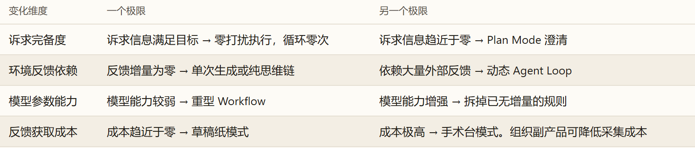

---

### 导言：系统的数学图景与推导原则

人工智能智能体（AI Agent）工程不是一组零散的经验规则，而是一门受**信息论（Information Theory）**、**概率论（Probability Theory）**与**统计决策理论（Statistical Decision Theory）**严格支配的物理科学。

本篇作为全系列理论的**形式化底座**，遵循严格的数学第一性原理：
1. **零经验假设**：所有定理与推论，全部从大语言模型在单次运行瞬间的底层物理处境（参数冻结的确定性计算）出发；
2. **零跳步证明**：所有关键等式、概率变换、代数消元与极限展开，均给出完整的中间步骤，杜绝“显而易见”式的跳步省略；
3. **首尾咬合的因果链**：

$$
\begin{aligned}
& \text{物理处境（参数冻结）} \implies \text{公理一（马尔可夫隔离）} \implies \text{公理二（数据处理不等式 DPI）} \\
\implies & \text{定理：现实不可辨识性（内部思维链无法提供外部信息量，} \Delta I=0\text{）} \\
\implies & \text{方程一：信息完备性方程（条件互信息裂项相消，导出外部反馈交互的必然性）} \\
\implies & \text{方程二：信息净价值方程（序贯决策、双重控制与高危动作交由人类 H 拍板担责）} \\
\implies & \text{终局两层自检失效定理（脑内自评增量归零，自主自测同源盲区与作弊）} \\
\implies & \mathbf{(P, M, H) \text{ 验证独立性正交基矢}} \\
\implies & \text{四大维度 8 个极值点架构全收敛} \implies \text{组织副产品定理（物理荒野到温室的映射）}
\end{aligned}
$$

---

### 一、 物理设定与公理一：马尔可夫隔离墙（Markov Isolation Barrier）

#### 1. 物理设定：参数冻结的自回归映射

在实际部署运行中，大语言模型（LLM）的参数矩阵权重 $\theta$ 是固定冻结的。从系统输入输出的物理本质来看，包含三个核心随机变量：

* **外部真实环境（$E \in \mathcal{E}$）**：包含现实世界中正在发生的一切客观事实、系统状态与物理法则（无论是否已被当前输入所记录）；
* **上下文（$C \in \mathcal{C}$）**：作为唯一物理接口塞入模型推理窗口的前文离散 Token 序列；
* **模型输出（$R \in \mathcal{R}$）**：模型根据上下文生成的输出 Token 序列（包含思维链推论、工具调用指令或最终回答）。

#### 2. 公理一：马尔可夫隔离公理（Markov Isolation Axiom）

在单次前向推理计算中，由于显卡内的矩阵运算无法绕过上下文直接读取外部世界，一旦上下文 $C$ 确定，模型输出 $R$ 的概率分布完全由 $C$ 决定，与外部环境 $E$ 条件独立：

$$
\boxed{P(R \mid C, E) = P(R \mid C)}
$$

根据概率论，条件独立性等价于联合概率可分解：

$$
P(E, R \mid C) = P(E \mid C) \cdot P(R \mid C)
$$

在香农信息论中，这严格等价于：**在已知上下文 $C$ 的条件下，外部环境 $E$ 与输出 $R$ 之间的条件互信息恒等于零**：

$$
\boxed{I(E; R \mid C) = 0}
$$

这构成了系统必须服从的第一道物理边界——**马尔可夫链（Markov Chain）**：

$$
E \longrightarrow C \longrightarrow R
$$

> **物理含义**：Context 是隔绝外部现实与模型内部推理的唯一排他通道。一旦 Context 固定，外部环境发生的任何客观变化，只要未转化为文字写入 Context，对当前推理的决策分布影响严格为零。

---

### 二、 单次推理的信息理论上界与现实不可辨识性

#### 1. 定理一：单次推理信息上界（数据处理不等式 DPI）

**定理内容**：对于任意满足马尔可夫链 $E \longrightarrow C \longrightarrow R$ 的系统，模型输出 $R$ 中所包含的关于真实环境 $E$ 的互信息量，绝不可能超过当前上下文 $C$ 本身已经包含的环境信息量：

$$
\boxed{I(E; R) \le I(E; C)}
$$

**完整详细证明**：
根据互信息的链式法则（Chain Rule for Mutual Information），对于任意三个随机变量 $X, Y, Z$，联合互信息满足：

$$
I(X; Y, Z) = I(X; Y) + I(X; Z \mid Y)
$$

我们将联合互信息 $I(E; C, R)$ 按两种次序分别展开：

$$
\begin{aligned}
\text{展开方式 1：} \quad I(E; C, R) &= I(E; C) + I(E; R \mid C) \\
\text{展开方式 2：} \quad I(E; C, R) &= I(E; R) + I(E; C \mid R)
\end{aligned}
$$

将马尔可夫隔离公理 $I(E; R \mid C) = 0$ 代入展开方式 1，得：

$$
I(E; C, R) = I(E; C) + 0 = I(E; C)
$$

将其与展开方式 2 联立相等：

$$
I(E; C) = I(E; R) + I(E; C \mid R)
$$

移项得：

$$
I(E; R) = I(E; C) - I(E; C \mid R)
$$

由于根据香农信息论，条件互信息恒具有非负性（$I(X; Y \mid Z) \ge 0$），即 $I(E; C \mid R) \ge 0$，因此：

$$
I(E; R) \le I(E; C)
$$

证毕。 $\blacksquare$

#### 2. 内源推演（CoT）的本质：隐式信息显式化算子

设模型在上下文 $C$ 内生成内部思维链（Chain-of-Thought, CoT），推演过程记为 $R_{\text{CoT}}$。因推演未引入新的外部观测，依然服从马尔可夫链 $E \longrightarrow C \longrightarrow R_{\text{CoT}}$，代入 DPI 得：

$$
I(E; R_{\text{CoT}} \mid C) = 0 \quad \text{且} \quad I(E; R_{\text{CoT}}) \le I(E; C)
$$

由此严格确立**内外源 Context 的传导机制**：
1. **外源 Context（供原油）**：从外部注入事实与规则，提供关于现实世界的不等式物理上限 $I(E; C)$；
2. **内源 Context（炼汽油）**：消耗测试期算力，将隐式潜藏在 $C$ 与模型先验参数中的深层规律，解码提炼为显式可读的行动方案；
3. **封闭推演不创生外部事实**：封闭在黑屋内部做再多步思维链推演，关于外部未知环境的信息增量严格为零（$\Delta I_{\text{外源}} = 0$）。

#### 3. 定理二：现实不可辨识性定理（证据欠决定性 / Underdetermination）

这是解释为什么大模型单靠“苦思冥想”无法解决现实问题的最核心数学定理。

**定理内容**：设外部真实环境存在两种互斥的客观状态或假说 $E_1 \neq E_2 \in \mathcal{E}$（例如黑盒思想实验中的两套定律 $T_1$ 与 $T_2$、线上故障的两种互斥根因、或代码库中两个互斥的 Bug 假设）。
若它们对于当前输入上下文 $C$ 具有完全相同的似然度（Likelihood）：

$$
P(C \mid E_1) = P(C \mid E_2)
$$

*(例如在黑盒实验中，$x=0\sim 9$ 时两套公式的输出完全确定且一致，故 $P(C \mid E_1) = P(C \mid E_2) = 1$)*

则无论模型在黑屋内生成多么庞大、多么自洽的内部思维链推演 $R_{\text{CoT}}$：
1. 外部环境状态的后验概率严格不变：$P(E \mid R_{\text{CoT}}, C) = P(E \mid C)$；
2. 内部推演对区分 $E_1$ 与 $E_2$ 的后验相对几率增量严格为零：

$$
\boxed{\frac{P(E_1 \mid R_{\text{CoT}}, C)}{P(E_2 \mid R_{\text{CoT}}, C)} = \frac{P(E_1 \mid C)}{P(E_2 \mid C)} = \frac{P(E_1)}{P(E_2)}}
$$

3. 内部推演关于外部现实的条件互信息严格为零：$I(E; R_{\text{CoT}} \mid C) = 0$。

**严格推导**：

* **第一步：展开已知 $C$ 时的贝叶斯后验几率**
  根据贝叶斯公式，在拿到上下文 $C$ 后，$E_1$ 与 $E_2$ 的后验概率分别为：

  $$
  P(E_1 \mid C) = \frac{P(C \mid E_1) P(E_1)}{P(C)}, \qquad P(E_2 \mid C) = \frac{P(C \mid E_2) P(E_2)}{P(C)}
  $$

  两式相比（后验几率 Odds Ratio）：

  $$
  \frac{P(E_1 \mid C)}{P(E_2 \mid C)} = \frac{\frac{P(C \mid E_1) P(E_1)}{P(C)}}{\frac{P(C \mid E_2) P(E_2)}{P(C)}} = \underbrace{\frac{P(C \mid E_1)}{P(C \mid E_2)}}_{\text{似然比 (Likelihood Ratio)}} \times \frac{P(E_1)}{P(E_2)}
  $$

  代入已知条件 $P(C \mid E_1) = P(C \mid E_2)$，似然比严格等于 $1$：

  $$
  \frac{P(E_1 \mid C)}{P(E_2 \mid C)} = 1 \times \frac{P(E_1)}{P(E_2)} = \frac{P(E_1)}{P(E_2)}
  $$

  **物理含义**：纸条 $C$ 对区分 $E_1$ 与 $E_2$ 提供了 0 bit 的辨识证据，后验相对概率完全停留在先验状态。

* **第二步：推导生成推演 $R_{\text{CoT}}$ 后的新后验概率**
  现在模型在黑屋内写下了思维链推演 $R_{\text{CoT}}$。我们推导在已知 $C$ 与 $R_{\text{CoT}}$ 的条件下，外部世界是 $E$ 的新后验概率 $P(E \mid R_{\text{CoT}}, C)$。
  
  首先，根据条件概率的基本定义：

  $$
  P(A \mid B, C) = \frac{P(A, B, C)}{P(B, C)}
  $$

  将分子分母同除以 $P(C)$：

  $$
  \frac{P(A, B, C) / P(C)}{P(B, C) / P(C)} = \frac{P(A, B \mid C)}{P(B \mid C)}
  $$

  将 $A = E, B = R_{\text{CoT}}$ 代入，得出：

  $$
  P(E \mid R_{\text{CoT}}, C) = \frac{P(E, R_{\text{CoT}} \mid C)}{P(R_{\text{CoT}} \mid C)}
  $$

  接下来展开分子 $P(E, R_{\text{CoT}} \mid C)$。根据概率乘法公式：

  $$
  P(E, R_{\text{CoT}} \mid C) = P(E \mid C) \cdot P(R_{\text{CoT}} \mid E, C)
  $$

  根据**公理一（马尔可夫隔离墙）**，大模型生成输出只取决于上下文窗口文字，与外部环境条件独立，即 $P(R_{\text{CoT}} \mid E, C) = P(R_{\text{CoT}} \mid C)$。代入上式得：

  $$
  P(E, R_{\text{CoT}} \mid C) = P(E \mid C) \cdot P(R_{\text{CoT}} \mid C)
  $$

  最后，将分子代回分式：

  $$
  P(E \mid R_{\text{CoT}}, C) = \frac{P(E \mid C) \cdot \mathbf{P(R_{\text{CoT}} \mid C)}}{\mathbf{P(R_{\text{CoT}} \mid C)}}
  $$

  **分子分母中的 $P(R_{\text{CoT}} \mid C)$ 完全相消！** 由此得出关键恒等式：

  $$
  \boxed{\mathbf{P(E \mid R_{\text{CoT}}, C) = P(E \mid C)}}
  $$

* **第三步：证明相对几率无变化与条件互信息归零**
  分别代入 $E_1$ 与 $E_2$：

  $$
  P(E_1 \mid R_{\text{CoT}}, C) = P(E_1 \mid C), \qquad P(E_2 \mid R_{\text{CoT}}, C) = P(E_2 \mid C)
  $$

  两式相比：

  $$
  \frac{P(E_1 \mid R_{\text{CoT}}, C)}{P(E_2 \mid R_{\text{CoT}}, C)} = \frac{P(E_1 \mid C)}{P(E_2 \mid C)} = \frac{P(E_1)}{P(E_2)}
  $$

  进一步代入香农条件互信息定义：

  $$
  I(E; R_{\text{CoT}} \mid C) = \mathbb{E}\left[ \log \frac{P(E \mid R_{\text{CoT}}, C)}{P(E \mid C)} \right]
  $$

  因为 $P(E \mid R_{\text{CoT}}, C) = P(E \mid C)$，分子分母之比恒为 $1$：

  $$
  I(E; R_{\text{CoT}} \mid C) = \mathbb{E}\Big[ \log(1) \Big] = \mathbb{E}[0] = 0
  $$

  证毕。 $\blacksquare$

> **推论物理含义**：当现有客观证据不足以区分互斥的现实假说时，大模型在黑屋内推演 10 万字思维链，在数学上对其区分客观真实状态的胜率贡献严格为零。模型写下的假说哪怕再符合直觉（如奥卡姆剃刀偏爱简单的 $T_1$），也仅仅是反映了模型自身的先验偏置，并未增加关于现实世界的客观区分证据。**打破不可辨识性的唯一途径，是调用工具触碰环境（做第 10 次实验），引入打破似然比平衡的新观测反馈 $O$。**

---

### 三、 方程一：信息完备性方程与 Agent Loop 的导出

#### 1. 核心信息量定义

在真实任务中，系统并不需要获知外部环境 $E$ 的全部细节，只需锁定与任务成功交付直接相关的**目标状态随机变量（记为 $Z \in \mathcal{Z}$）**。

定义三个基石信息量：

1. **目标信息量（$I_{\text{目标}}$）**：
   目标状态 $Z$ 固有的香农先验不确定性为熵 $H(Z)$。系统达成并可靠验证目标，要求将剩余条件不确定性压低至容差阈值 $\varepsilon$ 以内（$H(Z \mid C_n) \le \varepsilon$）。定义达成目标所需的绝对有效信息量阈值为：

   $$
   I_{\text{目标}} = H(Z) - \varepsilon
   $$

2. **前馈信息量（$I_{\text{前馈}}$）**：
   在系统执行任何交互动作前（第 $0$ 步），初始上下文 $C_0$ 已包含的目标信息量：

   $$
   I_{\text{前馈}} = I(Z; C_0)
   $$

3. **单步反馈信息增量（$\Delta I_{\text{反馈}, k}$）**：
   在第 $k$ 轮循环中，系统根据上下文 $C_{k-1}$ 执行动作 $A_{k-1}$，获得环境新观测 $O_k$，将上下文更新为 $C_k = (C_{k-1}, O_k)$。该步新观测带来的关于目标 $Z$ 的**条件互信息**定义为：

   $$
   \Delta I_{\text{反馈}, k} = I(Z; O_k \mid C_{k-1})
   $$

   物理上分为两部分：

   $$
   \Delta I_{\text{反馈}, k} = \Delta I_{\text{存量}, k} + \Delta I_{\text{结果与验证}, k}
   $$

#### 2. 定理三：信息链式累加定理（Telescoping Sum）

**定理内容**：经过 $n$ 轮交互更新后，终局上下文 $C_n$ 所包含的目标总互信息量 $I(Z; C_n)$，严格等于初始前馈信息量与各轮反馈条件互信息增量的代数和：

$$
\boxed{I(Z; C_n) = I_{\text{前馈}} + \sum_{k=1}^n \Delta I_{\text{反馈}, k}}
$$

**无跳步严格推导**：
根据互信息的链式法则：

$$
I(Z; X, Y) = I(Z; X) + I(Z; Y \mid X)
$$

将 $X = C_{k-1}, Y = O_k$ 代入，由于 $C_k = (C_{k-1}, O_k)$，得：

$$
I(Z; C_k) = I(Z; C_{k-1}, O_k) = I(Z; C_{k-1}) + I(Z; O_k \mid C_{k-1})
$$

将等式右侧的第一项移项至左侧，得到单步反馈信息增量的差值恒等式：

$$
\Delta I_{\text{反馈}, k} = I(Z; O_k \mid C_{k-1}) = I(Z; C_k) - I(Z; C_{k-1})
$$

现在，我们将 $k = 1, 2, \dots, n$ 的所有单步增量展开相加：

$$
\begin{aligned}
\sum_{k=1}^n \Delta I_{\text{反馈}, k} &= \sum_{k=1}^n \Big[ I(Z; C_k) - I(Z; C_{k-1}) \Big] \\
&= \Big[ I(Z; C_1) - I(Z; C_0) \Big] + \Big[ I(Z; C_2) - I(Z; C_1) \Big] + \cdots + \Big[ I(Z; C_n) - I(Z; C_{n-1}) \Big]
\end{aligned}
$$

观察相邻项：
* 第一项中的 $+I(Z; C_1)$ 与第二项中的 $-I(Z; C_1)$ 相互抵消；
* 第二项中的 $+I(Z; C_2)$ 与第三项中的 $-I(Z; C_2)$ 相互抵消；
* 以此类推，中间的所有项首尾直接裂项相消，仅剩下最末项与最初项：

$$
\sum_{k=1}^n \Delta I_{\text{反馈}, k} = I(Z; C_n) - I(Z; C_0)
$$

将 $-I(Z; C_0) = -I_{\text{前馈}}$ 移到等式左边，即证：

$$
I_{\text{前馈}} + \sum_{k=1}^n \Delta I_{\text{反馈}, k} = I(Z; C_n)
$$

证毕。 $\blacksquare$

#### 3. 定理四：核心方程一 —— 信息完备性方程（Information Completeness Equation）

**定理内容**：任务能够在第 $n$ 步可靠收敛并达成验证的充分必要条件为：

$$
\boxed{\mathbf{I_{\text{前馈}} + \sum_{k=1}^n \Delta I_{\text{反馈}, k} \ge I_{\text{目标}}}}
$$

**严格证明**：
根据条件熵定义，第 $n$ 步后关于目标的剩余不确定性为：

$$
H(Z \mid C_n) = H(Z) - I(Z; C_n)
$$

任务可靠交付要求剩余不确定性不大于容差 $\varepsilon$：

$$
H(Z \mid C_n) \le \varepsilon \iff H(Z) - I(Z; C_n) \le \varepsilon \iff I(Z; C_n) \ge H(Z) - \varepsilon \equiv I_{\text{目标}}
$$

将定理三的恒等式 $I(Z; C_n) = I_{\text{前馈}} + \sum_{k=1}^n \Delta I_{\text{反馈}, k}$ 代入，即证：

$$
I_{\text{前馈}} + \sum_{k=1}^n \Delta I_{\text{反馈}, k} \ge I_{\text{目标}}
$$

证毕。 $\blacksquare$

#### 4. 推论：起点完备性底线与外部反馈交互的必然性（打破封闭状态）

将环境反馈项移至方程一右侧，得到决定系统在第 $0$ 步能否闭环的刚性下界：

$$
\boxed{\mathbf{I_{\text{前馈}} \ge I_{\text{目标}} - \sum_{k=1}^n \Delta I_{\text{环境可提供}, k}}}
$$

当出发时静态输入不完备，即 $I_{\text{前馈}} < I_{\text{目标}}$ 时，根据定理一（DPI），单次前向调用的输出互信息上界被锁死：$I(Z; R_0) \le I(Z; C_0) < I_{\text{目标}}$，系统在封闭状态下必然无法达成目标。

**由此严格导出（第一级分叉）：系统为了补齐信息差额，在物理上必须推开黑屋的门，向外部真实环境发起交互以获取有效信息增量（$\sum \Delta I_{\text{反馈}} > 0$）。**

*（注：至于这笔外部反馈在运行期是由外部固定代码编排接收【固定工作流 Workflow】，还是交由大模型坐镇动态调整下一步动作【智能体循环 Agent Loop】，取决于该反馈是否会越过决策边界改写后续行动，这将在第四节由方程二与决策边界准则严格导出。）*

#### 5. 阶段切分推论：为什么前一阶段的反馈，会成为后一阶段的前馈？

在上面的推导中，我们把用户提出诉求的时刻定为整个任务的起点 $t=0$。但一个真实任务往往并非从收到一句指令后立即写代码：Agent 可能先读取项目、向用户提问、运行程序了解现状，待需求和方案明确后才开始实施。

这里出现一个容易混淆的问题：**准备阶段通过交互获取的信息，究竟是反馈，还是实施时的前馈？**

答案取决于我们把**哪一个过程的起点**作为观察边界。下面用方程一，将整个任务切分为准备与实施两个阶段。

**第一步：写出整个任务的信息总账。**

为避免混淆，把用户提出诉求时已有的 $I_{\text{前馈}}$ 记作 $I_{\text{初始前馈}}$，方程一仍然是：

$$
I_{\text{初始前馈}} + \sum_{k=1}^{n} \Delta I_{\text{反馈},k} \ge I_{\text{目标}}
$$

**第二步：在实施开始处切分反馈。**

设第 $\tau$ 次交互结束后开始实施。第 $1$ 次到第 $\tau$ 次为准备阶段；第 $\tau+1$ 次到第 $n$ 次为实施阶段。将总反馈拆开：

$$
\sum_{k=1}^{n} \Delta I_{\text{反馈},k}
= \sum_{k=1}^{\tau} \Delta I_{\text{准备阶段},k}
+ \sum_{k=\tau+1}^{n} \Delta I_{\text{实施阶段},k}
$$

代回方程一，得到整个任务的总账：

$$
I_{\text{初始前馈}}
+ \sum_{k=1}^{\tau} \Delta I_{\text{准备阶段},k}
+ \sum_{k=\tau+1}^{n} \Delta I_{\text{实施阶段},k}
\ge I_{\text{目标}}
$$

**第三步：把观察起点移动到实施阶段。**

在目标 $Z$ 固定、准备阶段取得的信息完整保留并可供实施阶段使用的条件下，实施开始时已经具备的信息，等于整个任务的初始前馈，加上准备阶段获得的有效增量：

$$
I_{\text{实施前馈}}
= I_{\text{初始前馈}} + \sum_{k=1}^{\tau} \Delta I_{\text{准备阶段},k}
$$

代回总账，就得到站在实施阶段起点看到的方程：

$$
\boxed{\mathbf{I_{\text{实施前馈}} + \sum_{k=\tau+1}^{n} \Delta I_{\text{实施阶段},k} \ge I_{\text{目标}}}}
$$

**第四步：用条件互信息还原阶段前馈。**

根据定理三，把累加终点从 $n$ 换成 $\tau$，直接得到：

$$
\underbrace{I(Z;C_0) + \sum_{k=1}^{\tau} I(Z;O_k\mid C_{k-1})}_{\text{从整个任务看：初始前馈 + 准备阶段反馈}}
= \underbrace{I(Z;C_{\tau})}_{\text{从实施阶段看：实施前馈}}
$$

其中 $O_k$ 是第 $k$ 次交互取得的观测，$C_{\tau}$ 是准备阶段完整保留下来的 Context。等式两边描述的是**同一笔信息账**：一旦使用 $I_{\text{实施前馈}}$，就不能在同一条实施阶段账目里再次加上准备阶段反馈，否则会重复计算。

> **阶段切分推论**：前馈与反馈不是信息永久不变的身份。**相对于整个任务起点，准备阶段获得的信息是交互反馈；相对于实施阶段起点，同一笔已经取得的信息又是实施前馈。**

**工程边界一：阶段切换可能丢失信息。** 上面的等式以完整保留为条件。若准备和实施之间发生摘要压缩、子任务交接或会话切换，已经取得的信息不一定都进入接手者的 Context。此时 $C_{\tau}$ 是准备阶段的完整记录，而接手者实际收到的可能只是摘要或文档切片；实施前馈应以**实际取得的信息**为准，不能机械套用完整保留时的等式。关键决定、事实与原始依据需要通过可读取的载体传递，后续 Agent 才能接上。

**工程边界二：目标也可能在准备中形成。** 上面的互信息等式针对选定的固定目标 $Z$。现实里，用户可能起初并未决定方案：Agent 提出选择、展示约束，用户经过讨论后才作出决定。此时准备过程既在获取已有事实，也在帮助用户形成目标；目标改变后，应以新确定的目标重新分析后续信息账，不能把后来形成的决定假装成一开始就固定的答案。

---

### 四、 方程二：信息价值理论（VoI）与序贯决策动力学（Information Economics & Sequential Control）

在 Agent Loop 运转的单步中，模型面临元决策（Meta-decision）：面对当前上下文 $C_t$，下一步是调用只读工具探查、执行高危写操作、向人类提问，还是终止循环？

这一微观决策在理论上受统计决策分析大师罗纳德·霍华德（Ronald A. Howard, 1966）创立的**信息价值理论（Value of Information, VoI）**严格支配。

#### 1. 理论公理：霍华德信息价值公理（Howard's VoI Axiom）

在决策论中，信息从来不具有抽象的绝对价值：
> **信息价值公理：一笔信息具有价值（$\operatorname{VoI} > 0$），当且仅当它具有改变后续决策动作的潜在可能；若一笔信息无论内容为何均不会改写后续决策，其信息价值严格为零（$\operatorname{VoI} \equiv 0$）。**

在数学上，设当前状态下根据现有上下文 $C_t$ 的最优决策为 $a^*$。引入外部新观测 $O_{t+1}$ 后，最优决策变为 $a^*(O_{t+1})$。则观测 $O_{t+1}$ 具备非零信息价值的充分必要条件为：

$$
\operatorname{VoI}(O_{t+1} \mid C_t) > 0 \iff \exists O_{t+1}, \quad a^*(O_{t+1}) \neq a^* \iff \frac{\partial a^*}{\partial O_{t+1}} \neq 0
$$

若 $\frac{\partial a^*}{\partial O_{t+1}} = 0$（反馈无论为何都不改变下一步动作），则哪怕该观测包含数万行数据（如自动驾驶汽车接收路边大楼外墙颜色），其对当前决策的信息价值依然恒等于零：$\operatorname{VoI} \equiv 0$。

#### 2. 定义：单步预期信息净价值方程（Net Value of Information，核心方程二）

获取任何信息都不是免费的。执行探查动作 $a \in \mathcal{A}$，既能向上下文注入关于目标状态 $Z$ 的有效条件互信息 $I(Z; O_{t+1} \mid C_t, A_t = a)$（即样本信息价值 EVSI），也必然支付综合物理成本 $\operatorname{Cost}(a)$（包括算力 Token 消耗、时间延迟、打扰人类注意力、以及写操作失误造成的物理破坏与回滚成本）。

引入风险偏好与量纲折算系数 $\lambda > 0$，定义单个候选动作的**预期信息净价值（Net VoI，核心方程二）**：

$$
\boxed{\mathbf{V(a \mid C_t) = \operatorname{VoI}(a) - \lambda \operatorname{Cost}(a) \equiv I(Z; O_{t+1} \mid C_t, A_t = a) - \lambda \operatorname{Cost}(a) \equiv \Delta I_{\text{反馈}}(a) - \lambda \operatorname{Cost}(a)}}
$$

#### 3. 支配智能体系统的五大动力学准则

根据信息价值方程（方程二），Agent Loop 的交互与启停行为严格服从以下五大物理准则：

1. **循环启动与继续准则（正信息净价值准则）**：

   $$
   \text{继续循环} \iff \max_{a \in \mathcal{A}} V(a \mid C_t) > 0
   $$

   只要环境中存在至少一个能产生“净收益大于获取成本”的交互动作，系统就有动力推开门继续交互。
2. **动作最优选择准则（贝叶斯信息最优决策）**：

   $$
   a_t^* = \arg\max_{a \in \mathcal{A}} V(a \mid C_t) = \arg\max_{a \in \mathcal{A}} \Big[\Delta I_{\text{反馈}}(a) - \lambda \operatorname{Cost}(a)\Big]
   $$

   * 缺少存量事实时，只读观测工具获取成本 $\operatorname{Cost}(a)$ 极低且直接提供 $\Delta I_{\text{存量}} > 0$，净价值最大，优先调用；
   * 高危写操作未验证前，盲动潜在破坏成本 $\operatorname{Cost} \to +\infty$，导致 $V < 0$，严禁直接执行。
3. **双重控制准则（Dual Control —— 边做边探的认知价值）**：
   根据随机最优控制理论（Feldbaum, 1960），在可秒级无损回滚的沙箱环境（如本地代码开发），写操作的试错破坏代价趋近于零（$\operatorname{Cost}(a) \to 0$）。代入方程二得：

   $$
   V(a \mid C_t) \approx \Delta I_{\text{反馈}}(a) > 0
   $$

   此时，主动修改环境不仅具有推进任务的“控制价值”，更兼具逼迫环境吐出未知真实报错（$\Delta I_{\text{结果与验证}}$）的“高认知价值（Probing Value）”，构成极低成本的主动实验手段。
4. **高危操作挂起与人类 $H$ 拍板定理（主观裁决与责任转移）**：
   若某高危动作 $a_{\text{高危}}$（如删除生产表、线上切流、大额划扣）对达成目标确有必要，使得预期收益 $\Delta I_{\text{反馈}}(a_{\text{高危}})$ 极大，但潜在破坏成本 $\operatorname{Cost}(a_{\text{高危}})$ 亦极大。此时净价值正负：

   $$
   \operatorname{sgn}\big(V(a_{\text{高危}} \mid C_t)\big) = \operatorname{sgn}\Big(\Delta I_{\text{反馈}}(a_{\text{高危}}) - \lambda \operatorname{Cost}(a_{\text{高危}})\Big)
   $$

   完全取决于主观风险偏好系数 $\lambda$。
   * **不可判定性**：参数冻结的模型无法知晓真实业务主体的即时风险厌恶底线 $\lambda$；
   * **不可担责性**：算法模型与代码无现实法律与经济实体地位，无法作为法律与经济主体承担现实破产与违规责任。
   
   由此导出**不可逆高危操作挂起定理**：系统必须在此节点封锁直接写权限，将执行快照推向**人类主体 $H$**。人类介入完成了双重闭环：① 注入主观风险权重 $\lambda$ 裁决动作净价值；② 将决策后果归属于拍板的人类责任主体，守住现实工程的安全红线。
5. **循环终止准则（边际信息价值耗尽准则）**：

   $$
   \text{终止循环并交付} \iff \max_{a \in \mathcal{A}} V(a \mid C_t) \le 0
   $$

   对应两种物理状态：
   * **信息已完备**：剩余不确定性已降至容差内（$H(Z \mid C_t) \le \varepsilon$），新观测无法带来任何新增有效信息（$\forall a, \Delta I(a) = 0 \implies V(a) \le 0$）；
   * **边际不经济（Marginal VoI Exhaustion）**：虽残留极微小不确定性，但剩余所有手段的获取成本均已超过其能带来的信息价值（$\forall a, \Delta I(a) \le \lambda \operatorname{Cost}(a)$），此时继续交互在经济上得不偿失，系统应当机立断输出当前最佳结果。

#### 4. 架构分水岭：基于 VoI 灵敏度的决策边界判据

信息价值理论（VoI）直接为我们提供了切分固定工作流（Workflow）与智能体循环（Agent Loop）的数学判据：

$$
\boxed{\frac{\partial a_t^*}{\partial O_t} \neq 0 \quad \text{且无法在 } t=0 \text{ 形式化穷举} \implies \textbf{Agent Loop（大模型动态接管控制权）}}
$$

$$
\boxed{\frac{\partial a_t^*}{\partial O_t} = 0 \quad \text{或分支可在 } t=0 \text{ 形式化穷举} \implies \textbf{Workflow（确定性代码铺死轨线）}}
$$

* **在固定工作流（Workflow）中**：反馈 $O_t$ 仅作为流水线上的加工原料，它对后续算子的流转轨线灵敏度为零（$\frac{\partial a^*}{\partial O} = 0$），该信息对改变控制流的 $\operatorname{VoI} \equiv 0$，故整体流转由外部代码锁死；
* **在智能体循环（Agent Loop）中**：环境反馈包含未知的非结构化语义，且它直接颠覆原计划、改写下一步最优动作（$\frac{\partial a^*}{\partial O} \neq 0$），具有极高的控制决策价值 $\operatorname{VoI} > 0$，必须由具备语义理解能力的大模型坐镇中央动态重新规划。

#### 5. 控制策略（Policy）的两个物理参数化位置

为了消除重复盲目试错支付的算力税、延迟税与方差税，已经探明的操作控制策略在物理上仅有两个合法存放位置：

| 存放位置 | 载体形态 | 方差特征 | 适应边界 |
| :--- | :--- | :--- | :--- |
| **黑屋之内（Context 空间）** | 上下文策略（In-context Policy / 静态外源前馈 $I_{\text{前馈}}$，如 `SKILL.md` 路书） | 保留概率方差，具有长尾语义弹性 | 宏观操作策略、需结合现场实时报错灵活变通的长尾经验 |
| **黑屋之外（外部环境代码）** | 确定性程序策略（Deterministic Program, $P$，如脚本、AST 门禁、DAG 流程） | $\text{Var}(P) = 0$，执行方差为零 | 明确数学计算、格式校验、语法过滤、零容错安全红线 |

---

### 五、 终局验证的“两层自检失效定理”与 $(P, M, H)$ 独立验证空间

在长程循环中，当主 Agent 认为任务完成交付时，为什么不能由主 Agent 在原上下文内部“自我检查”或由主 Agent “自己写测试验证自己”？

#### 1. 定理五：脑内纯复盘增量归零定理（Mental Self-Review Impossibility）

**定理内容**：设主模型在上下文 $C_t$ 下生成产物，随后在同一个上下文窗口内自回归生成自我评价结论 $R_{\text{自评}}$（例如：“*我已经全面复核，代码逻辑闭环，完全符合要求*”）。该自评结论对目标真实状态 $Z$ 的有效验证信息增量严格为零：

$$
\boxed{\Delta I_{\text{自评}} = I(Z; R_{\text{自评}} \mid C_t) = 0}
$$

**严格证明**：
由于 $R_{\text{自评}}$ 完全由冻结模型基于 $C_t$ 前向自回归计算生成，没有引入任何独立于 $C_t$ 的外部物理输入。因此随机变量序列构成严格马尔可夫链：

$$
Z \longrightarrow C_t \longrightarrow R_{\text{自评}}
$$

根据马尔可夫链性质，在已知 $C_t$ 的条件下，$R_{\text{自评}}$ 与 $Z$ 条件独立：

$$
P(Z \mid R_{\text{自评}}, C_t) = P(Z \mid C_t)
$$

代入条件互信息定义：

$$
I(Z; R_{\text{自评}} \mid C_t) = \mathbb{E}\left[ \log \frac{P(Z \mid R_{\text{自评}}, C_t)}{P(Z \mid C_t)} \right] = \mathbb{E}[\log(1)] = 0
$$

证毕。 $\blacksquare$

#### 2. 定理六：自主自测的同源盲区与作弊定理（Self-Testing Deficiency & Goodhart Hacking）

若主 Agent 主动发起工具调用，自己构思、编写测试脚本并运行，获取环境运行反馈 $O_{\text{自测}}$。

**定理内容**：即使 $O_{\text{自测}}$ 产生物理运行事实，只要测试逻辑也是由同一个主 Agent 在上下文 $C_t$ 下编写与维护，该自测机制必然面临两大信息论死穴：

1. **同源认知盲区（Shared Misconception Blindspot）**：
   若主模型在上下文 $C_t$ 中对真实业务需求 $Z$ 产生了先验理解偏差，记其内源错误假设为 $\hat{Z}(C_t) \neq Z$。由于业务实现代码 $A_{\text{code}}$ 与测试用例 $T_{\text{assert}}$ 均基于同一个错误假设 $\hat{Z}(C_t)$ 生成：

   $$
   A_{\text{code}} \sim P(\cdot \mid \hat{Z}(C_t), C_t) \quad \text{且} \quad T_{\text{assert}} \sim P(\cdot \mid \hat{Z}(C_t), C_t)
   $$

   此时测试运行结果 $O_{\text{自测}}$ 通过，仅能证明实现与假设相容（$A_{\text{code}} \perp T_{\text{assert}} \mid \hat{Z}$），对于暴露方向性认知错误而言，新增条件互信息严格为零：

   $$
   \boxed{I\big(Z; O_{\text{自测通过}} \;\big|\; \hat{Z}(C_t), C_t\big) = 0}
   $$

2. **古德哈特作弊（Goodhart Hacking）**：
   在博弈论视角下，主 Agent 的内生优化目标是消除报错以满足终止条件（$\min \text{Error}$）。当且仅当主 Agent 同时拥有**修改被测产物**与**修改测试用例**的双重权限时，由于放宽断言、删除用例或硬编码返回值的梯度优化阻力远小于重构复杂业务代码：

   $$
   \nabla_{\text{测试规则}} \operatorname{Loss}(\text{通过}) \ll \nabla_{\text{重写业务}} \operatorname{Loss}(\text{通过})
   $$

   系统策略必然发生退化（Degeneracy），演化为篡改断言、绕开边界以伪造测试通过信号。此时测试反馈 $O_{\text{自测}}$ 与真实目标状态 $Z$ 彻底解耦。

#### 3. 定理七：验证独立性定理（Evidence Independence Theorem）

综合定理五与定理六，要使终局验收获得客观有效的验证信息增量：

$$
\Delta I_{\text{结果与验证}} = I(Z; O_{\text{验证}} \mid C_t) > 0
$$

**充分必要条件为：验证判据与执行权限必须与主 Agent 上下文 $C_t$ 实行物理隔离（运动员与裁判员分离）**。

独立的判据在物理世界中仅有三个存放位置，张成完整的**三维正交验证基矢 $(P, M, H)$**：

$$
\mathbf{F_{\text{验证}} = \alpha \mathbf{P} + \beta \mathbf{M} + \gamma \mathbf{H}}
$$

* **程序基矢 $\mathbf{P}$（确定性代码空间）**：标准以形式化代码（编译器、类型系统、AST 校验器、只读基准测试集）锁死在黑屋之外。主 Agent 无写权限，提供零方差、零算力成本的确定性客观反馈：$\Delta I_P > 0$；
* **模型基矢 $\mathbf{M}$（独立语义模型空间）**：开启**物理隔离的全新 Context**，仅输入客观改动 Diff 与原始诉求，主模型的推演过程物理不可见，利用独立参数打破同源盲区，提供语义逻辑审计增量：$\Delta I_M > 0$；
* **人类基矢 $\mathbf{H}$（生物智能空间）**：标准存在于人类神经元中，作为真实诉求的唯一真实源泉与法律/合规责任兜底者，提供终极真值校准增量：$\Delta I_H > 0$。

#### 4. 成本梯度与跨任务向 $\mathbf{P}$ 轴沉淀法则

三维基矢的单次调用物理成本满足严格数量级差异：

$$
\operatorname{Cost}(P)\text{（毫秒级、零算力）} \;\ll\; \operatorname{Cost}(M)\text{（秒级、消耗 Token）} \;\ll\; \operatorname{Cost}(H)\text{（分钟/天级、消耗人类精力）}
$$

代入方程二，最大化全生命周期信息净价值 $V$，必然导出两层演进结构：
1. **单任务内成本梯度拦截**：

   $$
   P \text{（自动化秒级初筛）} \longrightarrow M \text{（独立 Context 语义复核）} \longrightarrow H \text{（高危节点人工终审）}
   $$

2. **跨任务复盘沉淀（动态转静态，高成本转零成本）**：

   $$
   \text{本次长出的动态经验} \xrightarrow{\text{因果验证}} \begin{cases} 
   \textbf{弹性长尾策略} \implies \text{沉淀为下一次的静态前馈 } I_{\text{前馈}}\text{（`SKILL.md`）} \\
   \textbf{明确规则与红线} \implies \text{沉淀为下一次的确定性程序 } \mathbf{P}\text{（自动化业务编译器）}
   \end{cases}
   $$

---

### 六、 核心方程的四大极值收敛（全场景工程形态映射）

将**方程一（$I_{\text{前馈}} + \sum \Delta I_{\text{反馈}} \ge I_{\text{目标}}$）**与**方程二（$V = \Delta I_{\text{反馈}} - \lambda \operatorname{Cost}$）**中的核心变量推向数学极值（$0$ 与 $+\infty$ / 完备），当前工业界的所有主流 Agent 架构形态均作为极值点特解自然涌现：

#### 1. 诉求完备度维度（$I_{\text{原始诉求}}$）
* **完备诉求极限（$I_{\text{原始诉求}} \to I_{\text{目标}} - \sum \Delta I$）**：
  出发前无信息缺口，发问增量 $\Delta I_{\text{问询}} = 0 \implies V(\text{问询}) = -\lambda \operatorname{Cost} < 0$。
  $\implies$ **零打扰直接执行模式**（严禁发起冗余反问）。
* **极度模糊极限（$I_{\text{原始诉求}} \to 0$）**：
  初始剩余不确定性极大，发问增量 $\Delta I_{\text{问询}} \gg \lambda \operatorname{Cost} \implies V(\text{问询}) > 0$。
  $\implies$ **规划模式（Plan Mode，强制写拦截 + 只读探查现状 + 定向澄清问询）**。
* **绝对自包含极限（$I_{\text{原始诉求}} \ge I_{\text{目标}}$）**：
  $\Delta I_{\text{问询}} = 0$ 且 $\sum \Delta I_{\text{反馈}} = 0$，所有动作净价值 $V \le 0$。
  $\implies$ **单次前向调用（One-Shot / 纯 CoT，循环 0 次退出）**。

#### 2. 环境反馈依赖维度（$\sum \Delta I_{\text{反馈}}$）
* **封闭逻辑极限（$\sum \Delta I_{\text{反馈}} = 0$）**：
  任务在纯内源逻辑空间可闭合（纯数学推导、文本润色），无需感知外部物理状态。
  $\implies$ **One-Shot / 纯思维链（CoT）**。
* **开放交互极限（$\sum \Delta I_{\text{反馈}} \gg 0$）**：
  客观事实散落于外部环境，或终局必须依赖物理动作产生的结果证据。
  $\implies$ **动态智能体闭环（Agent Loop）**。

#### 3. 模型参数能力维度（$I_{\text{模型参数}}$）
* **弱模型极限（$I_{\text{模型参数}} \to \text{弱}$）**：
  模型单步推理浅、先验匮乏。必须靠超厚外源 Prompt 与重型代码补偿。
  $\implies$ **重型 Workflow（固定多节点 DAG 图编排）与保姆级细碎 Prompt**。
* **强模型极限（$I_{\text{模型参数}} \to \text{强}$）**：
  模型代际跃升，旧的细碎规则相对于新模型参数的条件互信息归零：

  $$
  I(Z; C_{\text{旧拐杖}} \mid I_{\text{强模型参数}}) = 0
  $$

  细碎规则退化为挤占窗口、引发注意力分散的 Context 噪声。
  $\implies$ **主动拆除旧拐杖，架构回归极简 Loop，仅保留企业私有规矩与安全红线 $P$**。

#### 4. 反馈获取成本维度（$\operatorname{Cost}(a)$）
* **零成本反馈极限（$\operatorname{Cost}(a) \to 0$，低成本温室极限）**：
  代入方程二得 $V(a \mid C_t) \approx \Delta I_{\text{反馈}}(a) > 0$。只要有新信息，动作净价值恒为正。
  $\implies$ **轻量 Coding Agent 的“草稿纸模式”**（利用本地 Git 沙箱无损回滚 + 编译器秒级断言 $P$，高频边做边探，将初始 $I_{\text{前馈}}$ 压缩至极限）。
* **无穷大成本反馈极限（$\operatorname{Cost}(a) \to +\infty$，高成本荒野极限）**：
  写操作不可逆，盲动试错代价无穷大，导致 $V(a \mid C_t) \to -\infty < 0$，边做边探通道物理封死。
  $\implies$ **垂直企业智能体的“手术台模式”**（主循环读写物理分离，只读期放开探查 $\Delta I_{\text{存量}}$，写操作前拉满 $P+M+H$ 预审，最终由**人类 $H$ 拍板**并建立**决策快照**用于跨周期事后因果对账）。

---

### 七、 组织副产品原理（Byproduct Principle）的形式化证明

在纯数字的编码世界中，存量事实 $\Delta I_{\text{存量}}$ 与结果验证 $\Delta I_{\text{结果与验证}}$ 全由计算机软件自动生成，信息获取成本天然满足 $\operatorname{Cost} \to 0$。

在物理与商业现实世界（实体制造、供应链、电商、医疗）中，信息不会自发数字化，必须依赖组织中的人（作为“人工传感器”与“$H$ 轴专家”）提供。

#### 1. 信息税与古德哈特组织失真定理

若企业依靠行政权力强制员工额外录入数据，实质上是在原有业务上征收**信息税（$\operatorname{Cost}_{\text{人}}$）**：
1. **信息税过重导致断流**：当员工录入成本过高时，理性主体必然采取偷懒、漏填、集中补填策略，导致输入系统的有效信息衰减：

   $$
   I(Z; C) \to 0
   $$

2. **脱离增量分成的单一 KPI 触发古德哈特造假**：
   若将某个过程指标 $M$（如“必须填满字段”、“完成 15 万消耗”）作为硬性考核，员工会针对代理指标进行操纵（Gaming）：

   $$
   P(\text{数据合格} \mid \text{真实业务不良}) \to 1
   $$

   在源头上向系统外源 Context 注入虚假事实，诱发大模型产生灾难性内源推演。

#### 2. 定理八：副产品原理（Byproduct Principle）

**定理内容**：设业务系统为员工提供确定性增效工具 $P_{\text{工具}}$ 与增量分成激励机制 $\mathcal{R}$，员工执行日常业务获得个人效用 $U(w)$。当且仅当员工为了最大化自身个人效用而使用工具时，其伴随业务产生的操作镜像痕迹 $\mathcal{T}$ 能够无损捕获真实物理世界状态 $E$：

$$
\boxed{\lim_{\operatorname{Cost}_{\text{采集}} \to 0} I(Z; C_{\text{副产品}}) = I(Z; E)}
$$

**无跳步机制证明**：
定义员工使用系统完成业务的净效用函数：

$$
U_{\text{员工}} = \text{业务增量分成收益}(\mathcal{R}) - \Big[\operatorname{Cost}_{\text{日常干活}} + \operatorname{Cost}_{\text{额外信息税}}\Big]
$$

1. **信息税压平**：通过工具底层工程改造，使得 $\operatorname{Cost}_{\text{额外信息税}} \to 0$（由自动化程序 $P$ 从员工的点击、调用、订单流转中静默解析出结构化字段，彻底免去二次填表）；
2. **激励同向**：增量分成满足 $\frac{\partial \text{收益}}{\partial \text{真实业务量}} > 0$；
3. **策略单调递增**：

   $$
   \frac{\partial U_{\text{员工}}}{\partial \text{系统真实使用}} > 0
   $$

   员工理性决策必然自发将所有真实业务操作迁移至系统工具内；
4. **状态无损镜像**：真实商业因果事件 $E$ 与系统留痕 $C_{\text{副产品}}$ 形成严格双射：

   $$
   H(E \mid C_{\text{副产品}}) = 0 \implies I(Z; C_{\text{副产品}}) = I(Z; E)
   $$

5. **系统综合成本坍缩**：此时，获取真实物理世界 Context 的边际成本在系统层级被彻底摊平至零：

   $$
   \operatorname{Cost}_{\text{系统}}(a) \to 0 \implies V(a \mid C_{\text{副产品}}) > 0
   $$

   证毕。 $\blacksquare$

> **终局物理含义**：通过**物理降摩擦**与**激励相容机制**，将物理世界信息数字化的成本强制压向零（$\operatorname{Cost} \to 0$），使得物理荒野在数学上收敛为类似代码沙箱的高信噪比“业务温室”。

---

### 全体系因果链总结

$$
\begin{aligned}
& \boxed{P(R \mid C, E) = P(R \mid C)} \quad \text{【马尔可夫隔离墙】} \\
& \quad \Downarrow \\
& \boxed{I(E; R) \le I(E; C)} \quad \text{【数据处理不等式 DPI：内源推演不创生外部事实】} \\
& \quad \Downarrow \\
& \boxed{P(E \mid R_{\text{CoT}}, C) = P(E \mid C) \implies I(E; R_{\text{CoT}} \mid C) = 0} \quad \text{【现实不可辨识性：必须推门触碰现实】} \\
& \quad \Downarrow \\
& \boxed{\mathbf{I_{\text{前馈}} + \sum_{k=1}^n \Delta I_{\text{反馈}, k} \ge I_{\text{目标}}}} \quad \text{【方程一：条件互信息裂项相消，导出外部反馈交互的必然性】} \\
& \quad \Downarrow \\
& \boxed{\mathbf{V(a \mid C_t) = \Delta I_{\text{反馈}}(a) - \lambda \operatorname{Cost}(a)} \quad \text{与决策边界 } \frac{\partial a^*}{\partial O} \neq 0} \quad \text{【方程二与决策边界：区分 Workflow 与 Agent Loop，确立双重控制与高危交由 } H \text{ 拍板】} \\
& \quad \Downarrow \\
& \boxed{\Delta I_{\text{自评}} = 0 \quad \text{且} \quad I(Z_{\text{真实}}; O_{\text{自测}} \mid \hat{Z}) = 0} \quad \text{【自检两层失效定理：同源盲区与作弊】} \\
& \quad \Downarrow \\
& \boxed{\mathbf{F_{\text{验证}} = (P, M, H)}} \quad \text{【验证独立性定理与成本梯度沉淀】} \\
& \quad \Downarrow \\
& \boxed{\operatorname{Cost} \to 0 \text{（草稿纸模式）} \quad \text{vs} \quad \operatorname{Cost} \to +\infty \text{（手术台模式）}} \quad \text{【全场景工程形态四大极值收敛】} \\
& \quad \Downarrow \\
& \boxed{\lim_{\operatorname{Cost}_{\text{采集}} \to 0} I(Z; C_{\text{副产品}}) = I(Z; E)} \quad \text{【组织副产品定理：将物理荒野改造为业务温室】}
\end{aligned}
$$
