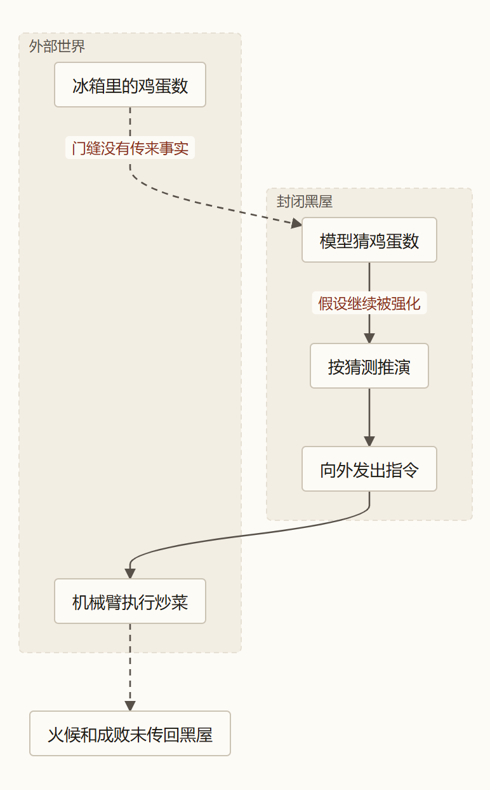
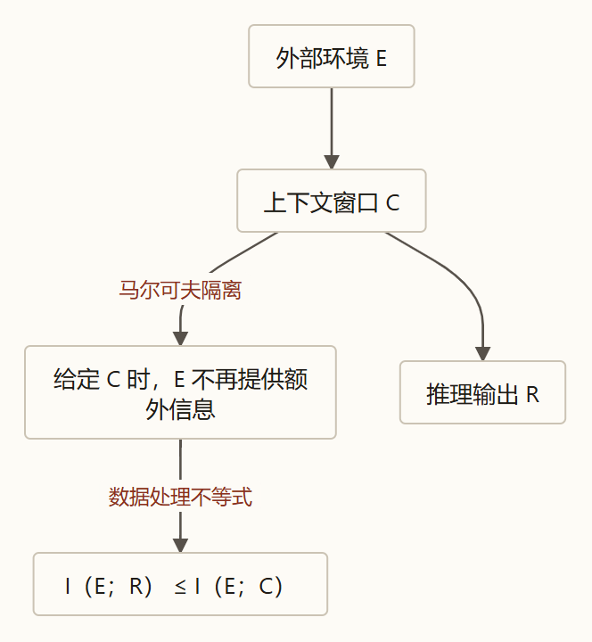
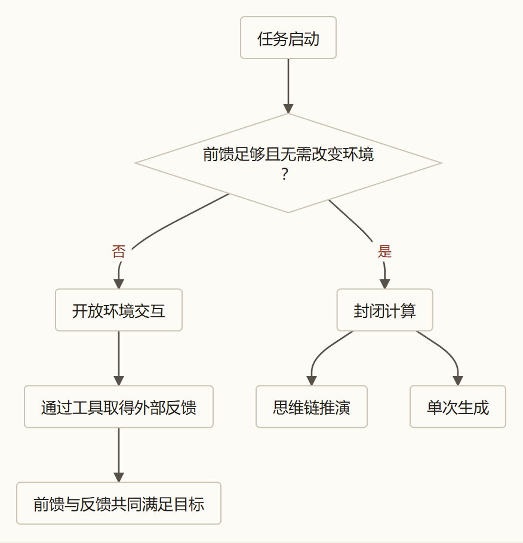
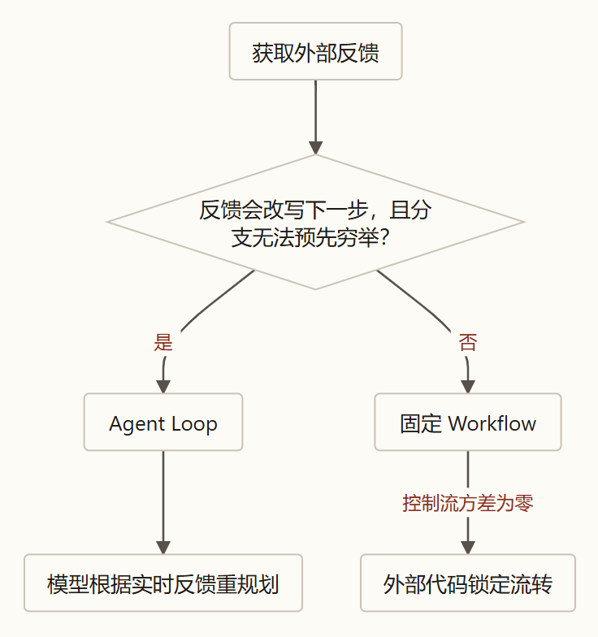
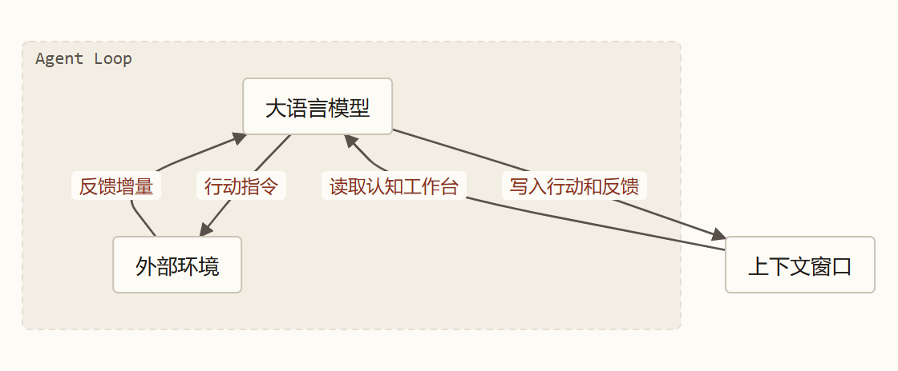

---

### 引言：一个看似简单的工程疑问

在当前人工智能工程实践中，存在一个普遍的演进现象：
几乎所有复杂的真实场景应用，都在从最早的“单次提示词调用（One-Shot Prompting）”和“检索增强生成（RAG）”，不可逆转地走向以“观测—推理—行动—反馈”为核心的 **智能体循环（Agent Loop）**。

许多人将这种演进归结为工程上的“经验尝试”或“行业潮流”。但如果回到物理与信息论的底层，我们会发现一个根本性的事实：

> **大模型之所以必须走向 Agent Loop，不是工程师的主观选择，而是由其单次前向推理的物理处境与信息论客观规律所决定的唯一必然解。**

本文将从两个纯粹的思想实验出发，剥离所有浮夸的行业概念，仅用被公认的信息论定律与概率公理，一步步推导出为什么面对开放世界时，单次模型调用必然失效，而 Agent Loop 又是如何作为唯一合法的架构收敛态自然涌现的。

---

### 一、 两个思想实验：关在黑屋里的天才与外部物理边界

为了看清大语言模型（LLM）在现实应用中的真实处境，我们先做两个直指物理本质的思想实验。

#### 1. 实验一：黑屋猜鸡蛋与机械臂炒菜

假设有一位熟读了人类所有百科全书、智商极高的天才。我们把他关进一间**完全封闭、没有窗户、没有任何外部传感器与网络的“黑屋子”**里。

你在屋外，从门缝塞进一张纸条，写着：
> *“今晚想做一盘西红柿炒鸡蛋。请告诉我：现在屋外的冰箱里还剩几颗鸡蛋？够不够做这盘菜？如果够，请写出操作指令交给屋外的机械臂把菜炒好。”*

把这位天才在屋里能做的事列出来，会发现他面临着**三重无法单靠智商跨越的客观物理屏障**：

1. **第一重屏障（在脑子里苦想）—— 外部存量事实缺口**：
   无论他的逻辑推理能力多强，他也算不出此时屋外冰箱里到底有几颗鸡蛋。这笔信息属于发生在外部现实世界里的特定事实，没有记录在他的预训练记忆里，也没有写在塞进来的纸条上。凭借概率猜测得出的具体数字，对应到大模型中就是**“幻觉（Hallucination）”**。
2. **第二重屏障（在草稿纸上推演）—— 错误假设的自我强化**：
   为了完成回答，他可能会先在草稿纸上写下一个看似合理的假设——*“按常理，家里一般备有 4 颗鸡蛋”*；紧接着，**他会把自己刚刚写下的猜测当成既定事实**顺着往下推导：*“既然有 4 颗鸡蛋，完全够做，接下来需要准备两个西红柿、半勺盐，按以下三步控制机械臂……”*
   草稿纸上的推导逻辑越来越严密、自洽度极高，然而屋外的冰箱里可能连一颗鸡蛋都没有。**他在自己捏造的前提上，完成了一套严丝合缝的错误推演。**
3. **第三重屏障（把指令塞出门缝后不再过问）—— 行动结果事实缺口**：
   退一步讲，就算他运气极好猜中了鸡蛋数量，把写好的《机械臂炒菜指令》从门缝塞了出去。指令塞出之后，现实世界会发生什么？煤气灶点着火了没有？机械臂打鸡蛋时有没有把蛋壳掉进锅里？菜最终炒熟了还是炒糊了？
   **这些信息，在他把指令塞出去的瞬间，现实世界中还根本不存在。** 如果没有屋外的传感器把“机械臂执行后的真实结果”写在纸条上塞回黑屋，屋里的人就只能永远停留在“指令已经发出，菜应该已经做好了”的主观幻想中。

#### 2. 实验二：黑盒装置的第 10 次实验

也许有人会问：*“如果我把过去发生过的所有历史数据，全写在纸条上塞给屋里的天才，让他总结规律，他总能靠纯推理得出客观世界的真理了吧？”*

我们来看第二个在数学上严格成立的思想实验。

假设屋外有一台未知的物理黑盒装置：输入数字 $x$，输出数字 $y$。屋外的实验人员做了前 10 次实验（$x = 0, 1, 2, \dots, 9$），把测得的 10 组真实结果写在纸条上塞进黑屋：

| 输入 $x$ | $0$ | $1$ | $2$ | $3$ | $4$ | $5$ | $6$ | $7$ | $8$ | $9$ | **下一轮待测：$x = 10$** |
| :--- | :---: | :---: | :---: | :---: | :---: | :---: | :---: | :---: | :---: | :---: | :---: |
| **观测输出 $y$** | $0$ | $1$ | $4$ | $9$ | $16$ | $25$ | $36$ | $49$ | $64$ | $81$ | **？** |

黑屋里的天才经过严密计算，写出了两条候选假说：

$$
T_1(x) = x^2 \qquad \text{与} \qquad T_2(x) = x^2 + \frac{\prod_{k=0}^{9}(x-k)}{10!}
$$

请仔细审视这两条假说：
* 在已知的 $x = 0, 1, \dots, 9$ 范围内，$T_2$ 右侧的乘积项必然包含一项 $(x-x) = 0$，乘积恒等于 $0$。这意味着：**两套截然不同的数学规律，都百分之百完美解释了纸条上已有的全部数据！**
* 但是，当面对尚未测试的 $x = 10$ 时，两条定律给出了互斥的预测：**$T_1(10) = 100$，而 $T_2(10) = 101$**。

请问：关在屋里的天才，哪怕算力无限、在草稿纸上推演一万亿轮，他能单凭手头的 10 组数据，判定屋外那台真实装置究竟遵循 $T_1$ 还是 $T_2$ 吗？

**在数学上绝对不能。** 他可以根据“奥卡姆剃刀（形式越简单越优美）”的主观偏好去押注 $T_1$，但如果真实制造这台装置的工程师偏偏写下的就是 $T_2$，黑屋里的天才就会在极度自信中答错。

科学哲学中将这一现象称为**“证据对理论的欠决定性（Underdetermination of Theory by Evidence）”**：任何有限的已知观测数据，都可以被无数个在逻辑上自洽但彼此互斥的理论所解释。

这两个思想实验直接指向了物理现实的唯一出路：
> **要打破封闭黑屋的局限，物理上只有一种办法——打破隔绝，让屋内的推演与屋外的现实形成持续的闭环交互：**
> **先让传感器把“存量事实”传回黑屋，模型据此推演出行动假设与分歧点（如算出需要去测 $x=10$），再派工具去物理世界执行动作或实验，把现实碰撞出的“真实结果”传回黑屋校准认知，如此往复，直到目标在现实世界中真正达成并得到验证。**

---

### 二、 底层物理处境：马尔可夫隔离墙与数据处理不等式

将上述思想实验映射到大模型工程中，智能体运转的底层物理约束便彻底清晰起来。

#### 1. 马尔可夫隔离墙（Markov Isolation Barrier）

在实际部署中，大语言模型的参数权重 $\theta$ 是完全固定的。大模型本质上是一个确定性参数化的自回归概率生成函数：

$$
R \sim P_\theta(R \mid C)
$$

在单次前向推理计算中，由于 GPU 显卡内的矩阵运算没有任何旁路通道能直接感知机房外的物理世界，**一旦塞进窗口里的上下文（Context，记为 $C$）确定下来，模型输出（$R$）就与外部现实环境（$E$）在概率上完全条件独立**：

$$
P(R \mid C, E) = P(R \mid C) \iff I(E; R \mid C) = 0
$$

这构成了大模型必须服从的物理链条——**马尔可夫链（Markov Chain）**：

$$
E \longrightarrow C \longrightarrow R
$$

**Context 是隔绝外部物理现实与模型内部矩阵计算的唯一排他漏斗与工作台。** 外部现实发生的一切剧变，只要没有转化为具体的文字 Token 写进 Context，对模型的前向计算而言就是零感知的。

#### 2. 数据处理不等式（Data Processing Inequality, DPI）

既然存在马尔可夫链 $E \longrightarrow C \longrightarrow R$，根据香农信息论的公理，我们能直接推导出**数据处理不等式（DPI）**：

$$
\boxed{I(E; R) \le I(E; C)}
$$

*（详细数学证明参见 [00_数学基石篇](../agent-math-foundations/) 定理一）*

这个不等式在数学上锁死了单次推理的理论上限：
**模型输出 $R$（哪怕包含了长达数万字的内部思维链 CoT）所包含的关于真实环境 $E$ 的信息量，绝对不可能超过当前上下文 $C$ 本身已经包含的信息量。**

由此，我们从第一性原理上彻底厘清了**“外源 Context”**与**“内源 Context”**的本质分工：

| 上下文类型 | 物理来源 | 信息论本质与核心职能 | 极限与边界 |
| :--- | :--- | :--- | :--- |
| **外源 Context** *(外部输入的信息)* | 外部环境、用户输入、工具返回的数据 | **【供给原油】** 跨过马尔可夫隔离墙，从外部物理世界注入客观事实与验证证据，**决定系统信息量的绝对上限 $I(E; C)$**。 | 无法凭空在模型脑内生成，必须从外部物理环境采集。 |
| **内源 Context** *(模型自生成的文字)* | 思维链（CoT）、方案草稿、推导公式、工具调用参数 | **【精炼汽油】** 消耗测试期算力，**将隐含在 $C$ 与模型参数先验中的隐式信息解码提炼为显式可读的行动方案**。 | **封闭推演对外部世界的信息增量严格为零（$\Delta I = 0$）**。无法单靠自身保证与外部现实相符。 |

> **核心公理（信息不可凭空创生定律）**：
> 炼油厂（内源推演）可以把已有的原油加工提纯为高标号汽油，但当缺乏原油供给时，炼油厂无法无中生有地造出客观事实。
> **大模型在 Context 内部写出的方案与假设，本质上永远只是“待验证的草案”，其真伪性必须等待外部世界真实反馈的检验。**

---

### 三、 第一级分叉：从封闭计算到推门触碰环境

基于上述物理处境，我们在任务启动时拥有**初始信息量（记为 $I_{\text{前馈}}$）**（包含模型冻结参数里的通用常识与用户首次给出的提示词）。

根据任务交付所需的**目标信息量（记为 $I_{\text{目标}}$）**与初始条件的关系，系统迎来了第一道架构分水岭：

#### 1. 封闭黑屋内的纯内源加工：当 $I_{\text{前馈}} \ge I_{\text{目标}}$ 且无需改变外部世界时
如果任务是**“鸡兔同笼，共 35 个头、94 只脚，问几只鸡几只兔？”**或者对一段已有文字进行格式转换：
* 达成目标所需的全部事实与边界条件，已经完备地包含在初始输入 $I_{\text{前馈}}$ 中；
* 任务本身不需要对外部物理世界做任何持久化修改（如写文件、删库、划扣资金）。

此时，系统**完全无需与外部世界交互**（外部信息增量 $\Delta I = 0$）：
* 若逻辑极其简单，模型单次前向推理（**One-Shot**）直接输出最终答案；
* 若逻辑跨度较大，模型在窗口内自回归生成一段草稿（**思维链 CoT**），利用分步矩阵计算将深埋在题目中的隐式答案显式化，完成交付。

#### 2. 穿过隔离墙：推门触碰外部世界的三大动因
一旦任务迈入真实世界的开放领域，必然出现以下三类缺口之一：
1. **外部存量事实缺口**：不知道当前代码库第 80 行怎么写、不知道数据库当前订单状态；
2. **计算精确度与确定性缺口**：需要对十万行数据做精确求和，靠概率心算极易出错，需交由确定性程序执行；
3. **外部行动与现实验证缺口**：需要实际修改文件、重启服务，或者必须像测 $x=10$ 那样拿回真实反馈才能证伪假设。

只要出现上述缺口，封闭推理必然失效。系统必须推开黑屋的门，智能体的三个基本工程概念随之生长出来：
* **环境（Environment）**：黑屋墙外的一切现实系统（文件系统、数据库、生产服务器、乃至人类用户），凡是存放着未知事实、承受操作并发生状态变化的地方，统称为环境；
* **工具（Tool）**：穿过隔离墙的物理通道。向外把模型指令转化为真实的观测或执行操作；向内把环境的反应加工成结构化文本送回窗口；
* **反馈（Feedback）**：工具触碰环境后带回黑屋、作为动态外源 Context 写入窗口的**有效信息增量（$\Delta I$）**。

#### 3. 核心方程一：信息完备性方程（Information Completeness Equation）

在开放环境中，系统如何从起点走向终局？我们在数学上用条件互信息的**裂项相消法（Telescoping Sum）**完成了严格证明：

$$
\boxed{\mathbf{I_{\text{前馈}} + \sum_{k=1}^n \Delta I_{\text{反馈}, k} \ge I_{\text{目标}}}}
$$

*（详细数学推导参见 [00_数学基石篇](../agent-math-foundations/) 定理三与定理四）*

将其移项，便得到指导系统在第 $0$ 步能否可靠收敛的刚性判据——**起点信息完备性定理**：

$$
\boxed{\mathbf{I_{\text{前馈}} \ge I_{\text{目标}} - \sum_{k=1}^n \Delta I_{\text{环境可提供}, k}}}
$$

> **起点完备性底线**：
> 出发前的前馈信息（$I_{\text{前馈}}$），必须兜住**“在目标全集 $I_{\text{目标}}$ 中，外部环境在后续运行中无法提供、或因高危破坏代价绝不允许靠盲目试错去提供的那部分信息差集”**。
> 这包括：**用户的真实意图判据、不可逆的安全红线（严禁删库）、以及最小的工具寻路入口**。一旦 $I_{\text{前馈}}$ 漏掉了这块差集，后续与外部交互时在信息论上便无从补齐，模型只能靠内源幻觉去脑补。

由此，**方程一在物理上严格完成了系统的第一级架构分叉**：它证明了当初始前馈不完备（$I_{\text{前馈}} < I_{\text{目标}}$）时，封闭内部推演必然无法收敛，**系统必须推开隔离墙、向外部环境发起交互以获取有效信息增量（$\sum \Delta I_{\text{反馈}} > 0$）**。

然而，**“去外部获取反馈”并不直接等同于“走向 Agent Loop”**——因为固定工作流（Workflow）与传统 RAG 同样在向外部获取反馈。这就直接导出了决定系统控制权归属的**第二级架构分叉**。

---

### 四、 第二级分叉：何时用固定工作流（Workflow），何时用智能体循环（Agent Loop）？

当系统需要通过工具从外部获取有效信息增量 $\Delta I$ 时，工程架构迎来了最关键的十字路口：
**同样是调用工具与外部交互，为什么有些场景应该用固定代码编排的“工作流（Workflow）”，而有些场景必须把控制权交给大模型坐镇的“智能体循环（Agent Loop）”？**

切开这两条路线的核心标尺，只有一个——**决策边界（Decision Boundary）**：

> **在任务执行过程中，外部环境返回的动态反馈 $\Delta I$，会不会推翻原定计划、改写下一步的动作选择，且这种改写能否在第 0 秒由程序员用确定性代码穷举？**

#### 1. 路线 A：反馈不改写预设轨线 —— 固定工作流（Workflow / 传统 RAG）
看一个典型场景：**“帮我查询今天北京的天气，并结合我的日程表给出出行建议。”**
* 第 1 步：系统调天气 API，获取气温与降雨数据 $\Delta I_1$；
* 第 2 步：系统调日历 API，获取今日日程数据 $\Delta I_2$；
* 第 3 步：把 $\Delta I_1$ 和 $\Delta I_2$ 组装进上下文，调用一次大模型生成出行建议。

审视这个过程：虽然第 1 步确实从外部获取了未知信息 $\Delta I_1$，但**无论今天查出来的天气是暴雨、晴天还是下雪，都不会动摇系统第 2 步去执行“查日历”这个动作**。
哪怕流程中包含几个 `if-else` 分支（如“如果超时则重试 3 次”），只要所有动作的流转轨线在第 0 秒就能被工程师用确定性代码完全排定，它就属于**固定工作流（Workflow）**。
此时，外部反馈 $\Delta I$ 就像装上有轨电车的货物，电车依然沿着铺死的铁轨向前开，控制流由外部代码绝对主导，**执行方差为零**。

#### 2. 路线 B：反馈动态推翻原计划、改写下一步动作 —— 智能体循环（Agent Loop）
一旦面对真实的复杂开放环境，“在第 0 秒由固定代码锁死所有动作轨线”的前提便复不复存在：
**因为下一步的最佳动作，取决于环境在被触碰之后才会揭晓的动态事实（尤其是行动后的客观结果 $\Delta I_{\text{结果与验证}}$）。**

看一个软件工程排障的真实案例：
* **第 0 步（初始假设）**：线上接口报错 500。模型生成的初始**内源计划**是：*“可能是数据库连接池满了，检查配置文件 `db.yaml`”*；
* **第 1 步执行与反馈 $\Delta I_1$**：模型调用 `read("db.yaml")` 工具，返回配置事实：`max_connections: 5000`（连接池余量极其充足）。
* **第 2 步（原计划被证伪，动作被实时改写）**：这笔反馈直接击碎了原计划。如果按照固定工作流，程序就只能停机或按死逻辑继续排查数据库；而在 Agent 架构中，大模型读懂了这笔反馈的语义，实时改写下一步决策：*“数据库连接充足，推翻原假设；下一步应去查看最近一次网关错误日志 `error.log`”*；
* **第 3 步执行与反馈 $\Delta I_2$**：调用 `read("error.log")`，发现日志报错：`SSL certificate expired at 14:00`（证书过期）。下一步动作再次被改写为：*“生成证书更新命令并执行验证”*。

#### 3. 为什么传统代码无法取代大模型坐镇控制流？
在上述排障过程中，传统软件工程为什么无法通过提前编写 `if-else` 脚本来处理？阻碍来自两重物理高墙：
1. **状态组合爆炸**：一个长程任务只要每一步面临 10 种可能的现实返回，连续走 10 步就会衍生出 $10^{10}$（100 亿）条可能路径，工程师绝无可能在出发前全部写成固定分支代码；
2. **反馈信息的非结构化语义本质**：真实环境带回的反馈，往往是人类未曾预料到的自然语言报错、动态网页片段或复合异常堆栈。传统代码面对未定义的输出只能崩溃抛错，**唯有坐镇循环中央的大模型，具备理解非结构化语义的能力，并能在内源推演中动态评估新证据、重构假设空间并开出下一步动作**。

---

### 五、 终局收敛：Context、Loop 与三大架构形态的统一

把“马尔可夫隔离墙”与“Agent Loop”合拢在一起，智能体工程最核心的哲学关系便清晰地收敛为一句话：

> **在系统层级上，现实目标的达成是终局目的；Context 是承载模型认知与决策状态的唯一物理载体；Loop 则是通过持续的“观测—行动—反馈”来向 Context 注入有效增量、用现实持续校准认知、推动系统向目标收敛的物理手段。**

构建 Loop，替静态的 Context 达成了三项不可替代的使命：
1. **按需获取存量事实（$\Delta I_{\text{存量}}$），保护窗口信噪比**：面对百万行代码库，若在第 0 步全塞进上下文，会瞬间撑爆窗口并引发严重的注意力稀释；唯有依靠 Loop 边探边读，才能在每一步只把当前决策最急需的一小片代码载入工作台；
2. **通过动作触碰现实，产生出发时不存在的结果验证证据（$\Delta I_{\text{结果与验证}}$）**：改完代码后，必须真正运行测试套件，才能拿到真实世界的报错堆栈；
3. **打断内源推演的“自欺偏差”**：当模型走偏时，外部环境无情的报错能够及时打碎错误的内源前提，迫使系统掉头。

由此，我们可以将当前市面上所有的人工智能架构形态，放入同一个坐标系中完成终极统一：

| 架构形态 | 外部反馈 $\Delta I$ 的特征 | 内源思维链（CoT）的角色 | 运行时的控制权归属 | 适用边界 |
| :--- | :--- | :--- | :--- | :--- |
| **形态一：封闭单次调用** *(One-Shot / 纯 CoT)* | **无需外部反馈（$\sum \Delta I = 0$）**：出发时已满足 $I_{\text{前馈}} \ge I_{\text{目标}}$，无需感知或改变环境。 | 负责将初始条件中的隐式逻辑显式化展开。 | 无外部交互，**循环 0 次**就地输出。 | 封闭数学推导、文本润色、格式提取。 |
| **形态二：预设轨线工作流** *(Workflow / 传统 RAG)* | **充当流水线加工原料（$\sum \Delta I > 0$）**：需从环境取数据，但反馈不会推翻既定流转顺序。 | 仅在预设的局部节点内充当信息提取器或润色器。 | **由外部确定性代码完全锁死控制流**。 | 报表抓取、固定审核规则核对、数据管道。 |
| **形态三：动态智能体循环** *(Agent Loop)* | **决定下一步决策方向（$\sum \Delta I \gg 0$）**：反馈充满未知变数，每一步反馈都会改写后续方案。 | 坐镇系统中央，实时理解非结构化反馈，动态生成下一步动作 $a^*$。 | **控制权完全交给大模型**。 | 复杂代码编写、生产故障排查、开放探索任务。 |

---

### 结语与引出《第二篇》的追问

至此，第一性原理的因果链条已完整闭合：
因为参数冻结，模型面临马尔可夫隔离墙与数据处理不等式；为了打破现实不可辨识性、跨越存量事实与行动结果的缺口，系统必须与外部环境交互；当交互反馈会动态推翻决策且无法在第 0 秒穷举时，**架构必然演化为由大模型接管控制权的 Agent Loop**。

然而，推导走到这里，一个新的工程矛盾立刻摆在了所有架构师面前：

> **既然 Agent Loop 拥有根据实时反馈动态探路的无上自由，为什么在高度成熟的生产级系统中，我们绝不会把所有事情都丢给一个纯粹的 Agent Loop 从零试错？**
> **为什么各大顶级团队还在花费大量心血编写规范文档（`SKILL.md`）、打造确定性脚本和外部拦截门禁？**
> **在纯循环、Skill 与 Workflow 之间，控制权的收放边界到底在哪里？**

这正是我们在下一篇——**《第二篇：控制权的收放艺术 —— 纯循环、Skill 与 Workflow 的连续光谱》**中要从信息经济学严格推导的核心命题。
