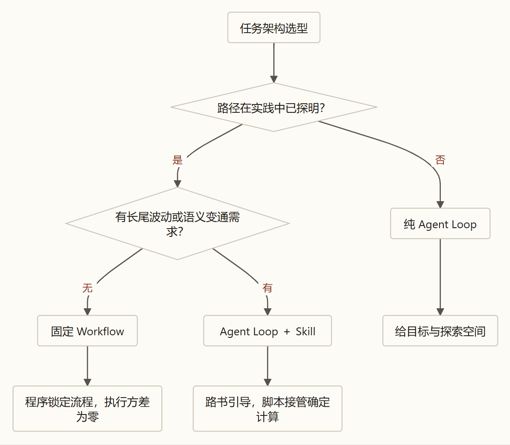
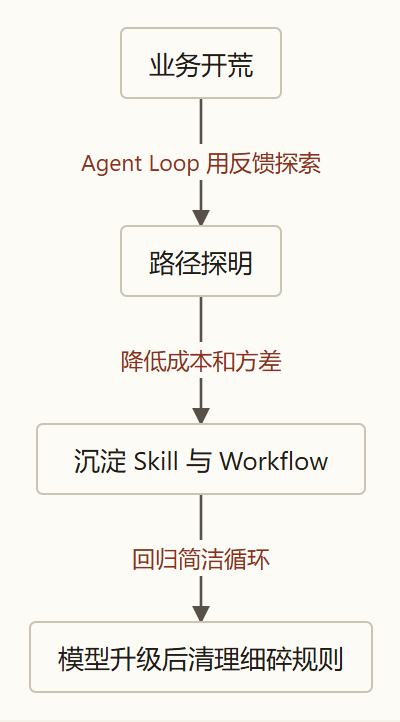

---

### 引言：既然 Agent Loop 能自主探路，为什么不把所有任务都丢给它？

在《第一篇》中，我们从物理与信息论的底层推导出了一个核心结论：
当初始前馈信息不足（$I_{\text{前馈}} < I_{\text{目标}}$），且外部反馈会越过决策边界改写后续决策（$\frac{\partial a^*}{\partial O} \neq 0$）时，系统必须构建由大模型坐镇中央的 **智能体循环（Agent Loop）**。理论上，只要给定目标判据，大语言模型（LLM）就能在循环中通过一次次调用工具触碰环境，在试探与反馈中自主摸索出通往目标的道路。

然而，这立刻引出了一个尖锐的工程现实矛盾：

> **既然纯 Agent Loop 拥有自主探索的通用能力，为什么工业界成熟的落地架构中，固定工作流（Workflow）依然占据大半江山？**
> **为什么各大顶级团队都在大力推行由“操作路书（`SKILL.md`）+ 确定性脚本”组成的技能包（Skill）？**
> **在纯循环、Skill 与 Workflow 之间，控制权的收放边界究竟由什么客观规律所支配？**

答案非常清晰：
**当一条求解路径尚属“未知”时，让大模型在 Loop 中自主试探，是在为系统创造信息增量价值；但当这条路径或规则已经“明确”之后，如果依然让纯 Loop 每次从零盲目试错，系统就会白白支付四笔高昂的工程代价。**

本文将从信息经济学与控制论的第一性原理出发，解析纯循环的代价本质，揭示控制策略（How）存放的两个物理位置，并给出在运行期与时间轴上收放控制权的严密决策模型。

---

### 一、 纯循环的工程代价：为什么不能每次都从零试探？

回到《第一篇》确立的大模型物理处境：大模型通过 Context 窗口与现实交互，每生成一个 Token 都是一次概率矩阵计算。若在一条“明明已知做法、却未预先告知”的操作路径上（例如清洗特定格式的财务报表并核对字段），依然放任纯 Agent Loop 从零摸索，系统将不可避免地支付**四笔刚性工程代价**：

#### 1. 第一笔代价：Context 试错过程污染税（信噪比衰减）
看一看模型在一条 5 步的已知操作路径上盲目摸索时，上下文工作台里发生了什么：
在前 10 轮盲目试探中，模型调用工具传错了参数、搜错了字段、读到了无关的网页日志。工具从外部带回了上万行报错堆栈与垃圾文本塞进外源 Context，模型也在内源写下了大量走不通的推导草稿。

这里存在一个关键的信息论区分：
* **“某条路径走不通”** 这一最终结论，是防止重蹈覆辙的有效信息增量（$\Delta I > 0$）；
* 但为了得出这句结论而留在窗口里的几千行报错堆栈与试探草稿，则属于**过程残骸（Noise）**。

由于大模型自回归生成是基于窗口内全部前文 Token 计算注意力分布的，等到第 11 轮模型终于把路摸通、准备做核心业务判断时，上下文工作台已被前 10 轮的过程残骸填满。**信噪比（SNR）严重下滑，导致关键有效信息的提取损耗剧增，直接拉低后续决策的准确率。**

#### 2. 第二笔代价：已知路径上的算力与延迟税（零信息增益空转）
哥伦布第一次横渡大西洋时，前方是未知的暗礁与洋流，每一步观测到的水文都在改变航向。他必须用动态循环（Agent Loop）一边观测一边调整舵向，花费三个月绕无数弯路——第一次为了探明未知的航路，这笔试错代价是必要的。

但是，当航线已经探明、绘制出了精确的航海图之后，第 100 次跑同一航线的货船如果把航海图扔掉，每次依然在海里靠触礁、看报错、再掉头来航行——**就是在为“零决策惊喜”重复支付高昂的算力 Token 与漫长的时间延迟。**

#### 3. 第三笔代价：控制器的概率方差税（内源心算的非零随机性）
大模型的生成本质上是在词表概率分布上的抽样计算（控制器存在非零方差）。
当面对一个规则完全明确的环节时（例如核算一万笔账单金额总和、校验 JSON 格式、过滤 SQL 注入指令）：
* **交给黑屋外的确定性程序（Program, $P$）**：通过 CPU 指令完成输入到输出的毫秒级映射，执行方差在物理上恒等于零（$\text{Var} = 0$）；
* **交给黑屋内的大模型靠思维链心算**：模型必须在窗口里逐行展开推理，既挤占宝贵的注意力空间，又引入了潜在的随机偏离。在零容错的安全红线面前，概率生成无法提供绝对保证。

由此确立**确定性分工法则**：
> **确定性分工法则：凡是处理规则已经完全明确、能够形式化表达的计算与刚性校验，应当交由黑屋外的确定性程序（$P$）执行，只将干净的最终结果作为外源事实注入上下文——既替模型的内源推演减负，又将该环节的执行方差彻底降为零。**

#### 4. 第四笔代价：私有规则完备性缺口（环境供给为零）
回到我们在《第一篇》推导出的**起点信息完备性不等式**：

$$
I_{\text{前馈}} \ge I_{\text{目标}} - \sum \Delta I_{\text{环境可提供}}
$$

现实业务中有大量的办事规矩（How），既不在大模型的预训练语料里，**也不存在于外部客观环境的数字记录中（即 $\sum \Delta I_{\text{环境可提供}} = 0$）**。它们属于企业的**私有 SOP**（例如：“*每周五统计完数据后，先过滤掉内部测试账号，再按规定的三段式模板写入表格*”）。

如果不在出发前将这套规则作为**静态前馈（$I_{\text{前馈}}$）**写入系统，纯 Agent Loop 去外部环境里尝试一万次，外部系统也不会报错提示“没按三段式写”——因为外部环境里根本就没有这笔信息！一旦前馈漏掉了这块环境给不了的信息差集，模型纯靠自己永远不可能“试探”出内部私有规矩。

---

### 二、 本质同源：控制策略（How）的两个物理存放位置

既然探明的操作路径（How）不能每次从零试错，在系统物理结构上，**我们究竟能把这些已经明确的控制策略存放在哪里？**

回顾大模型的物理边界，**能够存放“预设行动策略与规则”的物理位置只有两个**：

1. **位置一（黑屋内的 Context 载体）：写进静态外源前馈（$I_{\text{前馈}}$）**
   * **工程形态**：操作说明书与技能规范（如 `SKILL.md` 路书）。
   * **运行机制**：作为先验规则载入上下文窗口，在源头上引导大模型的内源规划，**方向盘依然握在大模型手里**。模型依据路书生成计划，在遇到长尾边缘特例时仍保留语义调整的灵活性。
2. **位置二（黑屋外的确定性程序代码）：写进确定性程序（$P$）**
   * **工程形态**：
     * **局部确定性脚本（`Scripts`）**：封装在工具内部供模型调用（如数据统计、格式转换）；
     * **执行前拦截门禁（`Guardrails`）**：在动作触碰环境前校验权限与参数（如正则过滤、AST 语法树解析）；
     * **全局流转工作流（`Workflow`）**：用代码或有向无环图（DAG）将整个任务的执行顺序串联起来，**直接接管方向盘**。

看清这两个物理位置后，**纯 Agent Loop、Skill 与 Workflow 在底层其实处于同一条连续光谱上**：

> **Skill 与 Workflow 的本质是同源的——它们都是为了免交纯 Loop 的四笔工程税，将已经探明或规定的控制策略提前固化下来，收敛试错空间并保护 Context 信噪比。**
> **区别仅在于：这个策略被固化在了黑屋内外的哪个位置，以及由此决定的控制权刚度。**

#### 工业级 Skill 的黄金结构：路书（`SKILL.md`）与确定性脚本（`Scripts`）的结合

这一理论直接解释了为什么当前成熟的 **Skill** 标准形态普遍由 **“一份 Markdown 说明书（`SKILL.md`）+ 一组配套脚本（`Scripts`）”** 组合而成：
* **为什么宏观策略要写成 `SKILL.md`（静态前馈）？**
  对于“大方向已知、但细节需要根据现场语境动态变通”的任务，写成清晰的路书注入前馈，能直接指引模型从第 1 步就生成高质量计划。在工程上配合**渐进式披露（Progressive Disclosure）**（平时只向模型展示一行描述，真正调用时才载入全文），既收敛了搜索空间，又避免了无关规则占满窗口。
* **为什么微观明确计算要写成 `Scripts`（确定性程序 $P$）？**
  技能内部涉及的正则解析、数据加总、接口拼装，直接写成 Python/Bash 脚本由工具执行。1 秒钟就能向上下文递回干净结果（$\Delta I$），避免了大模型在窗口内逐行心算产生的注意力消耗与计算方差。

| 架构形态 | 策略（How）存放在哪？ | 形象比喻 | 控制权归属 | 方差特征 | 适用任务边界 |
| :--- | :--- | :--- | :--- | :--- | :--- |
| **纯 Agent Loop** | **不固化 How**：初始前馈只给目标判据（Why & What） | **荒野越野车** *(无现成路，现场看地形探路)* | 完全在**大模型**手里 | 上限极高 方差较大 | 未知领域的开荒探索，或模型参数先验深度掌握的任务 |
| **Agent Loop + Skill** | **内外结合**：宏观弹性策略在 Context（`SKILL.md`），微观明确计算在代码（$P$） | **配路书与工具箱的越野车** *(主路走成熟路径，遇意外能动态绕行)* | **大模型主导**，受路书引导与脚本辅助 | 兼顾确定性与语义弹性 | 路径已基本验证跑通，但外部环境存在长尾波动的复杂任务 |
| **固定 Workflow** | **全在黑屋外**：全局流转顺序由确定性代码（$P$）排定 | **铺死铁轨的有轨电车** *(严格按既定铁轨站点行进)* | 完全在**外部代码**手里 | 执行流转 **方差 $= 0$** | 流程高度明确且稳定，或属于零容错的安全合规刚性卡点 |

---

### 三、 决策模型：任务级宏观切分与单步微观权衡

在工程落地中，控制权的收放发生在两个维度：**一是任务启动前的架构模式选型（宏观切分）；二是进入循环后的单步动作权衡（微观控制）。**

#### 1. 任务级宏观选型：按顺序发出两个追问

面对一个具体的业务任务，按顺序回答两个第一性追问，即可完成架构选型：

* **何时采用【纯 Agent Loop】？**
  * **核心条件**：处于“从 0 到 1 的未知探索期”，或者任务做法在大模型的参数先验（$I_{\text{模型参数}}$）中掌握得比编写者更深刻（例如前端视觉组件实现、复杂代码排错）。
  * **底层逻辑**：此时手里没有经过现实检验的正确路径，强行编写步骤指令，注入的往往是误导推演的错误偏见。应当满足**起点完备性底线**——给清目标验收判据与工具入口，放手让模型在循环中动态触碰环境探出可行解。
* **何时封装为【Skill（Loop + `SKILL.md` + 确定性脚本 $P$）】？**
  * **核心条件**：路径已经跑通，或者属于外部查不到的内部私有规矩，同时外部环境存在长尾变数（如接口偶发报错、网页结构微调），需要模型保留临场应变能力。
  * **底层逻辑**：将上一次在纯 Loop 中付出算力与时间代价摸索出的有效步骤，沉淀为 `SKILL.md` 路书。常规情况下照着路书调脚本快速推进；一旦遇到突发报错（意外的 $\Delta I$），大模型还能转动方向盘避让障碍。
* **何时锁定为【Workflow / 确定性代码门禁（$P$）】？**
  * **核心条件**：流转顺序完全明确稳定，或者是涉及资金、高危删库的“零方差容忍”底线。
  * **底层逻辑**：当一件事无需临场语义裁量时，用外部代码把流程与卡点锁死，是成本最低、方差为零的最优解。

#### 2. 单步微观权衡：信息价值方程（VoI）支配下的运行期控制

一旦任务进入 Agent Loop 运行，模型在每一步都需要进行元决策：是调用只读工具、执行高危写操作，还是停下来向人类求助？

这一决策在数学上严格服从我们在 [00_数学基石篇](../agent-math-foundations/) 中建立的**期望信息净价值方程（核心方程二）**：

$$
\boxed{\mathbf{V(a \mid C_t) = \operatorname{VoI}(a) - \lambda \operatorname{Cost}(a) \equiv \Delta I_{\text{反馈}}(a) - \lambda \operatorname{Cost}(a)}}
$$

* **何时选择只读观测工具**：
  查配置、搜文件的综合成本 $\operatorname{Cost}(a)$ 趋近于零，且能直接提供有效事实 $\Delta I_{\text{存量}} > 0$。代入方程二得 $V(a) > 0$，因此系统总是**优先执行低成本只读观测**；
* **何时放手“边做边探”（双重控制 Dual Control）**：
  在代码开发沙箱中，因有版本控制回滚机制，写操作出错代价 $\operatorname{Cost}(a) \to 0$。先改代码、跑编译器报错，是逼出动态结果验证证据（$\Delta I_{\text{结果与验证}}$）最廉价的手段；
* **高危操作何时必须停下来向人类（$H$）求助**：
  当执行不可逆写操作（如生产库删表、大额资金调拨）时，潜在破坏代价 $\operatorname{Cost}(a) \to +\infty$。此时净价值正负完全取决于主观风险偏好系数 $\lambda$。**大模型无法代替真实业务定夺这一风险，必须挂起执行向人类发起审批**——由人类拍板（输入真实 $\lambda$ 偏好），并将法律与经济责任主体转移给知情拍板的人类；
* **何时停止循环**：
  当所有动作的预期净价值均满足 $V(a) \le 0$ 时，停止循环。这对应着**边际信息价值耗尽**：继续交互带来的边际收益已无法抵消算力与时间成本，系统当机立断输出最终产物。

---

### 四、 时间维度的动态演进：为什么昨天的 Workflow 会变成明天的技术债？

把时间跨度拉长到数月，我们会看到一个经典的行业现象：
**优秀的 AI 团队每隔半年，在底层大模型升级后，会主动删减掉一批过去辛辛苦苦编排的复杂 Workflow 和冗长的提示词规则。**

写出《第一篇》的**初始前馈构成公式**，即可看清其中的第一性动力学：

$$
I_{\text{前馈}} = \mathbf{I_{\text{模型冻结参数}}} + \mathbf{I_{\text{静态外源前馈（Prompt / Skill）}}}
$$

在单次任务期间，模型参数 $I_{\text{模型参数}}$ 是常数；**但在半年的时间轴上，基础模型会发生代际跃升——参数自带的代码先验知识、推理深度与长文本抗噪能力显著激增。**

此时，重新审视过去写进工作流与提示词里的预设规则（How），它们会分化为性质完全不同的两类：

1. **第一类 How：属于真实资产，长期保留**
   * 企业内部的私有业务潜规则、独特的审批流程（属于语料库与外部环境都不存在的完备性差集，不写进前馈模型绝不可能获知）；
   * 毫秒级确定性计算脚本与“严禁删库”的代码门禁（$P$，用确定性程序消解概率方差）。
   **无论大模型怎么升级，这类规则始终是团队的刚性护栏与核心资产，需要持续维护。**
2. **第二类 How：属于辅助拐杖，随模型升级定期拆除**
   * 回想半年前使用旧模型时，为什么很多人写了 15 个节点的复杂 Workflow、数千字的保姆式提示词？因为当时的旧模型推理深度浅，稍微给个大目标就会迷路，只能靠人工把每一步拆得极碎来迁就它。
   * 当新一代强模型到来时，新模型本身已经具备直接端到端规划求解的能力。此时，那些细碎拆解的旧规则相对于新模型而言，**条件互信息严格归零**：

     $$
     I(Z; C_{\text{旧拐杖}} \mid I_{\text{新模型参数}}) = 0
     $$

   * 昔日的“辅助拐杖”，退化成了挤占上下文窗口、分散模型注意力的**噪声与枷锁**。这好比**一位腿伤已经彻底康复的短跑运动员，依然被强迫拄着去年的病号拐杖迈步跑步**。

因此，控制权在时间轴上的工程实践，不是静态的站队，而是螺旋上升的**“开荒 $\to$ 铺路 $\to$ 拆拐杖”动态三部曲**：

---

### 结语与引出《第三篇》的追问

至此，控制权的收放逻辑已经完整收敛：
* 纯 Agent Loop 拥有最高维度的探索上限，但会支付污染税、算力税、方差税与规则完备性缺口；
* 探明的策略（How）只能存放在黑屋内（作为路书引导模型的上下文策略）或黑屋外（作为零方差的确定性代码）；
* 宏观上通过两个追问选择架构，微观上由信息净价值方程（VoI）指导单步启停，时间轴上随模型升级定期拆除辅助拐杖。

然而，当我们顺着这一原则，在业务开荒期或复杂代码开发中，真正把探索权交给 Agent Loop，让它执行一个长达数十步甚至上百步的长程任务时，一道极其残酷的工程高墙立刻挡在了面前：

> **为什么一个裸跑的 Agent Loop，在前 3~5 步表现极其惊艳，可一旦连续跑上 20 步以上，就会陷入重复调用同一工具原地打转、偏离最初目标、甚至在还没做完时就极度自信地交差？**
> **为什么单靠大模型“在脑子里面自己检查一遍”，在数学上证明是完全无效的自欺欺人？**
> **我们究竟该如何在长程循环中构建一套确定性的护栏机制？**

这正是我们在下一篇——**《第三篇：驯服长程循环 —— 从恒温器闭环推导 Harness 驾驭工程》**中要从控制论与信息论彻底攻克的核心命题。
