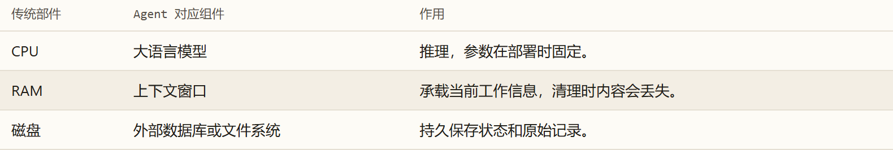
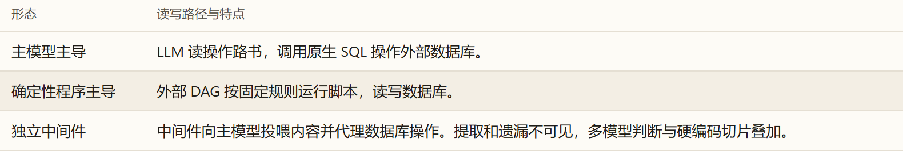
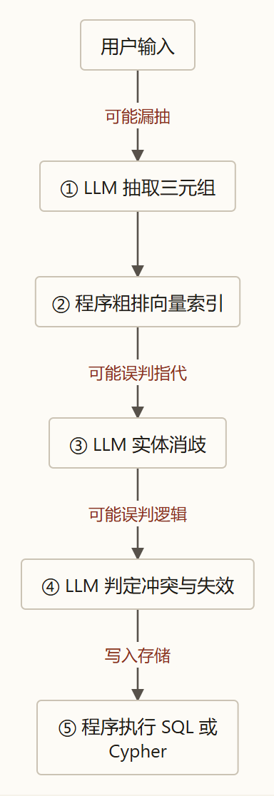
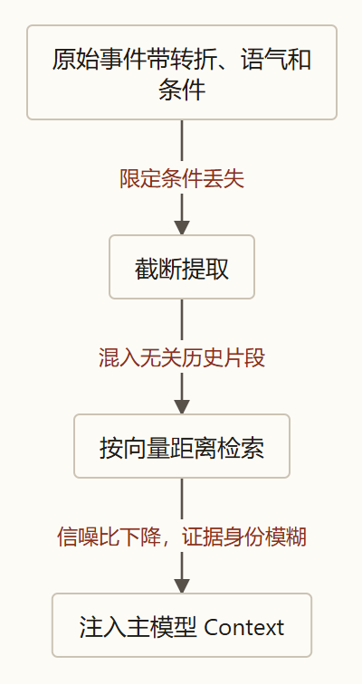
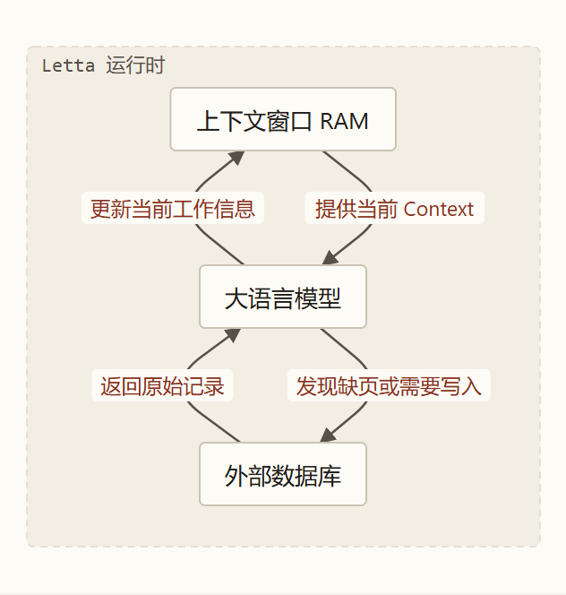
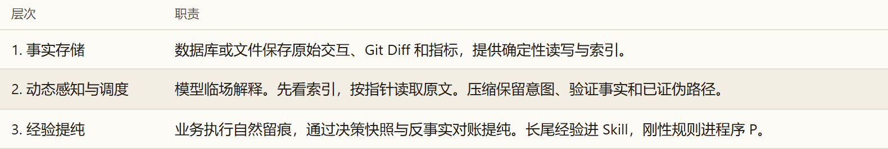

> 本文受冯若航对 Agent Memory 框架的分析启发，结合「智能体第一性原理」系列，进一步讨论记忆应该放在哪里，以及它如何影响后续任务。 [阅读原文《三分天下：为什么Agent Memory框架是死路》](https://vonng.com/ai/agent-memory-framework/)

---

### 引言：剥除拟人化迷雾

在当前人工智能智能体（AI Agent）的基础设施探索中，“记忆（Memory）”成为了最受追捧但也充斥着最多商业概念包装的领域。从早期的 Mem0、LangMem，到引入图结构的 Graphiti、Cognee，再到宣称操作系统级虚拟内存管理的 Letta（MemGPT），大量项目试图在“大语言模型”与“应用程序”之间建立一个独立的“记忆框架（Memory Framework）”。这些项目通常借用认知心理学甚至神经科学的术语——情景记忆（Episodic）、语义记忆（Semantic）、程序记忆（Procedural）、海马体巩固（Consolidation）与遗忘曲线——勾勒出极其复杂的架构图。

然而，如果剥离掉这些拟人化的生物学隐喻，回到现代计算机科学与信息论的底层物理设定，一个严肃的技术追问便浮出水面：

> **一个处于参数冻结状态、每次前向推理均独立发生的大语言模型，其与外部环境交互时的“记忆”，在信息论与系统架构中究竟对应着什么物理实体？**
> **今天市面上林林总总的独立“Memory 框架”，究竟是在提供不可替代的通用系统积木，还是在用脆弱的胶水代码搭造注定被淘汰的过渡期拐杖？**

本文将严格基于 [00_数学基石篇](../agent-math-foundations/) 与 [前五篇长文](../agent-loop/) 中建立的第一性原理体系，摒弃一切无实质意义的行话黑话，用公认的**信息论、经典控制论与计算机体系结构**语言，形式化解剖“智能体记忆”的物理真相，并给出面向长程任务的高保真状态持久化与调度架构。

---

### 一、 概念物理还原：“记忆”在计算机体系结构与信息论中究竟是什么？

要看清记忆的本质，必须先回到大语言模型（LLM）在运行期的真实物理处境。

#### 1. 物理设定：参数冻结与马尔可夫隔离墙
在部署运行期，大语言模型的参数权重 $\theta$ 是完全固化的。
根据我们在《数学基石篇》中确立的**公理一（马尔可夫隔离墙）**：

$$
P(R \mid C, E) = P(R \mid C) \iff I(E; R \mid C) = 0
$$

在单次矩阵前向计算中，外部客观现实环境（$E$）发生的一切，只要没有转化为具体的文字 Token 塞入当前的上下文窗口（Context, $C$），对模型输出（$R$）的影响严格为零。模型本身不具备像生物神经元那样的实时突触结构塑形能力，它在单次推理结束显存释放后，在物理上是**绝对无状态（Stateless）的纯数学映射函数**。

#### 2. 映射冯·诺依曼结构：Context 是 RAM，外部存储是 Disk
如果我们把大语言模型系统与经典冯·诺依曼计算机体系结构进行对齐，系统边界便一目了然：
* **大模型就是 CPU**：它是系统的逻辑运算核心，负责符号解码、语义关联与计划生成。CPU 本身不负责长期存数据；
* **上下文窗口（Context）就是 RAM（内存）**：它是当前运算必须直接读取的高速工作寄存空间。它极其昂贵，容量受限，并且在计算结束后即时清空；更严峻的是，受自回归注意力机制与数据处理不等式（DPI）制约，随着 Context 填入的内容增加，**有效信噪比（SNR）会发生持续衰减**；
* **外部数据库/文件系统就是 Disk（外存）**：它具备物理持久化能力，容量不受模型窗口限制，负责跨越时间与任务生命周期保留真实世界的物理状态。

#### 3. “记忆”的信息论定义
在计算机科学中，从来不存在神秘的“生物记忆”，只有**“状态持久化（State Persistence）”**与**“上下文换入（Context Paging）”**。

结合我们在 [01_第一篇](../agent-loop/) 推导出的**核心方程一（信息完备性方程）**：

$$
I_{\text{前馈}} + \sum_{k=1}^n \Delta I_{\text{反馈}, k} \ge I_{\text{目标}}
$$

所谓 Agent 的“记忆”，在信息论与工程架构中的本质就是：
> **外部物理环境（$E$）在过去的时间轴上产生并积累的大量真实交互日志与客观状态，如何通过确定性程序持久化保存在外存中；**
> **并在当前任务启动或执行遇到信息缺口时，以最高信噪比、最低信息失真的形式，精准地作为外源 Context（$\Delta I_{\text{存量}}$）动态投影（换入）到上下文窗口中，推动系统满足信息完备性方程。**

记忆不是一个独立于“计算、内存、外存”之外的第四个物理器官。它只是**系统状态跨越时间维度的存储与检索问题**。

---

### 二、 剖析前两类框架：为什么“独立记忆中间件”违背了第一性原理？

今天市面上大部分声称做“Agent Memory”的商业项目或开源框架，主要分为两类：
* **第一类：数据库套壳 SDK**（如 Mem0、LangMem、MemoryScope），其核心是封装一个带增删改查（CRUD）的 API，在向量数据库上增加重要性打分和时间衰减公式；
* **第二类：知识图谱/时序图谱构建器**（如 Graphiti、Cognee），其核心是在中间维护双时态知识图谱（Bi-temporal KG），进行实体消歧与冲突检测。

从第一性原理审视，这两类框架在架构设计上存在根本性的物理硬伤。

#### 1. 控制策略（How）的二元物理宿命被打破
我们在 [02_第二篇](../agent-control/) 中证明过：在系统物理结构上，已经探明的操作控制策略（How）只存在两个合法存放位置：
* **位置一：黑屋之内（Context 空间）**：载体为自然语言规范（如 `SKILL.md` 操作路书），**方向盘交给主大模型**，保留长尾语义弹性；
* **位置二：黑屋之外（确定性程序空间 $P$）**：载体为脚本、AST 语法树门禁或数据库引擎，**方向盘交给外部确定性代码**，执行方差严格为零（$\text{Var}(P) = 0$）。

然而，前两类 Memory 框架在两者之间生造了一个**“第三位置”**：
* **它不是纯粹的程序（位置二）**：因为它内部的核心逻辑（提取实体、重要性打分、关系冲突判断），全是在框架内部背着主模型偷偷调用另外的小模型跑 Prompt；它不具备确定性程序零方差、零幻觉的保证；
* **它不是纯粹的上下文智能（位置一）**：因为它把“什么时候该遗忘、提取什么字段、如何建立图关联”由 Python 代码死板焊死在中间件内部，剥夺了主模型根据现场具体任务语境进行灵活语义裁决的权力。

它既承担了小模型带来的概率方差，又继承了固定代码的生硬死板，在物理生态位上是一个畸形的过渡态。

#### 2. 还原真实工程本质：节点带模型的脆弱固定工作流（Workflow）
如果把这些框架宣传稿里的类脑名词剥掉，看其内部真实的执行代码（例如向图谱存入一条记忆），其本质就是一个**串行固定工作流（DAG）**：

在这个工作流中，隐藏着两个致命问题：
1. **概率误差的连环相乘（Compounding Error）**：
   在 5 个节点中，有 3 个节点是在调用无全局语境的大模型进行概率采样。即便每个节点的准确率达到 90%，全链路整体正确率也仅为：
   
   $$
   \text{全链路准确率} = 0.90 \times 1.00 \times 0.85 \times 0.90 \approx \mathbf{68.8\%}
   $$
   
   只要上游抽错一个定语，下游就会对错一个实体，最终通过确定性代码精准无误地把一条荒谬的错误事实焊死在数据库中。
2. **局部盲盒的“盲人摸象”**：
   工作流中的中间小模型是**没有主任务全局 Context 的**。它不知道主模型正在攻关什么核心逻辑，只能看着被切碎的两三句话盲目猜想，其做出的信息提取和对齐必然漏洞百出。

#### 3. 信息论视角的灾难：Context 质量崩塌与“工业废水倒灌”
更严峻的后果发生在下游：经过中间件这套 Workflow 处理后的记忆，最终被塞进了主模型的 Context 窗口。这直接在信息源头上带来了三重不可逆的破坏：

* **早熟的有损压缩（Premature Lossy Compression）**：
  人类自然语言包含了细密的条件约束（例如：“*我以前用过 Go，但仅限于写简单的网络工具，大型分布式系统的并发调优我完全没碰过*”）。中间件为了建图或建表，通过一段提取 Prompt 直接将其压缩为 `[User] - [knows] -> [Go]`。
  **这种提前有损压缩直接阉割了原始语境的核心否定条件。** 下一次主模型在处理生产故障时，读到了这句被阉割的记忆，就会误判用户的能力边界。
* **证据身份彻底抹平（Evidence Identity Flattening）**：
  客观物理世界真实发生的事实（用户点击了什么、报错的退出码是多少），与中间件小模型生成的猜想，在塞入 Context 时被格式化为同一张白纸上的纯文本。**主模型无法分辨哪些是未经检验的机器脑补，哪些是物理铁律**，极易引发严重幻觉。
* **违反方程二（VoI），主动制造注意力稀释（Attention Dilution）**：
  根据我们在《数学基石篇》建立的**期望信息净价值方程（方程二）**：
  
  $$
  V(a \mid C_t) = \operatorname{VoI}(a) - \lambda \operatorname{Cost}(a) \equiv I(Z; O_{t+1} \mid C_t, A_t = a) - \lambda \operatorname{Cost}(a)
  $$
  
  如果一笔注入的信息无法改变当前任务的下一步动作决策（$\frac{\partial a^*}{\partial O} = 0$），其信息价值在数学上严格为零（$\operatorname{VoI} = 0$）。
  现在的 Memory 框架习惯在每轮交互前，机械地通过向量相似度把 Top-K 条历史记录强行拼接到系统提示词中。当主模型在处理具体代码排错或算账时，这些捞出来的历史闲聊对当前破局没有任何边际增量（$\operatorname{VoI} = 0$），却白白占用了昂贵的窗口容量、引入了注意力干扰（$\operatorname{Cost} > 0$），导致净价值倒挂（$V < 0$）。**这本质上是在向清洁的工作台上倾倒信息垃圾。**

#### 4. 萨顿“苦涩的教训”（The Bitter Lesson）形式化
理查德·萨顿（Richard Sutton）指出：AI 领域七十年反复证明，研究者手工编码的领域认知结构，长期来看必输给通用算力与数据驱动的方法。
在数学形式上，我们在《第二篇》第四节推导出的定理完全解释了为什么这类框架注定会被淘汰：

$$
I(Z; C_{\text{框架人工规则}} \mid I_{\text{新一代基础模型参数}}) = 0
$$

当基础大模型的上下文窗口达到数百万、内源推理链具备自我消歧和长程关联能力时，那些靠 Python 脚本预设的人工实体抽取模板、手工遗忘衰减公式，相对于新模型自带的通用推演能力，**有效条件互信息严格归零**。曾经被当作架构护城河的外部流水线，一夜之间退化为增加系统延迟与误差的纯累赘。

---

### 三、 厘清第三类物种：虚拟内存管理（Letta/MemGPT）的合法性与其现实工程枷锁

在行业普遍的混乱分类中，以 **Letta（原名 MemGPT）** 为代表的项目往往也被归为“Memory 框架”。但从计算机体系结构审视，它和前两类在系统拓扑上有着本质的不同。

#### 1. 为什么 Letta 在拓扑上是合法的？
MemGPT 首次把**现代操作系统的虚拟内存管理架构**映射到了大模型系统上：
* 它把上下文 Context 明确定义为 **RAM（物理内存）**，把外部数据库定义为 **Disk（外存）**；
* 核心区别在于：**它没有在主模型和数据库之间架设替模型做决定的黑盒中间件，而是把换入换出（Swap/Paging）的控制权，作为原生工具调用（Tool Calls）完整交给了大模型自身！**

模型拥有诸如 `archival_memory_search(query)`（主动缺页查询外存）、`core_memory_replace(old, new)`（主动改写内核工作记忆）的原生工具。**方向盘始终握在大模型手中**，外部数据库老老实实充当零方差的数据落盘底座（$P$）。

因此，它的准确属性是 **Agent Runtime（运行时操作系统引擎）**，属于闭环控制工程（Harness）的范畴。

#### 2. 为什么虚拟内存置换在现实产业落地中遇到了瓶颈？
尽管 Letta 在拓扑学上是完全合法的，但在工程实践中，依靠大模型自己高频调用内存置换工具，依然遭遇了三重现实物理条件的制约：

1. **内源“注意力管理税”过重（管理开销挤占生产开销）**：
   在方程二的成本项中，大模型每执行一步，都要额外分配宝贵的内源思维链去权衡：“*我刚才说的话要不要存进 Disk？我下一步要不要触发一次检索？*”这种自我状态管理消耗了大量测试期算力和时间延迟，使得模型常常在该专注于业务目标时，陷入了反复整理自身内存的空转中。
2. **底层硬件物理条件的代际跃升（RAM 爆炸推迟了 Paging 需求）**：
   MemGPT 诞生于 2023 年秋季，当时的硬件背景是 GPT-4 仅有 8K 上下文，工作台极其逼仄，频繁的虚拟内存换入换出是维持运转的刚需；
   然而，在随后的硬件演进中，主模型的上下文窗口迅速普及到 200K（Claude）乃至 1M~2M（Gemini）。在工作内存暴增数千倍的物理现实面前，绝大多数常规会话和中长程任务已经可以直接放在窗口内计算，**对复杂细粒度换页置换算法的边际依赖度急剧下降**。
3. **终局收敛：通用 Harness（如 Coding Agent）更原生朴素的收编**：
   审视当今最顶级的长程编码系统（如 Claude Code），系统甚至不需要定义专有的“虚拟内存置换接口”：
   * 模型调用 `read("src/main.py", lines=1-100)`，在物理上就是将 Disk 上的代码切片 **Page In（换入）** 到 Context；
   * 模型调用 `write("notes.md")`，在物理上就是将运行状态 **Page Out（换出）** 到持久化存储。
   
所谓“虚拟内存置换”，在高度成熟的 Harness 工程中，已经自然而然地溶化为了**操作系统最基础的文件读写与命令行工具调用**，不再需要一个独立的抽象层。

---

### 四、 正本清源：真正高保真的长程状态架构（三层正交解耦）

既然堆叠中间件的伪记忆框架走不通，在面对真实企业的长程任务时，如何构建一套完全符合第一性原理、能够经受住真实世界检验的长程状态沉淀系统？

答案不在于发明新的“认知层”，而在于**遵循系统科学的分工法则，实现三层正交解耦**：

#### 1. 第一层：客观物理事实存储（Database 底座 —— 确定性程序 $P$）
* **拒绝写入端有损压缩**：
  外部存储（Disk）的唯一使命是**忠实记录物理现实世界的客观发生**。用户发送的原始消息、工具执行的完整原始输出（退出码、受影响行数）、代码提交的 Diff、线上监控的真实数值指标，原封不动地结构化落盘。
* **绝对的零方差与标准接口**：
  放弃小众的专有中间件格式，采用打磨了数十年的通用数据库基础设施（在本地单机使用 **SQLite**，在企业服务端收敛至 **PostgreSQL**）：
  * 由关系表引擎提供 ACID 事务一致性保证（$\text{Var}(P) = 0$）；
  * 依托成熟扩展原生覆盖多元化索引：全文检索使用 `tsvector/GIN`，语义相似度使用 `pgvector`，图关联使用 `Apache AGE` 或关系递归查询（CTE）。

#### 2. 第二层：动态感知与调度（Harness 驾驭工程 —— 信噪比与 Context 纯度保护）
* **原则一：延迟求值（Lazy Evaluation）**：
  绝不在写入时由弱模型去猜这条记录意味着什么。事实原样保存，**将语义理解、冲突比对的权力留到最后任务发生的那一瞬间，交由知晓全部现场语境的主模型去推演**。
* **原则二：物理指针与渐进式披露（Progressive Disclosure）**：
  借鉴 Coding Agent 处理庞大代码库的成熟经验：
  * 系统在初始化时，只向 Context 注入**高信噪比的索引切面与物理指针**（如：时间线概要、文件目录、关键事件 ID）；
  * 只有当主模型在内源推演中明确探测到了针对某项历史的有效信息差额时（$I_{\text{前馈}} < I_{\text{目标}}$），主模型才依据信息净价值方程（VoI），主动调用针对性工具（如 `read(pointer, range)`）换入指定历史片区的原始真实文本。
  * **主模型拿到的是未经二道贩子污染的 100% 真实原件，Context 的信噪比得到最严密的保护。**
* **原则三：结构化保真压缩（Structured Compaction）**：
  当长程任务不可避免需要对历史上下文进行压缩清退时，严禁用通用大模型做朦胧的全文摘要，而是由外部程序（$P$）按**四个刚性槽位**强行归拢（详见 [03_第三篇](../agent-harness/)）：
  1. 用户原始指令与历次明确修改（$H$ 轴真实意图）；
  2. 经过工具运行校验确认的客观事实（Fact 底座）；
  3. 已经证伪、走不通的死胡同结论（保留“某路径因报错 Y 失败”的信号量 $\Delta I$，彻底剔除几千行堆栈过程残骸）；
  4. 当前已确认的下一步计划。

#### 3. 第三层：经验提纯与闭环（Byproduct 原理与业务编译器 —— 认知演进）
在企业垂直场景中，长程状态如何升级为指导未来行动的规则与经验？我们在 [05_第五篇](../agent-industry/) 中证明的规律在这里终极闭环：

* **践行副产品原理（Byproduct Principle）**：

  $$
  \lim_{\operatorname{Cost}_{\text{采集}} \to 0} I(Z; C_{\text{副产品}}) = I(Z; E)
  $$

  **真正高级的状态沉淀，绝不靠模型或人类在工作之余额外分心“记笔记”。**
  用户点击确认审批的动作（$H$）、自动化编译器校验通过的绿灯（$P$）、Git Commit 的持久化版本、以及线上业务恢复正常运行的监控指标，本身就是业务在物理闭环中自然留下的**操作镜像痕迹（副产品）**。Harness 异步、静默地捕获这些真实事实，将信息生产的边际成本压向零。
* **跨周期反事实因果对账与四级经验晋升**：
  长程业务（如电商补货、金融放款）结果的揭晓往往延迟数周。系统在决策瞬间保存**决策快照（Decision Snapshot）**，在结果揭晓后进行**反事实因果剥离**（排除大促并发干扰），并沿着严格阶梯晋升：
  
  $$
  \text{单点运行日志} \xrightarrow{\text{因果剥离}} \text{对照实验假设} \xrightarrow{\text{多轮复现验证}} \text{标准操作路书（SKILL.md）} \xrightarrow{\text{形式化锁死}} \text{业务编译器代码（P）}
  $$
  
* **双轨物理存放**：
  * 凡是需要结合现场语境变通的长尾经验，提炼为精炼的自然语言规范，存放在**黑屋之内**（下一次任务的静态外源前馈 $I_{\text{前馈}}$，即 `SKILL.md`）；
  * 凡是已经完全明确的合规红线与业务核算逻辑，提炼为自动化校验脚本，存放在**黑屋之外**（零方差的形式化验证器 $P$）。

---

### 五、 终局收敛：三分天下的物理必然性与工程实践法则

走完这一整套第一性原理推导，所谓“Agent Memory 赛道”的技术泡沫便彻底破裂，整个智能体产业的基础设施最终不可逆转地收敛于**“三分天下”的极简物理实体**：

* **智力由模型提供（Model）**：长期来看是高度通用化、充分竞争的算力商品。不要在模型前挂载自作聪明的认知过滤中间件，将完整的上下文语义理解与裁决权交还给主模型；
* **驾驭由工程提供（Harness）**：围绕恒温器的四个物理节点建立防护，提供干净的工具接口，管理 Sub-agent 隔音小黑屋，按照渐进式披露原则调度 Context，防止信噪比衰减；
* **状态由数据库提供（Database）**：企业核心的资产是数据主权。将所有客观交互事实原封不动地沉淀在标准的 PostgreSQL 或 SQLite 中，利用经过三十年工业验证的成熟数据库能力解决索引与一致性。

### 结语

在计算机科学发展的漫长岁月中，每当底层算力发生跃升，应用层总会短暂冒出一批试图在“计算”与“存储”之间兜售私有胶水架构的中间商。然而，**物理规律与信息论法则从来不承认这种多余的妥协。**

正如当年操作系统统一了混乱的硬件外设调度、关系型数据库终结了文件系统上各立门户的私有索引方案一样，AI Agent 的发展也将以同样冷峻的纪律收敛：

**那些试图在外部替大模型预设认知、在数据库前拦截私有语义的“Memory 框架”，终将作为上一代弱模型的辅助病号拐杖而烟消云散；**
**而真正能够穿越周期的，唯有日益强大的通用基础智能（Model）、严密可靠的闭环驾驭工程（Harness），以及沉淀着企业物理世界客观真理的数据库基石（Database）。**
