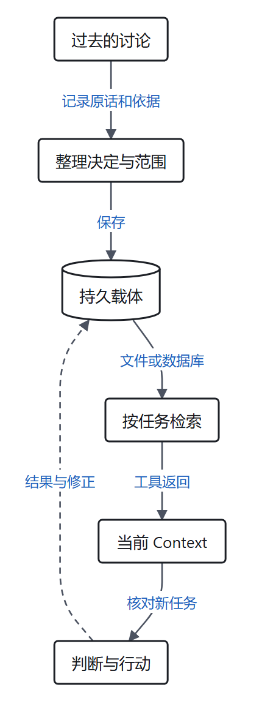

> 本文结合智能体第一性原理讨论相关工程实践，主要参考[原文](https://vonng.com/ai/agent-memory-framework/)。

上周，你和 Agent 讨论一个网站功能。为了赶上活动，你决定先把收藏保存在浏览器本地，暂时不做账号系统。Agent 当时理解了：这是有期限的取舍，不是你永远拒绝跨设备同步。

一周后，你请它为网站规划会员系统。新的会话开始了。Agent 从记忆里读到一句话：**“用户不要账号系统。”**

它于是绕开账号设计，给你提出一套只存在于单台设备上的方案。你问它为什么，它很认真地回答：“因为您之前明确要求不要账号系统。”

它没有完全编造。你确实说过不做账号系统。但那句话属于上周的收藏功能，理由是赶工；现在要讨论的是另一个目标。一次具体取舍，被压成了一条没有期限、没有对象的长期规则。

这只是为解释问题构造的场景。它揭示的困惑却很实际：**Agent 明明记住了，为什么反而更难合作？**

我们之前在[《第六篇》](/zhangmuchuan/blog/agent-memory/)讨论过，记忆让一次任务中获得的经验穿过时间，成为下一次任务可以使用的信息。可信息从对话走进下一次 Context，中间还要经过一连串选择：谁决定记什么？谁保留原话？谁负责找到合适的记录？谁能修改它？

冯若航在[《三分天下：为什么 Agent Memory 框架是死路》](https://vonng.com/ai/agent-memory-framework/)中给出一个很有锋芒的判断：Agent 需要记忆，但许多独立的 Memory 框架未必会长期占据一个独立位置；智力、驾驭执行和数据持久化，可能分别由模型、Harness 和数据库承担。原文发表于 2026 年 4 月，讨论的终局主要针对企业级 Agent 和重视数据资产的组织、个人；关于产业终局的部分是作者的预测。

我们不妨把这份判断放回自己的理论中，先不问哪个产品会赢，而是从那句被误记的“不要账号系统”出发：**信息究竟在哪一步失去了条件？换一个架构，就能保证它回来吗？**

---

### 一、模型没有亲历昨天，昨天怎样影响今天？

在[《数学基石篇》](/zhangmuchuan/blog/agent-math-foundations/)中，我们把外部环境记作 $E$、当前上下文记作 $C$、模型输出记作 $R$。在模型参数固定、环境只通过当前输入影响此次输出的设定下，有：

$$
E \longrightarrow C \longrightarrow R
$$

由数据处理不等式：

$$
I(E;R) \le I(E;C)
$$

这里的 $I(E;C)$ 是 Context 中关于环境的信息，$I(E;R)$ 是输出中关于环境的信息。这个式子告诉我们：在上述条件下，模型不能仅靠加工当前 Context，从输入之外额外取得独立的新观测。模型的参数可能包含历史知识，也可能据已有信息作出有用的预测，但预测本身不是对当前现场的新观测。

回到网站例子。今天的新会话并没有亲历上周的讨论。如果运行系统没有把当时的对话、决策记录或可靠摘要交给它，模型就无法单凭推理知道“先做本地收藏”是为了赶活动。它也许能根据通用经验猜到几个合理原因，但猜测和当事人当时的决定不是一回事。

于是，跨会话记忆首先要完成一件朴素的事：**把过去可能有用的信息保存在会话之外，并让后来的任务在需要时取得它。** 文件、数据库、项目文档或其他持久载体都可以参与；信息保存在那里，并不意味着已经进入当前模型的 Context。

图：根据本文的构造场景归纳。持久记录可以按任务检索，也可以在会话启动时注入；相关信息进入当前 Context 后，后续 Agent 才能在本次推理中使用。行动结果和修正也可以写回持久载体。

可以想象一家饭店交接晚班。午班服务员知道一位常客今天不能吃花生，于是在交接本上写了一句“这桌忌花生”。晚班同事先找到交接本，确认它说的是哪一桌，再把这条信息告诉厨房。纸本留下了记录；翻到正确页面是读取；厨房收到的那句话，才真正影响这次做菜。

如果交接本忘了写桌号，信息依然留在纸上，却很难正确使用。如果晚班根本没有翻本子，纸上的字也不会自动跑进厨房。Agent 的持久化与读取，同样是两个需要分别完成的步骤。

在我们用来描述单次任务的信息账里：

$$
I_{\text{前馈}}+\sum_{k=1}^{n}\Delta I_{\text{反馈},k}\ge I_{\text{目标}}
$$

先固定要判断的目标状态 $Z$。基石篇把目标信息阈值设为 $I_{\text{目标}}=H(Z)-\varepsilon$，其中 $H(Z)$ 表示起初对目标状态的不确定性，$\varepsilon$ 是允许留下的不确定性容差。$I_{\text{前馈}}$ 是阶段开始时 Context 中关于 $Z$ 的信息；$\Delta I_{\text{反馈},k}$ 是第 $k$ 次交互的观测相对于此前 Context 所带来的条件互信息。

在目标固定、此前观测完整保留的设定下，上式等价于最终的剩余不确定性 $H(Z\mid C_n)\leq\varepsilon$。它描述的是一个信息条件：即便信息足够，真实系统仍可能没能正确利用信息、执行动作或通过验收。若交接发生压缩，信息账要以接手者实际取得的内容为准；若目标改变，则要针对新目标重新判断。

上周讨论中取得的决定，相对那次讨论是反馈；如果这次会话启动时就被注入，它是新阶段的前馈；如果启动后才查到，则是这次交互取得的信息。**分类跟观察起点有关，同一笔信息不能在同一个阶段被重复算两遍。**

还有一条不能忽略：上周的目标是收藏功能，这周可能已经换成会员系统。旧记录不能因为曾经正确，就自动成为新目标的约束。前馈是否有用，取决于它的内容、适用范围，以及它是否真的被交给了当前任务。

---

### 二、保存的是一句话，还是做决定时的依据？

为什么那句“用户不要账号系统”会误导今天的 Agent？

设想午班服务员接到两桌不同的要求。第一桌说：“这份菜是给孩子吃的，孩子对花生过敏。”交接单写下“这份菜不得加花生，原因是孩子过敏”，晚班把它交给厨房，就能对应到正确的菜和原因。

第二桌说的却是：“这份菜先别加花生，我们想自己另外加。”如果服务员把它写成“这位客人对花生过敏”，晚班下一次接待同一位客人时，可能不仅不给菜里加花生，还劝他不要点任何含花生的食物。客人感到困惑：我什么时候说过自己过敏？晚班回查当时的原话，才能发现那只是对上一份菜的要求。

同样是一条简短的交接记录，准确程度和行动后果却不同。问题不是纸太小，也不是数据库存不下，而是**写入时丢失了对象、原因与适用范围，读出时又把推断当作了用户声明**。

这可以用黑屋边界再追问一步。假设原始对话是 $C$，抽取器只读取这段对话，产出一条摘要 $R$；在抽取器没有其他与真实环境相关输入的条件下，仍是：

$$
E \longrightarrow C \longrightarrow R
$$

摘要可以让后续 Agent 更快看见一个决定，却不能凭自身加工补回原文根本没有提供的事实；有损摘要还可能丢失原本在对话里的限定。**信息有没有新增，和已有信息能不能更容易被使用，是两笔不同的账。** 一份整理不必创造新事实，也可能节约下一次查找和理解的成本；但整理结果越简短，就越要问它省掉了什么。

因此，一个更可靠的交接，不妨记录成这样：

> **已确认决定**：收藏功能先使用浏览器本地保存，本阶段不做账号系统。\
> **当时理由**：活动时间临近，先控制实施范围。\
> **适用范围**：本次收藏功能；不自动约束以后的网站功能。\
> **依据**：指向当时的用户原话或决策记录。

这并不要求每段对话都变成一份长表。它针对的是未来可能影响行动、又不容易从当前环境恢复的决定。用户已经明确确认的内容可以及时记录；Agent 根据零散现象推断出的偏好，则应标为假设、保留依据和范围，必要时再与用户核对。用户的“这次先这样”不应被悄悄升级为“以后都这样”。

---

### 三、三分天下：把记忆放回完整的行动路径

现在再看原文的三分法，就能看清它试图回答什么。冯若航设想：模型提供理解与推理能力；Harness 管理上下文、工具、循环与执行；数据库等持久化系统保存跨会话状态。这个划分不是说记忆只属于数据库，而是提醒我们：**一条有用记忆必须经过理解、保存、取回和使用，单独哪一层都不能完成全部工作。**

仍以会员功能为例，假设一个团队选择文件作为最初的持久层。下面是一种为了讲清机制构造的实现，不是原文声称已经部署的产品流程：

1. 用户在会话中确认“收藏功能先做本地保存”。Agent 根据对话拟出一条带范围和理由的记录。
2. Harness 调用受控的写入工具，将记录写入项目中的 `decisions/favorites.md`，同时保留指向原始讨论的入口；写入是否成功由工具返回。
3. 下一次用户提出会员功能时，Agent 先根据任务需要读取项目索引，再读取相关决定。工具把文件内容返回当前 Context。
4. Agent 比较新任务与旧决定的范围：它知道收藏功能当时没有账号系统，却不能据此断定会员系统也不能有账号；需要业务取舍时，再根据现有信息与用户讨论。

这里，模型负责在具体语境中理解与推演；Harness 决定如何提供工具、传递结果和执行权限；文件系统负责保存文件。这三种职责可以由不同组件实现，也可以由同一个产品封装。**逻辑上能够区分职责，并不等于现实中只能有三家公司、三个进程或两条连接地址。**

原文用 `MODEL_URL` 和 `DB_URL` 表达解耦的愿望：替换智力来源与迁移数据不应被绑成一件事。这个愿望有工程意义，但两个接口地址本身还不足以完成迁移。数据结构、工具协议、权限、检索方式、历史版本与备份能否被新系统理解，都需要实际处理。

也正因为如此，判断一个 Memory 产品时，不宜只看它的名称。原文区分了封装存取的 SDK、处理实体与时序关系的工具，以及管理上下文与外存的 Agent Runtime。它将 Letta/MemGPT 一类归入后者。[Letta 的 V1 SDK 文档](https://docs.letta.com/v1-sdk/concepts/stateful-agents)描述了记忆块可附加或移除，并在附加期间进入 Agent 可见的上下文；这展示了一种上下文管理机制，而非产业结局。

---

### 四、谁握着方向盘：让模型判断，还是把步骤写死？

在[《第二篇》](/zhangmuchuan/blog/agent-control/)里，我们讨论过控制策略放在哪里：一部分作为指引进入模型 Context，由模型结合现场选择；另一部分写进外部程序，由代码执行确定的处理或限制。

记忆系统也面临同一个选择。比如用户说：“收藏功能这次先不做账号，会员功能下个月再讨论。”

一种做法是固定流水线：每次用户说话后，抽取器都按预设字段提取“偏好”，再由程序决定存入相应表。它容易统一执行，也便于检查每一步有没有运行；但若字段只允许填写“是否喜欢账号系统”，这句话中的任务范围和时间条件就可能被挤掉。

另一种做法是让主 Agent 在完整任务语境中判断：这是一个针对收藏功能的阶段性决定，还是用户对所有功能的长期偏好？它可以写入一份说明，也可以先问一句。但它仍然可能理解错、忘记记录，或把推测写得过于肯定。

这里不存在“模型判断”和“程序约束”必须二选一的道理。模型可以解释语义，程序可以要求记录带上来源、对象和时间；程序可以检查写入权限，却不能只凭字段齐全证明内容为真。形式正确的记录，也可能是一条写错的记录。

用饭店交接来讲：店里可以规定每张交接单都要有桌号、时间和签名。这个规定能防止交接单缺项；但如果服务员听错了客人的话，表格填得再整齐，厨房仍会收到错误信息。让有现场语境的人记录，可能减少误解；保留客人的原话、发现矛盾时重新确认，则为纠错留出机会。

原文引用“苦涩的教训”，主张模型变强后，一些替模型预设认知步骤的规则会失去优势。这个方向值得认真对待，但它还不是一张可以直接覆盖所有规则的判决书：某条规则可能是在补偿弱模型，也可能保护用户授权、隔离数据，或者保证另一套系统知道怎样接收结果。**是否删掉某个步骤，要看它在具体任务中提供了什么收益，又付出了什么代价。**

可以沿用[《数学基石篇》](/zhangmuchuan/blog/agent-math-foundations/)的信息与成本比较思路，先写一个用于讨论的简化评分：

$$
V(a\mid C_t)=\Delta I_{\text{反馈}}(a)-\lambda\operatorname{Cost}(a)
$$

其中 $a$ 是候选行动，比如查询一条历史决定；$C_t$ 是当前 Context。固定目标状态 $Z$ 后，$\Delta I_{\text{反馈}}(a)$ 指行动可能带回的观测相对于当前 Context 的预期目标相关信息增益，而非返回的字数；$\operatorname{Cost}(a)$ 表示行动的代价，$\lambda$ 用于在这一模型里把成本折算到可比较的尺度。时间、计算、维护与风险各有不同单位，实践中需要说明怎样衡量与折算。

这只是“预期信息增益减去折算成本”的代理，并不等同于决策理论中的实际收益：取得某个新事实，不保证它会改变行动，也不保证最终结果更好。现实中这些量通常难以精确测得；要判断检索值不值，还须比较它对任务结果可能带来的改善与代价。

例如，准备设计会员系统时，假设上周的讨论散落在几百段项目记录里。没有索引，Agent 可能逐条搜索、读取大量无关片段，才找到“收藏功能暂不做账号”的原话；这些搜索结果还会占用当前 Context。

如果项目索引把“收藏功能的阶段决定”与原话链接放在一起，Agent 可以先读索引，再沿链接检查当时的对象和理由。整理并没有创造一条新的用户决定：原始决定一直在旧记录中。它改变的是找到并利用这条决定的路径，让相关条件更容易进入有限的工作台，也可能减少多次任务中的重复搜索。

但整理层也有自己的代价。索引如果漏写“仅限收藏功能”，或长期未更新而指向已被推翻的决定，Agent 仍可能走错；因此它需要维护，关键处要回查原话，并检查今天的项目状态。建索引省下的搜索和理解成本，必须与制作、核对及更新它的成本一起比较。这个比较比“环境里能查到就绝不整理”更接近实际工作。

这不是说索引总能获益。[Anthropic 的一项实验](https://www.anthropic.com/research/components-of-agent-memory)使用 Stainless 文档和 25 个问题：仅搜索满足 53% 的评分项，逐步构建的 Wiki 配合搜索最高满足 61%；研究者报告后者每题约节省 2 万 Token。这是特定文档与题集下的结果，不能直接当作所有项目的收益，也不能把答题时省下的 Token 当成已经扣除 Wiki 构建和长期维护成本后的净收益。它提供的是一个值得在自己任务中检验的线索：多次复用时，整理层能否摊薄建立和维护成本？

---

### 五、数据库保证保存，谁保证记下来的是真的？

原文对数据库的一点强调很重要：Agent 再擅长推理，也需要某种持久载体，把今天的状态留给明天。数据库提供的事务、并发控制等能力，可以帮助系统在规定条件下可靠地处理数据。[PostgreSQL 的事务文档](https://www.postgresql.org/docs/current/tutorial-transactions.html)解释了如何把多个操作组成一个事务，使它们作为整体提交或撤销。

但请看一个更令人不安的情况：交接本保存得很好，备份也完整，晚班每次都能读到那条记录；只是午班一开始把“今天不加花生”写成了“这个人花生过敏”。

账本越可靠，错误的那句话也越可靠地被传下去。保存与真假，是两个不同问题。

我们在[《第三篇》](/zhangmuchuan/blog/agent-harness/)把反馈拆成事实获取与判断：先看发生了什么，再拿标准比较。放到记忆中，至少要区分三件事：

- **程序 $P$** 可以检查记录格式、写入权限、版本冲突，也可以保存原始记录和变更历史；这些检查不自动证明语义判断正确。
- **模型 $M$** 可以对照记录和原始对话，寻找摘要是否遗漏条件、两条结论是否冲突；它的判断仍可能出错，换一个窗口也不保证完全独立。
- **人 $H$** 可以确认自己的意图、纠正误解，并决定重要约定；对不影响当前行动的小事，不必把每次记忆操作都变成人工审批。

比如，夜间维护任务发现“用户从不做账号”与原始讨论不一致，可以先把它标为待核对，附上原话，再由后续任务结合需要处理。若原话清楚写着“仅限本次收藏功能”，维护者可以修正范围；若只留下模糊摘要而原始对话已不可用，就不能把猜测伪装成已验证事实。

这里还有一个容易被忽略的区别：**原始记录是过去发生过什么的依据，不自动等于现在仍然成立的事实。** 当年的项目没有账号系统，今天可能已经有了。历史决定应当保留，但执行新任务时仍需读取当前项目状态；必要时再对照旧决定为什么作出、是否已被新决定替代。

---

### 六、记忆框架会消失吗？先看它真正承担了什么

原文最尖锐的判断是：独立 Memory 框架可能被模型、Harness 和数据库分食，最终失去单独存在的空间。我们的理论能帮助解释其中的压力，却不能单凭黑屋或信息方程证明产业结局。

如果一个框架主要把通用数据库的存取操作包装成固定接口，而调用方本来就具备相应能力，那么团队确实应该比较：这层包装节省的开发与维护成本，是否大于引入新依赖、迁移和限制带来的成本。原文设想用 Skill 指导模型判断何时记录、检索和更新，再由受控工具与数据库执行；这种组合能否替代某个具体框架，要比较任务质量、权限、并发和维护成本。随着模型能力和工具生态变化，答案可能改变。

但“可以把同样功能写出来”和“已经拥有同样可靠的系统”也不是一回事。实际系统可能需要多人并发、权限隔离、审计、备份恢复、冲突处理、版本迁移，以及对不同任务的检索评估。某个框架是否真正做好这些事、值不值得依赖，需要检查具体实现和实际使用效果；也不能因为这些需求存在，就认定框架一定做得更好。

对图谱和时序处理也是如此。模型可以参与实体消歧与冲突判断；数据库可以保存图结构或时间字段。但从“组件分别存在”到“组合后的结果稳定可用”，中间还有数据质量、评测和维护工作。原文认为策略会被模型吸收、存储回到数据库，这是值得检验的演化判断，而不是由职责拆分自动推出的定理。

原文还看好 PostgreSQL 作为多智能体、跨设备和组织协作的通用持久层，并承认本地轻量场景可以使用 SQLite 或文件。我们可以理解这个选择背后的诉求：成熟的事务能力、查询工具、生态与可迁移性。但不同系统的部署、数据结构、权限和运维条件不同；**需要可靠持久化，不等于逻辑上只能选一个数据库。** 数据属于谁、能否导出、能否恢复，也要看具体服务的契约和运维，而不是看数据库名字就能保证。

这也给了我们一个可检验的问题：在同一批真实任务、相同数据与权限要求下，引入框架后，相关记忆找得更准了吗？错误摘要更容易被发现了吗？迁移和维护花了多少精力？把这些结果与自行组合工具的方案比较，才知道这一层在具体场景里有没有为团队省力。

---

### 七、让过去帮助今天，而不是替今天做主

回到开头的会员功能。一个好的记忆系统，不是让 Agent 永远背住“用户不要账号”，也不是每次把过去全部对话重新塞进 Context。

这一次，Agent 先找到上周的决定，沿链接读到原话：“收藏功能先做本地保存，活动前不做账号系统。”它再检查当前项目，发现会员系统仍未建立。旧决定只约束当时的收藏功能，不能替今天的会员方案作答。于是它带着已经确认的背景，与用户讨论会员是否需要跨设备身份和保存能力。用户不用重讲一遍历史，也没有被过去的阶段性决定替自己做主。

这样的系统里，模型需要理解语境，Harness 需要组织读取与权限，持久层需要可靠保存，用户需要能够纠正自己的意图。具体组件怎样打包可以变化，但这些工作不能因为换了一个产品名就消失。

所以，读完“三分天下”，我更愿意把问题留在这里：**每一条进入未来 Context 的记忆，从哪里来，经过谁的判断，又保留了什么纠错的机会？**

把这几个问题回答清楚，记忆才不只是让 Agent 在下一次会话里说出“我记得”，而是真的能接住上一次合作。

### 参考资料

- 冯若航，[《三分天下：为什么 Agent Memory 框架是死路》](https://vonng.com/ai/agent-memory-framework/)，2026 年 4 月 19 日。
- Anthropic，[The components of agent memory](https://www.anthropic.com/research/components-of-agent-memory)。
- PostgreSQL，[Transactions](https://www.postgresql.org/docs/current/tutorial-transactions.html)。
- Letta，[Introduction to Stateful Agents](https://docs.letta.com/v1-sdk/concepts/stateful-agents)。
