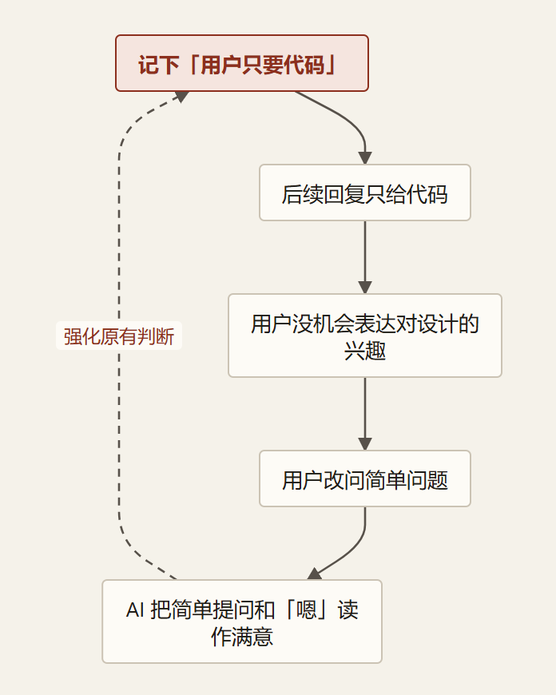
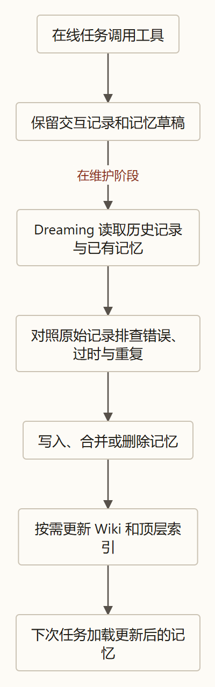

> 本文从 Anthropic 披露的 Dreaming 实验出发，结合前作讨论智能体怎样回查历史记录、纠正旧笔记，并把更新后的记忆用到下一次任务。 [阅读原文 *The components of agent memory*](https://www.anthropic.com/research/components-of-agent-memory)

---

### 引言：撕掉拟人化的伪装与 Kierkegaard 的时序困境

在当前的 AI Agent 讨论中，“记忆（Memory）”大概是被包装得最玄乎、充斥最多行话的领域。

打开市面上各种开源 Memory 框架的主页，你几乎总能看到一张极其繁复的架构图：底下一层画着“情景记忆（Episodic）”，中间一层堆着“语义记忆（Semantic）”，顶上架着“海马体巩固（Consolidation）”与“遗忘曲线”。仿佛只要给大模型套上几个 Python 脚本，它就突然拥有了人类大脑的神经突触。

但如果我们关掉这些花哨的生物学比喻，退回到计算机与物理现实的底层，事实极其朴素甚至有些冷酷：

> **在部署运行中，大模型的参数权重是完全冻结的。每一次会话结束，显存瞬间释放，上下文工作台物理清空。模型本身是绝对无状态的纯数学计算映射。**

正因如此，丹麦哲学家克尔凯郭尔（Søren Kierkegaard）的一句名言，恰如其分地道出了智能体记忆的底层物理宿命：
> **“生活只能向后理解，但必须向前生活（Life can only be understood backward, but it must be lived forward）。”**

智能体在构建记忆时，面临着完全相同的时序困境：**它必须在知道下一步会发生什么之前，预先决定当下什么值得记住。**

由此，Anthropic 在最新研究中提出了一个根本性的定性——**记忆的本质，是一场对未来需求的预测（Memory as Prediction）**：
* 当智能体记下一条核验过的规则时，它是在**预测**未来的自己遇到相同模式时能直接套用；
* 当智能体记下一个客观事实时，它是在**预测**未来的自己无需再次耗费网络调用去重复验证。

在深入细节前，必须划清严格的**物理边界**：所谓的“智能体记忆”，**排除了**模型底层权重参数的微调更新（Weights）、**排除了**单次会话窗口内的上下文学习（In-Context Learning），也**排除了**为了腾出窗口而做的单会话滚动摘要截断（Compaction）。它专指**跨越会话生命周期、被持久化保留在外部介质中、并在后续会话作为有效上下文读入的知识系统**。

既然模型每次面对的都是一张白纸，所谓的记忆到底如何运作？那些五花八门的独立 Memory 框架究竟是在提供地基，还是一场中间商的自嗨？Anthropic 在最新研究博文《The components of agent memory》中力推的“做梦（Dreaming）”机制，在工程上到底是怎么跑起来的？

这篇文章不谈玄学，我们完全从**信息论底层推导**、**认知交互哲学**与**扎实的软件工程实战**出发，把 Agent 记忆的物理真相与落地做法彻底讲透。

---

### 一、 记忆的物理本质：下一次任务的静态前馈与五类图景

要理解记忆，首先要搞清楚：**记忆究竟为什么存在？**

很多人下意识把记忆当成“录像机”，觉得把过去发生的所有对话、所有日志都存下来，Agent 就会越来越聪明。这是典型的存储思维，而非决策思维。

对一个需要解决现实问题的智能体而言，如果一条信息记下来之后，**永远不会改变它未来的任何一次动作选择**，那么这条信息就毫无价值。它不仅没用，还会像杂草一样挤占模型有限的上下文窗口，拉低整个工作台的信噪比。

在我们此前推导的智能体基石——**信息完备性方程（方程一）**中，任务能收敛交付的充分必要条件是：

$$
I_{\text{前馈}} + \sum_{k=1}^n \Delta I_{\text{反馈}, k} \ge I_{\text{目标}}
$$

* **$I_{\text{前馈}}$**：出发前系统已经掌握的信息（模型脑子里的常识 + 初始提示词）；
* **$\sum \Delta I_{\text{反馈}}$**：出发后通过调用工具、看终端报错、向外界打听，一步步在现场摸索回来的有效信息增量；
* **$I_{\text{目标}}$**：把任务彻底办成所需的全部信息总和。

把记忆放入这个方程，它的物理本质瞬间原形毕露：


> **记忆的本质，绝不是为了“怀念过去”，而是把上一次任务在现实中撞得头破血流才趟出来的有效经验，沉淀为下一次任务启动时的“静态外源前馈（$I_{\text{前馈}}$）”。**
> 
> 它是一块在第 0 步就把起跳点垫高的跳板，目的是减少未来现场试错的轮次与破坏代价。

#### 1. 准入网筛：基于信息净价值（VoI）的三道过滤器
根据期望信息净价值方程（$V = \Delta I - \operatorname{Cost}$），向系统写入任何信息都是有成本的。一条信息值得被持久化，必须通过三道硬核网筛：
1. **决策敏感性（$\frac{\partial a^*}{\partial O} \neq 0$）**：无法改变未来动作决策的闲聊与临时推导草稿，一律丢弃；
2. **不可廉价恢复性**：代码原文、数据库现成行数、屏幕当前坐标，这些“抬眼向环境发个只读请求就能秒级确认”的存量事实，**绝对不抄录进记忆**。“记住地图索引，而非复制整片领土”；
3. **超出先验（意外度）**：符合模型通用常识的不记（如“代码要有可读性”），**只记模型默认本能在当前特殊环境下的“偏差修正量”**（如“本仓库严禁使用 Early Return”）。

#### 2. 系统需要记住的五类终极内容
通过信息完备性方程推导，未来决策所必需、且环境无法廉价恢复的静态前馈，在逻辑形态上严格收敛于回答五类终极问题的完整图景：
1. **为谁做（委托人模型）**：用户的目标、边界约束、禁忌与隐性工作习惯。这是唯一必须通过长期交互建立的“共同基础（Common Ground）”。**其衡量标准极其严苛：随着合作深入，用户需要重复解释自己意图的次数必须严格单调递减**；
2. **为什么（决策与否决理由）**：代码库记载了结果，Git 记载了修改时间，但**“为什么选方案 A 而废弃方案 B”以及“被否决方案的致命缺陷”会随会话结束彻底蒸发**。被否决的理由是防止未来 Agent 在相同路口重复踩坑的最珍贵记忆；
3. **怎样做得更好（经验与纠错）**：包含具体情境、触发动作与真实后果的“本能修正清单”；
4. **还有什么没做完（前瞻承诺与未竟事项）**：答应过的事、做到一半的系统状态。这对应人类的“前瞻记忆（Prospective Memory）”，是维系跨会话长程任务连续性的物理支柱；
5. **去哪里找（索引而非内容）**：记住各个知识模块的存储指针与目录地图，而非把领土内容全部搬进脑海。

---

### 二、 在线记笔记的死穴：推断距离、两端折损与反向驯化

明确了该记什么之后，工程上最自然的直觉往往是：
*“既然模型在干活时掌握着第一现场，让它在对话中顺手把这些修正量记下来，不就解决了吗？”*

这种“边干活边记笔记”的在线模式，看似最省事，实则埋下了整个系统失控的导火索。

#### 1. 推断距离光谱与“两边各丢一种信息”
“事实 vs 解读”并不是非黑即白的二元对立，而是一条不断延长的**推断距离光谱**：

$$
\text{原始观察} \longrightarrow \text{描述} \longrightarrow \text{解读} \longrightarrow \text{归纳} \longrightarrow \text{行动规则}
$$

$$
\text{“他说：太长了”} \to \text{“他嫌回答太长”} \to \text{“他喜欢简洁”} \to \text{“他一贯要简洁”} \to \text{“以后回答控制在5行内”}
$$

越往右推断距离越长，直接指导行动的效率越高，但每跨一步都在叠加主观猜测，出错概率呈指数级攀升。

这就引出了记忆在**时机权衡上的认识论悲剧：两边各丢一种信息**。
* **写入时解读（提前切菜）**：掌握最丰富的**现场信息**（语境、压力、情绪、上下文氛围），压缩率极高；但它是**不可逆的有损压缩**，缺少未来全局参照，极易把偶发特例当成终生真理；
* **读取时再算（留整土豆）**：保留了完整原貌与未来重新解读的选择权，掌握**全局信息**；但**当时的现场氛围早已流失**，且每次读取都要重新耗费海量算力二次分析。

急诊科医生的经典病历生动反映了这一点：
病人满头大汗、心率 110、说话发抖。若医生在病历上写“心率 110，手抖”（留整土豆），下一位医生结合新检查能纠偏发现是“甲亢”；若医生图省事直接写下结论“患者焦虑”（切成土豆丝），后续所有医生都会被这个标签带偏，错误被永久锁死。

大模型在处理复杂任务时，受数据处理不等式（DPI：$I(Z; M) \le I(Z; T)$）约束，加上注意力被当前主任务挤占，在线记笔记必然做出这种**早熟的有损压缩**。

#### 2. 声明（Statement） vs 推断（Inference）的反家长主义原则
在推断距离光谱上，存在着一条不可逾越的权力红线：
* **声明**：用户亲口表达的要求（如“我需要详细的设计推演”）；
* **推断**：Agent 通过行为观察猜出的偏好（如“他跳过了长段落，推测他喜欢短答案”）。

**在“用户希望被怎样对待”这件事上，用户拥有不可剥夺的最高解释权。**
Agent 无论统计置信度多高，绝不能自作聪明地用推断出的“潜意识偏好”去强行覆盖用户的明文声明——这种行为在认识论上被称为**技术家长主义（Paternalism）**。推断的权威性必须严格低于声明，最佳做法是将推断转化为问句向用户求证。

#### 3. 偏见自证的四重茧房：用户被反向驯化的悲剧
如果放任在线生成的草率解读进入记忆，它不会自我修正，反而会触发极其隐蔽的**四重自我强化闭环**：



一条错误的记忆，亲手关闭了观测真相的窗户。为了防止这种灾难，记忆的微观单元绝不能是一句武断的死结论，而必须是一个**“带出处的假说（Hypothesis with Provenance）”**：
> **“这次选了纯脚本交付（行动假说）；依据是当时面临下周上线的赶工期（现场原始证据指针）；暂定，下次遇架构任务需以问句先行试探（适用边界条件）；来源：推断而非声明。”**

---

### 三、 移动目标的快照：记忆老化、速度层级与好朋友法则

前面讨论的在线早熟压缩，本质是“一开始就记错了”（推断错误）。
但在真实世界中，更致命的系统退化来自另一种隐蔽悲剧：**记下的那一刻完全正确，但人变了，世界变了。**

#### 1. 移动目标的快照与“越老越自信”悖论
记忆的物理本质，是对一个处于动态运动中的“移动目标”所拍下的定格快照。
食品包装有保质期，但磁盘上的 Markdown 笔记没有。一条三年前记下的“用户偏好 Python”，在今天读起来依然字字铿锵。

更具讽刺意味的是：**越老的记忆，在历史任务中被检索、验证和引用的次数往往越多，统计置信度看起来极高；但恰恰因为它跨越了漫长时间，它过期的客观概率反而最大！**
系统架构师必须牢记：**证据的积累强度（Strength）与证据的新鲜度（Recency），在信息论上是两码事。**

#### 2. 记忆的 4 个变化速度层级（从盐到鲜牛奶）
为了防止记忆系统在时间维度上产生混乱，记忆单元必须显式标注其所处的变化半衰期：

| 层级 | 现实隐喻 | 典型现实锚点 | 预估半衰期 | 系统更新与淘汰策略 |
| :--- | :--- | :--- | :--- | :--- |
| **几乎不变** | **食盐** | 核心价值观、底线红线、母语、致命过敏 | 数年 ~ 终生 | 极难动摇，非经用户显式声明不更新 |
| **缓慢变化** | **罐头** | 职业身份、主修技术栈、写作基调、长期架构 | 1 ~ 3 年 | 需跨情境的多轮确凿反例才允许修正 |
| **中速变化** | **冷藏品** | 正在维护的仓库、当前团队组织架构、工具链 | 几个月 | 随项目生命周期演进而周期性巡检 |
| **快速变化** | **鲜牛奶** | 今日心境、本周上线冲刺、排查临时脚本 | 几小时 ~ 数天 | 极速自然衰减，任务结束即归档脱敏 |

如果系统缺乏层级感知，就会把“冲刺期的临时求快（鲜牛奶）”固化为“永远不要可读性（盐）”，或者把“安全红线（盐）”当成临时状态轻易丢弃。

#### 3. 连锁失效与“用户成长悖论”
人的变化常常是静默发生的。
当用户随口提了一句“我跳槽去新团队了”，这不仅是一条新事实，更是一声警报——建立在“旧公司 A”之上的整棵记忆树（技术栈、审批流、代码风格、同事上下文）瞬间发生了**级联雪崩**。

更残酷的现实是**用户成长悖论**：
> **Agent 越是出色、高效地辅导与服务用户，用户技能成长得越快；而关于用户是“新手、需要每一步详细阐述”的旧记忆，其失效速度也就越快！**
半年前详尽的语法讲解叫“无微不至”，半年后面对已成老手的用户继续逐行解释，就变成了居高临下的“技术侮辱”。

#### 4. 处理旧记忆的艺术：好朋友法则
面对带着历史快照的旧记忆，系统如何行动？
* **僵化**：把历史当圣旨，直接越俎代庖（老友聚餐，擅自替对方退掉香菜）；
* **健忘**：每次都如同初见，一切从零打听（把多年老友当陌生人）；
* **最高境界（好朋友法则）**：**“以问句的形式使用旧记忆”——“你现在吃面还是不放香菜对吧？”**

**记忆不是直接驱动执行的断言，而是发起高质量校准的假说。**
是否发起试探，取决于“猜错的代价”：代价轻微者（如输出长短），直接低成本尝试；代价沉重者（破坏性脚本、核心架构抉择），必须以问句先行确认。

#### 5. 人性最高宪章：人有权不被过去定义
如果一个用户决心戒糖，Agent 却基于他长达五年的历史数据疯狂向他推送高糖糕点，这不仅是不专业，这是对用户自我重塑意志的阻碍。
**智能体的终极伦理，是服务于委托人“正在成为的那个人”，而非“曾经是的那个人”。**

---

### 四、 代际觉醒：CL-Bench 1.0 的闭环跃迁与引导原则

大模型究竟在什么时候才真正具备了使用记忆的能力？人类应该如何引导它？
Anthropic 在最新研究中给出了极为详实的评测与反常识的消极实验。

#### 1. CL-Bench 1.0 数据库任务与六代模型闭环横评
Anthropic 在标准的持续学习基准（CL-Bench 1.0）上测试了跨 Session 数据库问答任务。模型每答完一题就会被告知正确答案，并允许将心得写入持久化记忆目录中供下一题参考：

| 模型代际 | 无记忆基线得分 (Baseline) | 挂载记忆后得分 (With Memory) | 记忆行为特征与自我闭环成熟度 |
| :--- | :---: | :---: | :--- |
| **Claude Sonnet 4.6** | 0.330 | 0.364 | **未能闭环**：仅生成零散猜想，留下大量未验证文件，主动读记忆概率不足 50%。 |
| **Claude Opus 4.7** | 0.383 | **0.700** | **初级整合**：自发将笔记整合为单一参考文档，开始显式标注“已核实 / 未确认”。 |
| **Claude Sonnet 5** | 0.306 | **0.610** | **主动纠偏**：被评分后主动回填标记，答错时主动撰写纠错笔记。 |
| **Claude Opus 5** | 0.564 | **0.828** | **首度完全闭环（Closed the Loop）**：写明规则、**给出证明规则为真的证据**、记录历史解法与避坑陷阱（Traps）。 |
| **Claude Sonnet 5.5** | 0.644 | **0.833** | **天然闭环**：无记忆基线大幅抬升，挂载记忆后达到 0.83+ 极高水准。 |
| **Claude Opus 5.5** | 0.655 | **0.838** | **巅峰协同**：基线极高，多 Session 间展现出极高水准的经验复用。 |

这一实验揭示了智能体工程的分水岭：**在 Opus 5 之前，模型需要人类教它闭环；而从 Opus 5 开始，模型展现出了自发构思、验证假说并提炼避坑指南的完整闭环能力。**

#### 2. 引导黄金法则：管 What 不管 How，与“只记失败”的翻车实验
在人机协作中，人类最容易犯的错误是把自己的偏见硬套给 Agent。Anthropic 做了一项极具震撼力的负向实验：
* 他们尝试给模型下达一条看似极其合理的规则——**“只记录失败教训（Record only failures）”**；
* 结果令人大跌眼镜：**Claude Opus 5 的记忆收益直接暴跌 −0.234（总分从 0.828 断崖式摔落至 0.594，跌幅达 28%！）**；Opus 4.7 的收益同样暴跌 −0.150。
* **原因剖析**：顶尖模型依赖从“成功经验”与“跨场景对比”中提取正向模式。人类强制给它套上“只能记失败”的紧箍咒，等于切断了它的正向归纳通道，造成了严重的认知失调。

由此确立了面向前沿模型的**引导黄金法则**：
> **“Tell Claude what memory is for, but not how to use it（告诉模型记忆的目的是什么，绝对不要规定它具体怎么记）。”**

强弱模型的引导分水岭在此泾渭分明：
* **弱模型（如 Sonnet 4.6）** 需要保姆式流程拆解：如果不提示它“答题前先读记忆”，它主动读记忆的概率不足一半；一旦提示它，得分能从 0.364 近乎翻倍至 0.641；
* **强模型（Sonnet 5 及以上）** 拥有自主显著度（Salience）判断力，无需任何催促，它主动调阅记忆的概率天然高达 **90%**。强加死规则，只会负向扼杀性能。

---

### 五、 脱去玄学外衣：Anthropic 的 Dreaming 究竟是怎么跑的？

既然在线记笔记不可靠，强模型又需要自由度，系统该在何时完成客观校准与认知进化？

这就引出了 Anthropic 在其研究博文中提出的核心概念——**Dreaming（离线做梦机制 / 睡眠期计算）**。

很多人一听到“Dreaming”，以为 Anthropic 发明了某种革命性的神经网络权重微调算法，或者开发了某种类脑突触结构。
**完全不是。**

从工程实现角度看，Anthropic 的 Dreaming 本质极其朴素、硬核：
> **Dreaming 的本质，就是在 Agent 执行主任务之外，再运行一轮（或多轮）专门由独立 LLM 驱动的“记忆维护任务”，让它读取历史全量日志、检查已有记忆文件，然后利用文件读写工具直接修改磁盘上的 Markdown 记忆文件。**
> 
> **它没有动任何模型底层参数，它就是纯粹的：LLM + 文件读写工具 + 原始历史记录 + 多轮离线维护迭代。**

#### 1. 两个 Agent 的核心职责切分
在工程架构上，必须分清运行时的两个不同角色：
* **主任务 Agent（Task Agent / 白天开车）**：
  在现场焦头烂额地执行业务（调工具、查资料、改代码、交付结果），它的核心关注点是**“为了搞定眼前的事，我现在要不要临时记一笔”**；
* **Dreaming Agent（Maintenance Agent / 晚上检修）**：
  在主任务结束后的离线静息阶段启动。它的核心关注点是**“之前记下的东西到底对不对？有没有过时？原始记录到底支持不支持这个结论？有没有更好的组织结构？”**

#### 2. Dreaming 的标准运行时工作流



*图为本文对维护流程的整理。参考 [Anthropic 原文](https://www.anthropic.com/research/components-of-agent-memory)。*

为什么模型在任务现场自我反思是掩耳盗铃，而离线 Dreaming 能纠错？
我们在《第三篇》中推导过**脑内纯复盘增量归零定理（定理五：$\Delta I_{\text{自评}} \equiv 0$）**。在原上下文里自评，只是概率回味；
而 Dreaming 之所以有效，是因为它严格践行了**验证独立性定理（定理七）**：**它启动了物理隔离的独立上下文（裁判），并且手里拿着未经篡改的原始事实原件（Transcripts）去对照打假！**

---

### 六、 解剖 Anthropic 论文里的五个真实案例

为了让这种工程操作彻底落地，我们直接剖析 Anthropic 在博文中披露的五个最具代表性的真实实验。

#### 案例 A：显著度全景审判（宝可梦 Sonnet 3.7 瘫痪 vs Fable 5 仪表盘）
在《宝可梦 红》的长程环境中，Anthropic 对比了 10,000 步时不同模型的记忆管理：
* **Claude Sonnet 3.7（无节制记录导致系统瘫痪）**：
  盲目认为“一切可能都有用”，进行地毯式记录。每次遇敌、捡道具、NPC 对话全单独建文件，**疯狂生成了 413 个文件、225 个文件夹、97.8 万字符**！
  在第 10,000 步左右，由于记忆库过于臃肿，它开启了第 4 个“Master”总控目录试图整理；**在随后的连续 17 步中，它新建了 6 个文件、删除了 9 个文件，在游戏世界中完全没有采取任何行动！** 最终在记忆泥潭中寸步难行，仅获 1 枚徽章；
* **Claude Fable 5（显著度大师）**：
  严格遵循**“只记屏幕上没有的信息”**。屏幕实时显示的金钱、坐标绝对不记；只记自己悟出的策略；
  仅生成 **10 个文件（Locations、Gameplay 两个子目录 + 顶层 `global.md`）、4.3 万字符，最终斩获 4 枚徽章**！
  - **`global.md` 仪表盘机制**：内含当前总体目标、道馆攻略路线图以及模型自设的“记忆原则”；
  - **策略举例**：连续 7 次精灵球抓鲤鱼王失败后，Fable 5 自发悟出游戏机制：“*若连续 3 次捕获失败，改变时序（在菜单动作间插入额外的‘wait’以扰动随机数）*”，随后立即成功捕获；
* **Opus 5.5** 采用相似精简目录架构，**直接通关了整部宝可梦游戏**。

#### 案例 B：月见山悬崖陷阱的做梦纠错
即使是高显著度模型，在线生成时仍会犯错。
* **受灾现场**：月见山洞穴西侧是入口，东侧是出口，西侧入口旁有一座宝可梦中心，且有一处单向跳下即无法回头的悬崖陷阱。Claude 在线产生幻觉，在 `locations.md` 里写下：*“PokéCenter 位于东侧出口，月见山已穿越完成（DONE）”*。随后出门大步向东走，直接跳下悬崖掉回了起点小镇。它甚至脑补推论“我走得太快向西超速了”，陷入死循环（未纠偏组掉下 3 次后放弃后退）；
* **Dreaming 的现场对账**：
  1. 打开 `locations.md`，读到“中心在东侧”；
  2. 调出原始 Transcripts，检索真实按键与屏幕返回；
  3. 发现矛盾：刚出门走了两步就退回了起点路线，这在几何上绝对证明中心根本在西侧入口；
  4. 调用 `edit` 工具直接修改 Markdown 文件：*“中心在西侧！门外是悬崖，绝对不能向右跳！必须重新寻找洞穴入口！”*
* **结果**：修正后的笔记落盘。下一轮任务加载该记忆，Claude 掉头重新入洞，于第 1,935 步顺利穿越山洞抵达华蓝市（Cerulean City）。

#### 案例 C：Stainless 35 万文档库的 Wiki 规模化演进
面对 Stainless 公司内部约 35 万份文档（约 4.2 亿 Token），单次会话根本无法处理。Anthropic 让 Claude Opus 5 展开最多 128 个独立的 Dreaming Session，像一支工匠团队一样，离线迭代修建一座“知识维基（Wiki）”：
* **演进网络数据**：
  - **第 2 轮 Dreaming**：生成 103 个页面、766 条链接，仅凭 Wiki 解题得分为 **13%**；
  - **第 128 轮 Dreaming**：生成 222 个页面、12,893 条链接，仅凭 Wiki 解题得分攀升至 **48%**；
  - **Wiki + 搜索工具**：随着 Wiki 扩展，综合得分从 54% 提升到 **61%**（纯搜索停留在 53%）；
  - **Token 效益**：Wiki + 搜索相比纯搜索，**每个问题节省了约 20,000 个推理 Token**。
* **形象比喻**：在初期 Dreaming 中，Claude 就像一个**刚入职的新员工**，只能掌握零星事实；随着离线做梦轮次递增，知识地图不断织密，最终成长为能自如穿梭于系统复杂拓扑的**资深老员工**。

#### 案例 D：博尔赫斯“帝国地图”式 Wiki 膨胀陷阱与选型边界
阿根廷作家博尔赫斯在小说《论科学的精确性》中描述过一个寓言：制图师公会绘制了一幅与帝国领土 1:1 大小的地图，最终被后人弃置荒野。
Anthropic 发现 Agent 建 Wiki 同样会掉入这个陷阱：
* **1.77 倍膨胀失败案例**：针对一个并购任务，Claude 为 10 份原始文档（仅 115 KB）建 Wiki，最终竟膨胀出 **68 个页面、255 条链接、203 KB（体积达到原始文本的 1.77 倍！）**。大量的页面毫无外链孤立存在，**“巨细靡遗，却毫无抽象价值”**；
* **死链跨会话缝合**：在该任务中，某一轮 Dreaming 巡检发现 Wiki 中有 9 条死链指向了不存在的 `escrow-agreement`，Dreaming 自动将其重定向修复为 `buyer-form-escrow-agreement`，并增补了 3 个概览索引页面；
* **严苛的选型决策准则**：
  - **必须上 Wiki**：跨文档综合归纳 + 多步数学逻辑推理（并购 24 问中得分 **87% vs 73%**，完胜纯搜索）；
  - **坚决不上 Wiki**：单文档即可定位的全文搜索（Wiki 零增益且引入高昂做梦维护开销与膨胀隐患）。

#### 案例 E：合同条款的并发覆写冲突与元反思闭环
在法律合同分析基准（Harvey LAB）任务中（57 项指标）：
* **第一次折戟（并发覆写）**：多个并发 Agent Dreaming 时，全挤到同一个名为 `provisions.md` 的大文件里写表格，互相覆写且过度有损压缩，仅 41/57 存活（72%）；
* **元反思循环**：$\text{构建} \to \text{评估} \to \text{归因} \to \text{重写构建指令} \to \text{重构验证}$。Dreaming Agent 自主重写了构建规矩：
  1. **一合同一文件**：严禁抢写同一张表，每份合同由单个 Agent 建立独立页面；
  2. **逐字保留（Quote word for word）**：核心法律权责条款一字不漏摘抄，拒绝草率摘要；
* **结果**：Wiki 重构后，最终评分达到 **57/57（100% 满分通过）**！

---

### 七、 动手实现：一个最小可用的文件系统 Dreaming 架构

基于标准的本地文件系统，我们完全可以搭建出一套极其工业化、高保真的 Dreaming 智能体记忆系统。

#### 1. 极简物理目录拓扑与环境经验切分
```text
agent_workspace/
├── transcripts/              # 【客观事实层 (P)】全量黑匣子原始日志 (JSONL)
│   ├── session_20261101_01.jsonl
│   └── session_20261101_02.jsonl
│
├── memory/                   # 【顶层前馈注入层】方向盘上的便利贴
│   ├── MEMORY.md             # 核心索引目录与最高优先级红线 (< 200 行 / 25 KB)
│   └── lessons.md            # 经过核验的模型本能修正清单
│
└── wiki/                     # 【专题知识表征层】抽屉里的详细档案
    ├── index.md              # Wiki 总览导航
    ├── auth_architecture.md  # 认证模块深层细节与历史坑
    └── deployment_quirks.md  # 发布环境的特殊配置
```

> **环境经验切分铁律**：
> 凡是对所有开发者都成立的客观真理（如端口占用、构建前需 codegen、依赖锁版本），Dreaming Agent 必须调用工具**直接写回项目的 `README.md` 或文档**；唯有针对模型自身认知偏差与弱点的信息，才允许落盘到 `memory/lessons.md`。

#### 2. 顶层注入层（Context Injection）的极简克制
在每次新任务启动时，系统**预先注入上下文的内容必须极端克制——严格封顶在 200 行（< 25 KB）以内**（如 Claude Code 的 `MEMORY.md` 规范）。
其背后的认知工程机理极其深刻——正如 Claude Code 官方警告：**“Longer instruction files reduce adherence（指令与记忆文件越长，模型对核心规则的遵循度越呈指数级衰减）”**。
Dreaming 在此的核心职能是**向下沉淀（Demote）**：不断把长文本下潜为 `wiki/topic.md`，顶层只维系由 Markdown 链接构成的纯轻量级导航索引。

#### 3. Dreaming Agent 的系统提示词模板（System Prompt）
挂载最基础的 4 个工具：`read_file`、`write_file`、`edit_file`、`search_directory`：

```markdown
You are a Memory Maintenance Agent (Dreaming Engine).
Your goal is to inspect recent execution logs and consolidate persistent knowledge files on disk.

### Input Sources:
1. `transcripts/`: Read recent raw interaction logs. These contain ground truth exit codes, stack traces, and environment outputs.
2. `memory/` & `wiki/`: Read current persistent memory notes.

### Operating Directives:
1. **Fact Verification (Evidence Audit)**:
   - Compare claims in `memory/lessons.md` against raw `transcripts/`.
   - If an existing note contradicts what actually happened in the logs, correct or delete it.
2. **Distillation (Beyond-Prior Only)**:
   - Identify new, verified rules and failure lessons from recent sessions.
   - Do NOT record universal common sense or things directly readable from the environment.
   - Every lesson MUST cite the source session and the specific condition under which it applies.
3. **Index Hygiene (Progressive Disclosure)**:
   - Ensure `memory/MEMORY.md` remains extremely lean (strictly under 200 lines / 25 KB).
   - Move detailed context and multi-step guides into dedicated pages in `wiki/`.
   - Keep only high-level takeaways and Markdown hyperlinks (`[Topic](wiki/topic.md)`) in `MEMORY.md`.
4. **Link Integrity**:
   - Check all markdown links within `wiki/`. Repoint or remove any broken links.

You have access to file search, read, write, and edit tools. Perform the updates directly on disk.
```

Dreaming 运行完毕后，**它的真实交付物就是磁盘上被精准修改过的 `MEMORY.md` 和 `wiki/` 文件**。

---

### 八、 生产落地未解的六个硬核工程挑战

在将这套系统搬入生产级真实业务时，必须由系统架构师权衡定夺以下关键细节：

#### 1. 触发时机与调用调度（Cadence）
绝不能每次对话结束都触发（账单爆炸）。可行策略是：**连续 30 分钟无新交互时触发**、**检测到 `transcripts/` 中累积了严重报错或回滚标志时标记触发**、或**固定在夜间低峰期批处理运行**。

#### 2. 上下文预算与历史切片（Chunking）
面对上千个 Session 的海量 Transcripts，由外部确定性程序（$P$）自动根据元数据标签（工具名、退出码），**优先抽取包含失败报错与环境异常的切片供 Dreaming 深度复盘**，严禁盲目全量倒灌。

#### 3. 并发写入与文件冲突（Concurrency & Git）
多 Agent 并发写入同一文件必然引发冲突。解法是：**分片落盘**（每个 Agent 维护专属临时文件），底层纳管为 Git 仓库，Dreaming 的修改作为分支提交，由脚本处理无冲突合并。

#### 4. 防范斯金纳鸽子迷信与禁令负向雪球
心理学家斯金纳做过经典实验：给鸽子定时投食，结果鸽子自发学会了转圈和点头，误以为是自己的动作带来了食物。
Agent 自我记忆极易患上这种病态：偶然一次网络抖动导致测试失败，加了 `sleep(1)` 成功了，Agent 便从此记下“此处必须等 1 秒”。由于该禁令阻断了反例，**迷信永远无法自愈，导致 Agent 越进化越胆小、越迟钝**。
**防线**：所有禁令必须附带原始事件来历（Provenance）；Dreaming 定期对缺乏因果支撑的禁令实施周期性退火剥离。

#### 5. 经验演化 vs 约定守序：严禁单方面放宽安全契约
* **经验（数据驱动）**：Agent 可自主根据统计更新（如小步提交还是大步提交）；
* **约定（人类授权）**：如“删除生产库前必须人工确认”。
* **铁律**：约定的效力来自契约而非概率。**无论模型连续 1000 次推导都绝对正确，只要是双方约定，模型绝对无权单方面放宽！**

#### 6. 换脑日记清空原则（底层模型升级时的治理）
根据我们在《第二篇》证明的**拆除旧拐杖定律**：

$$
I(Z; C_{\text{旧拐杖}} \mid I_{\text{新模型参数}}) = 0
$$

当系统底座从旧模型升级到新一代强模型时，外部客观事实（服务器配置）必须保留；**但所有关于“模型自身弱点”的记忆笔记（如“我不擅长写正则”），必须在升级当天全部物理清空！** 强模型读着弱模型的悔过书，只会自断经脉。

---

### 结语：从认知科幻走向扎实工程与双向建模

回望整个体系，关于“智能体记忆”的一切玄妙幻想，最终都在坚硬的系统科学面前清晰落位：

* **记忆不是录像机，不是海马体**，它是下一次任务启动时垫高起跳点的**外源静态前馈（$I_{\text{前馈}}$）**；
* **在线写下的笔记不可尽信**，因为局促环境下的自回归生成必然带来有损压缩与自证偏见；
* **离线 Dreaming 毫不神秘**，它无非是一个拥有文件读写权限的维护任务，拿着**一手客观流水账（Transcripts）**去核验打假**二手主观回忆（Memory）**；
* **终局是一座整洁的书架**：方向盘上贴着不到 200 行的高信噪比索引（`MEMORY.md`），抽屉里整齐码放着专题维基（Wikis），底层躺着真实保真的黑匣子原件。

最后需要记住：**不仅 Agent 在给用户建模，用户也无时无刻不在根据输出为 Agent 建模。**
一个记忆可靠、风格稳定、可被预测的 Agent，才是人机之间建立长程信任的唯一基石。抛弃伪概念，直面物理世界的约束与信息传递的铁律——这才是让 AI Agent 真正穿越时间周期、在长程荒野中持续进化的高保真工程之路。

### 参考资料

- [数学基石篇](../agent-math-foundations/)
- [第二篇：控制权的收放艺术](../agent-control/)
- [第三篇：驯服长程循环](../agent-harness/)
- [How Claude remembers your project](https://code.claude.com/docs/en/memory)
