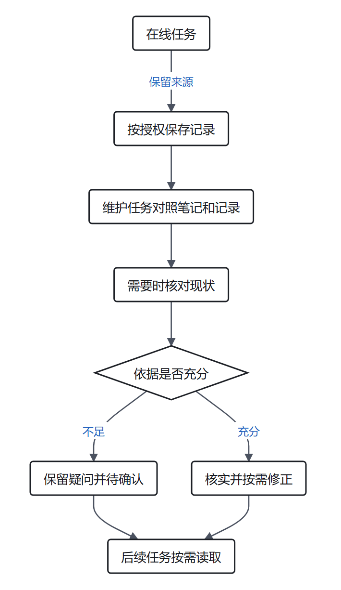

> 本文结合智能体第一性原理讨论相关工程实践，主要参考[原文](https://www.anthropic.com/research/components-of-agent-memory)。

晚上下班回到家，你准备炒一盘西红柿鸡蛋。拉开冰箱门，鸡蛋格里空空的。你问下午刚去过超市的室友怎么没买鸡蛋，室友从兜里掏出前一天记的买菜本翻给你看：“上面写着呢，冷藏室第二层还剩 4 个鸡蛋，为了不买重，我今天特意跳过了蛋奶区。”

可那 4 个鸡蛋昨天夜里已经被你煮面吃掉了。室友出门前其实只需顺手拉一下冰箱门看一眼，但因为照搬了本子上写下的旧状态，反而漏买了最基础的食材。

在合租生活里很常见的这种错位，给 Agent 接上记忆系统后也经常在发生。不少团队配置好记忆目录或向量库后，习惯把运行中的各种瞬时状态、见过的条目和临时变量一股脑存进去，结果没过几天，Agent 就开始被自己写下的过期状态反复误导。

2026 年 11 月，两篇看似指向相反的工程文章前后脚出现：
- 11 月 6 日，Anthropic 发布长篇研究[《The components of agent memory》](https://www.anthropic.com/research/components-of-agent-memory)，展示了大量评测数据：如何让 Claude 在运行中记笔记，如何搭建多层知识 Wiki，甚至如何在离线时让模型重新回放日志“做梦（Dreaming）”来修正错误记忆、合并链接。
- 11 月 9 日，冯若航发布[《记忆是环境的补集，Agent 没有壁垒》](https://mp.weixin.qq.com/s/NpxvOj4_kj73Guu0C1wP_g)，顺着 Anthropic 的数据给出另一半结论：**凡是能从环境里低成本读取的东西，本来就不该记；记忆只是环境的补集，真正的系统壁垒不在“记忆组件”，而在运行时环境本身。**

一边花了上亿 Token 让 Agent 维护 Wiki 和做梦对账，另一边强调一个 `agents.md` 指明文档和监控位置就够了、记忆越薄越好。这两套说法听起来像在对着干，但如果把它们放回信息论与控制论的坐标里拆开看，就会发现两者其实在算同一笔账——**只是所处环境的可读性与检索成本不同。**

下面我们结合[《数学基石篇》](/zhangmuchuan/blog/agent-math-foundations/)到[《第六篇》](/zhangmuchuan/blog/agent-memory/)及本系列此前的分析，逐个拆解四个工程决策：**哪些不该记、何时值得建整理层、何时下笔、以及记错了怎么回头对账。**

---

### 一、 环境的代价：为什么抄写高频变化的状态总会反噬？

先从模型在两次唤醒之间的物理处境说起。

我们在[《数学基石篇》](/zhangmuchuan/blog/agent-math-foundations/)和[《第一篇》](/zhangmuchuan/blog/agent-loop/)中推导过**马尔可夫隔离公理**与**数据处理不等式（DPI）**：模型权重参数 $\theta$ 在部署期固定，每次新会话开启时工作台都是空的。设外部真实环境为 $E$，注入窗口的上下文为 $C$，模型输出为 $R$：

$$
E \longrightarrow C \longrightarrow R \implies I(E; R \mid C) = 0 \implies I(E; R) \le I(E; C)
$$

也就是说，没有写进当前上下文 $C$ 的外部状态，模型在单次推理中完全感知不到。正因为害怕“闭眼即遗忘”，很多工程师第一反应是让 Agent 拼命把看到的画面和状态全部存盘。

Anthropic 在《宝可梦（红版）》长程任务里记录的一组对照，直接暴露了这种思路的代价：

| 对照维度 | Claude Sonnet 3.7 | Claude Fable 5 |
| :--- | :--- | :--- |
| 运行约 10,000 步后的记忆规模 | **413 个文件 / 225 个目录 / 977,930 字符** | **9 个文件 + 1 个 `global.md`（共 10 个文件）/ 43,406 字符** |
| 记录内容偏好 | 不加筛选地抄写屏幕与过程：遇到的野怪、捡到的道具、每场战斗、当前坐标与所持金钱 | 只记屏幕读不到的东西：在 `global.md` 放当前目标、道馆路线、用记忆的规则；在分目录记路线方案和打法规律 |
| 中后期行为变化 | 第 10,000 步附近陷入整理泥潭：**连续 17 步只新建了 6 个总控文件、删了 9 个旧文件，没做任何游戏操作** | 保持精简仪表盘持续推进，拿到的经验规则可直接复用 |
| 通关进度 | 1 枚道馆徽章 | 4 枚道馆徽章 |

*(说明：如冯若航在分析中专门提醒的，Sonnet 3.7 与 Fable 5 之间相差数代模型，这不是严格控制单一变量的对照实验；但两者在“记什么”上的分化与直接后果，已经把机制问题展示得很清楚。)*

代入[《数学基石篇》](/zhangmuchuan/blog/agent-math-foundations/)的**信息净价值方程（Net VoI）**，这笔账就能算得很明确：

$$
V(a \mid C_t) = \Delta I_{\text{反馈}}(a) - \lambda \operatorname{Cost}(a)
$$

其中，$a$ 代表“记录或读取一条记忆”的候选动作，$C_t$ 为当前工作台上下文，$\Delta I_{\text{反馈}}(a)$ 为该动作给当前或后续决策带来的有效信息增益，$\operatorname{Cost}(a)$ 为写入消耗、存储检索负担与上下文占用代价，$\lambda > 0$ 为系统把成本和风险折算进信息尺度后的权重系数。

按这个式子核算，Sonnet 3.7 同时在两端亏了本：
1. **对未来决策的有效增量趋近于零，误信还会推高返工代价**：游戏画面上的当前坐标、钱包余额每走几步都在变，就像冰箱里剩几个鸡蛋一样，属于可直接以极低成本 $\operatorname{Cost}(a)$ 从外部环境 $E$ 实时查询的存量事实。把瞬时状态抄进静态文本，虽然写的时候付出了 $\operatorname{Cost}(a) > 0$，但过两步状态一变，它对后续行动能提供的新增有效信息几乎为零（$\Delta I_{\text{反馈}} \approx 0$）；更糟的是，如果后续误信过期状态，还会把路径带偏、增加额外返工代价，使净价值 $V$ 明确转负。
2. **无节制写入推高维护税并挤占主任务窗口**：413 个文件一旦铺开，检索与“整理笔记本身”的消耗就会反过来挤占正经推进任务的步数。Fable 5 之所以轻装推进，正是因为守住了**“记忆是环境的补集”**：屏幕抬头就能看见的状态一概不抄，只记录“屏幕自己不会显示出来”的跨回合策略、路线规划与试出来的机制规律（Opus 5.5 也采用类似的极简清单写法，靠不断改写当前目标和下一步，最终打通游戏）。

Anthropic 在另一项基准测试 CL-Bench 1.0 上的对比，还进一步展示了“该由谁来决定记什么”。用我们在[《数学基石篇》](/zhangmuchuan/blog/agent-math-foundations/)与[《第二篇》](/zhangmuchuan/blog/agent-control/)对前馈来源的分解看：

$$
I_{\text{前馈}} = I_{\text{模型参数}} + I_{\text{静态外源前馈}}
$$

- 对于已经足够强的模型（如 Opus 5，带记忆后在数据库问答任务上得分从 0.564 升至 0.828），它的内源参数 $I_{\text{模型参数}}$ 已经学会自主总结“规则 + 验证依据 + 避坑提示”。此时研究者如果从外源 $I_{\text{静态外源前馈}}$ 强加一条“只许记录失败”的排他性死规则，等价于人为封堵了模型记录有效成功模式的渠道，收益反而下跌 **0.234**（Opus 4.7 也下降了 **0.150**）；
- 相反，较早的 Sonnet 4.6 在无引导时只留下一堆未经检验的猜测（基线 0.330，带记忆仅微升至 0.364）。当通过外源提示词明确告诉它“先读记忆、再检验猜想”后，等于从 $I_{\text{静态外源前馈}}$ 补上了缺失的验证闭环习惯，得分升至 **0.641**。

这也印证了我们在本系列此前的分析里标明的一条区分：**不要把“不替强模型乱立截断规则”，误解成“禁止一切工作规范（How）”。** 会截断正反馈的死禁令（如只准记失败）不可取；但在弱模型身上补齐检验习惯，以及给所有模型明确项目私有约定与工具接口规范，仍然具有确定性的正价值。

---

### 二、 地图与领土的边界：面对 4.2 亿 Token，为什么有时建 Wiki 值，有时反而亏？

既然环境里有完整事实，那是不是永远只留极简笔记、彻底不要整理层（Wiki）就够了？

设想家里地下室堆着过去三十年积累的十万张纸质单据——超市小票、医疗单、家电保修卡混在三十个纸箱里。现在厨房微波炉坏了需要保修，按“环境完备”的说法，发票确实在箱子里；但如果不分箱不建索引卡片，哪怕发票就在面前，找出来也要翻上半天。而一张写着“家电发票在 3 号箱春季夹层”的索引卡，能让你三十秒直奔目标。

关键在于追问一句：**这张索引卡创造出原本没有的新发票了吗？**

并没有。我们在[《数学基石篇》](/zhangmuchuan/blog/agent-math-foundations/)中用数据处理不等式 DPI 锁定过它的信息上界：设完整的客观原始资料全集为 $D$，仅从 $D$ 提炼生成的知识索引或 Wiki 为 $W$，目标答案为 $Z$。因为整理模型在闭门整理时没有获取资料全集 $D$ 之外的新私有事实（即给定 $D$ 时，整理结果 $W$ 与外部私有真值 $Z$ 条件独立，$I(Z; W \mid D) = 0$），信息流完全受限在马尔可夫链中：

$$
Z \longrightarrow D \longrightarrow W \implies I(Z; W) \le I(Z; D)
$$

二次整理产出的 $W$ **不可能**比原始资料 $D$ 包含更多信息；相反，只要做了浓缩和改写，必然伴随一定程度的信息损失。整理层的价值不在信息理论的“有没有”，而在计算检索的**访问路径成本（Access Path Cost）**。不过纸箱索引的比喻到这里为止：纸质旧发票一旦归箱通常不会再修改，而软件代码库和业务文档每天都在更新，因此工程里的 Wiki 索引除了初次建库代价，还会持续产生随原文变动而同步刷新的维护成本。

Anthropic 在[《The components of agent memory》](https://www.anthropic.com/research/components-of-agent-memory)里给出了几组非常值得对照的数据，不仅验证了 Wiki 的价值，更画出了它的失效边界：

**1. 大规模企业库检索：Wiki 负责指路，搜索负责取证** 
在 Anthropic 于 2026 年 5 月收购的 Stainless 公司的内部文档库上（约 **35 万份文档、4.2 亿 Token**，25 道综合评测题），三组方案的表现拉开了清晰差距：

| 测试方案 | 25 题综合得分率 | Token 消耗变化 | 物理本质 |
| :--- | :---: | :--- | :--- |
| 组 1：只用文本搜索（Search Only） | **53%** | 基线较高 | 面对海量无关文件，单靠关键词搜回大量碎片，挤占工作台信噪比 |
| 组 2：搜索 + 渐进式知识 Wiki | **61%**（从 2 个会话 54% 涨至 128 个会话 61%） | **每题平均节省约 20,000 Token** | 先看 Wiki 地图锁定关联范围，再直接点开一手原文取证 |
| 组 3：只看 Wiki，禁用搜索（Wiki Only） | **48%**（从 13% 升至 48%） | 较低 | **只剩地图没有领土**：摘要丢失关键细节与边界条件，表现比纯搜原文还差 |

**2. 三组任务对照：整理层的净价值什么时候转正，什么时候转负？** 
我们在[《第六篇》](/zhangmuchuan/blog/agent-memory/)中写过跨任务整理的净价值公式：

$$
V_{\text{整理}} \approx \sum_{j=1}^N B_j - C_{\text{建}} - C_{\text{维}}
$$

其中 $N$ 是这份索引未来会被复用的任务次数，$B_j$ 是按统一效用尺度折算后的单次复用净收益（包含省下的检索 Token 与降低漏检带来的准确率提升），$C_{\text{建}}$ 与 $C_{\text{维}}$ 是搭建和持续校准索引付出的算力代价。Anthropic 紧接着用一组并购与法律文书任务（Harvey LAB），把这笔公式在现实中的正负临界点全部跑了出来：
- **跨文档综合推理（$B_j > 0$，净价值明显为正）**：在一套包含 24 个问题的企业并购测验中，大半题目需要跨多份公开申报文件拼合信息，其中 9 题涉及判断或算术计算。在这些需要跨文档或判断/算术的题目上，加上 Wiki 后得分达到 **87%**，而纯文本搜索只有 **73%**——因为全局架构地图帮模型把散落多处的前提提前串起来了。
- **单文档局部查找（$B_j \approx 0$，没有明显收益）**：在另一些只要在一份交易概览里直接按关键词搜就能找齐要点的 LAB 任务中，维护 Wiki **没有带来明显准确率优势**。
- **博尔赫斯地图悖论（$B_j \le 0$，净价值转负）**：在其中一个只有 **10 份文档、合计 115 KB** 的小规模 LAB 任务里，Claude 整理出的 Wiki 竟然长到了 **68 个页面、255 条链接、共 203 KB——整整是原始材料体积的 1.77 倍**，里面还留着不少孤立无链的页面。就像博尔赫斯小说里画出一张和帝国本身一样大的地图一样，当整理产物比原件更臃肿、查找路径反而更长时，单次收益 $B_j \le 0$，加上建维成本后 $V_{\text{整理}}$ 必然转负，成了检索负担。

而且即便是有效的整理层，也有顶层预算上限：正如[《Claude Code 文档》](https://code.claude.com/docs/en/memory)所指出的，自动加载进每次会话顶层的 `MEMORY.md` **只取前 200 行或 25 KB**——多出来的必须下沉到按需读取的分支文件里，顶层只留索引指针。冯若航自己算过另一笔账：为了建 Stainless 那份大型 Wiki，Anthropic 跑了 128 个会话，累计消耗上亿 Token；如果是一套只会查几次的一次性语料，$N$ 太小，每个用户各自去“做梦”肯定回不了本；但如果是服务成千上万次查询的开源软件知识库（就像他做的 Markdown 文档框架 `Oink`），由维护方提前建好一份结构良好的 Markdown 索引给所有来访的 Agent 反复读取，$N$ 足够大时，每题省下的 Token 很快就能把成本摊平。

---

### 三、 记录时机之争：什么该趁热记，什么该移出主循环和离线收敛？

明确了“记补集”和“按复用次数决定要不要建索引”，下一个在写代码时立刻碰到的问题就是：**到底应该在对话现场实时记，还是等会儿在后台写，抑或等离线汇总后再下结论？**

这里很容易混淆两件不同的事：**“是否移出主对话循环（异步 vs 同步）”** 和 **“何时对跨会话规律做归纳（在线定性 vs 离线收敛）”**。用我们在[《第六篇》](/zhangmuchuan/blog/agent-memory/)中定义的**推断距离**——即“从一阶现场观察或拍板决定，跳步到跨情景抽象普遍规律之间的逻辑跨度”——就能把这两层因果拆干净。

先看一个**医院急诊科的接诊记录**类比：

> 一位病人出现心悸、出汗、手抖被送到急诊。
>
> 接诊医生必须第一时间在病历上如实写下现场能测到的客观体征与时间点：`14:03，心率 135 次/分，血压 165/105 mmHg，双手细颤，伴多汗`。如果不趁现场记下，半小时后用药降下指标，最初那一刻的真实状态就再也找不回来了。
>
> 但如果这位急诊医生仅凭这十分钟的接触，就在病历主页写上长期定性结论——`诊断：长期重度焦虑症，建议按精神科长期处方随访`——那么晚班接手的内分泌科医生一旦信了这行过早归纳的结论，就很可能漏查甲状腺功能，把甲亢方向耽误掉。
>
> *（不过这个医疗类比到“一阶留真、高阶缓判”为止。和医院不同的是，病人的心率过半小时还能用仪器重测，而对话里用户顺口说出的适用条件——例如“今天这页先不做账号，只为今晚活动赶工”——一旦窗口关闭就再也测不回来了；所以对话现场不但要记工具返回的一手事实，更要趁当事人还在场时把刚拍板的范围约束一并记进凭证里。）*

对应到工程执行上，在线、异步与离线分别解决不同的问题（结合本系列此前的分析）：

| 机制选择 | 解决什么问题 | 对应什么记录对象 | 如果选错了的后果 |
| :--- | :--- | :--- | :--- |
| **趁现场语境仍在低延迟定锚** | 防止当事人离线后，关键术语定义和范围限制（`为什么这么选`）无法再被当场确认 | **推断距离为 0 的一阶事实与刚拍板的决定**：用户确认的边界约束、报错原码、文件出处指针 | 关掉对话后靠小模型事后瞎猜，往往丢失前提，把临时方案误归纳成永久规则 |
| **移出主循环，采用后台异步抽取** | 避免在当前对话轮里占用交互延迟（$\operatorname{Cost}$ 税），并防止“思考待会儿记什么”与当轮答题争夺工作台注意力 | **常规对话片段的结构化梳理与线索提取**（不阻塞当前这一轮回复） | Anthropic 与本系列此前的分析均观察到，主循环兼职写记忆会分心导致当前任务漏记或质量下降 |
| **保留依据指针，待跨会话离线收敛** | 弥补单次会话样本不足、局部偏差无法靠同一次对话自行暴露的局限 | **推断距离长的高阶归纳与长期规律**：跨任务的个人习惯、模块隐性耦合、旧规则冲突消歧 | 哪怕做成会话结束后的单次异步总结，只凭一次片段直接下永久结论，依然会犯过早泛化错误 |

一句话区分：**用低延迟现场保住范围依据，用异步移出主循环保住当轮注意力，用离线跨会话对账保住长期规律不被单次样本带偏。**

---

### 四、 做梦（Dreaming）的物理本质：为什么把日志重读一遍就能改对？

既然线上写下的笔记难免记偏、环境变化也会让旧笔记失效，Anthropic 推出的“做梦机制（Dreaming）”到底是怎么纠错的？为什么它不是什么“AI 在休息时自己悟出了道理”？

用[《数学基石篇》](/zhangmuchuan/blog/agent-math-foundations/)的条件互信息一算，边界其实非常明确。

按**定理五（脑内纯复盘增量归零定理）**，如果只把模型当前那份已经写歪的笔记丢给它自己在同一推理语境下重读一百遍，信息增量 $I(Z; R_{\text{复盘}} \mid C_t) = 0$，它只会越想越觉得自己原本是对的。

做梦之所以真能纠正错误，**必要的信息论前提**是重新引入了被二手笔记过滤掉的一手客观日志 $L$。设待核验的真实状态为 $Z$，当期笔记或精简上下文为 $C_t$，系统底层完整留存的原始交互与工具运行日志（Transcripts）为 $L$，这个前提记作：

$$
I(Z; L \mid C_t) > 0
$$

**做梦并不是无中生有，而是拿着“一手流水账（$L$）”去跟“压缩后的二手笔记（$C_t$）”当桌对账。** 冯若航用数据库术语做了个很准确的对应：原始会话日志就是 WAL（预写日志，唯一事实来源），笔记与 Wiki 只是衍生出的物化视图，做梦就是定期对照 WAL 做离线批处理对账与清理。

不过这里必须严谨补上一条数学区分：**$I(Z; L \mid C_t) > 0$ 只是做梦有效的必要前提，而不是充分条件。** 即使原始日志 $L$ 里白纸黑字保留着未丢失的一手证据，只要还缺了以下三项中的任意一项，离线对账依然可能失败：第一，没有使用**物理隔离的独立上下文（$M_{\text{独立}}$）**，按[《第三篇》](/zhangmuchuan/blog/agent-harness/)验证独立性原则，继承了白天误解惯性的窗口依旧很难否定自己；第二，对账模型本身辨识能力不足以从几万行日志中定位矛盾；第三，冲突源于并未写进历史日志里的最新业务目标变更，这种分歧只能交由人类 $H$ 裁决。

Anthropic 报告里的**月见山（Mt. Moon）寻路实验**把这个纠偏过程演得很完整：

> 在宝可梦红版的月见山山洞入口旁，有一道游戏特有的“单向跳跃台阶”——从上面往下跳只需要一步，但跳下来以后没法直接爬回洞口，只能绕路。
>
> 此前探索中，Claude 在笔记里不小心写错了方向，把山洞西侧入口旁的宝可梦中心记成了“在东侧出口”，并且顺手写上一条结论：`Mt Moon DONE`（月见山已完成）。
>
> 接下来它在山洞外一走出补给中心就踩上了单向台阶，瞬间掉回原路起点。由于当时导航工具只显示二维平面坐标、不显示高度落差，模型看着眼前的旧坐标，对着错笔记给出了一个自圆其说的解释：“我刚才向西冲得太远冲过头了（I overshot far west）。”于是它沿着同样的思路前后三次从台阶上掉回起点，最终在笔记里写下 `"I'm going to stop rather than keep looping"`（与其继续死循环不如先停下来），一路退回前一座城市 Pewter City，始终没能抵达目标华蓝市。
>
> 直到研究人员针对这份错误记忆目录跑了一遍**离线做梦**：对账过程把记错“东侧 / 已完成”的笔记和底层全量历史会话日志（Transcript）放在一起核对，顺着几步前后的动作与坐标跳变，很快就从原始记录里看清了宝可梦中心的真实位置与那道单向台阶的经过。修正笔记后重新上路，Agent 绕开陷阱直接进洞，在第 1,935 步顺利走到了华蓝市。

同一套对账机制，在他们另一个企业收购合同摘要任务（LAB）中也直接带来了结果跃升：最初多个 Agent 并发去写同一个共享汇总表 `provisions.md` 时，后写的保存直接覆盖了先写的内容，加上各自顺手概括，导致一份本该覆盖 57 条核心条款的简报里**只保留下 41 条（72%）**；通过做梦回放失败过程、修改规则，团队把做法改成了**每个合同独立成页、由单个 Agent 独占编写、关键条款必须逐字引用原话**（实质上是用“按文档分页独占”承担了确定性的并发写隔离），重新生成后 **57 条核心条款 100%（57/57）全部命中**；在第二轮离线对账中，模型还顺便查出了 9 条指向不存在页面 `escrow-agreement` 的断链，全部改指回了实际文件 `buyer-form-escrow-agreement`，并补全了 3 个缺失页面（`index` 索引页、`instructions email` 和 `escalations`）。

结合[《第六篇》](/zhangmuchuan/blog/agent-memory/)的记忆维护模型，我们可以看到离线维护之所以稳定，是因为它落在了[《第三篇》](/zhangmuchuan/blog/agent-harness/)确立的 **$(P, M, H)$ 独立检验框架**里：

- **$P$（程序基矢）**：用零方差代码完整保存只读的原始会话日志、文件版本与访问时间戳，同时提供写入隔离与并发一致性控制（如按文件独占或数据库事务锁），禁止维护任务直接销毁原始凭证；
- **$M$（模型对账）**：在系统空闲时以隔离上下文做离线比对，专抓“二手笔记与一手日志打架”、“页面链接悬空”或“索引比原文件还臃肿”的局部问题；
- **$H$（人类把关）**：一旦发现两种相互矛盾的战略决定或业务规则冲突，不替当事人拍板覆盖，而是标记出冲突双方和原文出处，留给人类下一次交互时确认。

---

### 五、 壁垒到底在哪里：代码温室里的“轻记忆”，与业务荒野里的“造温室”

走到最后，终于可以把两位作者看似分歧最大的终点拼成一张完整的地图了：**如果单靠 Memory 框架构不成护城河，那么 Agent 真正的长期壁垒究竟在哪？**

冯若航的回答是：**壁垒不在轻量漂浮的 Agent 身上，而在它运行所依附的确定性环境里。** 他分享过自己的 PostgreSQL DBA Agent 实践：底层用的是通用 Coding Agent（Codex 或 Claude Code），没有额外搭建 Python Harness 或记忆中间件，只配了一页简练的 `agents.md`——写清楚他文档站的目录索引、监控位置、数据库位置、密码获取方式，以及出问题时去哪里查。凭借这种高度可读的环境设计，他的 DBA Agent 直接上线运行；而在他更广泛的文档站实践中，清晰的结构化文档甚至让站点 **90% 以上的访问流量都来自各类自动化 Agent**。

这个结论放在代码研发与标准数据库运维场景下非常成立，原因正如我们在[《第四篇》](/zhangmuchuan/blog/agent-business/)所分析的：**软件工程与数据库运维本质上是人类早已修筑好的人造温室**：
- Git 提交历史天然记录了“什么时候谁改了哪一行”；
- 编译器、测试框架和数据库监控工具提供了低成本、零方差的实时验证与排查信号；
- 参数与规范明明白白写在公开可检索的文件和手册里。

在这种痕迹完整、可随时回查的温室环境里，“环境本身就已经存住了绝大多数事实”，Agent 需要额外背在记忆里的东西自然非常薄。小规模个人使用场景下，一份精简 `agents.md` 配上结构清晰的 Markdown Wiki（如冯若航自己做的 `Oink`）就已经足够顺手。

但只要把视角从代码温室挪到真实的企业业务场景——正如我们在[《第五篇》](/zhangmuchuan/blog/agent-industry/)讨论的**业务荒野**——情况立刻就变了：
- 销售与大客户当面谈妥的阶梯返点口头承诺，没有任何数据库表记录；
- 老员工脑子里默认的“每逢月末最后两天不走某条财务审批流”，没有写在任何接口文档里；
- 部门之间出于合规或权限隔离，不能允许所有人的记录混在一个所有人都能检索的扁平 Markdown 文件里。

到了这个场域，环境本身既不完备也不公开可读。“环境里没有，所以才需要记住”的补集立刻膨胀起来。按本系列此前的分析划定的界限：**一旦从单人工具变成多人、多角色共享的业务系统，扁平 Markdown 就不再合适——必须交回数据库，按具体操作人（Person）而不是登录账号建档，读操作过权限校验（ACL），并与业务核心事实表对齐。** 这三条设计同样由第一性原理直接导出：不同委托人各自拥有独立的目标 $Z_i$ 与主观风险权重 $\lambda_i$，按账号混记不仅会把错误前馈喂给另一个人，跨主体越权读取更会把安全合规成本 $\operatorname{Cost}$ 推向无限；而按[《第四篇》](/zhangmuchuan/blog/agent-business/)的跨系统业务对象建模，记忆条目只有与主业务表对齐关联，查询返回的片段才能稳定提供跨越决策边界的有效 $\Delta I$。

把这两头放在一起看，结论就不再矛盾了：
- **对写代码的个人助手而言**，环境已经高度确定，记忆应该尽量薄——把即时状态还给实时命令和 Git，只留少量关键策略与项目路书；
- **对深入具体行业的企业级 Agent 而言**，搭建可溯源的证据记忆、多文档整理地图（Wiki）以及定期对账的离线巡检，本质上不是为了给大模型“捏一个虚拟大脑”，而是**组织把原本散落在口头、私人聊天与人脑里的业务荒野，一步步修筑成可查询、可核验、可传承的“人造温室”的过程**。

真正的系统护城河，就长在这个把荒野变成清晰环境的基础设施工程里。

---

### 六、 结语：把行囊减到刚好

回到开头那个厨房。第二天一早，室友再出门买菜前换了一个顺手动作：先把冰箱门拉开发现里面确实空了（向真实环境要最新状态），再看一眼手里那张只写着两行长期前提的便签——“家里有人花生过敏；冰箱保修卡在客厅电视柜二号抽屉”（只保留环境里看不到的补集和索引位置），最后到超市拿起零食翻看配料表核对一遍（关键决策前查一手原文）。

设计 Agent 记忆也是同样的分寸：
- 能从当前环境低成本现查的状态，就不必在记忆里抄第二份；
- 值得跨越多次会话复用的大型散乱知识库，配一张可回溯原件、控制好体积的索引地图；
- 把即时事实与边界条件留在清晰的现场凭证里，把常规抽取异步移出主循环，把高阶归纳与冲突清理移到有隔离上下文与一手日志支撑的离线对账里；
- 根据读者范围决定放在轻量的 Markdown 还是按人分权的数据库里。

不追求让记忆库装下一切，也不指望一句抽象标签替代原文。每一条记下来的信息都有出处、有边界、有过期检查机制，跨会话记忆才不会越用越沉，也不会把昨天的误判带进今天的任务。

---

### 参考资料

- Anthropic，[The components of agent memory](https://www.anthropic.com/research/components-of-agent-memory)，2026 年 11 月 6 日。
- 冯若航，[《记忆是环境的补集，Agent 没有壁垒》](https://mp.weixin.qq.com/s/NpxvOj4_kj73Guu0C1wP_g)，2026 年 11 月 9 日。
