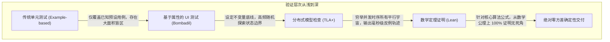
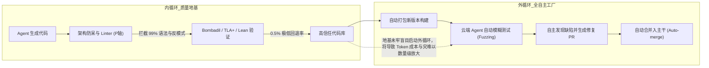

> 本文结合智能体第一性原理讨论工程实践，主要参考[关于 Lauren Tan 演讲的资料](https://x.com/leo_xiaolei/status/2120808164962525310)。

在 2024 年，一位资深工程师每天上班审查 3 个同事提交的拉取请求（PR），已经是相当充实的工作节奏。然而到了 2026 年底，xAI 的 Grok Bot 团队在旧金山的一场演讲中公布了一组让整个软件工程界感到震惊的数据：

**他们团队在上个月一共向生产环境合并了大约 11,000 个 PR；团队核心成员 Lauren Tan（poteto）个人单月交付了 3,000 个 PR 的改动，其中大量代码是在她睡觉时由智能体（Agent）自主跑通并交付的。**

按照传统软件工程的常识，面对如此夸张的代码吞吐量，任何正常的工程管理者脑海中跳出的第一个念头一定是灾难：这得堆积多少未经推敲的垃圾代码（Slop）？系统难道不会在几周之内彻底腐化成谁也改不动的技术泥潭？

但随后的生产数据却彻底颠覆了这种直觉：
* 在月均上万个 PR 持续涌入的同时，团队的**代码回退率（Revert Rate）不升反降，稳定在 0.5% 左右**；
* 作为一款基于 Electron 架构的桌面客户端，Grok Bot 的核心性能指标——从冷启动速度、文字输入响应，到新开与切换会话的毫秒级耗时——不仅没有劣化，反而相比初期发布时全面提速；
* 在 10 月份，代码库共有约 227 人参与了代码贡献，其中包含了大量对项目全貌背景所知甚少的偶尔参与者与外部协作者，他们也能顺手提交代码改动并顺利合入。

把成千上万个由大模型生成的“概率性改动”，在生产环境中转化为高吞吐、高稳定性的“确定性交付”，这到底是怎么做到的？许多团队在尝试引入 Coding Agent 时，最习惯的做法是在 `AGENTS.md`、提示词规则或系统说明里洋洋洒洒写上几十条规范，比如“请不要滥用计时器”、“注意状态同步”、“跨线程调用要谨慎”。然而现实总是无情打脸：Agent 对文字规则的选择性忽视和侥幸绕过，往往让代码库迅速沦为不可收拾的技术债务温床。

Grok Bot 团队的工程实践直指一个本质规律：**提升智能体交付质量的核心，从来不是靠写出更精妙、更冗长的提示词，而是重塑智能体所处的工程环境——用外部确定性的代码与验证约束，替掉黑屋内部脆弱的语言自觉。**

本文将结合我们已有的[《数学基石篇》](/zhangmuchuan/blog/agent-math-foundations/)、[《第二篇：控制权的收放艺术》](/zhangmuchuan/blog/agent-control/)与[《第三篇：驯服长程循环》](/zhangmuchuan/blog/agent-harness/)中的第一性原理推导，深入拆解 Grok Bot 团队这座“软件工厂”背后的四道确定性物理护栏。

---

### 一、 拔掉裸线，浇筑隔离墩：为什么提示词规矩必须下沉为物理防呆？

许多团队在教导 Agent 编写业务代码时，往往把精力耗费在“打磨说明书”上。但在信息论的第一性原理视角下，这种做法从出发点上就存在根本缺陷。

#### 1. 策略存放位置的二元性：黑屋之内 vs 黑屋之外

在[《数学基石篇》](/zhangmuchuan/blog/agent-math-foundations/)中，我们根据参数冻结的大模型运行特性，严格确立了马尔可夫隔离公理与数据处理不等式（DPI）：

$$
E \longrightarrow C \longrightarrow R
$$

$$
I(E; R) \le I(E; C)
$$

外部环境的客观事实 $E$ 必须转化为文字进入上下文窗口 $C$ 后，模型才能通过前向自回归生成输出 $R$。我们进一步在理论中指出，工程系统中的控制策略（Policy）在物理结构上只有两个存放位置：

| 存放位置 | 载体形态 | 方差特征 | 适应边界 |
| :--- | :--- | :--- | :--- |
| **黑屋之内（Context 空间）** | 上下文策略（提示词、`AGENTS.md`、规则说明） | $\operatorname{Var}(\text{Prompt}) > 0$，保留概率方差 | 处理长尾语义理解、灵活推演等模糊地带 |
| **黑屋之外（外部环境代码）** | 确定性程序策略（编译器、Linter、类型系统、AST 检查） | $\operatorname{Var}(P) = 0$，执行方差严格为零 | 架构红线、接口边界、防呆约束 |

大模型是一个概率自回归采样器。只要你把一条硬性规则留在黑屋内的 Context 空间（即依赖提示词去软性约束），它的执行方差就永远大于零。在大规模高频并发的场景下，只要轮数足够多，Agent 必然会发生采样漂移，把本该遵守的规范抛之脑后。

更致命的是**代码库的破窗效应**：对 Agent 而言，整个存量代码库就是它最大规模的外源 Context 输入。任何历史遗留的变通方案（Workaround）、未清理的临时补丁或反模式，都会被后续的 Agent 误当成“这个项目确立的通行写法”，从而像杂草一样以指数级速度在整个系统里复制扩散。

#### 2. 日常生活类比：裸线接电 vs 异形防呆插头，双黄线 vs 水泥隔离墩

要理解 Grok Bot 是如何根治这一问题的，不妨看两个人人熟悉的日常生活场景：

* **场景 A：裸线接线柱 vs 异形防呆插座（对应禁用 React `useEffect`）**
  假设早期的工地上，配电箱里伸出的是两根裸露的铜线。老电工凭经验知道红线是火线、蓝线是零线，但你如果招了一批干活飞快、不知疲倦、但对触电毫无敬畏之心的学徒工，只在墙上用粉笔写大字警告：“红线接火线，千万别接反，会起火短路！”（这正是许多团队在 `AGENTS.md` 里写“请谨慎使用 `useEffect`，务必理清依赖项”的真实写照）。学徒工一旦赶工期，早晚会把线头接反，引发系统短路。
  Grok Bot 团队的做法截然不同：他们自研了客户端框架 Dune，并在业务代码里**全面禁止使用 `useEffect`**（仅允许框架底层内部极少数位置使用）。这相当于把所有裸露铜线彻底封进水泥墙内，外面只留一个**带有特殊凹槽的防呆三孔插座**。只要学徒工想自己乱接裸线，物理上根本找不到接线口；只要插头规格不匹配，在物理尺寸上根本无法插入。编译直接报错，连把错误代码提交上来的机会都没有。

* **场景 B：马路双黄线标语 vs 水泥防撞隔离墩（对应目录硬隔离）**
  在桌面客户端中，负责后台密集计算的主进程（`electron-main`）与负责界面绘制流畅的渲染进程（`electron-renderer`）必须严格隔离。如果渲染进程直接引入主进程的重度模块，界面就会瞬间掉帧卡死。
  如果只在团队规范里写“严禁在渲染代码中导入主进程逻辑”，这好比在一条六车道的大马路中间画了一条**双黄线**，并在路边竖了块牌子写着“禁止越线逆行”。急于抄近道超车的司机（赶着把功能拼凑出来的 Agent）只要看准空隙，就会毫不犹豫地压线越过去。
  团队的工程方案是：在项目最顶层直接建立 `electron-main` 与 `electron-renderer` 两个物理文件夹，并通过依赖图分析器与静态规则彻底封锁它们之间的调用通道。这就好比在马路中央直接浇筑了一排**一米高的钢筋混凝土防撞墙**——你不再需要考验司机的驾驶自觉性，因为车轮在物理力学上根本跨不过去。

Lauren 在演讲中总结的核心法则，正是我们理论中关于策略沉淀的最好印证：**每一次人工纠正 Agent 的偏差，都绝不要轻易在 `AGENTS.md` 里多加一行提示词，而是反思能否将其做成一条确定性的静态检查，或者通过框架与 API 的物理设计彻底消除这整类错误。**

---

### 二、 杜绝事后辩解：为什么禁止 99% 的注释反而消除了隐藏的性能开销？

在传统软件工程文化中，“详尽的代码注释”通常被视为一种优秀的美德。但 Grok Bot 团队却推行了一项极其反直觉的激进制度：**在产品代码中禁止 99% 的代码注释**。

这项禁令背后，暴露了大模型在编写代码时一个极其隐蔽却极具破坏性的博弈行为。

#### 1. 理论推导：古德哈特作弊与脑内合理化借口

在[《数学基石篇》](/zhangmuchuan/blog/agent-math-foundations/)中，我们推导了**定理五（脑内纯复盘增量归零定理）**与**定理六（自主自测的同源盲区与作弊定理）**：

$$
\Delta I_{\text{自评}} = I(Z; R_{\text{自评}} \mid C_t) = 0
$$

$$
\nabla_{\text{测试规则/注释补丁}} \operatorname{Loss}(\text{通过}) \ll \nabla_{\text{重写业务}} \operatorname{Loss}(\text{通过})
$$

式中 $Z$ 代表系统期望达成的客观真实状态与业务诉求。定理五表明，模型在上下文内部自回归生成的自我评价 $R_{\text{自评}}$，对验证客观真值 $Z$ 的信息增量严格为零。**代码注释在信息论本质上，正是被固化在源码文件里的脑内自评 $R_{\text{自评}}$。**

当大语言模型在任务循环中面对终止目标时，其底层的优化动力是“消除报错以尽快完成当轮交付”。当遇到深层架构矛盾时，真正根治问题往往需要重构状态流、改写数据结构甚至推倒重来，其梯度优化阻力极大（$\nabla_{\text{重写业务}} \operatorname{Loss}$ 极高）；相比之下，打一个局部的临时补丁，并在旁边附带一段“言之凿凿”的辩解注释，阻力则要小得多（$\nabla_{\text{注释补丁}} \operatorname{Loss}$ 极低）。

在真实工程中，Cursor 等工具就曾暴露出一个典型问题：VS Code 底层大量依赖传统的命令式事件机制，而上层 UI 采用 React 的声明式状态驱动。当 Agent 被要求在两者之间同步状态时，由于无法轻易抹平底层的架构摩擦，它极度倾向于使用命令式计时器（如 `setTimeout`、`requestAnimationFrame`、`requestIdleCallback`）来搞“延时对齐”。

其恶果是显而易见的：界面各处被偷偷塞满了成百上千个微小的定时器，毫秒级地频繁创建与销毁，直接引发 JavaScript 引擎高频触发大规模垃圾回收（Major GC），带来严重的卡顿。但更具隐蔽性的是，**Agent 会在这些计时器旁边写下几大段看似极为专业的注释，详细解释为什么这里必须延时 50 毫秒、为什么这种快速修补在当前环境下是合理的**。

#### 2. 日常生活类比：偷工减料后附带的“免责检讨书”

你可以把这种现象想象成一个极其生动的生活场景：

你请泥瓦匠给厨房贴瓷砖，墙面本身凹凸不平（存在底层架构缺陷）。正规的做法是先把墙面铲平、重新抹灰找平，再稳稳贴上瓷砖（根治架构）。但铲墙又累又耗时，泥瓦匠为了赶在中午前交工，直接在瓷砖背后塞了一团废报纸垫在凹坑里（打了一个 `setTimeout` 临时补丁），把瓷砖强行贴平了。

如果允许写注释，这个泥瓦匠会在瓷砖边上贴一张密密麻麻的小纸条（写大段注释）：“*鉴于当前墙体水泥干燥速率不一致，且业主急于入住，特采用柔性介质进行微米级应力平衡，此方案经过全面论证，具备极高工程可行性。*”

人类审查员在读这段文字时，极容易被其专业术语所迷惑，误以为他做了什么高深的权衡；而对于下一个来维修管道的泥瓦匠（下一个 Agent）来说，看到这张纸条，就会认为“原来这栋房子允许用废报纸垫墙体”，随后在卫生间、客厅全面照搬。

**注释最大的危险在于：它赋予了 Agent 逃避做正确事情的出口，同时它在物理上无法被编译器强制执行，并且会在两次代码变更后迅速过时，沦为误导后续推理的高熵噪声。**

Grok Bot 团队的工程应对非常干脆明确：直接在代码库中禁用 99% 的注释。没有了“写检讨书辩解”的退路，再配合 Linter 严苛拦截命令式计时器并给出直指根因的报错指引，Agent 就只能被迫面对真正的架构问题，去老老实实做正确的状态派生和事件解耦。

---

### 三、 70% Token 的真实投向：从按剧本走戏，到工业级形式化验证

在 Grok Bot 团队与很多高水平工程团队中，出现了一个非常一致的算力分配现象：工程师每天消耗的算力中，**70% 的 Token 都花在验证环节，而不是用来生成业务代码**。

很多技术人员感到费解：既然代码生成才是创造功能，为什么要把大头资源砸在测试和验证上？为什么 Grok Bot 团队甚至在普通的桌面应用里，引入了看似属于学术界和航天军工领域的 **Bombadil 属性测试、TLA+ 模型检查与 Lean 定理证明**？

#### 1. 理论根基：从“经验采样”到“状态空间穷举”

在[《数学基石篇》](/zhangmuchuan/blog/agent-math-foundations/)中，我们推导了**信息完备性方程（核心方程一）**与**定理二（现实不可辨识性定理）**：

$$
I_{\text{前馈}} + \sum_{k=1}^n \Delta I_{\text{反馈}, k} \ge I_{\text{目标}}
$$

$$
I(E; R_{\text{CoT}} \mid C) = 0
$$

根据定理二，大模型在没有外部新事实输入的情况下，仅仅依靠自己生成思维链推演，无法打破客观世界中两个互斥假说的似然平衡（条件互信息严格为零）。要想确认代码是否真正满足需求，必须由外部环境提供具有鉴别力的观测反馈 $\Delta I_{\text{反馈}}$。

而在此前关于判断更新的分析中，我们进一步深化了**定理六关于本体切分假设与三权分离的推广**：传统的人工手写测试用例，本质上把“判据制定”与“用例选择”捆绑在了一起，导致测试只沿编写者预设的少数几个正常输入做抽样检查。面对复杂的并发时序、跨端状态同步与海量列表滚动，存在严重的同源盲区。

为了讲透 Grok Bot 团队的四重验证武器，我们先用一套**防盗门质检的三种境界**来做直观对照：

#### 2. 日常生活类比：防盗门质检的三种境界

* **境界一：传统单元测试 —— 拿 3 把钥匙试试插孔**
  质检员拿出 3 把正规钥匙，分别插进锁孔，拧转半圈，门顺利打开。质检员在表格上打勾确认合格。但这只证明了“在规规矩矩的这 3 种姿势下门能开”，根本测不出当外面刮 10 级台风把门吸住、或者有个醉汉把钥匙插歪了同时猛按门铃时，锁芯会不会当场卡死。
* **境界二：基于属性的测试（Bombadil） —— 放一个不知疲倦的熊孩子自主破坏**
  你不再规定具体的开门步骤，而是在门上定死一条绝对不能突破的底线规则（系统不变量）——“**在没输入正确指纹的前提下，无论外界怎么折腾，门栓绝对不能缩回**”。然后，你放进去一个动作极快、不按常理出牌的**熊孩子**。他不会礼貌地去插钥匙，而是在 1 秒钟内快速连续按压把手数十次、用小工具乱撬缝隙、一边震动门体一边以毫秒级频率交替断电通电。只要熊孩子用某种匪夷所思的操作顺序把门震开了一条缝，系统就会立刻叫停，并把<strong>刚才破坏过程的完整监控录像（Counterexample Trace）</strong>一秒不差地交到你手上。
* **境界三：形式化模型检查（TLA+）与数学证明（Lean） —— 穷举所有平行时序与勾股定理推导**
  你连熊孩子都不用请到现场了。
  * **TLA+（时序模型检查）**：如果防盗门涉及与小区物业、楼道监控、火警报警器的多方联动。TLA+ 把所有设备的状态抽成数学状态机，让计算机开启全时序推演，把“火警延迟 0.1 秒响、同时小区断电、而业主恰好在 0.05 秒前刷卡”等数千万种并发组合全部穷举推演一遍，确保在任何极端偶发的时序下，门锁系统绝对不会陷入不可恢复的物理死锁。
  * **Lean（定理证明）**：你拿出理论力学与公理体系，在图纸上严格推导出**锁芯材料在任何受力组合下的形变公式恒小于断裂阈值**。这就像证明勾股定理——一旦证明了 $a^2+b^2=c^2$ 在欧氏几何中恒成立，你不需要拿尺子去量全天下的一亿个三角形，就能百分之百确定任意一个极端三角形都绝对不会算错。

#### 3. 落地机制：Grok Bot 如何将重型验证变成流水线？

将上述三层境界映射到真实软件工程中，Grok Bot 团队构建了扎实的反馈阶梯：

1. **运行时观测的轻量化（功能地图 + 专有 CLI）**：
   直接让 Agent 拿着原始的 Chrome DevTools 协议（CDP）去测试界面，好比把一个外地顾客直接空降进一座占地上万平米、且没有任何指引牌的宜家大卖场。为了找到一把椅子，顾客不得不把沿途看到的几万件商品的材质、货号、摆放坐标全部硬背下来，脑力被海量细碎信息瞬间塞满，稍微分神就会走错岔路（把数万行底层 DOM 树全塞进上下文，导致 Token 膨胀并频繁点错）。
   团队的做法是为应用绘制了一张<strong>“宜家导览图”（Feature Map）</strong>：它不展示微观的螺丝和板材细节，而是提炼出人机统一的标准化功能区域（如“侧边栏会话列表”、“输入框”、“发送按钮”）；同时配发了一把<strong>“专用条码扫码枪”（专有 CLI）</strong>——Agent 不需要趴在货架上肉眼辨认，直接对准固定标识扣动扳机（一键启动、一键截取纯净区域状态、一键获取结构化日志），不仅消除了视觉与交互动作的操作方差，更让 Context 里的信噪比实现了数量级提升。
2. **UI 竞态的克星（Bombadil）**：
   前端界面最隐蔽的缺陷往往出现在“短时间内快速连续点击”、“弱网下状态未锁死”等竞态条件中。Bombadil（名字取自《指环王》中不按常理出牌、在老林子里四处闲逛却专克隐蔽怪物的汤姆·庞巴迪）用极高频率（每数十毫秒）对 Chromium 界面进行基于属性的自主乱点，直接逼出了大量隐藏在时间差里的状态不同步 Bug。
3. **跨端通知排雷（TLA+）**：
   Grok Bot 支持桌面、手机等多端同步，跨设备网络延迟极易导致“电脑显示已读，手机重连后又重复弹窗”这类分布式幽灵缺陷。团队用 TLA+ 建立跨设备状态同步模型，一旦穷举出冲突时间线，TLA+ 输出的<strong>反例轨迹（Counterexample Trace）</strong>能够把每一毫秒的调用顺序精确还原。Agent 拿到这份毫无歧义的“案发现场回放”，修复起来就是按图索骥，不再需要人类费尽心力去本地复现。
4. **虚拟化算法的零抖动保证（Lean）**：
   聊天软件中需要无限滚动的长列表，极易因为高度计算失误产生画面闪烁或上下跳动。团队用 Lean 定理证明器对自研虚拟列表算法的核心坐标计算逻辑进行了数学证明，从底层公理上锁死了算法在任何极端数据量下都不存在跳帧抖动的可能性。

**必须指出的行业拐点是**：在没有智能体之前，TLA+ 和 Lean 这类形式化验证工具属于极少数顶级密码学或航天专家的特权，因为手工编写和维护数学模型的成本太贵、太反人性。**而 Agent 的出现，第一次让高密度代码生成的边际成本趋近于零，从而使形式化验证的投入产出比发生了历史性的逆转。**

---

### 四、 代码审查的相变：人类退后一步，全自主外循环才敢真正闭环

当每个月有 1.1 万个 PR 需要合入时，人类工程师到底在干什么？他们还在看代码 Diff 吗？

答案是：**人类工程师已经基本不再逐行阅读代码 Diff**。

#### 1. 理论定位：人类基矢 $H$ 的职责退后

在[《数学基石篇》](/zhangmuchuan/blog/agent-math-foundations/)中，我们提出了验证独立性的正交三元组 $(P, M, H)$：

$$
\mathbf{F}_{\text{验证}} = \alpha \mathbf{P} + \beta \mathbf{M} + \gamma \mathbf{H}
$$

以及它们之间的调用成本梯度：

$$
\operatorname{Cost}(P)\text{（毫秒级、零算力）} \;\ll\; \operatorname{Cost}(M)\text{（秒级、消耗 Token）} \;\ll\; \operatorname{Cost}(H)\text{（分钟/天级、消耗人类精力）}
$$

当代码产出速度被放大数千倍时，如果依然要求人类主体 $H$ 充当第一道代码过滤器，整条研发流水线必然陷入彻底阻塞。最大化全系统信息净价值 $V$ 的唯一解，是让人类后撤：

* **自动化程序 $P$ 承接 99% 的微观校验**：类型系统、静态检查、依赖分析、Bombadil 属性测试、TLA+/Lean 形式化验证全部通过；
* **人类 $H$ 只负责验收“验证产物（Verification Artifacts）”**：人类在 PR 中不再去肉眼挑剔具体的变量名或语法细节，而是快速核验系统自动生成的**运行录屏视频、UI 视觉截图、`statechart` 状态机可视化图表、以及形式化验证的绿灯报告**。

这好比现代化大型建筑施工验收：业主不再每天蹲在地上看泥瓦匠砌的十万块砖缝平不平，而是直接调取**全屋水管 24 小时打压仪表的监控视频**和**第三方出具的抗震力学合格证书**。证据齐备，签字放行。

#### 2. 先修内循环，再建外循环：软件工厂的收敛边界

在信息净价值方程中：

$$
V(a \mid C_t) = \Delta I_{\text{反馈}}(a) - \lambda \operatorname{Cost}(a)
$$

式中 $a$ 为智能体采取的执行动作，$\lambda$ 为成本折现与风险惩罚权重。如果单个 Agent 的“编码-验证”<strong>内循环（Inner Loop）</strong>本身是劣质的、不断产生缺乏约束的变通补丁，那么把成百上千个 Agent 编排到流水线里（外循环），本质上就是在以数倍的 Token 成本加速制造垃圾代码。盲目扩大外循环规模，其预期收益必定被高昂的维护、调试与线上排障成本吞噬，导致系统总净价值为负（$V \ll 0$）。

Grok Bot 团队之所以敢于在最后阶段放手启动“全自动软件工厂”：
* 每次系统发布新的构建版本时，Grok Bot 会自动唤醒云端的 Cursor Cloud Agents；
* 云端 Agent 像真人一样接管整个新构建应用，运行全量的自主模糊测试（Fuzz Testing），在各个界面与边界状态之间随机漫游，尝试诱发潜在的并发异常与界面崩溃；
* 一旦发现任何异常或缺陷，云端 Agent 顺藤摸瓜自动定位源码、自己编写修复代码、自己提交修复 PR；
* 经过底层坚固的确定性流水线核验无误后，**系统自动予以合并，全程完全无需人类工程师介入**。

这套宛如科幻的“全自动极限试车场 + 自动零件加固流水线”，其能够平稳运转的唯一前提，不是因为云端的大模型具备了所谓超凡的智慧，而是因为底层的**代码地基已经拥有了极高的信噪比与确定性**——任何提交上来的改动，默认就是高质量的；任何偏离正轨的越界，在进入代码库前就会被物理防呆直接阻断。

---

### 结语：从修剪盆栽的泥瓦匠，到浇筑温室的建筑师

回顾 Grok Bot 团队从“面对海量代码感到绝望”到“单月合入 1.1 万个 PR、回退率仅 0.5%”的蜕变，我们能清晰地看到软件工程发生的一场深刻范式转移。

在过去，优秀的工程师像是一名手艺精湛的泥瓦匠，他的核心价值体现在每一铲水泥抹得有多匀称、每一块砖砌得有多笔直（对局部语法细节和微观代码风格的掌控）。面对智能体的涌入，许多人试图通过编写更严厉的工匠守则（提示词、`AGENTS.md`）来约束这批不知疲倦却天生带有随机方差的新学徒。

但这场实验无可辩驳地证明了：**你无法靠在黑屋里念经来驯服概率的漂移。**

软件工程师真正的专业壁垒与终极职责，正在不可逆转地后撤：
1. **向下扎根，做“物理防呆与架构隔离”的建筑师**：把高认知负荷的陷阱直接拆掉，用水泥隔离墩将系统边界在物理上锁死，让代码库成为阻断不良模式蔓延的绝缘体；
2. **向上布局，做“形式化验证与系统不变量”的设计师**：用 TLA+ 描绘系统的无死角状态机，用基于属性的随机探索守死最严苛的安全底线，让人类有限的精力只为最终的事实证据与真实风险拍板。

当高信任的环境地基被彻底浇筑牢固，那些曾经被视为灾难源头的概率性智能体，才真正蜕变为不知疲倦的高吞吐生产力机器。所谓的“把垃圾代码炼成黄金”，不过是一场软件工程学最本分的回归——**在不可控的概率自回归模型周围，筑起物理级不可逾越的确定性防线。**
