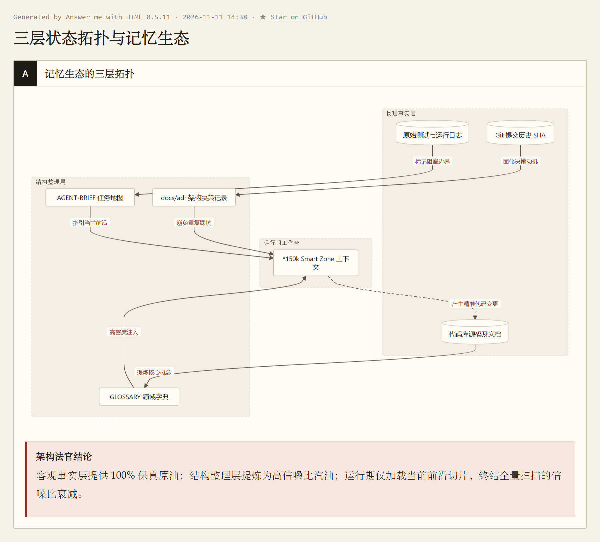
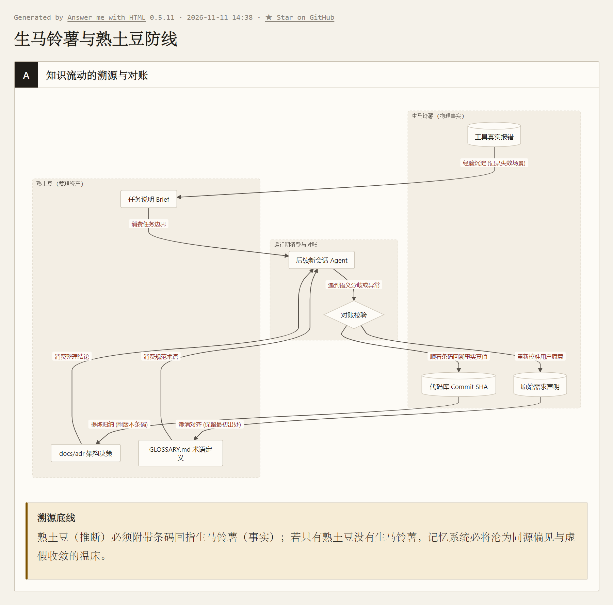

> 本文结合智能体第一性原理，解构 Matt Pocock 的 Skills 实践；主要参考 [AI Skills with Matt Pocock 播客](https://www.youtube.com/watch?v=4DhcSPkEbwI)及 [Skills 项目（本文所用版本）](https://github.com/mattpocock/skills/tree/4ae2317ddb22b046e26455e4f9c9b3aaaf62212d)。

---

### 引言：《记忆碎片》式工坊与解剖台上的工程标本

在克里斯托弗·诺兰的经典悬疑电影《记忆碎片》（*Memento*）中，男主角 Leonard 患有严重的顺行性遗忘症：他的长期记忆永远停留在过去，任何新发生的经历都无法在大脑中留存超过几分钟。
每天清晨醒来，他不记得昨天查到了什么线索，不记得谁是可以信任的盟友，甚至不记得自己身处何方。
为了在这片记忆废墟中追凶，他被迫建立了一套极其冷酷的生存工程：把终极目标用刺青刻在皮肉上，把关键人物与地点拍成带注释的宝丽来相片，把未竟的线索整齐塞在风衣口袋里。

大语言模型驱动的 Coding Agent，在底层物理世界中与 Leonard 遭遇了**完全同构的顺行性遗忘**：

我们在《第一篇》与《第六篇》中反复论证过：大语言模型本质是一个参数冻结的确定性计算核心。单次任务结束、连接关闭、显存瞬间释放，上下文窗口（Context）工作台彻底抹平。
**无论前一天你和它把系统架构推演得多么精妙，当下一次会话启动时，它面对的依然是一张没有任何昨天记忆的纯白稿纸。**

面对这种天然的健忘，工程界最常见的应激反应是：“把昨天的历史全塞进系统提示词，或者挂一个向量数据库无脑召回！”
然而，这种做法会瞬间撞上一道冷酷的物理高墙——**150k Token 智能区（Smart Zone）定律**：
无论模型对外宣称自己的上下文窗口是 100 万还是 200 万 Token，其最高水准的推理与决策“智能区”，在物理上往往被局限在最初的 150k Token 以内。超过这个阈值，塞入 Context 的每一个 Token 都在大声争夺自注意力权重；上下文残骸越多，核心指令的信噪比衰减越严重。

```
Context 窗口规模：
[  0k ~ 150k  ] ───> 【黄金智能区 (Smart Zone)】：信噪比高，逻辑推演锋利，严格遵循指令
[ 150k ~ 1000k ] ───> 【注意力衰减区 (Dumb Zone)】：Token 争夺权重，幻觉丛生，上下文残骸严重
```

真实的大型软件重构往往跨越数天、消耗数百万 Token，在物理上绝不可能塞进单一窗口。
前 Vercel 开发者、TypeScript 领域知名技术人 Matt Pocock，在其斩获超 30 万 Star 的开源 [Skills 库](https://github.com/mattpocock/skills/blob/4ae2317ddb22b046e26455e4f9c9b3aaaf62212d/README.md) 中，给出了一个极具工业体感的定性：
> **“我们是在进行《记忆碎片》式开发（Memento-driven Development）。正因为 Agent 每天早晨醒来都会彻底失忆，我们才必须将代码库优化成对一个完全失忆的新人极端友好的工坊。”**

今天，我们将这个在开源社区引发广泛讨论的现象级标本按上解剖台。
抛开大咖光环与社区狂热，我们只用一把手术刀剖开它的肌理——**智能体第一性力学**（信息完备性方程、DPI、阶段切分与整理层理论）：
为什么他的初始化技能极其克制地只立三根路标？为什么他强推“禁止引用行号与路径”的耐用性契约？而在这些精妙设计的阴影之下，他又做出了哪些不可忽视的工程妥协？

---

### 一、 为什么第 0 步只能立三根路标？—— 从信息完备性方程推导元指针（Meta-pointers）

任何 Agent 架构在面对一个全新的工程仓库时，第一道无法逾越的物理审判，就是**信息完备性方程**：

$$
I_{\text{初始前馈}} + \sum_{k=1}^n \Delta I_{\text{反馈}, k} \ge I_{\text{目标}}
$$


系统要可靠达成目标，必须保证前馈与各步反馈之和覆盖目标信息量。但在长程开发第 0 步，架构师面临着一个致命的物理两难：
* **前馈暴食症（打爆 150k 智能区）**：在第 0 步把几千行项目架构、历史讨论和规范全塞进启动前馈，看似 $I_{\text{初始前馈}}$ 充沛，实则瞬间用工业废水淹没 150k 黄金智能区，让模型在第 1 步就因注意力稀释而变钝；
* **前馈贫血症（零感知裸跑必踩雷）**：若为了省 Token 什么都不给，面对拥有私有规则的代码库，环境无法凭空提供信息（$\sum \Delta I_{\text{环境}} = 0$），Agent 迈出第一步就会撞墙。

市面上诸如 GSD（Get Shit Done）、BMAD、Spec-Kit 等重型框架，试图通过在项目里植入层层嵌套的模板、预设死板的流水线接管一切流程。Matt Pocock 在其项目说明 [`README.md`](https://github.com/mattpocock/skills/blob/4ae2317ddb22b046e26455e4f9c9b3aaaf62212d/README.md) 中敏锐地指出了这种病态：
> *“Approaches like GSD, BMAD, and Spec-Kit try to help by owning the process. But while doing so, they take away your control and make bugs in the process hard to resolve.”*
> （那些试图‘接管流程’的方法剥夺了开发者的控制权；一旦流程卡死或走偏，在重重黑盒之下极难调试。）

这种做法本质上是患了“前馈暴食症”——在第 0 步就塞满流程黑盒，让工作台彻底丧失了信噪比。

**打破这一悖论的唯一物理收敛态，是“元指针（Meta-pointers）”**：
初始前馈（$I_{\text{初始前馈}}$）必须被极限压缩到 50 个 Token 以内，它不包含任何具体的业务细节，只保留**指向环境存量事实（$\Delta I_{\text{存量}}$）的物理寻路入口**。

这正是 Matt Pocock 的工程初始化技能 [`setup-matt-pocock-skills`](https://github.com/mattpocock/skills/blob/4ae2317ddb22b046e26455e4f9c9b3aaaf62212d/skills/engineering/setup-matt-pocock-skills/SKILL.md) 最令人惊叹的克制之处。他在项目的 `CLAUDE.md` 或 `AGENTS.md` 顶层，仅仅悬挂了三根极轻量的物理指针：

```markdown
## Agent skills

### Issue tracker
[简要说明任务在何处跟踪]. See `docs/agents/issue-tracker.md`.

### Triage labels
[简要说明标签词汇映射]. See `docs/agents/triage-labels.md`.

### Domain docs
[简要说明单上下文或多上下文布局]. See `docs/agents/domain.md`.
```

这三根指针分别指向三个极简的 Markdown 契约文件：
1. **`docs/agents/issue-tracker.md`（任务追踪器指针）**：告诉失忆者“去哪里看领土上未竟的任务与 Bug”，锚定调用 `gh` CLI 还是读取本地 `.scratch/` 目录；
2. **`docs/agents/triage-labels.md`（分流标签词汇表）**：约定跨任务流转的状态信号，完成外部状态到标准角色的映射；
3. **`docs/agents/domain.md`（领域文档布局）**：约定术语表（`GLOSSARY.md`）与架构决策（`docs/adr/`）放在哪里，规定如何对齐概念边界。

仔细审视这三根指针，它们绝非 Matt Pocock 拍脑袋发明的经验脚手架，而是我们在《第六篇》推导出的**“五类无法廉价恢复的终极前馈”在软件代码库中的最小正交基矢投影**：
* **元指针自身** ──► 兑现第 5 类前馈【去哪里找（地图索引而非领土内容）】；
* **Issue Tracker 与 Triage Labels** ──► 承载第 4 类前馈【还有什么没做完（前瞻承诺与未竟状态）】；
* **Domain Docs 中的 Glossary 与 ADR** ──► 分别锁死第 1 类【为谁做（通用语言共同基础）】与第 2 类【为什么（决策理由与被否决方案）】。

将五类前馈的索引收敛为三根物理指针，后续的专业技能（`triage`、`to-spec`、`domain-modeling`）全部是这三根元指针的消费端。
新会话启动时，工作台如手术室般清洁；只有当具体任务被触发时，Agent 才顺着指针精准换入（Paging）对应片区。
**这好比失忆特工 Leonard 绝不在自己身上抄录整部刑法，他只在胸口刺上一行：“追查真相，去储物柜 42 号取档案”。**



---

### 二、 Issue 看板与未竟状态的领土持久化 —— 为什么代码自身说不清“还差什么”？

我们在《第六篇》中剖析过未来决策真正需要、而未来环境又无法廉价恢复的五类终极内容，其中极其关键的一类是：**“还有什么没做完（前瞻承诺与未竟状态）”**。

代码库本身的源码和 Git 提交历史，是客观世界的**既成领土**。
根据数据处理不等式（DPI），代码能忠实地反映系统“当前由什么构成”，却**在物理上完全无法表达“负空间”——系统缺失了什么功能？用户昨天遭遇了什么隐蔽闪退？管理层否决了哪种架构取向？**
这些关于未竟目标的信息，一旦脱离会话窗口，就会随着显存清空而彻底湮灭。

Matt Pocock 体系强制要求在第 0 步确定 Issue Tracker，其力学本质在于：**把动态的工作状态从易失的内源记忆中彻底剥离，持久化在外部物理看板上。**

但随之而来的工程死穴是：
如果一个生产 Bug 已经在 GitHub Issue 下讨论了 40 多条评论，夹杂着提报者的情绪宣泄、初期的错误假设、过期的调试日志和被否决的方案。第二天，一位全新的失忆 Agent 走进工坊，它该如何阅读这条 Issue？

若放任新 Agent 把这 40 条杂乱评论全量灌入窗口，它不仅要交出沉重的 Token 费用，而且根据我们论证过的**“证据身份抹平”**定律：模型极易把讨论初期人类试探性的错误猜测误认作客观事实，从而在错误的前提下重蹈覆辙。
为此，必须引入一道强有力的工程转译工序——**编写 Agent Brief**。

---

### 三、 Agent Brief：承接“白班与夜班”的耐用性契约

在工业化开发中，人机协同存在着一种经典的异步节奏——**白班与夜班（Day Shift and Night Shift）**：
* **白班（高频人机对齐）**：人类工程师坐在屏幕前，与 Agent 展开高频交互，调查项目现状，消除歧义，把模糊的目标锤炼成确定性的施工图纸；
* **夜班（AFK 无人值守执行）**：人类离开键盘（Away From Keyboard）。调度器启动一个干净隔离的子窗口，让实施 Agent 独自翻阅代码、修改并运行测试，直到早晨交差。

连接白班与夜班的桥梁，就是由 `triage` 技能输出的标准化契约——**Agent Brief**。

#### 1. 阶段切分的工程实战落地

回顾我们在《数学基石篇》与《第一篇》确立的**阶段切分方程**：

$$
I_{\text{实施前馈}} = I_{\text{初始前馈}} + \sum_{k=1}^\tau \Delta I_{\text{准备阶段}, k}
$$


白班的调查与盘问，本质上是一个前置的 Agent Loop，其产出的有效信息增量 $\sum \Delta I_{\text{准备阶段}}$，在实施阶段启动的瞬间，转化为实施者的**初始前馈（$I_{\text{实施前馈}}$）**。

让我们还原一个端到端的真实工序：
* **原始输入（模糊与噪音）**：GitHub Issue #108 仅有一行抱怨：“*手机上看长公式右边被切了，根本看不了，排版很烂！*”；
* **白班盘问与复现（Triage 操作）**：维护者执行 `/triage 108`。Agent 启动无头浏览器视口模拟，在 375px 宽度下确认了公式被硬截断；随后当场向人类发起盘问：“*是否连同代码块（Code Fence）一起支持横向滚动？*”人类明确界定：“*代码块不要动，这次只修公式容器*”。
方案瞬间收敛，Agent 当场在 Issue #108 下方生成并追加了一条结构化的 Markdown 评论，贴上免责声明 `> *This was generated by AI during triage.*`，并打上 `ready-for-agent` 标签。

#### 2. Agent Brief 的设计铁律：耐用性压倒精确度（Durability over Precision）

仔细研读 Matt 编写的 [`AGENT-BRIEF.md`](https://github.com/mattpocock/skills/blob/4ae2317ddb22b046e26455e4f9c9b3aaaf62212d/skills/engineering/triage/AGENT-BRIEF.md) 规范，里面包含了一条反直觉的工程硬指标：
> **“Durability over precision: The issue may sit in `ready-for-agent` for days or weeks. The codebase will change in the meantime. Don't reference file paths; don't reference line numbers.”**
> （耐用性重于精确度：这条 Issue 可能会在看板里静置数天甚至数周。在此期间，代码库随时会被其他提交重构。**绝不要在 Brief 里引用具体的文件路径，绝不要引用具体的代码行号！**）

许多平庸的辅助工具，喜欢让 AI 写下保姆式的说明：“*请打开 `src/render/math.ts` 的第 142 行加一个 `if`*”。
这种指令看似精确，实则极度脆弱。只要一次重命名或代码格式化，行号偏移，说明书瞬间沦为致幻毒药。
**Agent Brief 追求的是行为性契约（Behavioral Contract），而非过程性琐碎指令。**

看一份严格遵循该规范、剔除了具体路径与行号的真实契约切面：

```markdown
> *This was generated by AI during triage.*

## Agent Brief: 移动端公式溢出截断修复
**Current vs Desired:** 视口 < 480px 时长公式被硬截断；需在保持桌面端渲染不变的前提下，为移动端容器注入 `overflow-x: auto` 水平滑动支持。
**Key interfaces (No paths/lines):**
- 文章正文渲染的公式容器组件（聚焦 CSS 容器与媒体查询断点）
**Acceptance criteria:**
- [ ] 375px 模拟视口下超出宽度的公式呈现水平滚动条，内容可完整滑动
- [ ] 桌面端（视口 > 768px）原有渲染样式与段落行高严格保持像素级不变
- [ ] 自动化测试套件通过，无新增控制台警告
**Out of scope (Negative space):**
- 严禁重构文章排版引擎底层解析器；暂不处理 Code Fence 代码块溢出
```

* **下游消费与执行闭环（Downstream Consumption）**：
  夜班实施 Agent 启动后，拉取到该 Brief。由于 Brief 严禁硬编码路径，实施 Agent 依据 **Key interfaces** 提供的语义关键词（`formula-container`、`katex`），在仓库中发起受控语义定位，命中对应样式；随后严格按照 **Acceptance criteria** 编写针对 375px 视口的样式回归测试，添加 `overflow-x: auto`；测试全绿后发起 PR，完成无人值守闭环。

#### 3. 法官审判：耐用性契约背后的物理代价与工程妥协

站在第一性原理的裁判席上审视，任何工程设计都是约束下的折现，Matt 的“耐用性压倒精确度”绝非免费午餐：

1. **搜索税与污染税的代际转移**：
   Brief 中剥夺了具体文件路径与行号，固然换来了抗代码变迁的耐用性；但在数十万行的大型老旧代码库中，这等于**把定位成本强行甩给了夜班实施 Agent**。
   实施 Agent 在第 0 步必须花费多轮 `grep` 与文件遍历去寻找“负责渲染公式的容器组件”，被迫向 Context 注入数千行探索残骸。
   Matt 这一设计之所以能跑通，完全建立在其倡导的**“深模块（Deep Modules）”**前置假设上——接口语义收敛、抽象名字全库唯一。一旦遇到浅模块横行、重名满天飞的平庸工程，这项禁令就会直接引爆实施期的探索算力税；
2. **交接损耗与“生熟土豆”的对账设计**：
   根据我们在《数学基石篇》立下的定律，阶段切分方程在跨会话交接时必然面临**信息有损压缩**。文字 Brief 再精炼，也无法 100% 还原白班讨论中的微妙语境。
   如果工程走入极端，两头都是死路：
   * **全留带泥生土豆**：逼夜班 Agent 全量阅读 40 条原始评论，它立刻会在早期错误猜测和争吵的泥浆里严重噎死（Token 暴击与注意力污染）；
   * **另建新 Issue 只留炒好的土豆丝**：一旦白班 Agent 在提炼 Brief 时产生了自作聪明的幻觉或漏掉了致命边界，实施者就彻底失去了上下文，错误被永久闭环锁死！

   Matt 最老辣的工程设计，在于**“将 Brief 作为追加评论贴在原 Issue 之后，坚决不另起炉灶”**——这在物理上直接印证了我们在《第六篇》提出的经典记忆结构：
   **在案头递上一盘方便快速下咽的熟菜（结构化的 Agent Brief 契约），但在盘底牢牢保留着那一块带泥的原装生土豆（原始 40 条讨论与报错现场）。下游 Agent 优先享用熟菜；一旦察觉味道不对，随时能伸手抓起泥土豆下潜对账！**



---

### 四、 Triage Labels 状态机：用最小比特撬动信息路由与软门禁

如果一个工坊积累了上百条 Issue，失忆 Agent 启动后难道要把每条 Issue 全读一遍来挑选任务吗？
回到我们在《数学基石篇》与《第六篇》确立的核心方程——**信息净价值方程（VoI Equation）**：

$$
V(a \mid C_t) = \Delta I_{\text{反馈}}(a) - \lambda \operatorname{Cost}(a)
$$


* **若无标签、全量拉取 Issue**：模型遍历上百条 Issue，绝大多数讨论对于当前待办目标而言有效增量为零（$\Delta I \to 0$），却向 Context 倾倒数万 Token 闲聊残骸，支付巨大的注意力稀释成本（$\operatorname{Cost} \gg 0$），导致信息净价值严重倒挂（$V \ll 0$）；
* **引入离散状态标签**：一枚离散标签的信息熵极低，后续实施 Agent 仅需执行一条 `gh issue list --label ready-for-agent` 命令，就把无关任务的检索成本挡在黑屋之外（$\operatorname{Cost} \to 0$）。
**标签的力学本质，就是一个以近乎零成本撬动决策动作转移（$\frac{\partial a^*}{\partial O} \neq 0$）、确保信息净价值最大化（$V > 0$）的宏观物理路由开关。**

Matt Pocock 在外部看板上构建了一套**二维正交标签坐标系**：每个被分流的任务，必须恰好带有一个**类别角色（Category role：`bug` 或 `enhancement`）**和一个**状态角色（State role）**。

```
                 ┌──────────────┐
                 │ needs-triage │ <───────────────┐ (提报者回复)
                 └──────┬───────┘                 │
                        │                         │
         ┌──────────────┼──────────────┬──────────┴───┐
         ▼              ▼              ▼              ▼
   ┌────────────┐ ┌─────────────┐ ┌─────────────┐ ┌─────────┐
   │ needs-info │ │ready-for-   │ │ready-for-   │ │ wontfix │
   │            │ │   agent     │ │   human     │ │         │
   │ (等待输入) │ │(夜班AFK实施)│ │(人机高危审批)│ │(沉淀知识库)│
   └────────────┘ └─────────────┘ └─────────────┘ └─────────┘
```

被否决的新功能提案（`enhancement` 类的 `wontfix`），规范强制要求将其决策理由沉淀进 `.out-of-scope/*.md` 知识库（但严禁将“已实现的需求”或“无效 Bug”混入该目录）。这一设计直接契合了我们在《第六篇》强调的“决策理由与被否决方案”沉淀原则，防止未来的 Agent 凭借通用先验把前人踩过坑才废弃的架构方案重新发明一遍。

#### 法官审判：战地色卡与纸糊的门禁

然而，必须站在裁判席上犀利指出该标本的**重大工程局限**：

一枚离散标签（如 `needs-triage`、`ready-for-agent`），充其量只是战地急救中挂在伤员胸口的**红黄绿分流纸卡**——它能让担架队（调度器）一眼看出该把谁抬进手术室，但它**本身没有任何防越权制动能力**。

Matt 体系中所谓由标签区分的 `ready-for-human` 与 `ready-for-agent`，**本质上只是一种纸糊的软约束（Soft Constraint）**。
这就好比在没有锁门的重症监护室门上贴了一张“闲人免进”的便签。人类或许会自觉停步，但一个手握执行工具、在死循环里盲跑的 Autonomous Agent，本质上是一辆**毫无痛觉且视力受限的无人叉车**——你指望它在冲向悬崖或执行 `rm -rf` 时，因为看到一张便签而自发踩刹车，无异于痴人说梦！

我们在《第四篇》的手术台模式中严格证明过：当操作涉及生产数据库删改、核心支付配置等不可逆写操作时，破坏代价 $\operatorname{Cost} \to +\infty$。此时绝不能把系统安全寄托于模型的自觉，必须在黑屋之外架设**由确定性代码（$P$）主导的物理钢闸与断路器**，实行主循环的读写强制物理剥离。
Matt 的体系完全依托于单机开源代码库（破坏代价由 Git 回滚兜底，$\operatorname{Cost} \to 0$）；若将这套纯标签机制照搬到企业核心业务深水区，系统必将遭遇灾难性的不可逆踩踏。

---

### 五、 Domain Docs 与通用语言：击穿私有语义鸿沟与不可辨识性

在初始化配置中，第三项指针指向了领域文档体系——`GLOSSARY.md`（项目术语表）与 `docs/adr/`（架构决策记录）。
这触碰到了我们在《第一篇》与《数学基石篇》中确立的物理边界：
大模型的预训练参数权重 $\theta$ 固然凝结了人类浩瀚的通用知识，但对于某一个具体仓库内部私有的业务黑话与概念映射（记为目标状态变量 $Z_{\text{私有}}$），冻结的参数对其互信息量严格为零：

$$
I(Z_{\text{私有}}; \theta) = 0
$$


在未注入领域文档的裸上下文 $C_0$ 下，初始前馈同样为零（$I(Z_{\text{私有}}; C_0) = 0$）。缺乏私有词汇定义时，模型面对现场黑话只能进行低效的外围试探，直接诱发了极其痛苦的**大模型啰嗦病（The Verbosity Trap）**。

#### 1. 击穿沟通带宽税与 Leading Words 效应

Matt 在开发其课程管理系统 `course-video-manager` 时曾记录过一次惨痛对比：
* **缺乏术语表时，模型写出的臃肿内源推演**：
  *“系统遇到了异常：当课程某一章节内的教学片段被写入本地文件系统时，其外层的章节与所属课程也必须相应地在物理磁盘上同步创建对应条目……”*（消耗 40 个 Token 迂回解释现象）；
* **确立领域术语后，模型的精炼表达**：
  *“系统在发生 **级联具象化（materialization cascade）** 时产生了冲突。”*

这正是 Eric Evans 在《领域驱动设计》（DDD）中强调的核心概念——**通用语言（Ubiquitous Language）**在 AI 时代的威力：
1. **压缩沟通带宽税**：用高信噪比的硬核概念取代几十个单词的冗余推演，直接为 150k 黄金智能区腾出昂贵的注意力和显存空间；
2. **唤醒深层先验（Leading Words 引导词效应）**：如 Matt 在访谈中所揭示，像 *tracer bullet*（曳光弹）、*vertical slice*（纵向切片）、*deep module*（深模块）这类词汇，是经典工程方法在大模型潜空间中的高能量锚点。在术语中精准使用这些引导词，能以极小的 Context 代价瞬间激活模型的高阶工程抽象模式。

#### 2. `grill-with-docs`：动态结晶，杜绝僵化死百科

传统的文档体系之所以迅速荒废，是因为人类不可能脱离具体业务凭空编纂词海。
Matt 在此展示了符合我们在《第五篇》论证的**副产品原理（Byproduct Principle）**的操作：
使用 [`grill-with-docs`](https://github.com/mattpocock/skills/blob/4ae2317ddb22b046e26455e4f9c9b3aaaf62212d/skills/engineering/grill-with-docs/SKILL.md) 技能。当人机讨论具体需求时，一旦出现语义模糊（例如“账户是指付费机构还是具体员工？”），Agent 停下追问；**在当场辩清边界的一瞬间，Agent 顺手调用工具将该术语原地写入 `GLOSSARY.md`！**
规则不是脱离业务的事前死教条，而是在每次人机交互碰撞中即时结晶出来的外源副产品。同时，规范严守冷峻的纯度门禁：**术语表只定义概念语义，严禁夹带任何具体的实现细节或临时代码**，确保领域语言的高信噪比。

#### 3. 架构决策记录（ADR）：击穿证据欠决定性

对于 `docs/adr/`，Matt 的规范同样展现出极其冷峻的准入红线。[`domain-modeling`](https://github.com/mattpocock/skills/blob/4ae2317ddb22b046e26455e4f9c9b3aaaf62212d/skills/engineering/domain-modeling/SKILL.md) 规定，**只有同时满足以下三条硬性门禁时，才允许撰写 ADR**：
1. **难以逆转（Hard to reverse）**：推翻成本极高；
2. **脱离背景令人困惑（Surprising without context）**：后人看到代码会本能质疑“为什么写得这么反直觉？”；
3. **真实经历过权衡取舍（The result of a real trade-off）**：当时确实存在方案 A 与方案 B，因特定原因废弃了 B。

从《数学基石篇》定理二（现实不可辨识性 / 证据欠决定性 Underdetermination）审视，这正是对抗系统遗忘的终极盾牌。设外部真实环境存在两种互斥的客观假说：
* $E_1$：方案 B 在当前系统历史特定约束下存在致命隐蔽缺陷，方案 A 是唯一存活解；
* $E_2$：方案 B 是更优的现代架构，现有代码采用方案 A 纯属历史遗留或前人偶然妥协。

对于只包含方案 A 源码的现有代码库上下文 $C_{\text{现有代码}}$ 而言，两种假说对其产生的观测似然度完全等价：

$$
P(C_{\text{现有代码}} \mid E_1) = P(C_{\text{现有代码}} \mid E_2)
$$


代入贝叶斯后验几率公式，似然比严格等于 1：

$$
\frac{P(E_1 \mid C_{\text{现有代码}})}{P(E_2 \mid C_{\text{现有代码}})} = 1 \times \frac{P(E_1)}{P(E_2)} = \frac{P(E_1)}{P(E_2)}
$$


**物理含义**：客观代码库仅能证明“方案 A 目前能跑”，却对区分“方案 B 当年究竟是走不通还是没尝试”提供了 0 bit 的辨识信息量（$\Delta I = 0$）。
若无 ADR 这一外部观测 $O_{\text{ADR}}$ 强行打破似然度平衡，失忆的新 Agent 极易凭借通用概率先验（认为方案 B 更具现代优雅感），自作聪明地把前人踩过无数次坑才废弃的方案 B 重新发明一遍。

---

### 六、 整理层与源头保真：为什么轻量地图能穿越时间？

把 Matt Pocock 的整套体系解剖至最深处，我们会发现它与我们在《第六篇》中基于 Anthropic 前沿研究所推导出的认知力学，呈现出惊人的**首尾闭环**：

我们在信息论中反复证明过：**整理层与底层源材料承担着截然不同、不可替代的力学职能。**

| 层级 | 物理载体 | 核心工程职能 | 信息论特征 |
| :--- | :--- | :--- | :--- |
| **客观源材料层**<br>*(Single Source of Truth)* | 原始 Issue 讨论、未篡改的报错截图、Git 历史提交、真实测试退出码 | **绝对保真与溯源对账**。原汁原味，杜绝未经检验的人工主观阉割 | 容量大，保真度 100%，但全量翻查代价高昂 |
| **高密度整理层**<br>*(The Navigation Map)* | **全局项目地图**：`AGENTS.md` 顶层三根指针、`GLOSSARY.md`、ADR<br>**单任务行动契约**：Issue 下方结构化追加的 Agent Brief 评论 | **低阻力导航与敏捷行动**。将高频共识、行为契约与模块指针收拢在工作台前 | 高信噪比，在第 0 步垫高起跳点，保护 150k 智能区 |

Anthropic 在其里程碑式的记忆研究（针对 Stainless 语料库 35 万份文档、约 4.2 亿 Token）中，给出了极具震撼力的对照证据：
* 单纯依赖底层关键词暴搜，准确率仅为 **53%**；
* 单纯依赖上层 Wiki 摘要，准确率为 **48%**；
* **而当 Agent 顺着 Wiki 导航图锁定概念指针、再针对性下潜搜索底层原件时，准确率直接跃升至 61%，且每道题平均节省了约 20,000 个推理 Token！**

市面上林林总总的“独立 Memory 框架”之所以走入死胡同，是因为它们试图在中间架设一套黑盒中间件，把源材料草率压缩成失去上下文的向量死结论，最终导致信息工业废水倒灌工作台；
而 Matt Pocock 的 Skills 库之所以能在开源社区的喧嚣浪潮中立住脚跟，是因为它在工程一线**无意识地暗合了计算机体系结构的物理真相**：

1. **地图绝不替代领土**：`docs/agents/` 极其克制，它只给 Agent 指明去哪里查 Issue、去哪里查术语，绝不试图把整个代码库抄进记忆；
2. **整理绝不抹杀源头**：Agent Brief 作为评论追加在原 Issue 之后，原有的真实讨论与报错截屏完好无损地躺在上方，随时供未来 Agent 下潜对账；
3. **耐用契约跨越时间**：以行为边界取代具体行号，使规划成果能够抵御代码变迁，从容跨越数周的时间跨度。

---

### 结语：为“失忆者”建造一座清晰的工坊

回顾这场对跨会话 Agent 的深度解剖：
大模型在物理时间上的“顺行性失忆”和在空间尺寸上的“150k 智能区衰减”，并不是系统可以通过套壳或念咒抹除的缺陷，而是现代生成式模型的内生力学边界。

既然模型注定是每天早晨醒来就失去记忆的 Leonard，那么软件工程的责任，就绝不是假装它拥有生物突触，而是为这位每天按时到岗的顶级无状态工匠，打造一座井井有条的工坊：
* 在工坊门口（`AGENTS.md`），立起三张指向明确的元指针路标；
* 在任务看板上（Issue Tracker），用耐用的 Agent Brief 交代清楚进退边界；
* 在公约墙上（`GLOSSARY.md` 与 ADR），用确定性的领域语言扫清理解迷雾。

当一个失忆的 Agent 走进这样的工坊，即使它的脑海中空无一物，它也能在第 0 步迅速抓起工具，严谨、可预测、充满底气地开始今天的劳作。

而当一项新任务刚刚进入工坊，但人类自身的真实意图依然模糊、甚至自己都说不清楚想要什么时，系统又该如何应对？
在下一篇中，我们将把手术刀对准 Matt Pocock 最负盛名、最具侵略性的核心技能——**`grill-me` 与 `grilling` 机制，看智能体如何通过连环盘问，把摇摆不定的人类意图连根拔起。**

---

### 参考资料

本文从本系列的信息完备性方程阶段切分、跨任务信噪比衰减及整理层与源头保真理论出发，参考以下核心项目规范、工程代码与研究讨论：

- [Matt Pocock Skills 项目说明](https://github.com/mattpocock/skills/blob/4ae2317ddb22b046e26455e4f9c9b3aaaf62212d/README.md)（GitHub 现象级高星技能库官方文档，系统阐述了 Real Engineering 理念与 Coding Agent 四大死穴）
- [setup-matt-pocock-skills 规范](https://github.com/mattpocock/skills/blob/4ae2317ddb22b046e26455e4f9c9b3aaaf62212d/skills/engineering/setup-matt-pocock-skills/SKILL.md)（工程初始化技能源码，定义了 Issue Tracker、Triage Labels 与 Domain Docs 的交互探测与落盘逻辑）
- [triage 技能规范](https://github.com/mattpocock/skills/blob/4ae2317ddb22b046e26455e4f9c9b3aaaf62212d/skills/engineering/triage/SKILL.md)（任务状态机分流核心，规范了从评估、核实到派发 Agent 的全生命周期）
- [Writing Agent Briefs 原文](https://github.com/mattpocock/skills/blob/4ae2317ddb22b046e26455e4f9c9b3aaaf62212d/skills/engineering/triage/AGENT-BRIEF.md)（详细披露了 Durability over Precision 设计哲学与标准化 Brief 契约模版）
- [domain-modeling 规范](https://github.com/mattpocock/skills/blob/4ae2317ddb22b046e26455e4f9c9b3aaaf62212d/skills/engineering/domain-modeling/SKILL.md)（领域驱动建模与 ADR 三大准入准出红线）
- [grill-with-docs 技能规范](https://github.com/mattpocock/skills/blob/4ae2317ddb22b046e26455e4f9c9b3aaaf62212d/skills/engineering/grill-with-docs/SKILL.md)（高强度人机盘问与领域文档即时结晶机制）
- [AI Skills with Matt Pocock 播客访谈](https://www.youtube.com/watch?v=4DhcSPkEbwI)（The Pragmatic Engineer 播客深度访谈，深入探讨了 Memento 式开发、Dex Horathy（节目转写为 Dex Halsey）提出的 150k Smart Zone、Eric Evans 的 DDD 通用语言实践及 AFK 执行模式）
- [The components of agent memory](https://www.anthropic.com/research/components-of-agent-memory)（Anthropic 官方研究博文，提供了 Wiki 整理层与原文搜索协同的定量实验基准）
- [记忆是环境的补集，Agent 没有壁垒](https://mp.weixin.qq.com/s/NpxvOj4_kj73Guu0C1wP_g)（老冯云数，剖析客观环境与智能体记忆边界的经典推导）
