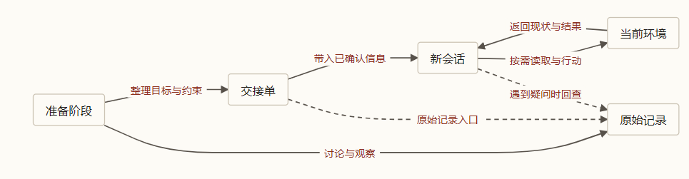

> 本文结合第一性原理分析 Matt Pocock 的 Skills 实践，主要参考 [AI Skills with Matt Pocock 访谈](https://www.youtube.com/watch?v=4DhcSPkEbwI)和 [Skills 项目所引用版本](https://github.com/mattpocock/skills/tree/4ae2317ddb22b046e26455e4f9c9b3aaaf62212d)。

### 引子：昨天说清楚的事，今天为什么又要说一遍？

假设你在维护一个技术博客。有读者反馈：在手机屏幕上，文章里的长公式右边被截断了，滑也滑不动，只能看到前半截。

昨天下午，你和 Agent 折腾了半小时。你们一起打开浏览器调试、缩小窗口、翻样式文件，总算找到了病根：包裹公式的容器在窄屏下宽度溢出了，却没加横向滚动。临收工时，你特意叮嘱了一句：**“只修手机端的横向滚动，桌面端的公式排版保持原样，更别顺手把整套数学渲染系统重做一遍。”**

讨论结束，你关掉了窗口。第二天早上，你新开一个会话，让另一个 Agent 接手把这个 Bug 改掉。

新来的 Agent 看得到整个代码仓库，也许系统还会自动给它加载几份项目说明。可十分钟后你打开预览一看，差点气笑：要么它又花了好几轮重新排查为什么公式会截断；要么更糟——手机端确实能滑了，桌面端的公式行距却全变了形，因为它在重构样式时“顺手”把通用容器也统一改了一遍。

这种无力感在跨会话开发里太常见了：**代码还在同一个文件夹里，问题还是昨天那个问题，你人也清清楚楚记得昨天的决定，可新来的执行者表现得就像刚推门进来的陌生人。**

为什么会这样？把昨天整段聊天记录全塞进今天的新会话，行不行？如果不全塞，又该怎么在“两眼一抹黑”和“把窗口撑爆”之间找平衡？

我们先用黑屋和信息完备性把这笔账算清，再来看 Matt Pocock 的 Skills 是怎样靠一张精简的项目地图，把跨会话的信息接上线的。

---

### 一、会话结束之后，昨天的约定究竟去了哪里？

在[《第一篇》](/zhangmuchuan/blog/agent-loop/)里，我们用一间封闭黑屋比喻大模型的工作处境：屋里的天才博闻强记、算力惊人，但参数权重 $\theta$ 在部署后是冻结的。黑屋外边是不断变化的真实环境 $E$（你的代码库、浏览器渲染结果，以及你昨天下午在心里敲定的“别动桌面端”），连接屋内与屋外只有一个极其狭窄的信封缝——当前放进模型窗口的上下文 $C$。模型吐出的每一步回答或工具调用 $R$，完全取决于这个信封里装了什么：

$$
E \longrightarrow C \longrightarrow R
$$

对应[《数学基石篇》](/zhangmuchuan/blog/agent-math-foundations/)里的数据处理不等式（DPI），单次推理能携带关于外部世界的信息量有一个死上限：

$$
I(E; R) \leq I(E; C)
$$

放到今天这个 Bug 上看，$I(E; C)$ 衡量的是“今天这轮窗口里，到底装进了多少关于这次修 Bug 的真实信息”；$I(E; R)$ 则是模型输出方案里能命中的真实信息量。

很多人会困惑：模型明明读过全网的 CSS 文档，也看到了仓库里的源码，为什么还会改坏桌面端？原因就在这条不等式里。模型脑子里的训练先验确实能告诉它“写 `overflow-x: auto` 可以解决溢出”，却绝不可能提前预知“你昨天下午四点决定保留桌面端现有间距”。只要这句约束没有写进文件、也没有在新会话里喂进当前上下文 $C$，模型在黑屋里哪怕再聪明、推演再多轮思维链，也制造不出哪怕 1 bit 关于昨天决定的事实。它觉得顺手统一桌面端样式更整洁，按通用经验改了，纯粹是因为“别动桌面端”这几个字根本没穿过那道信封缝。

因此，跨会话衔接的核心矛盾很明确：**新会话启动时，昨天的对话状态会随着旧窗口关闭一起归零；真正能留下来起作用的，只有写进外部文件、并且今天还能被重新读进当前上下文里的记录。**

这就立刻引出了下一个躲不开的问题：既然怕新 Agent 漏掉约束，干脆把昨天几十条聊天记录原封不动全塞进今天的第一条提示词里，一劳永逸行不行？

---

### 二、全塞进去还是留张路标？先算这笔信息账

回到昨天的那场调试。你们聊了足足四十条消息：第三条你怀疑是不是字号太大，第八条 Agent 猜过可能是 Safari 的字体渲染 Bug，直到第十五条你们把窗口拉窄，才真正确认是外层容器缺少横向滚动；中间你们还认真讨论过一版“干脆把所有公式字体整体调小”的废弃方案。

把这四十条原封不动倒进今天新会话的开头，画面会立刻变得很狼狈：新 Agent 上来还没摸到 CSS 文件，就得先读完两个已经证伪的猜测和一套被枪毙的方案，自己从四十条拉扯记录里筛选哪句是早期随口猜的、哪句才是最后拍板的。更麻烦的是，那些曾经被热烈讨论过的错误路径还占着它的注意力窗口，一不小心就把后面的判断带偏。

可如果反过来，你图省事只丢给它一句“把手机端长公式截断修好”，成本又转嫁到了另一头——它得重新花好几轮去排查问题，而且大概率还是会踩中“顺手改乱桌面端”的坑。

为什么两端都不对？先用[《数学基石篇》](/zhangmuchuan/blog/agent-math-foundations/)的**信息完备性方程**来算第一步，账目就清清楚楚：

$$
I_{\text{初始前馈}} + \sum_{k=1}^{n} \Delta I_{\text{反馈}, k} \geq I_{\text{目标}}
$$

把三个变量直接对应到修公式这件事上：

- **$I_{\text{目标}}$（终点线在哪里）**：把手机端长公式修到能横向滚全、桌面端排版丝毫不乱、并且构建和检查全部通过，需要掌握的总信息量；
- **$I_{\text{初始前馈}}$（出发时手里有什么）**：第 0 步还没调任何工具之前，新 Agent 已经拿到手的信息——你这一句任务描述、系统启动时自动塞进来的项目说明，加上它自带的编程常识；
- **$\Delta I_{\text{反馈}, k}$（路上新查到什么）**：正式动手后，第 $k$ 步通过工具读工单、翻 CSS 文件、在 375px 手机视口下截图验证，每一步带回来的**有效新线索**。

留意方程里每一轮增量背后的条件互信息形式 $I(Z; O_k \mid C_{k-1})$：它算的从来都是**在已经知道前文 $C_{k-1}$ 的基础上，新观察 $O_k$ 到底多出了多少关于目标 $Z$ 的有效信息**。如果昨天工单里已经贴了一张手机截断的报错图，今天再打开同一张图看一遍，信息增量接近于零；而当你改完样式、重新打开浏览器截一张新图回来，这张图告诉你“到底修好了没有、桌面端有没有跟着歪”，这才是实打实的新增量。

盯住方程中间那个加号：**达成目标靠的是“起点前馈 + 路上反馈”两笔合起来够数，从来没人要求起点把所有细节一次背完。**

起点该带的，只有“目标、红线、以及去哪找下一条线索的入口”；至于具体代码怎么写、当年讨论怎么来回拉扯，全留给执行过程中的 $\sum \Delta I_{\text{反馈}, k}$ 按需去取，窗口才能既干净又够用。

不过，信息完备性方程只说明了“不必在起点一次背完”，还没解释清楚“硬把那四十条全塞进去为什么会把结果做坏”。这里要把**“信息有没有写进窗口”**和**“模型能不能准确提出来”**拆成两笔账来看：按照[《第二篇》](/zhangmuchuan/blog/agent-control/)和[《第三篇》](/zhangmuchuan/blog/agent-harness/)对信噪比的拆解，“某条猜测走不通”的结论本身算有效线索，可伴随它留下的几十条旧误判、废弃方案和推演草稿却属于过程残骸；当未经整理的闲聊和最终拍板在纯文本里混作一团（证据身份被抹平），模型有限的注意力预算就会被厚厚的噪声摊薄——关于目标 $Z$ 的信息量 $I(Z; C)$ 看似没减少，模型真正能从杂乱窗口里提炼出来并落到修改动作 $R$ 上的有效信息 $I(Z; R)$ 却大幅缩水。

为什么起点只留“目标、红线、去哪找线索的入口”最顺手，偏偏不能全塞、也不能空手硬上？放到逛陌生超市的日常选择里，其中的取舍一下就具体了。

#### 去超市买菜：抄全本货架，还是先看门口分区图？

周末晚上，你准备在家做一道西红柿炒鸡蛋。出门前，家里老人特意叮嘱了一句：“最近肠胃不好，**绝对不能放辣，哪怕带一点辣椒成分的调料都别买。**”

你走进一家之前从没逛过的大型仓储超市，迎面有两个极端做法摆在面前。

第一种做法，是你进门前找店员要来超市两百页的完整商品台账——生鲜区几号柜摆什么菜、零食区打几折、甚至洗发水货架的出厂日期全抄在本子上，抱着这摞纸开始逛。等你站在调料区想找一瓶番茄酱时，手里的本子沉得发酸，光是翻过前面几十页冷冻饺子和调味料报价就花了十分钟，视线还老被无关的促销信息晃花眼。

第二种做法，是你觉得写清单和便条太麻烦，干脆两手空空走进去凭感觉拿。西红柿和鸡蛋倒是不难找，路过调味区时你顺手挑了一瓶包装喜庆的红油番茄拌饭酱，心想炒出来肯定香。回到家忙活半小时端上桌，老人夹了一筷子就放下了——你早把“不能放辣”那句嘱咐抛在脑后，可这瓶酱配料表第三行偏偏写着辣椒油，整盘菜谁也吃不成，还得重新下楼买。

真正顺手的买法，每个人其实都在用：兜里只揣一张**三行字的便条**（“买鸡蛋、西红柿、油；零辣椒”），进门抬头扫一眼门口那块**大分区牌**（“生鲜在 A 区，调味品在 C 区”）。到了 A 区货架前，你再去捏捏西红柿软不软、翻开鸡蛋盒看有没有碎壳；到了 C 区，把酱料瓶翻过来瞄一眼背面的真实配料表，确认没写辣椒再放进筐里。

兜里的三行字，就是任务目标和绝对不能碰的红线（起点前馈）；门口那块大分区牌，就是项目地图的入口；到了货架前再翻看鸡蛋和配料表，就是执行过程中按需拉取的真实反馈。回到代码仓库里，给跨会话 Agent 留启动配置，要解决的正是怎么替它画好门口那块牌子。

#### 解剖 Matt 的项目入口：先守住一张唯一的分区牌

顺着这个思路去看 Matt Pocock 的 Skills 库（以仓库提交 `4ae2317` 为准），他的初始化技能 [setup-matt-pocock-skills](https://github.com/mattpocock/skills/blob/4ae2317/skills/engineering/setup-matt-pocock-skills/SKILL.md) 干的正是“在门口立分区牌”的活。

如果把项目里积攒的几十条 Issue、所有业务术语和架构决策全塞进每次启动都会自动加载的 `CLAUDE.md` 或 `AGENTS.md`，等于让每一个新会话的 Agent 进门先抱起那本两百页的超市台账。Matt 的做法克制得多：初始化时，Agent 先扫一遍仓库现状（看有没有 GitHub 远端、是否装了 `triage` 技能、是不是多包 monorepo），和开发者分三项逐一对齐后，只在根目录的入口文件里写入短短十几行导航块（以下按该技能的模板结构写成中文示例）：

```markdown
## Agent skills

### Issue tracker
任务在哪里跟踪：GitHub Issues（使用 `gh` CLI）。参见 `docs/agents/issue-tracker.md`。

### Triage labels
任务分流标签的映射约定。参见 `docs/agents/triage-labels.md`。

### Domain docs
单一领域布局：根目录 `GLOSSARY.md` 与 `docs/adr/`。参见 `docs/agents/domain.md`。
```

这段配置里甚至藏着两条很老道的工程细节：

1. **死守唯一入口，绝不另起炉灶**：`setup-matt-pocock-skills` 明确规定——如果仓库里原本已有 `CLAUDE.md`，就只更新 `CLAUDE.md`；原本已有 `AGENTS.md`，就只更新 `AGENTS.md`；绝不在已经有了一块牌子的情况下再去新建第二块。道理很简单：一个大门口挂两块分区牌，半年后改了一块忘了改另一块，新来的执行者就会顺着旧牌子走到空货架前。
2. **用不上的路标干脆不挂**：如果项目没安装 `triage` 技能，初始化阶段会直接跳过 `Triage labels` 这一节，一行废话也不留在启动上下文里，省得每次开机让模型白读一个根本不存在的流程入口。

把三份详细说明拆到 `docs/agents/` 下、在门口只留几行指针，用信息账一算就明白它的取舍：每次新会话启动轻装上阵，只有在真正要翻工单、查术语的时候，Agent 才顺着指针去多做一次读取（支付一次极小的读取成本，换取平时整个窗口的干净）。

不过反过来，超市重新装修把调味品搬去了 D 区，门口的分区牌却忘改了，哪怕牌子写得再简练，照样会把人指进死胡同。**地图的价值，全建立在它始终指向真实位置的前提上；路标一旦跟不上文件搬家，越简练的入口反而越容易让执行者放心走偏。**

---

### 三、昨天的反馈，怎样成为今天的前馈？

有了门口的分区牌，新来的 Agent 至少知道去哪找任务追踪器了。接着看下一步：它顺着 `docs/agents/issue-tracker.md` 找到了昨天那条修长公式的 Issue。这时候，昨天和今天之间的接力账该怎么算？

假设昨天下午的调查已经跑到了能动手的程度，并在闭窗前把结论写进了 Issue。今天的新 Agent 打开这条 Issue 准备改代码。这里藏着一个很容易让人犯糊涂的身份切换：**同一笔信息，在昨天是交互中问出来的反馈，放到今天新会话的起跑线上，变成了实施前馈。**

回到[《数学基石篇》](/zhangmuchuan/blog/agent-math-foundations/)和[《第一篇》](/zhangmuchuan/blog/agent-loop/)建立的阶段切分模型，只要把观察起点从昨天挪到今天，就能把两天的账并到同一张纸上。

从昨天你刚提需求那一刻算起，你在下午和 Agent 一起缩小浏览器窗口、翻看样式文件、敲定“保留桌面端不变”，这些都发生在新任务开始之后，属于准备阶段获取的反馈。设准备阶段在第 $\tau$ 次交互结束，当时完整保留下来的上下文为 $C_\tau$，总信息量写成：

$$
I_{\text{初始前馈}} + \sum_{k=1}^{\tau}\Delta I_{\text{准备阶段},k} = I(Z;C_{\tau})
$$

假如昨天积累的这些信息一分不少地交到了今天动手的 Agent 手上，且目标 $Z$ 没变，那么站在今天实施阶段的起跑线上，新 Agent 出发时手里就已经握着：

$$
I_{\text{实施前馈}} = I_{\text{初始前馈}} + \sum_{k=1}^{\tau}\Delta I_{\text{准备阶段},k}
$$

代入今天实施阶段的信息总账里，新会话只需要在路上有选择地补齐剩下的反馈：

$$
I_{\text{实施前馈}} + \sum_{k=\tau+1}^{n}\Delta I_{\text{实施阶段},k} \geq I_{\text{目标}}
$$

需要看清的是，前后两组式子算的是同一笔本金，只是站位不同：准备阶段挣回来的信息既算进了今天的 $I_{\text{实施前馈}}$，就不能再在实施阶段那一项里重复加账。只要完整落盘并被今天读到，昨天问出来的事实与边界就能在今天第 0 步直接垫高起跑线。

**问题就出在“顺利交到手上”这五个字，往往最不保险。**

真正在跨会话交接时，昨天那 40 条冗长的聊天记录几乎不可能原封不动搬进今天的窗口，通常是由昨天的 Agent 或维护者提炼成一份简短的交接摘要 $B$。只要 $B$ 纯粹是对昨天上下文 $C_\tau$ 的浓缩加工，没有引入任何新证据，信息处理链 $Z \longrightarrow C_\tau \longrightarrow B$ 就立刻触发了数据处理不等式：

$$
I(Z; B) \leq I(Z; C_{\tau})
$$

这个不等式点破了交接摘要的天然风险：**浓缩永远伴随丢信息的可能——交接一旦只经由摘要 $B$ 完成，今天新会话起跑线上的实际实施前馈就已经变成 $I(Z; B)$，而不再是完整记录下的 $I(Z; C_\tau)$。** 要是昨天的总结只写了“给手机端公式容器加横向滚动”，顺手把“桌面端绝不能改”漏掉了，那对今天的新 Agent 来说，这句约束就跟从来没说过一样——哪怕它依然安安静静躺在昨天的聊天记录里。

虽说今天的 Agent 上工后还能靠翻代码、跑本地预览补回部分现场线索，可一旦交接单漏掉了关键约束或边界前提，新旧线索就很容易在半路打架；要是隔夜之后目标 $Z$ 本身也改了（比如你决定顺便连代码块样式一并大改），整本信息账更得对照新目标重算。

但话又说回来：如果摘要随时可能漏掉关键限制，我们为什么不直接甩给今天的新 Agent 看全部 40 条原始评论，还要费劲写一份交接单呢？把这个问题放到生活里，就看清“摘要”和“原始聊天”到底各管哪一摊。

#### 一张交接便条，为什么还要留着家庭群聊？

一家人轮流买菜做晚饭时，每天都在碰这个取舍。上午十点你去菜市场买菜，本来打算晚上做香菇滑鸡，结果摊主说鲜香菇今天全卖断货了。你在家庭微信群里问了一圈，家里人商量完说：“那换个家常豆腐烧肉末吧。”老妈顺便在群里补了一句：**“今天孩子有点上火，一点辣都别放，豆瓣酱也别放。”**

中午你赶着上班，没法自己下厨，临走前在冰箱门上贴了张黄色便条交给晚上做饭的家人——为了图省事，便条上只写了“买豆腐”三个字，既没抄进“零辣椒”的硬红线，也没写清楚“原本想做香菇滑鸡，因为香菇缺货才换的豆腐”。

到了傍晚五点半，接手做饭的人提着菜篮子走到菜市场豆腐摊前，傻眼了——今天的嫩豆腐和老豆腐也全卖空了。

他站在摊位前盯着手里的便条，越看越犯难：光看“买豆腐”三个字，他既不知道这盒豆腐原本只是香菇的替补，也没看见“一点辣都不能放”的红线。偏偏摊主还热心推荐：“没豆腐了，拿盒香辣千页豆腐回去炒也一样！”要是不想瞎买踩坑，也不用急着挨个打电话问，最稳妥的办法就是掏出手机翻开上午那个家庭微信群。往上一划，看见“香菇缺货才换的豆腐”和老妈那句“不能放辣”，他心里立马有底了：直接绕去菌菇摊看看有没有平菇或杏鲍菇，顺手买块不辣的鲜肉回去，照样能把晚饭端上桌。

冰箱门上的黄色便条，就是交接摘要（整理层）；上午那段家庭微信群聊，就是原始讨论记录（回查依据）；傍晚豆腐摊前“没货了”和隔壁菌菇摊还有平菇，则是动手时新拿到的现场反馈。

**交接单的作用，是让晚上做饭的人不用先爬三百条闲聊群消息，进门就能立刻直奔目标；而保留群聊原文的价值，则是当现场出现意外、便条写漏约束或语焉不详时，接手的人手里还有一条路能退回去翻出前因后果、重新核对真相。** 保留原始记录，归根结底是为了在现场情况有变时留一份可供二次核验的底稿。

把刚才这套“准备期留底、交接单领路、现场查验与回溯原文”的接力路径落回工程现场，跨会话的信息流向就是下面这张图：



*图：准备阶段、交接单、原始记录与新会话现场环境之间的信息流向。*

---

### 四、交接单为什么写“行为”，不写“行号”？

理解了“整理层留方向 + 原始记录留底稿”的分工，接着看一份交接单具体该怎么写才抗折腾。

在跨会话协作里，不同信息过期的速度差别极大。“手机端读者能完整滑动看清长公式，桌面端排版保持原样”，这是业务目标和约束，往往管好几周；“样式代码写在 `src/styles/article.css` 第 142 行”，这是物理坐标，明天上午随便哪个同事格式化一下 CSS 文件或者拆分一个组件，第 142 行就彻底移位了。如果把这两类保质期完全不同的信息混在一起写成操作命令，接手的新 Agent 往往死盯着旧行号改错了地方，反倒忘了真正要守住的页面效果。

现在再来看 Matt Pocock 的 [`triage` 技能](https://github.com/mattpocock/skills/blob/4ae2317/skills/engineering/triage/SKILL.md)和配套的 [`AGENT-BRIEF.md`](https://github.com/mattpocock/skills/blob/4ae2317/skills/engineering/triage/AGENT-BRIEF.md) 规范，就能看出这套设计背后的算盘。在他的流程里，一条 Issue 经由维护者拍板确认就绪（打上 `ready-for-agent` 标签）时，`/triage` 才会引导 Agent 为它附上一份结构化的 Agent Brief，把它作为后续无人值守 Agent 干活的**任务契约**，原来的 Issue 正文和评论区则留在后面当背景资料。

打开 [`AGENT-BRIEF.md`](https://github.com/mattpocock/skills/blob/4ae2317/skills/engineering/triage/AGENT-BRIEF.md)，最显眼的是两条写进原则里的规矩：

1. **耐用性压过死坐标（Durability over precision）**：明确禁止在 Brief 里写文件路径和行号，只允许写清楚相关的接口名、类型定义和模块职责。原因很现实——工单可能在看板里躺好几天甚至几周，期间代码随时会被移动、重命名或重构。
2. **写清行为契约，别开操作处方（Behavioral, not procedural）**：只交代“改完之后系统该表现成什么样、哪些边界不能碰”，绝不写“打开某文件第 42 行加一个 `switch` 分支”。用我们在[《第二篇》](/zhangmuchuan/blog/agent-control/)确立的控制权原则来审视，这一条非常干脆：**既然实施阶段的代码库结构要在动手那一刻才重新扫描确认，那就应该把“具体怎么改代码”的探索权留给实施期的 Agent Loop，在 Brief 里只把起点目标、接口契约和验收红线锁死。**

拿我们的博客长公式 Bug 做个对比就一目了然。如果昨天的交接单图省事写成一条“操作处方”：

```text
打开 src/styles/article.css 第 142 行，加上 overflow-x: auto。
```

到了下周新 Agent 接手时，一旦样式表被拆分成 `math.css`，第 142 行可能早变成一段毫不相干的标题样式；更致命的是，这句话完全没说清“为什么改、桌面端不能动、改完怎么算验收通过”。

照着 Matt 的 `AGENT-BRIEF` 模板，把前面修博客长公式的场景改写成一份交接单示例，大概就是下面这样：

```markdown
## Agent Brief

**类别（Category）：** bug
**摘要（Summary）：** 修复窄屏下长数学公式右侧被裁切的问题，同时保持桌面端排版不变

**当前情况（Current behavior）：** 窄屏下，超出正文宽度的长公式右侧被容器裁切，无法横向查看。

**期望行为（Desired behavior）：** 手机端读者可横向滑动查看完整公式；桌面端原有公式排版与行距保持不变。

**相关接口（Key interfaces）：** 正文数学公式外层布局容器（如公式渲染包装器及其响应式样式契约）；不绑定具体文件路径。

**验收标准（Acceptance criteria）：**
- [ ] 在 375px 视口下，长公式可横向滚动并完整显示。
- [ ] 在桌面视口下核对现有长短公式页面，排版没有出现非预期变化。
- [ ] 运行项目构建与样式检查并确认通过。

**不在本次范围（Out of scope）：**
- 重写数学公式渲染引擎
- 调整普通代码块容器样式
```

除此之外，[`triage` 规范](https://github.com/mattpocock/skills/blob/4ae2317/skills/engineering/triage/SKILL.md)在动笔写这份 Brief 之前还有一道前置门禁：**先查证，再交接。** Agent 拿到一条新 Issue，不能看完标题直接开写 Brief，动手前必须先过三道关：去代码库按领域概念搜一遍是不是早就实现过了；翻一遍 `.out-of-scope/` 看过去是不是拒绝过类似需求；如果是 Bug，先按报告者给的步骤在本地尝试复现，把究竟是确认重现（并附上代码路径）、未能复现还是信息不足（直接指向 `needs-info`）如实汇报给维护者。先把猜想变成核实过的现状，交接单才不会沦为二手谣言集散地。

把话说透，Matt 这套“彻底不写路径”的做法也有自己的代价：**它把“重新定位文件”的搜索成本，全留给了后面的实施 Agent。** 在结构清晰的小仓库里，Agent 搜几下接口名一两秒就能找到位置；可要是碰上一个命名混乱、十几个目录里都躺着同名 `MathBlock` 组件的老项目，执行者照样得绕好几圈弯路。如果团队发布节奏紧、交接后一小时内就会立刻开工，附上一句带版本说明的模块提示其实能省不少工夫；Matt 宁可多花一点执行期搜索税，也要死保工单在数周跨度里的耐用性。

---

### 五、标签能帮我们少看什么？又挡不住什么？

理清“单条工单怎么写”之后，再把视线放到整个项目看板上。假设积压了整整一百条工单：三十条还在等提问的人补充复现环境，二十条牵扯架构大改或者线上密钥得人类自己处理，真正规格清晰、可以丢给后台 Agent 异步动手的大概只有十五条。

今天新启动的 Agent 刚连上仓库，第一件事要问的是：**面对这一百条工单，我先看哪一批？**

如果每一任新 Agent 每次开工都得把一百条工单的评论区从头翻一遍，自己判断哪条还没聊清楚、哪条能直接改，这笔重复筛选的 Token 和时间税很快就会把整个系统拖垮。既然之前的维护者已经跑过一遍 `triage` 查证、把筛完的状态写在了工单标签里，新 Agent 只需要读一眼这份既有分类结果，就能直接切进该干活的那一小堆。

Matt 的 [`triage`](https://github.com/mattpocock/skills/blob/4ae2317/skills/engineering/triage/SKILL.md) 为此设计了一组极精简的状态机角色（通常对应同名的看板标签，也可以在配置里映射到项目已有标签）：`needs-triage`（刚进来待评估）、`needs-info`（卡在缺信息，等报告人回话）、`ready-for-agent`（契约写清了，Agent 可领走异步施工）、`ready-for-human`（得由人类拍板或手工执行）、`wontfix`（明确关闭不做），再配上一个类别标签（`bug` 或 `enhancement`）。如果用 GitHub Issues，新会话开局只需要一句命令就能先把范围缩窄到能干活的那一小撮：

```bash
gh issue list --label ready-for-agent
```

不过，分类标签既然是人或 Agent 打上去的，就有维护成本和过期风险。今天把一条还没确认复现步骤的工单手滑标成了 `ready-for-agent`，后续 Agent 确实过滤得飞快，代价却是飞快地领着错任务一头撞进代码里；反过来，一条等了好几天的 `needs-info` 工单就算报告人刚补齐了截图，虽然再次手动运行 `/triage` 时能把这条带新回复的工单重新扫出来，可在此之前若没人跑一遍流程并把标签改回去，只盯着 `ready-for-agent` 拉活的后台 Agent 根本看不见它，它就会在角落里一直沉睡。

到底值不值得维护一个标签？拿我们在[《数学基石篇》](/zhangmuchuan/blog/agent-math-foundations/)和[《第二篇》](/zhangmuchuan/blog/agent-control/)确立的**信息价值（VoI）**标尺来衡量，判断标准很直接，就看两件事：**看完这个标签，能不能改写并提升 Agent 接下来的行动选择；摊到多次复用后，这份收益又能不能盖过打标与维护的代价。**

具体来看，在后台 Agent 打开看板时已掌握的当前上下文 $C_t$ 下，它的分流候选动作非常明确：$a \in \{\text{直接领走施工}, \text{跳过先看下一条}, \text{转给人类确认}\}$。把读到某枚标签视为一次新观测 $O$，按照霍华德决策边界判据，只有当这枚标签真的会改写最优动作时，它的决策价值才大于零：

$$
\operatorname{VoI}(O \mid C_t) > 0 \iff \exists\, O,\quad a^*(O) \neq a^*
$$

再套进跨会话复用的净价值核算，扣掉起初分类打标和日后人工核对改标的成本，这枚标签算下来的总账就是：

$$
V_{\text{标签}} = \sum_{j=1}^{N} \operatorname{VoI}_j - C_{\text{打标}} - C_{\text{维护}}
$$

其中每次复用获得的 $\operatorname{VoI}_j$ 衡量的就是看清工单真实状态 $Z$ 后，最优分流动作相比盲选多出来的预期效用差；一旦读完标签根本不换动作，这项收益就是零。把两类标签放进这两条式子一算，高下立判：

- **真正改写动作的高价值标签（$\operatorname{VoI} > 0$ 且 $N$ 足够大 $\implies V_{\text{标签}} > 0$）**：比如 `needs-info` 和 `ready-for-agent` 的切分。看到前者，最优动作直接切到“跳过不碰”，省下对半成品需求瞎写一通的返工损失；看到后者，直接拉起 Brief 领活开干。这枚标签实实在在改写了下一步动作（$a^*(O) \neq a^*$），且随后几十个新会话反复消费这组状态（$N$ 够大），总收益稳稳压过打标与维护代价；
- **只减分类不确定性、不改动作的零价值标签（$\Delta I_{\text{分类}} > 0$，但 $\operatorname{VoI} = 0 \implies V_{\text{标签}} < 0$）**：假设有人兴冲冲给这条通用后台 Agent 队列加了一堆细分标签——`css-overflow`、`math-font`、`mobile-only`。对“领走还是跳过”这组动作而言，这些标签确实降低了“属于哪类 Bug”的不确定性（$\Delta I_{\text{分类}} > 0$），可无论看到哪一个，后台 Agent 下一步的最优动作都照样是“读完整 Brief 再动手”——$a^*(O) = a^*$ 纹丝不动，决策价值严格为零（除非团队按前后端专职队列拆开分派、把动作集改写掉了，否则毫无决策增量）。既然不改行动，还要持续支付打标和同步过期的成本 $C_{\text{打标}} + C_{\text{维护}}$，整笔账算下来 $V_{\text{标签}} < 0$，迟早沦为看板上的死装饰。

除了“值不值得打标”，标签还有一个更危险的盲区：**提示牌挡不住没上锁的门把手。**

你把一条涉及生产库迁移、大额计费调整的工单标上了 `ready-for-human`，这就像在小区配电室的门上贴了一张打印工整的纸条：“非专业人员禁止操作，请联系物业”。纸条能提醒守规矩的人别乱进，可门要是压根没上锁，提醒就只是一张纸。放到 Agent 系统里也一样：哪怕工单贴着 `ready-for-human`，只要执行 Agent 手里的终端工具还挂着生产库的读写密钥，提示词稍一走偏，它照样能直接动手把表改掉。

结合[《第四篇》](/zhangmuchuan/blog/agent-business/)对高风险写操作的分析：**标签负责在信息层做任务分流，真正的安全边界必须靠工具权限隔离、分支保护和人工审批门禁在执行层把门锁死。**

---

### 六、代码就在眼前，为什么还要记术语、拒审记录和架构决策？

假设新来的 Agent 顺着 `ready-for-agent` 领走了修长公式的工单，也拿到了清晰的 Agent Brief，代码仓库就在面前。它是不是就能安心只读代码把活干完了？

一动手，两堵只靠看代码绝对绕不开的墙立刻冒了出来：第一，团队嘴里常用的同一个词，在代码和聊天里到底指什么？第二，眼前代码明明选了 A 方案，当初为什么没用看起来更简单的 B 方案？

#### 1. `GLOSSARY.md`：同一个词，人和 Agent 说的是一回事吗？

假设你今天在新会话里对 Agent 说了一句：“修完这个公式后，顺便确认一下文章**发布**没问题。”

听起来再普通不过的两个字，团队里却可能藏着三种完全不同的指代：写稿的人说的“发布”，是把 Markdown 推到仓库并把 `draft` 改成 `false`；负责构建的人说的“发布”，是 Hugo 编译打包成功；运维盯着看的“发布”，是 GitHub Pages 真正上线且线上页面能正常打开。一旦 Agent 对“发布”的理解和你错位了半拍，它可能在本地刚改完 `draft: false` 就径直跑来交差，或者反过来把已经推上线的部署流程重跑一遍。

Matt Pocock 在[访谈记录](https://www.youtube.com/watch?v=4DhcSPkEbwI)里分享过一个特别具体的案例：他在做一个课程平台时，课程（course）、章节（section）和课时（lesson）各自都有一种“幽灵态（ghost）”和“真实态（real）”。当最里层的一个幽灵课时变成真实课时时，包在它外面的幽灵章节和幽灵课程也必须一路连锁变成真实条目。刚开始他和 Agent 每次聊这个逻辑都要绕一大段车轱辘话，后来干脆一起给这个连锁规则拍了个专属名词——`materialization cascade`（具现化级联）。从那以后，无论是人提需求还是 Agent 在代码里搜相关函数，两个词一甩出来，双方瞬间就对上了同一个模型。

这背后正是我们在[《第六篇》](/zhangmuchuan/blog/agent-memory/)里划出的合法即时记录区：一个术语刚刚在人机讨论中敲定，推断距离几乎为零，而且能拍板的人类（$H$ 轴）就在屏幕对面，核对成本趋近于零。相对于当下的探索对话，与人类核对术语属于即时交互反馈；趁现场语境鲜活立刻写进 `GLOSSARY.md`，这笔共识就直接沉淀成了后续所有新会话低成本享用的高信噪比前馈。

看一眼 Matt 的 [`domain-modeling`](https://github.com/mattpocock/skills/blob/4ae2317/skills/engineering/domain-modeling/SKILL.md) 和 [`GLOSSARY-FORMAT.md`](https://github.com/mattpocock/skills/blob/4ae2317/skills/engineering/domain-modeling/GLOSSARY-FORMAT.md) 规范，里面有三条非常克制的规矩，正好对应到我们前面的理论要点上：

1. **有主见地消歧（`_Avoid_`）**：当同一个概念冒出几个近义词（比如 `Order`、`Purchase`、`Transaction`），必须选定一个唯一标准词，把其余别名全部列入 `_Avoid_` 禁用名单。这是在直接压缩语义歧义，守住跨会话沟通的信噪比；
2. **只收项目私有概念，严禁收录通用编程常识**：规范明确指出，像 `timeout`、常规报错类型这些通用编程概念绝不放进术语表。放到[《第六篇》](/zhangmuchuan/blog/agent-memory/)的坐标系里看，这就是**“记忆是环境的补集”**——大模型冻结参数里本来就装着通用的计算机词汇，再抄一遍只会占窗口，术语表只负责记录模型预训练先验里不可能知道的“这个项目自己的私有词汇”；
3. **死守“零实现细节”红线**：规范强硬要求 *`GLOSSARY.md` should be totally devoid of implementation details*（绝对禁止把实现细节、接口路径或开发草稿塞进术语表）。为什么？因为业务逻辑的定义相对稳定，内部实现代码却天天在重构；一旦把具体类名、实现步骤混进术语表，代码一改术语表就跟着过时，很快整张表就会沦为污染上下文的过期废料。

#### 2. `docs/adr/` 与 `.out-of-scope/`：只看结果，猜得出当初为什么放弃 B 方案吗？

理清了名词，接着看第二个盲区：把我们那个博客长公式案例往前倒推一个月。

假设当时团队考虑过两种修法：
- **方案 A**：保留正常字号，给外层公式容器加上横向滚动；
- **方案 B**：不加滚动条，一到窄屏就自动把所有数学公式字号整体缩到 70%。

最后线上代码采用的是方案 A。今天，一个全新会话里的 Agent 打开了仓库里的 CSS，它一眼就看到了方案 A 的全部实现。它能靠自己“读代码”，判断出团队当初到底为什么没选看起来甚至更省事的方案 B 吗？

用[《数学基石篇》](/zhangmuchuan/blog/agent-math-foundations/)的**现实不可辨识性定理（定理二）**一看，结论非常干脆：

设两种截然不同的历史真相——$E_1$ 是“团队认真测过方案 B，发现分数下标在手机上小得像芝麻，读者根本看不清，于是忍痛枪毙”；$E_2$ 是“当初写样式的人压根没想到还能动态缩字号，随手写了个横向滚动”。面对今天这个只保留了最终实现、尚未附带决策说明的代码仓库 $C$，无论是哪种历史走到了今天，最终留在仓库里的 CSS 都可以一模一样，即：

$$
P(C \mid E_1) = P(C \mid E_2)
$$

一旦两种互斥原因产生的当前代码似然相等，根据贝叶斯后验更新：

$$
\frac{P(E_1 \mid C)}{P(E_2 \mid C)} = \frac{P(E_1)}{P(E_2)}
$$

又因为模型关在黑屋里做的思维链推演 $R_{\text{CoT}}$ 不会从外部历史注入新证据，严格受制于马尔可夫隔离链 $E \longrightarrow C \longrightarrow R_{\text{CoT}}$（条件互信息 $I(E; R_{\text{CoT}} \mid C) = 0$），它在脑子里推演得再久，后验比照样一动不动：

$$
\frac{P(E_1 \mid R_{\text{CoT}}, C)}{P(E_2 \mid R_{\text{CoT}}, C)} = \frac{P(E_1 \mid C)}{P(E_2 \mid C)} = \frac{P(E_1)}{P(E_2)}
$$

无论今天的 Agent 在思维链里推演多深、代码读得有多细，它都**拿不到哪怕一丁点把 $E_1$ 和 $E_2$ 区分开的新证据**。于是就会反复上演工程界最让人血压升高的一幕：新来的 Agent 看了一圈代码，觉得“这横向滚动多丑啊，用 CSS `clamp()` 动态缩字号不就全屏免滚动了吗？”，然后兴致勃勃地花半小时把团队上个月刚试错淘汰掉的方案 B 又给“重构”回来了！

要打破这种不可辨识性，单靠代码本身没有出路，必须在代码之外留下一份专门记载**“当初面对过哪些岔路口、为什么没走另外那条”**的外部证言。Matt 的工具链在这一点上分工非常利落：

- **架构决策记录 `docs/adr/`**：在 [`ADR-FORMAT.md`](https://github.com/mattpocock/skills/blob/4ae2317/skills/engineering/domain-modeling/ADR-FORMAT.md) 里，Matt 给 ADR 砍掉了所有官僚架子——一篇 ADR **1 到 3 句话就够**，只说清当时背景、拍了什么板、为什么放弃最明显的那个备选方案，而且目录懒创建，用得着时才建第一份。同时它卡了三道极严的准入门槛：**改起来很贵（难逆转） + 光看代码肯定会看懵（脱离背景会起疑） + 真的做过方案二选一（存在实质取舍）**。比如“方案 B 在 375px 下会导致多层分式彻底糊成一团，因此选择方案 A 保留可读性并锁定桌面布局”——新 Agent 只要读到这一段，就能把 $E_1$ 和 $E_2$ 一刀劈开，不再重踩同一个坑。日后要是换了一套支持清晰缩放的新渲染引擎，Agent 也绝不能绕开既有 ADR 静默重做；按照规范，它必须显式标出方案冲突并附上新引擎下的实测证据，交给人类维护者拍板确认旧前提失效后，再由人决定推翻并写一份替代 ADR。
- **需求拒审库 `.out-of-scope/`**：[`OUT-OF-SCOPE.md`](https://github.com/mattpocock/skills/blob/4ae2317/skills/engineering/triage/OUT-OF-SCOPE.md) 则负责把“做与不做”的边界也防住。一个功能提议一旦被明确枪毙（例如“博客不内置夜间模式切换”或“不重写整套数学渲染引擎”），按概念建一个简洁短文件记下架构原因和历史相关 Issue。下次再有新贡献者或新会话里的 Agent 翻出类似点子，`triage` 会按概念相似度先捞出这份拒审档跟维护者核对，省得隔半年把同一个吵过架的话题再重新辩论一遍。而且规范特意警告：**如果某条功能需求是因为“代码里其实早已实现”而被以 `wontfix` 关单，绝不许写进 `.out-of-scope/`**（只需在关单评论里指明该功能已在何处实现），免得把已上线功能误记成“拒审禁区”，把后续的查重判断带偏。

代码本身只负责记录“系统今天长什么样”；把团队词义、历史取舍和明确不做的边界单拎出来写在旁边，新来的 Agent 才不会对着同一段实现各猜各的。

---

### 七、地图值不值得画？先算这笔跨会话总账

讲到这里，从仓库门口的 `CLAUDE.md` 导航，到 `triage` 标签、Agent Brief、`GLOSSARY.md`、`docs/adr/` 和 `.out-of-scope/`，整套跨会话地图看起来条理分明。于是很容易冒出另一个冲动：既然这套路管用，那以后是不是每个项目开张第一天，就把这六七份文档全建齐、写得越事无巨细越好？

恰恰相反。把地图画过头，反而会变成另一笔沉重内耗。

我们在[《第六篇》](/zhangmuchuan/blog/agent-memory/)里给出过一笔极冷峻的**整理层净价值总账**：

$$
V_{\text{整理}} \approx \sum_{j=1}^{N} B_j - C_{\text{整理}} - C_{\text{维护}}
$$

算盘非常直白：一份地图、术语表或交接单到底值不值得存在，看的是未来预计会被拿出来复用 $N$ 次、每次替新会话省下的理解与试错收益 $B_j$ 累加起来，能不能盖过当初整理核查它付出的 $C_{\text{整理}}$，以及往后代码一改它就得跟着更新纠偏的 $C_{\text{维护}}$。

- 当一个概念会在几十个任务里反复出现（比如课程平台里的 `materialization cascade`），或者核心架构取舍一旦误判就会毁掉半个月重构时，$N$ 足够大、单次踩坑的 $B_j$ 极高，写几行整理层的回报稳赚不赔；
- 反过来，如果是一次性脚本项目（$N=1$），或者某个事实打开一个文件三秒钟就能搜到，你却硬在外面搭了一套五脏俱全的 Wiki 和 ADR 目录，结果就是文档还没用上两次，代码改了一轮它们先全过期了——此时 $V_{\text{整理}}$ 算下来必然是负数，每一行多余文档都在倒扣维护时间。

Anthropic 在关于智能体记忆的研究博文 [The components of agent memory](https://www.anthropic.com/research/components-of-agent-memory) 里，就做过一正一反两组很说明问题的对照实验：

- **正面收益区间**：面对收购而来的 Stainless 公司大约 35 万份内部文档（约 4.2 亿 Token），研究人员设计了 25 个评估问题。如果只让 Agent 硬搜原文，评分标准达成率为 **53%**；从 2 轮扩展到 128 轮后台整理生成互链 Wiki 后，单靠 Wiki 自己答题最高只拿到 **48%**；而把 **Wiki 与原文搜索工具同时提供**给它时，得分随整理推进从 **54%** 升至 **61%**，而且答题阶段平均每道题省下约 **20,000 个 Token**（单看 Wiki 之所以停在 48%，很大程度上是因为摘要浓缩丢掉了源码细节；两者并用之所以更有效，常见做法是借 Wiki 先找线索再回搜原文，不过 Anthropic 原文只报告了“同时使用两者”的结果，并未限定固定顺序）。此外，这 20,000 个 Token 算的只是答题阶段单次检索省下的读取开销（对应公式里的 $B_j$）；真搬进自家项目套上面那条净价值算式时，前面跑多轮后台整理的消耗（$C_{\text{整理}}$）和日后随代码更新同步维护的代价（$C_{\text{维护}}$）一样要从总账里扣掉；
- **反面亏损陷阱（博尔赫斯帝国地图）**：在另两项面向法律简报的 Harvey LAB 评测里，当答案本来就能从单份文档里一次搜到时，叠一层 Wiki 几乎没带来任何提升；而另一组只有 10 份原文、共 **115 KB** 的语料，Agent 整理出来的 Wiki 竟然膨胀到了 **68 个页面、255 条链接、体积高达 203 KB——达到了原始资料本身的 1.77 倍！**

就像博尔赫斯写过的那幅跟帝国领土 1:1 等大、最后只能废弃在荒野里的地图一样，**一旦整理层失去了克制和剪枝，它就变成了比原文件更难维护的沉重包袱。** 这也恰好解释了为什么 Matt 在规范里处处设限：`setup` 不安装 `triage` 就不写标签块、`GLOSSARY` 和 `ADR` 全部按需懒创建、Brief 严格禁写易朽行号、ADR 卡死三道准入门槛——这套克制全部指向同一个算式：压低 $C_{\text{整理}}$ 与 $C_{\text{维护}}$，只把真正高频复用的高密度信号留进地图。

非把这些高密度信号单独拧出来不可，归根结底是因为单次新会话能读进窗口的注意力预算始终有限。回到前面那条堆了 40 条评论的修公式 Issue：如果新 Agent 得自己从第一条往下爬，预算耗去大半可能还在看昨天大家怎么猜错字号和 Safari Bug；而一份干净的 Brief 直接在开头把“最终目标、红线约束和原文链接”摆上桌面，让它在同等预算里第一时间抓住主约束，碰到疑问再顺着链接退回原始讨论和代码现场核验。

把这七节的所有线索收拢到一起，一张真正经得住跨会话接力考验的项目地图，就只靠三条硬标准站稳脚跟：

1. **找得到**：门口只有一张简短、唯一且跟着目录搬迁同步更新的路标；
2. **看得懂**：交接单锁定行为契约与验收标准，术语表管住团队黑话，ADR 和 `.out-of-scope/` 交代清楚当初为什么放弃别的选择，不往里掺易朽的行号和实现流水账；
3. **查得回**：一切浓缩材料都挂着回溯入口，一旦新代码、新现象和旧记录打架，Agent 随时能退回原始讨论、源码和真实运行反馈里重新对账。

---

### 结语：把接力棒递到下一任起跑线上

回到开篇那个让你哭笑不得的早晨。要把“手机端长公式被截断，但桌面端不能乱改”这件事稳稳交给下一位 Agent，指望昨天的人反复当传话筒，或者把几十条零碎聊天记录一股脑倒进新窗口，两条路都走不通。

把信息完备性的加号拆开来看，昨天跑通的调研和拍板之所以没白费，靠的是一条极务实的接力链：**门口一张不变形的路标指向工单，看板标签把待处理队列先筛薄一层，Brief 用耐久的行为契约替下一棒垫高起跑线，术语表和 ADR 补上代码里装不下的词义与取舍理由，背后再留着回查原始讨论与实测页面的通路。**

Matt Pocock 这套做法真正实用之处，在于把这几块接力棒全都做成了轻量、纯文本、直接跟着代码走版本控制的 Markdown 规范——只要团队守住剪枝边界、及时更新路标、并在高风险处锁紧真实权限，新会话推门进来就能以最低负担接上手头的工作。至于当项目走到模糊探索期、连人自己都没想清楚要什么时，该怎么靠交互一步步把需求逼出来，我们留到下一篇继续拆解。

---

### 参考资料

本文对 Matt Pocock Skills 的分析以本地仓库提交 `4ae2317` 为准；播客为另行保存的访谈记录，录制时间与该代码提交并非同一天。

- [Matt Pocock Skills 项目说明](https://github.com/mattpocock/skills/tree/4ae2317)
- [setup-matt-pocock-skills 规范](https://github.com/mattpocock/skills/blob/4ae2317/skills/engineering/setup-matt-pocock-skills/SKILL.md)
- [triage 技能规范](https://github.com/mattpocock/skills/blob/4ae2317/skills/engineering/triage/SKILL.md)
- [Agent Brief 规范](https://github.com/mattpocock/skills/blob/4ae2317/skills/engineering/triage/AGENT-BRIEF.md)
- [Out-of-Scope Knowledge Base 规范](https://github.com/mattpocock/skills/blob/4ae2317/skills/engineering/triage/OUT-OF-SCOPE.md)
- [domain-modeling 规范](https://github.com/mattpocock/skills/blob/4ae2317/skills/engineering/domain-modeling/SKILL.md)
- [GLOSSARY Format 规范](https://github.com/mattpocock/skills/blob/4ae2317/skills/engineering/domain-modeling/GLOSSARY-FORMAT.md)
- [ADR Format 规范](https://github.com/mattpocock/skills/blob/4ae2317/skills/engineering/domain-modeling/ADR-FORMAT.md)
- [AI Skills with Matt Pocock 访谈记录](https://www.youtube.com/watch?v=4DhcSPkEbwI)
- [The components of agent memory](https://www.anthropic.com/research/components-of-agent-memory)
