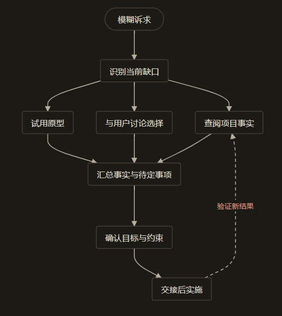

> 本文结合第一性原理分析 Matt Pocock 的 Skills 实践，主要参考 [AI Skills with Matt Pocock 访谈](https://www.youtube.com/watch?v=4DhcSPkEbwI)和 [Skills 项目所引用版本](https://github.com/mattpocock/skills/tree/4ae2317ddb22b046e26455e4f9c9b3aaaf62212d)。

### 引子：一句简单的需求，为什么被追问了 35 个问题？

如果你跟你的 AI 助手说这样一句话：

> “帮我写个接口，查一下某个邮箱是不是我的付费订阅会员。”

你希望它怎么回应你？

多数时候，一个追求“敏捷”的编程 Agent 会立刻开工，几秒钟内生成一段语法漂亮的 API 代码，顺便附带两个看起来很规范的 Mock 测试。代码看着挑不出毛病，但只要你打算把这东西部署上线，现实问题就会接踵而至：这个接口到底给谁调用？认证凭据存在哪里？如果有人恶意暴力枚举邮箱怎么限流？查询结果需不需要加缓存？

在一次技术访谈中，著名技术博主 Gergely Orosz（《The Pragmatic Engineer》作者）就提出了完全相同的一项需求：他想为自己的技术社区活动做一个鉴权接口，让付费订阅者能优先入场。他当时试用了 Matt Pocock 编写的澄清技能 `/grill-me`。

结果，这个 Agent 没有急着写下一行代码，而是反手向他抛出了一连串问题——**整整追问了 35 个之多**。

从认证 Token 采用标准的 Bearer Token 还是放在 JSON/GET 请求中，到防范暴力枚举的速率限制（例如是否严格限制为每日 1000 次），再到接口能为谁调用、禁止谁调用的权限边界，Agent 展开了一场密集的“现场盘问”。Gergely 在播客中回忆说，这个过程既让人有些烦躁，却也实打实地逼着他坐下来把原本模糊的边界逐一想清楚。那种感觉，非常像一位严谨的资深架构师在拉着你做技术评审。[来源：访谈记录](https://github.com/mattpocock/skills/blob/4ae2317/博客访谈1.txt)

这件事耐人寻味的地方，不在于“35”这个数字本身。真正值得每个工程师思考的是：

**为什么一句听起来清清楚楚的需求，背后会潜伏着几十个需要决定的未知项？**
更重要的是：**在真实项目中，Agent 到底什么时候该停下来追问人类？什么时候该闭嘴自己去查代码？而当人类自己都拿不定主意时，一味死板地追问，为什么往往只会演变成灾难性的“打扰”？**

在上一篇中，我们探讨了如何为跨会话的 Agent 建立项目地图。但地图上记录的设计决策，必须先有人将它们制定出来。这一篇，我们将从第一性原理的信息边界、信息净价值与反馈控制出发，解构需求澄清的物理本质，并以 Matt Pocock 的 `grilling`、`prototype` 和 `to-spec` 工作流为实战标本，看清工程落地中的关键取舍。

---

### 一、 为什么人说了需求，对方还是不知道该做什么？

在进入数学推导前，我们先来看一个几乎每个人都经历过的日常生活场景。

晚上你在公司加班，肚子饿了，给家里的伴侣发了条微信：“帮我点份牛肉面外卖吧，谢谢！”

伴侣知道你平时挺喜欢吃牛肉面，便顺手在常吃的一家面馆下了一单招牌香辣牛肉面。半小时后外卖送到工位，你揭开盖子却傻眼了：汤面上漂着一层红油，而你今天偏偏胃炎发作、喉咙肿痛，医生特意嘱咐必须饮食清淡。你有些无奈地发消息：“我今天肠胃不舒服，完全不能吃辣，刚才太忙忘了说。”

在这个场景里，出现了一处关键的信息缺失：**这是一条你脑海中已经存在、但压根没有传达给对方的先验约束。** 伴侣即便再了解你的历史口味，也不可能凭空感知到你今天实时的身体状况。

假设伴侣下单前多问了一句：“你今天身体有什么忌口吗？”
你立刻就会在脑海中调出这项约束，回复说“不要辣”。这一问没有替你发明任何新偏好，却成功把你头脑中已有的隐性信息拉到了对话中。

但故事还没完。伴侣紧接着又问：“这家店的清汤面只有细面和宽面两种，你今晚想吃哪种？”
这一问，你愣住了。因为在发微信之前，你根本没有想过面条宽细的问题，你脑子里原本就没有现成的答案。
伴侣补充说：“宽面有嚼劲，但店里现做要多等二十分钟；细面马上就能出餐送过来。”
你低头看了看表，手里还有紧急 Bug 要修，于是回答：“那选细面吧，能快点送来就行。”

这一次，答案不是从你心里的某个记忆盒子里“掏”出来的，而是在伴侣**列出选项、说明时间与口感的取舍之后，你在现场临时做出的新权衡。**



一个看起来简单的现实请求，其模糊性通常同时来自这两类截然不同的空白：

1. **已有但未传达的隐性约束**：你明明知道接口只供内网使用、绝对不能暴露到外网公网，但你潜意识觉得这是常识，于是一字未提；
2. **尚未形成的现场决策**：你此前从未考虑过如果遇到恶意高频刷接口，系统是直接封禁 IP 还是做指数退避限流，只有当系统列出维护代价与防护效果后，你才能做出选择。

如果 Agent 把这两类空白都当成“不存在”，直接擅自替你挑选一组默认方案开工，交付的结果往往南辕北辙；但如果 Agent 把系统里的每一个实现细节都当成必须由人类审批的问题，用户就会像面对一台审讯机一样，陷入严重的认知疲劳。

界定提问与自主行动的边界，首先必须回到大语言模型的底层物理处境。

---

### 二、 黑屋里的信息物理边界：模型为什么无法凭空“算”出你的需求？

在[《数学基石篇》](/zhangmuchuan/blog/agent-math-foundations/)与[《第一篇》](/zhangmuchuan/blog/agent-loop/)中，我们严格形式化了大模型的物理本质：在大模型单次前向推理过程中，权重矩阵 $\theta$ 是完全冻结的。

我们定义三个核心随机变量：
* 外部真实环境状态 $E \in \mathcal{E}$（包含当前代码库的真实目录结构、线上配置、以及用户内心真实的业务诉求）；
* 输入上下文序列 $C \in \mathcal{C}$（当前推理窗口中实际塞入的所有 Token）；
* 模型输出响应 $R \in \mathcal{R}$（模型生成的解答、思维链推论或工具调用指令）。

由于显卡内的矩阵计算无法绕过上下文直接感应物理世界，系统严格服从**马尔可夫隔离公理**：

$$
P(R \mid C, E) = P(R \mid C) \iff I(E; R \mid C) = 0
$$

这构成了系统必须面对的物理马尔可夫链：

$$
E \longrightarrow C \longrightarrow R
$$

根据信息论中的**数据处理不等式（Data Processing Inequality, DPI）**，可以严格证明：

$$
I(E; R) \le I(E; C)
$$

这个不等式揭示了一个不可逾越的物理边界：**模型输出 $R$ 中所包含的关于真实环境 $E$ 的信息量，绝对不可能超越输入上下文 $C$ 已经包含的信息量。**

很多开发者误以为只要给模型加上足够长、足够深刻的思维链（Chain-of-Thought, CoT），模型就能“推理”出业务的最优解。然而在信息论视角下，思维链本质上只是一个确定性的计算算子，它只能将上下文 $C$ 中蕴含的**隐式信息显式化**，而绝不可能在封闭的“黑屋”里凭空凭概率创造出关于外部环境 $E$ 的新信息。

如果上下文 $C$ 里只有一句话“帮我做个订阅查询接口”，关于“接口运行在什么环境”、“调用方是谁”的互信息几乎为零。此时模型给出的任何架构设计，本质上都是从训练集先验概率中抽样出来的统计猜测，而不是对你具体系统的准确反映。

要让系统在第 $n$ 步可靠交付并达成验证（将剩余不确定性压低至容差阈值 $\varepsilon$ 以内），系统必须满足我们在[《数学基石篇》](/zhangmuchuan/blog/agent-math-foundations/)中形式化证明的**信息完备性方程**：

$$
I_{\text{初始前馈}} + \sum_{k=1}^{n} \Delta I_{\text{外部反馈}, k} \ge I_{\text{目标}}
$$

当初始前馈 $I_{\text{初始前馈}}$ 严重不足时，唯一能够打破马尔可夫隔离墙、弥补信息缺口的手段，就是依靠外部反馈回路 $\sum \Delta I_{\text{外部反馈}}$。这正是 Agent 必须与人或环境发生交互的物理必然性。

#### 动态目标与阶段信息接力

这里有一个很多工程系统容易踩中的理论陷阱：许多人假设目标信息量 $I_{\text{目标}}$ 是一个在任务开始时就恒定不变的静态常数。

但在需求澄清的过程中，**讨论本身往往在不断重塑目标**。
例如最初的诉求只是模糊的“做个接口”。在与用户的讨论中，用户明确表示：“我们下周就要上线，先把外部调用砍掉，只允许内网调用。”

这一瞬间，任务的目标空间已经发生了实质性的漂移。如果我们继续机械地沿着原先设想的“通用开放接口”去设计架构，之前的推演就全成了无用的沉没成本。正如我们在本系列此前的分析中所明确的：**当讨论引发了目标的改变，必须先将新决定落地固化，再以确定后的新目标重新核算实施阶段所需的信息账。**

---

### 三、 查得到的自己查，真正要决定的再讨论

既然信息必须从外部补充，那是不是意味着 Agent 遇到任何未知，都应该跑来向人类提问？

当然不是。在软件工程中，外部信息至少分为两类截然不同的源头：

#### 1. 环境中客观存在的已有事实
* 项目用的是 pnpm 还是 npm？
* 仓库里现有的鉴权中间件是用 JWT 还是用 Session？
* 数据库使用的是 PostgreSQL 还是 Redis？

这些属于**代码与配置中已经固化的环境事实**。根据马尔可夫链，模型虽然在单次推理中看不见它们，但只要系统为 Agent 配备了读盘、搜索工具，Agent 就可以自行执行 `cat`、`ripgrep` 或 `git grep` 等只读操作。把这类问题丢给人类，是对人类最高带宽注意力的纯粹浪费。

#### 2. 涉及价值权衡的主观决策
* 为了赶在活动前上线，是牺牲部分安全性先采用固定 Token，还是必须完整接入 SSO 流程？
* 接口响应速度和数据实时性发生冲突时，是否允许接受 5 分钟的订阅状态缓存？

这些属于**主观效用与风险承担的范畴**。代码库里没有任何一行代码能替用户决定他愿意为项目承担多大的上线风险，这些决策必须由能够对系统后果承担最终责任的人类（$H$ 轴）来拍板。

#### Matt Pocock 的设计标本：决策树与前沿机制（Frontier）

在 Matt Pocock 设计的 [`grilling`](https://github.com/mattpocock/skills/blob/4ae2317/skills/productivity/grilling/SKILL.md) 机制中，我们可以看到非常清晰的应对策略：

1. **依赖前置与问题拓扑（Decision Tree Frontier）**：
   澄清过程并不是照着一份线性的问卷逐条念题，而是维护着一棵**决策依赖树**。
   只有当前置条件明确之后，依赖它的子问题才会进入提问的“前沿（Frontier）”。例如：在尚未确认“是否允许第三方合作伙伴调用”之前，绝不要急着逼问用户“合作伙伴调用超额时采用哪种降级策略”。前置决定的改变，往往会直接对后续的一整片问题分支进行剪枝。
2. **后台子 Agent 异步翻查（Subagent Context Isolation）**：
   当澄清主线需要确认某个代码库事实时，`grilling` 规定由系统派发一个具备干净独立上下文的只读子 Agent 去代码库检索事实，而主会话只专注于推进人类的决策逻辑。

假设 Agent 在分析订阅接口时，想要确认现有的认证机制。它绝不应该直接问人类：“你们项目是怎么做认证的？”而是应该由后台工具在终端中执行检索：

```bash
rg -n 'authMiddleware|verifyToken' src/
```

如果找到了现成的内部鉴权函数，Agent 呈现在人类面前的就不是一道填空题，而是一道带有上下文的确认题：

> “我查看了 `src/middleware/auth.ts`，发现项目中已有供内部服务调用的 `verifyInternalToken` 中间件。
> 既然第一版查询仅限内部活动系统调用，我建议直接复用该中间件，本次暂不引入外部 OAuth。你是否同意？”

从“提问”变成“基于事实给出有理有据的建议”，人机之间的交互带宽在这里发生了质的跃迁。

---

### 四、 一个问题值不值得问？信息净价值方程（VoI）

即使一个问题属于主观决策，Agent 就一定要马上问出来吗？

想象一下，如果 Agent 在讨论接口设计时，顺便问了你一句：“管理后台表格里的‘查询按钮’，背景颜色是用 `#0066FF` 还是 `#0055EE`？”
你大概会觉得这个助手脑子有些拎不清。

为什么？因为虽然按钮颜色也是一项“需要人类决定的主观偏好”，但它对当前后端核心架构的推进几乎没有任何决定性影响。

在[《第二篇》](/zhangmuchuan/blog/agent-control/)中，我们严格区分了两个概念：**信息量**与**决策价值（Value of Information, VoI）**。

* **信息量（Mutual Information）**：纯粹衡量不确定性消除的程度；
* **决策价值（VoI）**：衡量获得这笔信息后，**能否实质性地改变系统的后续行动，从而提升最终的预期效用**。

设当前上下文为 $C_t$，候选行动为 $a \in \mathcal{A}$，环境未知状态为 $Z$，行动效用为 $U(a, Z)$。若针对某个问题 $q$ 询问人类并获得答案 $Y_q$，该问题的**预期信息价值（VoI）方程**为：

$$
\operatorname{VoI}(Y_q \mid C_t) = \mathbb{E}_{Y_q \mid C_t}\left[\max_{a} \mathbb{E}[U(a, Z) \mid C_t, Y_q]\right] - \max_{a} \mathbb{E}[U(a, Z) \mid C_t]
$$

引入量纲折算与风险偏好系数 $\lambda > 0$，扣除人类介入的时间精力消耗与认知打断成本 $\operatorname{Cost}(q)$，得到支配提问决策的**预期信息净价值方程（核心方程二）**：

$$
V_{\text{净}}(q \mid C_t) = \operatorname{VoI}(Y_q \mid C_t) - \lambda \mathbb{E}[\operatorname{Cost}(q) \mid C_t]
$$

这笔账清楚地解释了提问的经济学本质：

* **高净价值问题**（$V_{\text{净}} \gg 0$）：例如“是否开放公网访问”。如果答案为“是”，行动必须走 API 网关与速率限制架构；如果为“否”，则直接走内网 RPC/轻量认证。答案直接导致后续架构行动发生重大分叉，且一旦做错重构代价极大，必须立即停下来提问。
* **零/负净价值问题**（$V_{\text{净}} \le 0$）：例如“未命中的查询返回 HTTP 404 还是带有布尔值的 200 OK”。在项目早期这属于极易重构的小约定，Agent 完全可以按照业界惯例先定下一个默认方案并在日志中注明，而不是用琐碎细节阻断整个会话。

#### 35 个问题的代价与“一键 Yes”的陷阱

回到 Gergely 经历的 35 个问题。尽管访谈中确认这最终帮他理清了思路，但在工程现实中，**人类的注意力是有严格容量极限的**。

面对 35 个连续涌来的问题，人类的审阅质量会随着轮次迅速衰减。Matt 的 [`grill-me`](https://github.com/mattpocock/skills/blob/4ae2317/skills/productivity/grill-me/SKILL.md) 为了降低回复摩擦，做了一个非常聪明的工程设计：**它强制要求 Agent 在每个问题后附带一个推荐默认值，并允许人类直接回复“yes”快速确认。**

这种设计极大降低了人类的敲键盘成本，但也在控制论上埋下了一处隐蔽的漏洞：**被动同意导致的虚假收敛（False Convergence）。**

当一个人面对第 20 个问题时，注意力疲倦往往会促使他本能地一路盲按“yes”。表面上，Agent 收集齐了所有决策输入，满足了形式上的信息完备性；但实质上，这些“决策”并没有经过人类真实的深度校验。一旦推荐答案中夹带了不符合实际业务环境的默认假设，系统就会基于错误的预设越走越偏，直到交付验收时才全面暴露。

因此，真正高效的澄清流程，绝不能把“问出更多问题”当成 KPI。在很多时候，当人自己也茫然时，最好的下一步根本不是继续追问。

---

### 五、 当用户说“我不知道”：下一步不是换着姿势继续问，而是做原型

在需求澄清的过程中，最让初级工程师或死板 Agent 抓狂的一句话往往是：**“这我也拿不准，我不知道。”**

我们来看订阅接口延伸出的一个具体业务冲突：
为了配合订阅查询，社区要上线一个付费会员优先报名的售票逻辑。活动名额极其有限，一旦有已报名的会员临时取消：
* **方案 A**：名额瞬间回流到公共池，先到先得；
* **方案 B**：名额先锁定 30 分钟，按排队顺序推送给候补队列里的会员。

Agent 向用户详细解释了方案 A 容易引发秒杀争抢，方案 B 逻辑链路较长。用户听完之后回复：“这两个方案听起来都有道理，但我实在想象不出用户用起来到底顺不顺畅，我现在不知道选哪个。”

此时，如果 Agent 像个固执的面试官一样，把两种方案换个句式再问三遍，只会让对话彻底陷入死锁。因为此时人类的认知卡点**不是缺乏表达意愿，而是缺乏用于比较的物理体验**。

#### Matt Pocock 的破局工具：`prototype`（探索型探针）

面对这种卡点，Matt Pocock 给出的工程解法非常干脆——调用 [`prototype`](https://github.com/mattpocock/skills/blob/4ae2317/skills/engineering/prototype/SKILL.md) 技能。

它的核心理念极其纯粹：**原型不是半成品的生产代码，而是一个为了回答特定未知而迅速构建的临时可丢弃探针。**

Agent 会立即在独立的一次性分支上，写一个极其简陋但完全可交互的单文件 HTML 页面：
* 页面上只画出三个模拟按钮：“模拟会员报名”、“模拟临时退票”、“模拟候补确认”；
* 内存中用几个简单的变量实时显示名额数量与候补队列。

用户打开浏览器，亲手点几下：把名额点满，让候补入队，然后点击退票。在方案 A 模式下，用户看到退票名额瞬间闪现又被路人抢走，候补会员毫无感知；而在方案 B 模式下，系统清晰显示名额暂留给排在第一位的候补者。

亲手操作完这不到两分钟的极简 Demo，用户心里的困惑瞬间消散：“候补者特意排了队，退出来的票绝不能直接让路人捡漏，我们选方案 B！”

这个过程在控制论上极具启发性：
这正是我们在[《数学基石篇》](/zhangmuchuan/blog/agent-math-foundations/)中论证的**双重控制准则（Dual Control —— 边做边探的认知价值）**在需求澄清阶段的绝佳工程映射。在秒级可运行且可随时丢弃的轻量沙箱里，编写极简原型的试错代价几乎为零（$\operatorname{Cost} \to 0$）。

**当纯语言的文本问答撞上人类认知的表达天花板时，一段低成本的可运行代码能够成为最高效的反馈探针。** 它不仅具有推进行动的控制价值，更兼具诱导真实反馈的高认知价值——将抽象的逻辑规则映射为人类直觉可以直接操作的物理体验，从而在几分钟内自然促成了此前单凭空想无法得出的确定性决策。

当然，我们必须对这种探针保持清醒的边界认知：
这个 HTML 原型证明的，仅仅是“方案 B 在交互逻辑上更符合用户心理”；它绝不证明方案 B 的分布式锁能在高并发场景下防超卖。**探针只负责消除特定的决策未知，绝不能直接被当成生产实现的基石。**

---

### 六、 决定形成了，怎样跨会话交接？从准备反馈到实施前馈

经过了代码检索、关键问询、以及原型的实际试用，人类与 Agent 终于把原本模糊一团的诉求拆解成了几项铁打的决策：
1. 接口仅供内部调用，复用已有鉴权中间件；
2. 允许对订阅状态做 60 秒的本地轻量内存缓存；
3. 退订名额优先向候补名单锁定 30 分钟。

现在，需求澄清阶段大功告成。在标准的现代 Agent 工作流中，后续繁重的具体编码任务往往会交由全新的、具备干净上下文的工作 Agent（如 Coding Agent）去实施。

这就引出了我们在[《数学基石篇》](/zhangmuchuan/blog/agent-math-foundations/)与本系列此前的分析中形式化证明的**阶段切分推论（Phase Cut Handover）**。在目标固定且准备信息完整保留的前提下，整个任务的信息账可以严格在实施起点切开：

$$
I_{\text{实施前馈}} = I_{\text{初始前馈}} + \sum_{k=1}^{\tau} \Delta I_{\text{准备阶段}, k}
$$

这个方程揭示了工程交接的深刻物理意义：
前馈与反馈从来不是信息固有的静态身份，而是取决于被观察过程的起点。**对于整个大任务而言，前期在翻代码、问人类与试玩原型中取得的所有信息，全部是与环境交互得来的“反馈”；但当切分进入实施阶段时，接手者启动时实际收到的这份汇总记录，又构成了实施阶段的“前馈”。**

#### 为什么必须有 `to-spec`？（拒绝上下文过程残骸）

很多团队在这里犯过一个低级错误：直接把上一轮澄清过程中长达几十轮的漫长对话记录，完整地作为历史 Prompt 塞给负责写代码的新 Agent。

这会引发极其严重的**注意力稀释与过程残骸污染**：
在长达三十几个问题的密集讨论中，充满了被推翻的中间假设、被否决的临时方案、以及调试原型时的杂乱日志。新 Agent 读到这些庞杂的历史信息，极容易把讨论初期被否决的“公网开放方案”误当成最终指令。

Matt Pocock 设计的 [`to-spec`](https://github.com/mattpocock/skills/blob/4ae2317/skills/engineering/to-spec/SKILL.md) 技能，精准地击中了这一痛点：
它的唯一职责，就是在澄清会话结束前，将所有的有效沉淀提炼成一份高度结晶的规范说明（Spec），并直接发布到项目的任务跟踪系统中（如 GitHub Issue 或 Jira）。

一份优秀的结晶 Spec 绝不是简单的对话摘要，它必须清晰界定系统的**正向空间与负向空间**（在 Matt 的设计中，为了防止文档因代码变迁而提前失效，他甚至严禁在 Spec 中硬编码易变的文件路径，只锁定模块职责与行为边界）：

```markdown
## 活动报名订阅查询接口：设计与实施规范

### 1. 已核实的环境事实 (Ground Truth)
- 复用鉴权模块中的内部验证逻辑（无需引入外部 OAuth）。
- 环境变量读取 `INTERNAL_SERVICE_SECRET`。

### 2. 人类明确做出的架构决策 (Confirmed Decisions)
- **范围**：第一版仅供内部系统调用，不暴露公网路由。
- **缓存**：采用内存缓存，TTL 设定为 60 秒。
- **名额流转**：退票释放的名额优先进入候补锁定池（30 分钟窗口）。

### 3. 本次严格禁止的动作 (Out of Scope / Negative Space)
- 严禁引入第三方外部 OAuth 登录逻辑。
- 严禁修改现有的生产数据库表结构（仅操作已有状态字段）。

### 4. 验证接缝 (Verification Seams)
- 提供单元测试覆盖：有效 Token 访问、无效 Token 拦截、60 秒缓存命中与穿透。
```

从信息论的角度来看，根据数据处理不等式（DPI），这份 Spec 并没有给系统凭空创造新的绝对互信息（$I(Z; \text{Spec}) \le I(Z; C_{\tau})$）。但在真实的大模型计算中，有限注意力的 Transformer 从庞大杂乱的对话中提取有效信息的损耗极高；Spec 通过剔除过程残骸、隔离负向空间，**将关键决策的信噪比（SNR）和有效可利用信息（Usable Information）提升到了极致**。它让负责具体编写代码的 Agent 在初始化加载的一瞬间，就获得了高度完备、零歧义的初始前馈。

---

### 结语：好的澄清，是让人更有能力做决定

回顾 Gergely 经历的那 35 个问题，我们终于能够用从容、客观的第一性原理透视整个全貌：

需求澄清从来不是一场“把人关在屋子里审问”、直到把所有未知榨干为止的消耗战。大模型的物理黑屋边界决定了它必须依赖外部交互，但**一个成熟的工程系统，必须学会对不同的未知采取截然不同的策略**：

1. **能在代码库里查到的事实，闭嘴自己去查**；
2. **需要人类决定的重大分水岭，用最小认知摩擦的方式提问，并根据先决条件严格组织决策拓扑**；
3. **人类自己也拿不准的体验模糊区，不要逼问，迅速抛出可交互的极简原型让直觉说话**；
4. **讨论形成的确定性成果，立即结晶为去噪的 Spec，为下一次会话提供坚固的前馈锚点**。

所谓的智能体工程，其最终目的绝不是为了向人类炫耀它能提出多么庞杂深奥的问题，而是通过严密的反馈控制与信息筛选，在纷乱复杂的真实世界里，帮人类把真正重要、不可妥协的选择，一件一件清晰地摆在眼前。

---

### 参考资料

本文对 Matt Pocock Skills 的分析以本地仓库提交 `4ae2317` 为准；播客是单独保存的访谈记录，不假定它与该提交发生在同一天。除明确归属于访谈的内容外，正文中的订阅查询细节、外卖与活动报名原型均为说明问题而构造的场景。

- [AI Skills with Matt Pocock 访谈记录](https://www.youtube.com/watch?v=4DhcSPkEbwI)
- [Matt Pocock Skills 项目说明](https://github.com/mattpocock/skills/tree/4ae2317)
- [grill-me 规范](https://github.com/mattpocock/skills/blob/4ae2317/skills/productivity/grill-me/SKILL.md)与[配套说明](https://github.com/mattpocock/skills/blob/4ae2317/docs/productivity/grill-me.md)
- [grilling 规范](https://github.com/mattpocock/skills/blob/4ae2317/skills/productivity/grilling/SKILL.md)
- [grill-with-docs 规范](https://github.com/mattpocock/skills/blob/4ae2317/skills/engineering/grill-with-docs/SKILL.md)与[domain-modeling 规范](https://github.com/mattpocock/skills/blob/4ae2317/skills/engineering/domain-modeling/SKILL.md)
- [prototype 规范](https://github.com/mattpocock/skills/blob/4ae2317/skills/engineering/prototype/SKILL.md)与[逻辑原型说明](https://github.com/mattpocock/skills/blob/4ae2317/skills/engineering/prototype/LOGIC.md)
- [to-spec 规范](https://github.com/mattpocock/skills/blob/4ae2317/skills/engineering/to-spec/SKILL.md)与[to-tickets 规范](https://github.com/mattpocock/skills/blob/4ae2317/skills/engineering/to-tickets/SKILL.md)
