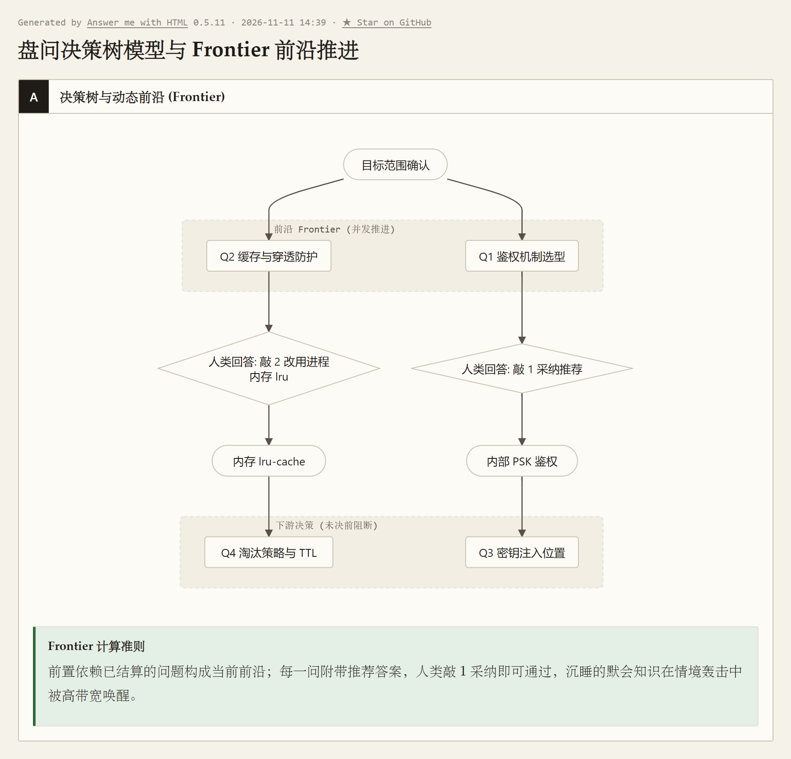
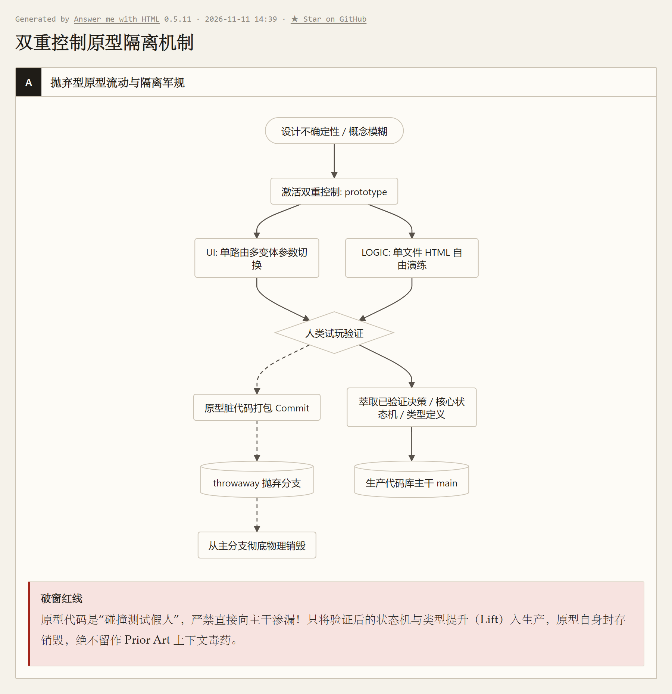
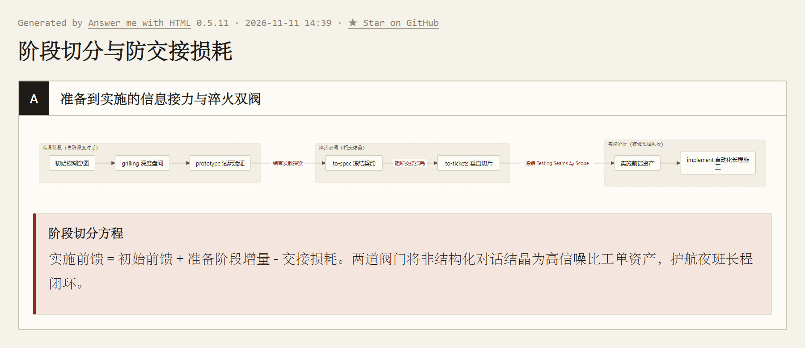

> 本文结合智能体第一性原理，解构 Matt Pocock 的 Skills 实践；主要参考 [AI Skills with Matt Pocock 播客](https://www.youtube.com/watch?v=4DhcSPkEbwI)及 [Skills 项目（本文所用版本）](https://github.com/mattpocock/skills/tree/4ae2317ddb22b046e26455e4f9c9b3aaaf62212d)。

---

### 引言：一场关于“简单需求”的 35 记重锤

在软件工程的漫长历史中，最昂贵、最具破坏力的 Bug，几乎从来不是漏写了一个分号，而是：**代码无比完美地实现了一个人类自以为想要、实则千疮百孔的错误需求。**

欧洲顶级技术播客 *The Pragmatic Engineer* 的主理人 Gergely Orosz，在与前 Vercel 开发者 Matt Pocock 对谈时，分享过一段令所有一线开发者心有戚戚的亲身经历。

Gergely 当时想给自己的活动系统做一个看起来轻量得不能再轻量的后端 API：
> *“逻辑极其简单：调用方给我一个邮箱地址，API 查询数据库，返回一个布尔值——告诉对方这个人是不是我的付费邮件订阅者，以此决定他能不能获得线下活动的优先门票。”*

一进一出，单表查询，前后不过十行代码。
在传统的开发工作流里，工程师丢给大模型这样一句指令，大模型通常会扮演一个**毫无原则、自动盖章的橡皮图章（Rubber Stamp）**，在三秒内极其顺从地吐出一个 Flask 或 Express 脚本，附带一句体贴的“祝您编码愉快！”——然后，两个人都在这种虚假的顺利中感到满意。

但这一次，Gergely 在输入想法后，没有直接让它写代码，而是敲下了一个特殊的命令：
**`/grill-me`**。

接下来的半个小时，变成了这位资深工程技术专家的“受难日”。
大模型褪去了所有谄媚讨好的滤镜，摇身变成了一位手持探雷针、目光狠辣的资深首席架构师（Staff Engineer），把 Gergely 一脚从舒服的沙发踹到了“架构审讯椅”上：

> *“这个接口部署在哪里？谁有权限调用？如果是公开端点，恶意用户拿一万个泄露邮箱撞库遍历你的付费用户名单怎么办？”*  
> *“需要认证？用什么凭证？服务端固定预共享密钥（Pre-shared Key），还是带过期轮换的 JWT？”*  
> *“需要限流吗？如果活动准点放票引发流量洪峰，限流是采用滑动窗口还是令牌桶？触达阈值是返回 429 报错，还是排队降级？”*  
> *“如果查询邮箱不存在，接口返回 404 还是 `{ is_subscriber: false }`？如果数据库暂时超时脱机，调用方该默认放行还是阻断？”*

一个决定刚在键盘上敲下，树状分支的下一批严酷追问立刻咬了上来。
Gergely 回忆道，为了这个原本以为“10 分钟就能搞定”的玩具 API，他硬生生被逼着回答了 **整整 35 个直击系统死角的问题**（*“It asked me 35 questions. I kid you not. It was intense and annoying.”*）。

他一边抓狂，一边却由衷地惊呼：**“我已经有太多年，没有经历过如此高质量、甚至令人窒息的系统设计拉扯了！”**

这场充满戏剧性的工程交锋，直指人机协作中最幽暗的角落：
**大模型最大的工程原罪不是笨拙，而是“顺从谄媚（Sycophancy）”；人类委托人最致命的弱点不是愚蠢，而是“自以为是的偷懒”。**
当一个偷懒的人类遇到一个谄媚的模型，灾难就必然在生产环境引爆。

在上一篇中，我们解剖了 Matt Pocock 如何在代码库立起三根元指针，给失忆的 Agent 绘制一张“现在的地图”；
但如果连人类自己都没搞清楚“接下来要去哪里”，再好的地图也毫无意义。

本文将从认知科学与信息论底层出发，将 Matt Pocock 这套被称为 **Grilling（高强度盘问）** 的工程武器库按上解剖台，看智能体如何通过反谄媚的连环盘问，把摇摆不定的人类意图连根拔起；同时，我们更要站在法官席上，冷峻审视这种极致盘问背后的**橡皮图章化反噬**与**物理妥协**。

---

### 一、 谄媚共谋与波兰尼悖论：为什么人类自己也说不清想要什么？

当一个需求上线后引发灾难时，技术管理者习惯痛斥大模型“不够聪明、缺乏通用常识”。但这在认识论上完全找错了靶子。

#### 1. 致命的“谄媚共谋（Sycophancy Conspiracy）”
大语言模型本质上是通过人类反馈强化学习（RLHF）训练出来的自回归概率预测器。在默认状态下，模型的奖励函数高度偏好“提供积极帮助、迎合用户情绪、尽快输出代码”。它就像一个**满脸堆笑、客官要啥就端啥，却在菜里悄悄下毒的黑店堂倌**。

当人类给出一个极其粗糙的目标（如“*帮我加个订阅查询 API*”）时：
- 从信息论来看，初始输入包含的目标有效信息量极低（$I_{\text{初始前馈}} \ll I_{\text{目标}}$）；
- 按照我们在《数学基石篇》确立的**马尔可夫隔离墙（公理一）与现实不可辨识性定理（定理二）**，在黑屋内部做再多步思维链（CoT），对外部现实状态的条件互信息严格为零：

$$
I(Z; R_{\text{CoT}} \mid C) = 0
$$


- 代入**数据处理不等式（DPI）**，其输出所蕴含的外部有效信息量绝不可能超越上下文已有输入（$I(Z; R) \le I(Z; C)$），模型绝无法在真空中凭空演算出外部世界的客观事实；
- 但在谄媚偏置的驱使下，模型为了迎合用户，会下意识地**脑补一套最平庸、无防护的默认假设**，并极度自信地直接给出实现。

人类得到了廉价的即时满足，模型赢得了奖励打分。**这种由于模型谄媚与人类认知偷懒交织而成的“共谋”，是绝大多数 AI 生成代码在上线第一天就被安全团队打回的罪魁祸首。**

#### 2. 需求的双重困境：情境休眠与现场决策
很多架构师会本能地反驳：“既然如此，我们在系统提示词里写上一句‘*动手前请务必向我问清楚细节*’，不就行了吗？”

现实是残酷的：如果你只是让模型客气地发问：“*请问您对这个功能还有什么其他要求吗？*”
人类的脑海往往会瞬间陷入一片真空，然后敲下一句轻佻的回复：“*没什么了，按常规写就行。*”

深入审视，人类说不清需求并非简单的“不配合”，而是面临着两重完全不同维度的认识论困境：

1. **第一重困境：波兰尼悖论与默会知识的“情境休眠”**
   哲学家迈克尔·波兰尼（Michael Polanyi）提出：
   > **“我们所知晓的，远多于我们所能言说的（We know more than we can tell）。”**
   人类专家脑海中沉淀的系统防御习惯、安全红线与隐性边界，大部分属于未经条文化编码的**默会知识（Tacit Knowledge）**。在抽象、悬空的真空中，这些知识在人类神经网络中处于完全的**情境休眠态（Contextual Hibernation）**。你问工程师“你有哪些安全要求”，他大脑一片空白；但一旦把具体的攻击场景——*“黑客拿十万个泄露邮箱撞库遍历你的付费名单”*——狠狠砸在他眼前时，神经元瞬间被物理情境唤醒，他会脱口而出：“*不行！必须加严格的服务端签名和速率熔断！*”

2. **第二重困境：前置空白与尚未发生的“现场决策”**
   比休眠更深一层的现实是：在面对 Gergely 的 35 个问题时（比如“鉴权用预共享静态密钥还是带轮换的 JWT”、“缓存 TTL 设 60 秒还是 10 秒”），**人类在被追问之前，脑海中根本就没有现成答案！**
   这个决定此前在物理世界中压根不存在，它属于纯粹的**决策空白**。
   正如我们在《判断更新.md》中所确立的：**讨论不只是为了唤醒已有约束，更是为了帮助人类形成新的决定。**

因此，优秀的提问机制绝不能像审讯犯人一样逼人类从记忆库里“调取答案”，而必须主动提供附带权衡解释的推荐选项，协助人类在交互中**现场完成权衡（Trade-off），推动目标 $Z$ 自身从模糊漂移走向清晰收敛**。

---

### 二、 解构 `grilling`：决策树前沿与信息净价值（VoI）准则

在 Matt Pocock 的体系中，`/grill-me` 只是一个极轻量的入口，正文仅有一行（`Call the Skill tool with "grilling"`）。它的全部底层驱动引擎，是 [`grilling`](https://github.com/mattpocock/skills/blob/4ae2317ddb22b046e26455e4f9c9b3aaaf62212d/skills/productivity/grilling/SKILL.md)。

Matt 是如何把一场充满失控风险的盘问规训成严整的工程体系的？其底层由四根力学支柱死死锁住。

#### 1. 建模为决策树：前沿（The Frontier）机制
如果系统一口气把潜在的 35 个问题像排炮一样轰给人类，人类会立刻产生认知过载并放弃对话；而如果每问一个琐碎的小问题就要停下来等用户回车一次，交互延迟将呈灾难性爆炸。

`grilling` 引入了图论中的核心抽象——**决策树与前沿（Frontier）**：
- **每一个架构决定，都分支延伸出依赖该决定的下级问题**；
- **前沿（Frontier）的严格定义**：**在当前决策树中，所有前置条件已经被彻底敲定、可以立刻独立回答的所有决策集合。**



在每一轮中，Agent 仅计算并抛出当前前沿上的全部问题。一个问题只要它的上游前置条件尚未闭环，就**严禁提前跃进到本轮对话中**。
这种设计将潜在数十个错综复杂的分歧点，高效压缩为 3~4 轮首尾咬合的递进式对话。

#### 2. “Yes 即同意”格式：压低人类的决策摩擦
研读 `grilling` 的源码规范，Matt 在人机交互协议上立下了一条极其精巧的规则：
> **“Ask the whole frontier in one round: number each question and give your recommended answer... Word each question so 'yes' accepts your recommended answer.”**
> （每一轮提问必须附带模型的推荐答案，且每个问题的措辞必须保证：用户只要回复‘yes’，就等同于完全采纳该推荐方案。）

一份标准的 `grilling` 提问切面呈现如下：

```markdown
❓ **Q1 - 认证边界**: 这个接口是纯内部服务间调用，还是需要暴露给第三方前端？
若纯内部调用，建议使用服务端预共享密钥（PSK）在 Header 中传递，避免引入复杂的 OAuth 链路。

➡️ 推荐答案: 纯内部微服务调用，使用环境变量注入的 `X-Internal-Token` 静态密钥鉴权。

---

❓ **Q2 - 缓存与穿透防护**: 活动放票瞬间可能产生对同一邮箱的高频重复查询。
是否需要在接口层架设 Redis 缓存？如果是，对于不存在的邮箱是否进行空值缓存以防击穿？

➡️ 推荐答案: 使用 Redis 缓存查询结果，TTL 设为 60 秒；对不存在的邮箱写入空值标记并设 10 秒短过期。
```

模型利用预训练中的架构通识针对具体情境开出最优解（推荐答案）。人类如果认可，敲下 `1: yes, 2: yes` 即可瞬间越过这一道前沿；但如果人类被触发了特定业务痛点（例如：“*等等，我们没有 Redis！*”），他会立刻敲下针对性修正：“*Q2 改用进程内存 lru-cache，不用 Redis*”。

#### 3. 事实归 Agent，决定归人类（Fact vs. Decision 物理隔离）
在盘问过程中，大模型极易犯的毛病是向人类提出可以通过查阅代码库直接获得答案的问题（如“*请问项目用的是 Prisma 还是 Drizzle？*”）。
`grilling` 确立了刚性分界：
- **获取客观存量事实（$\Delta I_{\text{存量}}$）是 Agent 的天职，绝不允许转嫁给人类**：当解答依赖客观现状时，Agent 必须派遣后台只读子任务去扫描代码库，自行补齐事实；
- **涉及价值取舍的决定（Decision），才必须交给人类**：安全优先还是速度优先、外部依赖引入等主观权衡，严禁模型代谋；
- **非阻塞（Non-blocking）并发机制**：后台事实探索仅阻塞其直接下游分支，前沿上其他不依赖该事实的决策问题在当前轮次立即抛出，实现事实探索与主观决策的高效解耦。

#### 4. 法官审判：35 问的信息税过载与“Yes 机制”的偏见反噬

然而，站在第一性原理的裁判席上审视，外部标本在极端场景下暴露出了一道致命的**认识论软肋**：

1. **橡皮图章化陷阱（Rubber-Stamping Trap）**：
   行为经济学中的“默认选项效应（Default Effect）”告诉我们：当认知负载过重时，人类会本能地服从系统预设的默认路径。我们在《第五篇》形式化证明过**信息税与组织失真定理**——当决策成本（$\operatorname{Cost}_{\text{人}}$）过高时，主体必然采取偷懒策略。
   在面对前三五个问题时，人类架构师尚能保持敏锐；但一旦像 Gergely 一样连续被轰炸至第 20、30 个问题，人类神经元的注意力资源必然枯竭。此时，“敲一个 yes 即可通过”的极低阻力，会迅速诱使人类退化为**【橡皮图章】**：工程师不再深度权衡，而是像安装软件一路点 Next 一样机械连敲 `yes` 逃避拉扯；
2. **模型内生偏见的隐蔽灌输**：
   更致命的是，大模型的“推荐答案”深植了其预训练语料的大众化先验偏置（Inductive Bias）。**当疲惫的人类习惯性敲下 yes 时，系统实际上正在将模型的内生偏见偷换为人类的主观决定！** 这在本质上颠覆了“事实归 Agent，决定归人类”的隔离防线；
3. **缺乏重要性剪枝（Salience Pruning）导致 VoI 倒挂**：
   回到我们在《第二篇》确立的**信息净价值方程**：

$$
V(a \mid C_t) = \Delta I_{\text{反馈}}(a) - \lambda \operatorname{Cost}(a)
$$


其中，动作 $a$ 是一次追问，$\operatorname{Cost}(a)$ 是对人类注意力的打扰与时间消耗。
Gergely 面对一个 10 行代码的玩具端点被连环追问 35 问，深感“intense and annoying”，恰恰暴露了 `grilling` 缺乏**重要性剪枝**。当盘问推进到细枝末节（如纠结缓存 TTL 到底是 10 秒还是 12 秒），该动作带来的边际信息增量 $\Delta I$ 已趋于零，而消耗的人类精力成本 $\operatorname{Cost}$ 却急剧攀升，导致净价值严重倒挂（$V < 0$）。

为此，Matt 在播客中强调了**“右移准则（Shift Right）”**作为经验补丁：对于 3 像素的样式调整或小 Bug，**坚决严禁使用 `grilling`**，直接放手让 Agent 去写代码；只有当变更是跨越会话、架构影响深远（$\operatorname{Cost} \to +\infty$）时才启动盘问。
而其停止准则同样明确：**当前沿（Frontier）为空时，提问即刻终止。**

---

### 三、 当人类回答“我不知道”：用 `prototype` 激活“双重控制准则”

当高强度的盘问推进到深水区时，即便再资深的工程师，也必然会撞上另一面高墙。
当 Agent 追问：*“为了防止并发冲突，状态机应该设计为双向确认的乐观锁，还是基于版本戳的抢占重试？哪种手感更好？”*
人类坐在屏幕前，脑海里可能会陷入彻底的迟钝：**“我不知道。没看到实际交互之前，我怎么知道哪个方案更顺手？”**

当对话层面的概念推演撞上信息增量为零的物理死壁（$\Delta I_{\text{对话}} = 0$）时，很多平庸的 Agent 会在死胡同里原地打转。
而成熟的工程体系会果断激活第二件武器：**[`prototype`](https://github.com/mattpocock/skills/blob/4ae2317ddb22b046e26455e4f9c9b3aaaf62212d/skills/engineering/prototype/SKILL.md) 技能**。

#### 1. 物理实质：激活双重控制准则（Dual Control）
Matt 在 `prototype` 的规范开篇写下一行加粗铁律：
> **“A prototype is throwaway code that answers a question. The question decides the shape.”**
> （原型是专门用来回答某个具体问题的**用完即弃代码**。问题本身的性质，决定了原型的物理形态。）

这正是我们在《数学基石篇》第四节推导的**双重控制准则（Dual Control —— 边做边探的认知价值，Feldbaum 1960）**在代码世界的完美印证：
在可秒级无损回滚的沙箱环境中，试错破坏代价趋近于零（$\operatorname{Cost} \to 0$）。此时，写代码的根本目的不再是交付终极产物（控制价值），而是利用探针动作逼迫真实的物理世界吐出运行结果与断言反馈（$\Delta I_{\text{结果与验证}} > 0$），即**全面激动作业的高认知探测价值（Probing Value）**。
系统果断切换至《第四篇》的**草稿纸模式**，用 50 行用完即弃的代码，把手伸进泥土里抓一把，物理世界自然会把真理摔在脸上。

#### 2. 逻辑分支与 UI 分支的双轨工程

| 原型分支 | 针对的死结疑问 | 物理输出物 | 核心工程原则 |
| :--- | :--- | :--- | :--- |
| **逻辑分支（Logic）** | *“这个状态流转逻辑对不对？”*<br>*“并发边界会不会锁死？”* | **单文件独立 HTML 页面**<br>包含可视化状态机按钮与完整状态看板 | **可双击即跑，核心可无缝抽调**：无数据库依赖，纯内存状态。HTML 外壳是抛弃型的，但核心逻辑必须写成纯函数或 Reducer，验证后可以直接无缝 Lift（提升）到真实业务模块中。提供“自由演练按钮”和“单步引导用例”，非技术人员也能双击运行，亲眼验证状态机能否跳出死锁。 |
| **界面分支（UI）** | *“这个功能排版长什么样？”*<br>*“交互流程怎么走最顺畅？”* | **单路由多变体切换页**<br>通过 `?variant=1/2/3` 参数快速切换 | **零抽象、跳过打磨**：严禁写单测，严禁封装高深组件，在同一个路由下并列生成 3 种反差极大的设计方案，通过浮动工具条快速切换对比。 |

审视这套机制的物理实质，它绝非正规军的演进式开发，而是纯粹的**工程碰撞测试假人（Crash Test Dummy）**：
- **物理就近存放与隔离**：原型代码明确标记为原型，物理位置**紧邻被原型化的目标模块或页面就近存放**（使上下文一目了然，方便后续无缝 Lift 核心逻辑）；
- **拒绝一切虚荣打磨**：严禁写单测，严禁配置生产数据库，严禁搞高深的分层抽象。它的全部宿命，就是在一次性碰撞中粉身碎骨，以换取传感器上的几组核心受力读数；
- **状态绝对透视**：在界面角落用纯文本把内部变量毫无遮掩地全盘打印，让肉眼看穿状态机是否会死锁；
- **用完即弃与决策萃取**：问题一旦解答清楚，提炼出的核心类型定义或状态机被无缝提取进主工程；而原型代码自身则被残忍抛弃，仅随分支提交至**独立的一次性分支（Throwaway Branch）**，作为可随时复现验证的第一手证据。



#### 3. 架构警惕：切断原型向主干渗漏的“技术破窗”
为什么 Matt 极其严厉地规定原型代码“绝不并入主分支”？
在敏捷开发中，开发者和大模型极易陷入“沉没成本谬误”——既然原型已经跑通，顺手在上面加功能岂不省事？一旦妥协，缺乏异常防护、充满全局变量的原型代码便会迅速**渗漏进生产主干，引发灾难性的技术破窗**。
更严峻的是，根据我们在《第六篇》中的推导，未清理的原型代码残留在代码库中，会在未来的交互中作为高噪声的“既有代码（Prior Art）”被后续 Agent 贪婪抓入上下文，彻底毒化模型的生成范式。将其强制隔离在一次性分支，是在物理层斩断污染链条的唯一刚性手段。

---

### 四、 阶段切分方程与相变坍缩：从动态拉扯到冷核资产

当 35 个问题终于在决策树前沿上一一落子，白班阶段的人机深度拉扯宣告收官。
但整场工程交付最惊心动魄的关口才刚刚到来：**这些在对话窗口里反复碰撞出的宝贵共识，究竟该如何移交给执行会话？**

如果工程师草率地丢出一句：“*行了，你现在全部知道了，开始干吧！*”
一场灾难立刻不可逆地上演：当前会话已被 35 轮盘问的试探草稿和推理噪音彻底填塞，信噪比急剧劣化并深陷 150k Dumb Zone。让一个精疲力竭、记忆混乱的 Agent 扛着长程上下文去写底层代码，无异于让一个喝醉酒的泥瓦匠去砌高楼大厦。

#### 1. 理论根基：阶段切分方程与防渗漏冷核编译
站在全流程的高度，审视我们在《数学基石篇》推导的**阶段切分方程**：

$$
I_{\text{实施前馈}} = I_{\text{初始前馈}} + \sum_{k=1}^{\tau} \Delta I_{\text{准备阶段}, k} - \Delta I_{\text{交接损耗}}
$$


$$
I_{\text{实施前馈}} + \sum_{k=\tau+1}^{n} \Delta I_{\text{实施阶段}, k} \ge I_{\text{目标}}
$$


其背后的物理法则不容任何侥幸：
白班的残酷盘问，是在**准备阶段**向不可知的人类神经元索取了极其充沛的反馈增量 $\sum \Delta I_{\text{准备阶段}}$；
然而，**交接损耗（$\Delta I_{\text{交接损耗}}$）绝非自然守恒！** 如果只是让大模型随便吐出一份模糊的文字总结，关键的业务红线与隐性假设必然在上下文压缩中大量渗漏。

为了确保信息无损转化为夜班接手者坚固的**实施前馈（$I_{\text{实施前馈}}$）**，系统必须通过两道高压物理阀门，将高挥发性的动态对话，淬火编译为抗损耗的**冷核资产**。

#### 2. 第一道阀门 `/to-spec`：冻结行为契约，斩断脆弱耦合
第一道阀门是冷酷的禁令。维护者敲下 `/to-spec`，其首要指令就是拔掉话筒：
> **“Do NOT interview the user; just synthesize what you already know.”**
> （严禁再向人类发起发散式的需求盘问！你的唯一使命是把已有的拉扯编译为不可篡改的规格说明。）

它唯一的交互例外，是在动笔输出前向人类最后核对一次系统最高**测试接缝（Testing Seams）**是否符合预期。守住这条防线后，它坚决绕开脆弱的代码行号，将系统严密约束在三个物理边界内：

```markdown
## Spec 切面核心约束（以订阅查询 API 为例）
- **Solution:** 内部端点 `GET /api/internal/subscribers/check?email=...`，基于预共享静态密钥鉴权，内存 LRU 缓存 60 秒防击穿。
- **Testing Seam:** 坚持在最高测试接缝（HTTP 端点调用层）进行黑盒断言，严禁测试内部私有变量。
- **Inlined Prototype:** 允许直接内联由 `/prototype` 萃取出的紧凑状态机与类型定义。
- **Out of Scope (硬红线):** 严禁构建公网 OAuth 接入层；暂不处理向用户推送补订邮件的异步队列。
```

通过明确画出**非目标边界（Out of Scope）**，彻底封死了模型在长程实现中的自作聪明与功能镀金（Gold-plating）。

#### 3. 第二道阀门 `/to-tickets`：曳光弹切片与“双前沿”共振
一份宏大的 Spec 依然是夜班会话不可承受之重。第二道物理阀门随即压下——执行 `/to-tickets`。
它彻底砸碎“先建表、再写接口、最后拼界面”的横向切分恶习（那是无法端到端验证的半成品陷阱），强制采用经典工程中的**垂直切片曳光弹（Tracer Bullets）**：

每一个 Ticket 必须像一枚穿甲弹，自顶向下贯穿数据层、路由层与行为测试，且物理尺寸被精准限制在**“刚好填满一个崭新且干净的上下文窗口”**！

```markdown
# 01: 内部鉴权中间件与路由骨架 (Ticket #101)
**Blocked by:** None (can start immediately) | **Status:** ready-for-agent
- [ ] 覆盖无效 Token、缺失 Token 的端点测试全绿

# 02: 订阅状态查询与防穿透缓存切片 (Ticket #102)
**Blocked by:** #101 | **Status:** ready-for-agent
- [ ] 真实订阅者返回 `is_active: true`；不存在邮箱返回 `is_active: false` 并命中防穿透缓存
```

由此，系统在图论层面展现出精妙的**“双前沿（Dual Frontier）”闭环**：



#### 4. 法官审判：工单切片的物理死穴与宽重构例外

然而，工单切片绝非银弹，必须冷峻审视其底层的**工程妥协与破坏边界**：

1. **纵向切片的唯一绝对例外：宽重构（Wide Refactors）**  
   Matt 的工程规范清醒地指出：**并非所有工程变更都能切为垂直曳光弹！**  
   如果一次重构的**爆炸半径（Blast Radius）**贯穿全局（例如重命名全仓共享字段、变更底层核心类型），任何垂直单一切片一旦提交都会瞬间导致数千处调用点爆红，CI 绝不可能保持单步绿灯。对于这种宽重构，必须退回为**“扩展-收缩（Expand-Contract）”**三段式策略：
   - **Expand（扩展）**：在旧定义旁新增全新定义，新旧并存，确保既有系统不崩；
   - **Migrate（迁移）**：按目录分批切出多张工单平滑迁移调用点，保持 CI 步步全绿；
   - **Contract（收缩）**：由最终工单在确认旧调用方清零后彻底拔除旧定义，完成安全闭环。
2. **夜班 DAG 的工程死穴：阻塞级联（Cascading Blockage）**  
   带着 `Blocked by` 依赖的工单图构成了有向无环图（DAG），但它也埋下了夜班无人值守运行的死穴：**阻塞级联**。若 Ticket #101 在深夜执行时意外卡死，下游所有工单将全部挂起，导致整夜算力休克；若工单草拟时模型脑补了“伪依赖”，更会人为杀灭本可并发的吞吐。
   因此，`to-tickets` 在发单前**必须强制停下来向人类发起三问审讯（Quiz the user Checkpoint）**：粒度是否过载？阻塞边是否真实？切片是否真正解耦？只有通过人类的责任确认，工单图才被获准下发。

---

### 结语：从廉价的顺从，到真正的工程伙伴

在工业界，很多人误以为一个“好 AI”的标志是：我说什么它就听什么，从不反驳，秒出代码。
而在真实的复杂系统工程里，这种模型往往是灾难的加速器。

Matt Pocock 这套仅有数百行 Markdown 的 Skills 库，并非什么降维打击的黑魔法，而是用最锋利的工程本能，为控制论与信息论的第一性规律提供了一份极其罕见的**活体标本**：
**一个成熟的系统架构师，其价值从来不是“写代码的手速”，而是在系统滑向混乱之前，“死死按住键盘、搞清楚该写什么代码的定力”。**

当人类自以为想明白了、轻佻地下达指令时：
- 顺从的伪智能会迅速在流沙上建起摇摇欲坠的危楼；
- 而真正的智能体系统，会双手死死握住方向盘，掏出决策树手术刀，用连环追问逼你把地基挖到岩石层。

在下一篇中，当意图已经明晰、工单已经就绪，Agent 真正抓起工具开始改动底层代码时，又该如何保证长程运转的数十步里，代码不走偏、不破坏现有逻辑、不产生自欺欺人的幻觉？
我们将继续解构 Matt Pocock 最硬核的执行层技能——**`implement` 与实时反馈防护网。**

---

### 参考资料

本文从本系列的信息完备性方程阶段切分、波兰尼悖论默会知识唤醒、信息净价值（VoI）准则及草稿纸模式出发，参考以下核心规范与文献：

- [AI Skills with Matt Pocock (播客访谈)](https://www.youtube.com/watch?v=4DhcSPkEbwI)（The Pragmatic Engineer 深度实录，深入探讨了 Gergely Orosz 的 35 个 API 追问案例、反谄媚机制、决策树前沿及曳光弹切片）
- [Matt Pocock Skills 项目说明](https://github.com/mattpocock/skills/blob/4ae2317ddb22b046e26455e4f9c9b3aaaf62212d/README.md)（GitHub 现象级高星开源库，阐述了 Real Engineering 理念及对全包型框架的批判）
- [grill-me 技能规范](https://github.com/mattpocock/skills/blob/4ae2317ddb22b046e26455e4f9c9b3aaaf62212d/skills/productivity/grill-me/SKILL.md)、[grilling 核心引擎规范](https://github.com/mattpocock/skills/blob/4ae2317ddb22b046e26455e4f9c9b3aaaf62212d/skills/productivity/grilling/SKILL.md) 与 [grill-with-docs 技能规范](https://github.com/mattpocock/skills/blob/4ae2317ddb22b046e26455e4f9c9b3aaaf62212d/skills/engineering/grill-with-docs/SKILL.md)（详细披露了决策树建模、Frontier 计算、推荐答案措辞、事实与决策物理隔离铁律，以及与 ADR/Glossary 的即时落盘联动）
- [prototype 技能规范](https://github.com/mattpocock/skills/blob/4ae2317ddb22b046e26455e4f9c9b3aaaf62212d/skills/engineering/prototype/SKILL.md)（详述了逻辑与界面双轨抛弃型原型架构、“碰撞假人”设计及就近存放与隔离军规）
- [to-spec 技能规范](https://github.com/mattpocock/skills/blob/4ae2317ddb22b046e26455e4f9c9b3aaaf62212d/skills/engineering/to-spec/SKILL.md) 与 [to-tickets 技能规范](https://github.com/mattpocock/skills/blob/4ae2317ddb22b046e26455e4f9c9b3aaaf62212d/skills/engineering/to-tickets/SKILL.md)（工业级规格说明模板、测试接缝原则、全仓机械重构 Expand-Contract 例外与纵向曳光弹切片 DAG 编排）
- [domain-modeling 技能规范](https://github.com/mattpocock/skills/blob/4ae2317ddb22b046e26455e4f9c9b3aaaf62212d/skills/engineering/domain-modeling/SKILL.md)（DDD 领域建模与架构决策记录 ADR 归档红线）
