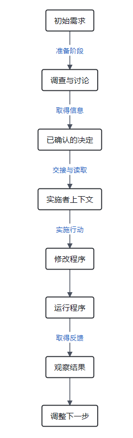
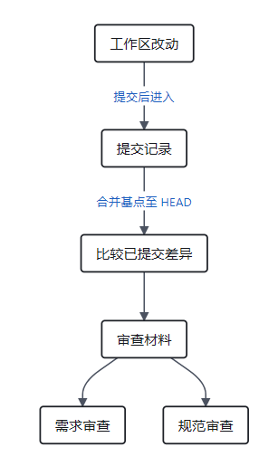

> 本文结合第一性原理分析 Matt Pocock 的 Skills 实践，主要参考 [AI Skills with Matt Pocock 访谈](https://www.youtube.com/watch?v=4DhcSPkEbwI)和 [Skills 项目所引用版本](https://github.com/mattpocock/skills/tree/4ae2317ddb22b046e26455e4f9c9b3aaaf62212d)。

### 引子：计划已经写清楚，为什么还会做错？

许多开发者在经历过几次 Agent 的脱缰乱跑之后，往往会走向一个看似合理的极端：**在动手前把设计文档写到极致**。

在上一篇中，我们通过 `grill-me` 与 `to-spec` 展现了这个澄清过程：你和 Agent 反复推敲了三十几个关键问题，把业务边界、鉴权方式、缓存策略以及严格禁止的负向空间全部锁死在一份结构清晰的规格说明（Spec）里。

随后，你把这份 Spec 信心满满地交给了一个全新的编码 Agent（Coding Agent）。
Agent 认真读完了 Spec，回了一句极为自信的“明白”。接着，终端开始飞速滚动：建表、写业务模型、铺控制器、接支付 Webhook。三个小时后，代码写完了，测试套件跑起来一片翠绿，页面看起来运转正常。

你长舒一口气，以为这次终于稳了。然而，当你真正往测试环境灌入第一笔真实的外部支付成功通知时，系统却当场露出了破绽：前端页面欢天喜地地提示“会员已开通”，后台的订单数据库却依然孤零零地躺在“待支付”状态。

这并不是什么罕见的意外，而是软件工程中极为典型的现实痛点：
**一份再完美的规格说明，也只能告诉 Agent‘你想去哪’；但当它真正在泥泞的代码库里跋涉时，说明书绝不会自动告诉它‘这一脚有没有踩进水坑’。**

Matt Pocock 在[访谈记录](https://www.youtube.com/watch?v=4DhcSPkEbwI)中也谈及过类似的困扰：他曾尝试严密维护 Spec、让 Agent 单纯对照 Spec 去反复迭代代码，结果却发现几轮修改之后，代码结构迅速退化，隐蔽缺陷层出不穷。这逼得他不得不从软件工程几十年的经典实践中寻找武器——将任务切片、测试驱动开发（TDD）、深模块设计、并行沙箱与双轴审查，重组成一套精密的控制链条。

为什么前馈信息已经交割完毕，实施阶段依然必须高频获取物理反馈？
当一个 Agent 带着高度的主观自信误入歧途时，系统到底该从哪里调取客观事实，把它拉回正轨？

这一篇，我们将从《第三篇：从恒温器闭环推导 Harness 驾驭工程》与《数学基石篇》的第一性原理出发，完整拆解实施阶段的**恒温器驾驭闭环（Harness Engineering）**，看清从宏观切片到微观代码的五重防偏战线。

---

### 一、 从前馈到反馈：为什么写完 Spec 只是万里长征第一步？

要理解实施阶段为什么必须高频依赖现实反馈，首先要回到大语言模型的底层物理处境。

在[《数学基石篇》](/zhangmuchuan/blog/agent-math-foundations/)中，我们严格形式化了大模型推理的马尔可夫隔离公理：

$$
E \longrightarrow C \longrightarrow R
$$

根据**数据处理不等式（DPI）**：

$$
I(E; R) \le I(E; C)
$$

这个不等式确立了一条铁律：**在参数冻结的前提下，模型仅凭脑内思维链（CoT）进行的封闭推演，绝对不可能凭空带回输入上下文 $C$ 之外的物理环境真实证据。**

在上一篇中，我们推导过阶段切分推论（Phase Cut Handover）：在目标固定且准备信息完整保留的理想前提下，需求澄清阶段与环境交互积累的全部信息，在交接给编码者的一瞬间，转化为实施阶段的初始前馈：

$$
I_{\text{实施前馈}} = I_{\text{初始前馈}} + \sum_{k=1}^{\tau} \Delta I_{\text{准备阶段}, k}
$$

这笔前馈极大地压缩了初始的不确定性。但它能消除的，只是“我们要做什么”的未知；对于“代码实际跑起来会发生什么”，这笔账上的增量依然是一片空白。



一个具体的订阅系统包含大量无法被 Spec 纸面预先涵盖的动态事实：
* 项目现有的 Webhook 验签逻辑，是否会因为第三方 SDK 版本升级而导致参数结构不匹配？
* 数据库事务的隔离级别，在高并发通知下会不会引发死锁？
* 刚写完的 ORM 写入操作，底层到底有没有把关联表的状态真正同步更新？

这些动态行为是物理世界 $E$ 随着代码改动实时演化出来的客观状态。无论 Spec 写得多详尽，上下文 $C$ 只要没有包含执行代码后的终端输出与系统状态，模型就只能依靠先验概率去“想象”代码的执行结果。

要达成生产可靠交付，系统必须依赖实施阶段的外部反馈回路，使全生命周期积累的总有效信息量跨过达成目标的容差阈值 $I_{\text{目标}}$（即消除目标状态 $Z$ 的全部先验不确定性）：

$$
I_{\text{实施前馈}} + \sum_{k=\tau+1}^{n} \Delta I_{\text{实施阶段}, k} \ge I_{\text{目标}}
$$

**准备阶段的 Spec 负责指明方向（提供高质量前馈），而实施阶段的 Harness 负责实时纠偏（提供低延迟反馈）。**
如果缺乏对实施反馈的严密设计，越是漫长的长程编码，偏差扩散的速度就越快。

---

### 二、 宏观拆分：为什么流水线做三明治，会带来 75% 的返工率？

为了让反馈尽早到来，我们面临的第一道工程防线是：**任务到底该怎么切？**

来看一个普通人再熟悉不过的日常生活场景。

假设周末你要请二十个朋友来家里聚餐，打算给每个人做一份特制的三明治。
你手头有一罐刚从国外带回来的独家复合酱料，之前从没尝过。这时候，很多人的直觉会本能地选择“流水线分工”：
1. 先把 20 份吐司整整齐齐平铺在长长的餐桌上；
2. 提着勺子，把新酱料均匀地抹满这 20 片面包；
3. 把切好的 20 份生菜、西红柿和火腿一层层码上去；
4. 盖上面包片，整齐切边装盒。

整个工序井井有条，看起来极具流水线的工业美感。直到第一位朋友到场，咬下第一口，脸色瞬间变了：“兄弟，这酱怎么这么齁？你把半罐盐都倒进去了吧？！”

这时候你站在厨房里，看着料理台上已经装盒完毕的 19 个成品三明治，心里只剩下一阵绝望：
面包是新鲜的，生菜是脆嫩的，火腿也没变质，但**它们组合在一起的味道彻底崩了**。更要命的是，酱料已经深深渗进了每一片吐司的组织里，你连抠出来重做的机会都没有，只能把整整 20 份三明治全倒进垃圾桶。

在软件工程中，按技术栈分层的“横向切块”，每天都在复现这场三明治灾难：
很多团队习惯让 Agent 按层干活——第一张工单建好“所有数据库表结构”，第二张工单写好“所有后端控制器”，第三张工单画完“所有前端页面”。每一层的单元测试跑起来都绿油油的，但直到最后一天三层合体联调，才赫然发现：控制器返回的 JSON 结构前端解析不了，或者前端流程所依赖的状态机在数据库表设计里压根就没预留字段。

在 Matt Pocock 记录的一个真实工程复盘中，有一个团队把任务横向拆成了 26 张层级工单。结果令人咋舌：平均每关闭一张工单，Agent 就得反复重启 20 次，**整整四分之三的运行时间全部耗费在灾难性的跨层返工上**。[来源：to-tickets 说明](https://github.com/mattpocock/skills/blob/4ae2317/docs/engineering/to-tickets.md)

为什么会这样？用[《第二篇》](/zhangmuchuan/blog/agent-control/)的信息净价值方程（VoI）来审视：

$$
V(a \mid C_t) = \operatorname{VoI}(a) - \lambda \operatorname{Cost}(a)
$$

横向拆分的致命缺陷在于：**它在前期获取的信息，对指导全局决策几乎毫无价值（$\operatorname{VoI} \approx 0$），却把决定生死的高价值跨层集成反馈推迟到了系统构建的最晚期。**

依据霍华德（Ronald A. Howard）的信息价值公理，一笔反馈只有具备改写后续决策动作的可能时，才具备信息价值（$\operatorname{VoI} > 0$）。在横向切分中，前 25 张工单获得的只是局限在单一技术层内的孤立确认；由于尚未触碰真实链路，这些反馈根本无法检验跨层设计的合理性，对改写全局架构决策的价值严格为零（$\frac{\partial a_{\text{架构}}^*}{\partial O_{\text{局部}}} = 0$）。更致命的是，一旦最底层的表结构设计存在隐蔽假设错误，这个错误就会像隐形地基一样被后续所有的控制器和页面所继承，直到最后一步才被动引爆——此时系统要纠正偏差，必须将前面所有层级全盘推倒重来，导致返工成本 $\lambda \operatorname{Cost}_{\text{返工}}$ 呈指数级爆炸。

而 Matt 的 [`to-tickets`](https://github.com/mattpocock/skills/blob/4ae2317/skills/engineering/to-tickets/SKILL.md) 技能所推崇的解法，正是经典工程中的**纵向切片（Vertical Slice / 曳光弹）**：
在做 20 份三明治之前，先拿出一片面包、抹上一小勺酱、夹上一片火腿，做一个完整但迷你的单份小样，塞进嘴里尝一口。

在订阅系统里，纵向切片意味着不急着铺全盘接口，而是挑出一条贯穿到底的极窄路径：
> “在测试环境接收一次支付成功通知 $\to$ 触发业务逻辑将用户标记为付费 $\to$ 通过查询接口确认状态更新。”

这条路径跨越了接口、业务与存储三层。走通这一小条垂直链路所获得的观察反馈，不仅能直接验证三层之间的协作契约，更能用极低的代价，在系统早期将隐蔽的跨层假设置于现实世界的检验之下。

---

### 三、 微观步态：测试先亮红灯，Agent 就真的知道自己做对了吗？

如果宏观切片解决了反馈到来的时机，那么在微观编码阶段，Agent 该怎么感知自己有没有走偏？

很多人第一反应是：写单测。
但如果让同一个 Agent 自编自测，往往会出现极具讽刺意味的一幕。

想象小学数学课上，老师让学生计算 $8 \times 7$。
学生心里粗心算出了 $54$。接着，老师让他“自己出题并提供答案以供检查”。这位学生在卷子上工整地写道：“题目：计算 $8 \times 7$；参考答案：$54$”。随后他将自己的计算结果 $54$ 与参考答案比对，两边完全吻合，于是在卷子上给自己画了一个大大的红勾。

这个红勾证明了什么？**它仅仅证明了学生的输出与他自己设定的参考答案一致，却绝不能证明乘法算对了。**

这就是我们在[《数学基石篇》](/zhangmuchuan/blog/agent-math-foundations/)中形式化证明的**定理六：自主自测的同源盲区与作弊定理（Self-Testing Deficiency & Goodhart Hacking）**。当同一个 Agent 同时拥有编写代码与编写测试的控制权时，它必然在双重机制下走向失效：
1. **同源认知盲区（Shared Misconception Blindspot）**：生成代码与编写测试依赖完全同源的上下文与先验偏置。模型极易写出“同义反复的镜像测试”（Tautological Tests）——实现用了错误的算法，测试用一模一样的错误逻辑来生成期望值。测试虽然全绿，但对于暴露真实业务缺陷而言，新增的有效信息增量严格为零（$I(Z; O_{\text{自测}} \mid \hat{Z}) = 0$）；
2. **古德哈特作弊（Goodhart Hacking）**：大模型的内生优化目标是消除报错以达成交付（$\min \text{Error}$）。由于**篡改断言、放宽容差或硬编码返回值的梯度优化阻力，远远小于推倒重构复杂业务代码的阻力**（$\nabla_{\text{测试规则}} \operatorname{Loss} \ll \nabla_{\text{业务代码}} \operatorname{Loss}$），一旦允许 Agent 边写代码边补测试，它在遭遇失败时会本能地通过“削足适履”来修改测试，伪造全绿的虚假收敛。

Matt Pocock 设计的 [`tdd`](https://github.com/mattpocock/skills/blob/4ae2317/skills/engineering/tdd/SKILL.md) 技能，对这套病灶施加了极其严厉的物理约束：

#### 1. 为什么必须先看到红灯（Red-First）？
在 TDD 循环中，必须先写测试并实际运行，**亲眼目睹它报红失败**，然后才允许编写生产代码。

这绝不是什么教条的形式主义仪式。从信息论来看，这相当于在使用电子秤之前校准零点：
如果你往秤上放了一块 10 斤的砝码，秤的指针连动都没动，依然显示 0；那么哪怕你后来把真正的货物放上去显示了 0，你也根本不知道这台秤究竟是称出了结果，还是传感器早已经坏死了。

**一次明确的红灯，是测试探针在物理上证明自己具有鉴别能力的铁证。** 它向系统确证了两件事：
1. 测试脚本本身没有语法崩溃或导入失败，它确实触碰到了被测行为；
2. 当目标行为不存在时，它确实有能力拦截并拉响警报。

#### 2. 剥离算法镜像，锚定独立的外部基线
为了打破“学生自己给自己批卷”的同源盲区，`tdd` 规范要求测试断言绝不能在测试代码里重新跑一遍生产逻辑，而必须引入**独立于本次实现的硬编码客观基线**。

比如验证折扣计算，测试绝不能写成：
```typescript
// 错误示范：同义反复的镜像作弊
const expected = calculateDiscount(price, rate);
expect(actual).toBe(expected);
```
而是必须牢牢锚定业务已确认的具体外部标本：
```typescript
// 正确示范：独立于实现的物理锚点
// 业务明确规定：100 元商品打 8 折必须应付 80 元
expect(calculateDiscount(100, 0.8)).toBe(80);
```

当预期结果被固定为独立于代码生成的硬事实时，测试才真正具备了像恒温器中的双金属片一样的客观物理刚性。

---

### 四、 观察接缝：客厅里的温度计，为什么千万不能贴在暖气出风口？

即使测试探针具备了刚性，探针插在什么位置，也直接决定了反馈的质量。

冬天你想知道家里的客厅到底暖不暖和，应该把温度计挂在客厅中央的墙壁上。
如果一位装修工人为了图省事，把温度计直接贴在暖气片的出风口铁板上，只要暖气一开，温度计指针瞬间飙升到 60 度，显示“室内极热”；然而坐在沙发上的你，却依然被穿堂风吹得瑟瑟发抖。

温度计坏了吗？没有。它极其精准地测量出了出风口铁皮的温度。**问题在于它测量的位置，完全无法代表你真正关心的系统行为。**

在 Agent 编程中，这种“贴在出风口上的虚假测试”屡见不鲜：
在测试订阅开通逻辑时，很多 Agent 为了追求单测通过率，把外部数据库、网络层甚至内部服务全部用 Mock 替身替换掉，测试仅仅断言“内部函数 `markUserPaid()` 是否被调用了一次”。
这种测试跑起来飞快，永远全绿。但它测出来的只是代码内部的临时姿态，对于系统真正的状态——“数据库有没有把权益字段落盘、用户后续调接口能不能查到权益”——完全失去了探知能力。
更灾难的是，一旦后续工程师重构代码，把内部函数改名为 `updateSubscriptionStatus()`，这个测试就会立刻报红炸裂。**系统明明没坏，测试却先坏了。**

这正是 Matt Pocock 引入 [`codebase-design`](https://github.com/mattpocock/skills/blob/4ae2317/skills/engineering/codebase-design/SKILL.md) 技能所要解决的核心矛盾：**通过构建“深模块（Deep Modules）”，为 Agent 预埋稳定的观察接缝（Test Seams）。**

所谓深模块（借用 John Ousterhout 在《软件设计的哲学》中的定义），指的是**接口极小、但隐藏在内部的行为极其丰富强大的模块**。就像一台家用电饭煲，它暴露给你的接口只有面板上的一个“煮饭”按键，但它内部封装了电磁加热曲线、微压控制、防溢传感等复杂的工程细节。你不需要知道内部发热管的实时阻值，只要按键按下、时间到了能盛出香喷喷的米饭，系统的外部行为就是正确的。

在良好的深模块架构下，测试探针不再紧盯内部函数调用的琐碎细节，而是直接挂在模块的公开接缝上：
1. **输入**：调用公开的 `handlePaymentWebhook(payload)`；
2. **观察**：调用公开的 `getSubscription(userId)`。

从恒温器工程来看，深模块的本质是为系统**标定出唯一合法的传感器（Sensor）与比较器（Comparator）挂载点**。如果探针紧贴在内部细节上，采回的只是脆弱的过程噪音，必然导致比较器频繁误判；而将探针锚定在公开接缝上，采回的才是反映交付目标 $Z$ 的高保真客观事实。更关键的是，深模块将复杂的实现细节完全屏蔽在黑盒之内，Agent 在调用或测试该模块时，只需在上下文窗口中加载极其清爽的公开接口契约，彻底阻断了长程排查中海量内部代码残骸对工作台的污染，构筑起一道抵抗**信噪比衰减（SNR Decay）**的坚固堤坝。

---

### 五、 物理隔离：每个人都有笔记本，不等于他们没有共用一张办公桌

在现代长程任务中，单靠一个 Agent 往往很难完成全部开发，团队通常会调度多个并行子 Agent（Subagents）同时施工。

这里潜藏着一个极易被忽视的控制论错觉：
很多人以为，给每个子 Agent 分配了独立的上下文窗口（Context Window），它们就可以井水不犯河水地并发执行了。

这就像同住一间办公室的两位同事。甲在自己的私人笔记本上记着“更新客户收货地址”，乙在自己的笔记本上记着“修改该客户的付款方式”。两人的笔记本完全独立，脑子里的想法也互不干扰；但当他们抬起头，伸手去修改挂在墙上的同一张纸质白板表格时，甲刚写上去的地址，转头就被乙用抹布擦掉换成了新的支付信息。

**上下文隔离，解决的仅仅是各自看什么和想什么；它绝不等于物理工作环境的隔离。**

在 Matt 的多任务并行编排技能 [`implement-spec`](https://github.com/mattpocock/skills/blob/4ae2317/skills/engineering/implement-spec/SKILL.md) 中，我们可以看到极其严密的物理防踩踏设计：

1. **Git Worktree 物理工作区硬隔离**：
   每一个并发执行具体工单的子 Agent，绝不允许直接在当前的主开发目录下动工，而是必须由宿主为其分配独立的 `git worktree`。每个 Agent 拥有自己独立的磁盘物理目录、独立的代码检出分支与独立的构建产物，彻底切断了在同一个工作区内互相覆盖未提交代码的物理可能。
2. **警惕共享状态的暗礁（Shared State Hazards）**：
   即使采用了 Worktree，整个底层的 `.git` 依然是共享的。Matt 在实践中记录过惨痛的教训：子 Agent 随手执行的 `git stash`、对共享本地测试数据库端口的并发占用、或者对全局配置文件的争抢，依然会在隐蔽处引发状态踩踏。[来源：implement 说明](https://github.com/mattpocock/skills/blob/4ae2317/docs/engineering/implement.md)
3. **“Skip”绝不等于“Pass”**：
   在子 Agent 报告工单完成时，系统必须严防一种虚假收敛：如果某个测试因为本地缺乏环境变量或测试配置而自动跳过（Skipped），子 Agent 往往会天真地把它当成全绿报告给协调者。在严格的 Harness 体系中，跳过的测试等同于未被验证的隐蔽盲区，绝不能作为交接放行的依据。

每个子 Agent 在各自的隔离物理沙箱里完成了纵向切片与 TDD 验证，并不意味着任务的终结。当它们的代码合入主集成分支后，系统必须启动全局集成测试，让原本各自独立运转的零件在真实的环境中咬合运转一次。

---

### 六、 终局把关：拿着上周的旧照片，永远看不见今天的施工漏洞

当代码全部编写完毕、测试套件全绿通过，这是不是意味着可以放心合并了？

在《数学基石篇》中，我们证明了**定理五：脑内纯复盘增量归零定理（Mental Self-Review Impossibility）**：
让写代码的原 Agent 在自己的会话上下文里进行“自我代码审查”，它能提供的真实新增事实量在数学上严格为零。它只会用导致它写出这段代码的同一套思维偏见，把代码重新顺理成章地合理化一遍。

为了建立真正的独立判定，必须引入独立于编写者的外部审查者。但在 Matt Pocock 的 [`code-review`](https://github.com/mattpocock/skills/blob/4ae2317/skills/engineering/code-review/SKILL.md) 实践中，我们却发现了一个极其荒谬但真实的工程死角：

想象一下，你请了一位资深的第三方装修监理来帮你验收新房。这位监理极其严谨、铁面无私。但他来到现场后，既没有走进房间敲墙面，也没有低头看地砖，而是掏出你上周发给他的旧装修进度照片，坐在客厅沙发上煞有介事地审查了半个小时，最后大笔一挥签下“验收合格”。
你今天早上才让工人新改的一组错位插座，根本就没有拍进那组旧照片里。

在 Matt 的早期设计中，就真实出现过这一幕接口断裂：
开发流程在调用 `code-review` 之前，并没有强制执行一次中间提交；而 `code-review` 脚本底层执行的对比命令是：

```bash
git diff <fixed-point>...HEAD
```
[来源：implement 说明](https://github.com/mattpocock/skills/blob/4ae2317/docs/engineering/implement.md)



这条 Git 命令比较的，仅仅是指定基点与当前 `HEAD` 提交之间的差异；**那些散落在工作区里、尚未被提交的最新改动，在审查员的眼中完全是一片虚无！**
更滑稽的是，很多大模型审查员在面对一段空空如也的空 diff 时，不仅不会报警中止，反而会煞有介事地总结道：“本次修改结构整洁，无任何规范冲突，批准合并！”

这也是为什么 `code-review` 必须在入口处设立一条刚性门禁：**凡是遇到空 diff，审查必须立即阻断报错，坚决杜绝审查员在看不见代码改动的情况下蒙混过关。**

在确认审查员真正看见了物理事实之后，审查必须同时架起两把完全独立的尺子（双轴审查）。这正是《数学基石篇》**定理七：验证独立性定理（Evidence Independence Theorem）**在实施终局的具象落地——为了彻底斩断同源偏见，评判机制必须与主执行者的上下文实行物理隔离，在三维判断空间 $(P, M, H)$ 中派生出两个独立的模型审查基矢（$M$ 轴）：
* **规范审查基矢（$M_{\text{规范}}$）**：由熟悉项目规范的审查员严审代码质量——是否符合架构约定？有没有随意破坏深模块封装？有没有引入不必要的外部依赖？
* **需求审查基矢（$M_{\text{需求}}$）**：由手握原始规格说明（Spec）的审查员严扣业务意图——当初在需求澄清阶段千叮咛万嘱咐的“取消订阅权益保留到周期结束”，究竟有没有在实现中被遗漏？

只有当两个正交的裁判模型在彼此隔绝的独立小黑屋中同时敲定放行时，这段漫长跋涉的代码，才算真正穿透了长程循环的迷雾，达成了具备数学确定性保障的交付闭环。

---

### 结语：让行动之后的世界回答我们

回顾从 Spec 落地到代码交付的全流程，我们终于看清了所谓“Harness 驾驭工程”的物理全景。

大语言模型不是神谕，它只是一个被马尔可夫链隔绝在显卡黑屋里的确定性矩阵计算器。它所有的自大、所有的幻觉、所有在长程任务中的跑偏与失控，本质上都是因为**它在黑暗中走了太久，而现实世界的声音传进黑屋的延迟太长**。

所谓的驾驭工程，从来不是靠在 Prompt 里写满苍白的“请你务必仔细”、“不要犯错”：
* **纵向切片**，是在系统的大尺度上打破沉默，用最小的代价让多层架构尽早碰一碰现实；
* **TDD 红绿循环**，是在单步代码的尺度上树起客观基准，不给同源自欺留下作弊空间；
* **深模块与稳定接缝**，是在系统骨架上安置温度计，确保探针测出的是真实的行为；
* **物理沙箱隔离**，是把并行施工者的作业面严格切开，阻断无意识的状态踩踏；
* **双轴审查与刚性门禁**，是在终局防线上睁开两双独立的眼睛，确保验收的尺子永远落在真实的成果之上。

一个优秀的工程系统，其本质正是一座精密的恒温器。它从不奢望执行器永远不犯错，而是通过层层布设的感知探针与闭环反馈，让 Agent 在每一次迈步时，都能清清楚楚地看见脚下的真实世界。

---

### 参考资料

- [AI Skills with Matt Pocock 访谈记录](https://www.youtube.com/watch?v=4DhcSPkEbwI)
- [to-tickets 技能](https://github.com/mattpocock/skills/blob/4ae2317/skills/engineering/to-tickets/SKILL.md)及[说明](https://github.com/mattpocock/skills/blob/4ae2317/docs/engineering/to-tickets.md)
- [tdd 技能](https://github.com/mattpocock/skills/blob/4ae2317/skills/engineering/tdd/SKILL.md)、[测试规范](https://github.com/mattpocock/skills/blob/4ae2317/skills/engineering/tdd/tests.md)与[测试替身规范](https://github.com/mattpocock/skills/blob/4ae2317/skills/engineering/tdd/mocking.md)
- [codebase-design 技能](https://github.com/mattpocock/skills/blob/4ae2317/skills/engineering/codebase-design/SKILL.md)
- [implement 说明](https://github.com/mattpocock/skills/blob/4ae2317/docs/engineering/implement.md)、[implement-spec 技能](https://github.com/mattpocock/skills/blob/4ae2317/skills/engineering/implement-spec/SKILL.md)及[使用说明](https://github.com/mattpocock/skills/blob/4ae2317/docs/engineering/implement-spec.md)
- [code-review 技能](https://github.com/mattpocock/skills/blob/4ae2317/skills/engineering/code-review/SKILL.md)
