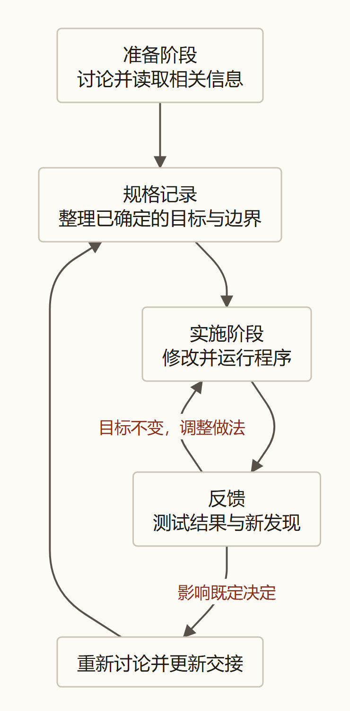

> 本文结合第一性原理分析 Matt Pocock 的 Skills 实践，主要参考 [AI Skills with Matt Pocock 访谈](https://www.youtube.com/watch?v=4DhcSPkEbwI)和 [Skills 项目所引用版本](https://github.com/mattpocock/skills/tree/4ae2317ddb22b046e26455e4f9c9b3aaaf62212d)。

### 引子：信息明明都在，为什么 Agent 还是做错了？

昨晚下班前，你拉着 Agent 仔细推敲了整整两个小时，终于把网站的会员订阅逻辑理得清清楚楚。

一开始你随口说：“用户取消订阅后，会员权益立刻停掉就行。”
Agent 敏锐地反问你：“如果用户已经提前支付了整月的费用，当天取消立刻剥夺权益，会不会引发严重的客诉纠纷？”
你拍了拍脑门：“有道理。那就改成停止次月自动扣费，但本月已经付过钱的权益，必须稳稳保留到账单周期结束。”
Agent 在屏幕上打出一行清爽的回答：“明白，已记录。”

随后，你们又顺着这个分支讨论了支付超时、重试机制和退款边界。对话记录拉得很长，但每一个原本模糊的暗礁都排查完毕了。你放心地关掉电脑，把任务托付给一个全新的夜班 Coding Agent，让它晚上写代码。

今天大清早，你满怀期待地泡好咖啡，打开它交付的运行环境，点下测试界面的“取消订阅”。

屏幕一闪，会员徽章与专属权限当场消失得无影无踪。

你端着咖啡的手僵在半空，赶紧滑开昨晚的聊天记录。“取消后权益保留到账单周期结束”那句话白纸黑字挂在屏幕上，Agent 那句自信满满的“明白”也赫然在目。
你忍不住在心里暗骂：“昨晚不是清清楚楚定好了吗？为什么一觉醒来全白干了？！”

你确实说过。但**昨天的你说过，绝不等于今天接班的 Agent 能够准确提取；更不等于它能在长达几十轮的杂乱对话里，一眼认出哪句话彻底推翻了前面的草案。**

为了解决这种普遍的跨会话交接事故，Matt Pocock 设计了一款核心技能——[`to-spec`](https://github.com/mattpocock/skills/blob/4ae2317/skills/engineering/to-spec/SKILL.md)：在漫长的澄清访谈结束时，将所有的有效共识提炼固化为一份标准的设计规格说明（Spec），直接发布到项目的任务跟踪系统中。

这个做法表面上看再自然不过，但只要我们把它放回信息论的显微镜下，一个极具张力的悖论立刻浮出水面：

在[《数学基石篇》](/zhangmuchuan/blog/agent-math-foundations/)中，我们严格形式化了马尔可夫隔离墙：大模型被困在参数冻结的黑屋里，单凭脑内推演，绝对不可能创造出超出原始输入之外的新信息。
既然如此，**所有决策本来就已经躺在昨晚的聊天记录里了。把同样的内容换个格式重新抄一遍，既没有新增任何外部事实，也没有改变业务规则，凭什么一份薄薄的 Spec，就能让原本漏洞百出的 Agent 突然走上正轨？**

这一篇，我们将从第一性原理的信噪比衰减、信息可利用性（Usable Information）与状态相变出发，彻底解构 `to-spec` 的物理底色，看清跨会话前馈交接中的四道关键防线。

---

### 一、 跨会话的“蓝墙乌龙”：为什么信息在，交接依然会失败？

先来看一个几乎每个人在生活或工作中都经历过的真实困境。

假设家里新房装修，全家人拉了一个微信群，在群里热火朝天地讨论了一整个星期。
周一，母亲在群里发了张图：“我觉得主卧刷天蓝色挺好看，清爽！”
周二晚上，你下了班翻看实体色卡，发现天蓝色在夜间灯光下显得过于冰冷，于是在群里回复：“蓝色太冷了，还是改成温馨一点的米白色吧。”母亲回了个赞同的表情包。
周三，工长去现场排查水电，发语音说主卧那面墙里埋着承重主线，千万不能开槽挂壁画。你在地铁上匆匆回了一句：“收到，那面墙绝对不动。”
随后的四天里，群里又陆续讨论了窗帘遮光率、地板脚感、阳台封窗，中间还夹杂着几十张建材市场的随手抓拍和全家人商量午饭吃什么的闲聊碎语。

周六早晨，一位新来的油漆师傅正式进场动工。
你把师傅拉进群，顺手发了一句：“师傅，我们这周所有的装修要求全在群聊记录里了，您自己看吧！”

师傅老老实实打开手机，从群记录的第一条开始往下翻。他看到了母亲发的“主卧刷天蓝色”，心里暗道一声明白，便在随身的小本子上工整地记下：“主卧：天蓝”。
至于第二天你纠正的“改成米白”，早已被淹没在后面几百条建材比价和生活闲聊的长河里，被师傅一目十行地滑了过去。

傍晚你兴冲冲跑去工地验收，一推开主卧大门，映入眼帘的是四面湛蓝发亮的墙壁。你当场一口气没提上来：“师傅，我周二不是在群里明确说过改米白了吗？！”
师傅一脸无辜地掏出本子：“老板，我真翻了记录，上面白纸黑字写着刷蓝色啊！”

你确实说过，群记录也确实没丢。但对于进场施工的师傅而言：**信息静静躺在历史记录里，绝对不等于信息已经有效摆上了他的工作台。**

把这个场景平移到大模型的多会话协作中，物理机制完全一致。

在[《数学基石篇》](/zhangmuchuan/blog/agent-math-foundations/)与《判断更新》中，我们推导过阶段切分推论（Phase Cut Handover）：在目标固定且信息无损传递的理想条件下，准备阶段积累的交互反馈，在切分点 $\tau$ 转化为实施阶段的前馈：

$$
I_{\text{实施前馈}} = I_{\text{初始前馈}} + \sum_{k=1}^{\tau} \Delta I_{\text{准备阶段}, k}
$$

这个代数等式描绘的是理论上的信息守恒。但在真实的工程落地中，**信息绝对不会凭空瞬间迁移**。

面对长达 60 轮的澄清对话，大模型有限注意力的 Transformer 机制面临着严重的物理限制。如果直接把整段对话历史硬塞给第二天的 Coding Agent，旧方案（“立即停权益”）、新共识（“保留到月底”）、被否决的临时假设以及中间的调试日志混成一团。模型在注意力机制的矩阵乘法中，极易被更早出现、措辞更绝对的旧假设所捕获，从而在上下文中重演这场尴尬的“蓝墙翻车”。

准备阶段的共识再完整，如果无法被安全地“结晶”并跨会话交接，前期的沟通努力就会在交接瞬间摔得粉碎。

---

### 二、 从气态到固态：DPI 限制下的“相变结晶”与信噪比

现在我们回到开头提出的那个核心信息论悖论：
如果用户真实的目标是 $Z$，昨晚完整的对话记录是 $H$，Agent 仅根据这段历史记录整理出的 Spec 文档是 $S$。在固定模型参数、不向外部环境查询新数据的封闭黑屋里：

$$
Z \longrightarrow H \longrightarrow S
$$

根据**数据处理不等式（DPI）**，我们必然得出：

$$
\boxed{I(Z; S) \le I(Z; H)}
$$

这个不等式无情地断言：**如果仅仅是对既有对话进行文字加工，Spec 绝不可能凭空创造出关于用户目标的新互信息。**
无论文档排版多规整、用词多专业，如果用户昨晚从未决定过“退款是否退回手续费”，这份 Spec 里的字句就绝不可能包含关于退款手续费的真实事实。

那么，既然香农互信息只减不增，我们为什么还要大费周章地运行 `to-spec`？直接把 $H$ 全量丢给后续 Agent，保留全部信息不是更稳妥吗？

答案在于**区分“香农互信息（Shannon Information）”与“计算信噪比 / 可利用信息（Usable Information）”的物理鸿沟**。

#### 1. 探索期的高价值过程，是实施期的高摩擦残骸
在需求澄清阶段（Grill 阶段），人与 Agent 的对话呈现为一种**高熵的“气态扩散”**：
> “要不先这样？” $\to$ “不行，这会导致用户资金受损。” $\to$ “那改成第二种方案。” $\to$ “等等，第二种方案线上数据库不支持，换第三种。”

这些反复横跳、推翻重来的过程，在探索期具有极高的认知价值，正是它们帮我们排除了暗礁。
但当任务切换到实施期时，这套历史记录就瞬间发生了身份异化——它们不再是探索资产，而是变成了[《第二篇》](/zhangmuchuan/blog/agent-control/)所指出的**上下文过程残骸（Process Debris）**。

实施 Agent 需要的不是见证人类的心路历程，它只需要极其确凿、零歧义地知道三件事：
1. **最终确认的决策是什么**；
2. **已经明确否决的死路是什么**；
3. **尚未决定的未知项是什么**。

如果把过程残骸一股脑倒进上下文，有限注意力窗口的计算带宽就会被大量已作废的信息所稀释，引发致命的**信噪比衰减（SNR Decay）**。

#### 2. 相变结晶与整理层的经济账
`to-spec` 的物理本质，正是**驱动上下文发生一次由“气态”到“固态”的相变结晶（Phase Transition Crystallization）**。

它通过严密的结构模板，将散落、多义且充满矛盾的历史对话，沉淀为结构紧凑、边界坚硬的低熵结晶体：

```text
【已确认的业务共识】
- 取消订阅仅关闭次月自动续费；
- 本计费周期已支付的权益，严格保留至账单日结束。

【已明确否决的方案】
- 严禁在取消当天直接吊销用户权益（防客诉）。

【明确挂起的未决项】
- 宽限期内的扣款重试策略（留待运营确认）。
```

用[《第六篇》](/zhangmuchuan/blog/agent-memory/)中关于“整理层（Project Knowledge Layer）”的净价值公式来核算：

$$
V_{\text{整理}} \approx \sum_{j=1}^{N} B_j - C_{\text{整理}} - C_{\text{维护}}
$$

一次性生成 Spec 固然要消耗时间与算力成本 $C_{\text{整理}}$，但它为后续所有并行的、接力的下游 Coding Agent 省去了在几千行聊天垃圾堆里翻找决定的巨大认知摩擦（$\sum B_j$）。更关键的是，它彻底消除了因为各 Agent 捕捉到不同历史废案而导致的严重架构打架。

**数据处理不等式限制的是客观信息量的上限，但它从未限制人类通过组织结构将信息的“可利用性”推向极致。**
这正是结晶的全部威力所在。

---

### 三、 负向空间（Out of Scope）：为什么“不做什么”比“做什么”更重要？

许多初次接触 `to-spec` 模板的工程师，往往对其中专门设立的一个栏目感到困惑：**`## Out of Scope（本次严格不做的事）`**。

有人会纳闷：“写需求文档，把要做的东西列清楚不就行了吗？我不提别的事，它难道还会自己闲得慌去写吗？”

答案是：**在真实项目中，大模型不仅会闲得慌去写，而且它往往写得极其认真、极其卖力。**

继续看会员订阅的例子。
昨晚你在讨论时提到了购买和取消。过程中，Agent 曾两眼放光地建议：“既然我们要做会员体系，要不要顺便把优惠券、拼团折扣和五人家庭共享套餐一起做了？市面上的竞品全都有！”
你当场斩钉截铁地回绝：“我们下周就要上线，资源极其有限。第一版坚决不做优惠券，坚决不做团队套餐，先把个人的核心订阅流程跑通！”

第二天，如果接手的 Coding Agent 手里的需求说明只写了一句：
> “实现会员订阅与取消功能。”

它会怎么做？
基于预训练集里海量的 SaaS 代码先验，模型的大脑会立刻触发强烈的关联联想：“一个健壮的商业会员系统，怎么能没有优惠券抵扣和团队席位呢？”
于是，它自作主张地新建了优惠券表、写了复杂的抵扣逻辑、设计了团队席位分配接口，甚至工工整整地写满了全套单元测试。

三个小时后，代码写得漂漂亮亮、测试全绿。你走过来一看，当场血压拉满：**真正核心的个人取消保留权益逻辑漏掉了大半，页面上却赫然冒出了一个谁也没批准过的优惠券兑换码输入框！**

#### 1. 环境是沉默的，编译器不会为“范围越界”报警
为什么会发生这种灾难？
因为物理环境（编译器、数据库、单测运行器）只能扮演**“能否运行”的无情检验者**：
* 语法写错了，编译器会报错；
* SQL 拼错了，数据库会抛异常；
* 但只要代码逻辑自洽，**没有任何一个编译器会在 Agent 自行扩充功能时跳出来报警说：“住手，你在做用户这次根本不需要的功能！”**

用信息论的语言来说：
设最终期望的目标范围为随机变量 $Z$。在缺乏负向约束时，基于大模型的预训练联想，系统潜在的假设空间包含四种离散组合：1. 仅个人订阅；2. 个人 + 优惠券；3. 个人 + 团队；4. 三者全包。在先验等概率分布下，模型面对的目标先验不确定性为：

$$
H(Z) = -\sum_{i=1}^{4} \frac{1}{4} \log_2 \frac{1}{4} = \log_2 4 = 2 \text{ bit}
$$

当 Spec 明确钉下一行铁律：`【Out of Scope：严禁引入优惠券与团队套餐】`（记为负向约束前馈 $C_{\text{neg}}$），这一行文字以极高的信息密度，直接从假设空间中精准排除了其余三种弥散分支：

$$
H(Z \mid C_{\text{neg}}) = \log_2 1 = 0 \text{ bit}
$$

通过注入这笔负向先验约束，系统获得了净确定性增量：

$$
\Delta I = I(Z; C_{\text{neg}}) = H(Z) - H(Z \mid C_{\text{neg}}) = 2 \text{ bit}
$$

它在第 0 步就硬生生地将模型的注意力与算力带宽，死死收敛在唯一合法的正向空间内。

#### 2. 饭店点菜写单：为什么交接时严禁“重新访谈”？
在 `to-spec` 的规范中，有一条甚至被加粗强调的硬性禁令：**`Do NOT re-interview the user. Synthesize what you already know.`（严禁重新访谈用户，只整理已确认的信息）。**

这看似冷酷的规定，背后是极其深刻的控制论考量。

想象你在高档餐厅点菜。服务员陪着你把整本菜单翻了个遍，你反复权衡后终于下了决心：“一份清蒸石斑鱼，绝对不要放香菜；一份番茄炒蛋；两碗米饭。”
服务员掏出小票夹，刚准备下笔划单，突然抬起头热情地问你：“先生，这条石斑鱼其实红烧味道也绝了，要不要考虑红烧？红烧的话口重，番茄炒蛋不如换成酸菜汆白肉汤？”

你原本已经坚定的神经瞬间被重新拉回了纠结的泥潭，又不得不重新翻开菜单。厨房的灶火一直在空烧，而后厨的大厨连一张真正可以开工的小票都拿不到。

**需求澄清（Grill）是为了通过发散提问寻找约束；但规格固化（Spec）则是为了终止发散、完成确定性收敛。**
如果在生成 Spec 的关头，Agent 每写一条又重新向用户开启新一轮的架构大讨论，任务的目标空间就会发生无休止的随机游走，系统将永远无法跨入编码阶段。

当然，不重新访谈，不等于对自相矛盾装聋作哑。
如果服务员发现你刚才既说过“少放香菜”，后文又改口说“完全不放香菜”，他在划单前定点向你核对一句：“先生，最终确认完全不放香菜，对吗？”这是高价值的冲突消除。

**已经确立的决定，必须坚决锁定；发现的冲突与盲区，必须忠实记录为未决项；而绝不许服务员自作聪明地替客人“脑补加菜”。**

---

### 四、 预埋测试接缝（Test Seams）：机器没坏，测试为什么先坏了？

Spec 不仅要交接“业务要做成什么”，它还必须提前回答后续实现中致命的一问：**代码写完之后，我们凭什么客观判断它有没有做对？**

在上一篇中我们提到了恒温器模型：恒温器之所以能控温，是因为传感器被挂在了正确的位置。如果挂错了位置，就会酿成荒唐的系统悲剧。

来看一个自动售货机找零的经典工程场景。

假设你采购了一台自动售货机，给工程师提了一个简单的需求：顾客塞进一张 10 元纸币，买了一瓶 6 元的饮料，机器必须准确找零 4 元。
机器内部装配了 1 元和 2 元两种硬币的储币仓。

第一版机器的内部出币机械臂是这么动作的：
控制器先向 2 元硬币仓发送指令，吐出一枚 2 元硬币；接着连续向 1 元硬币仓发送两次指令，各吐出一枚 1 元硬币。
三枚硬币叮叮当当跌入托盘，顾客伸手一抓：一枚 2 元加两枚 1 元，正好 4 元，功能完美交付。

工程师给它写了一段自动化单元测试：
测试用代码深度 Mock 掉了出币通道，直接严密断言：
```typescript
// 错误示范：把测试探针直接插在内部机械零件上
expect(coinDispenser.eject2Yuan).toHaveBeenCalledTimes(1);
expect(coinDispenser.eject1Yuan).toHaveBeenCalledTimes(2);
```
测试跑通，全绿通过。

过了两个月，工厂为了降低磨损，换了一套更先进的双通道出币装置：遇到找零 4 元时，装置能够直接从 2 元仓连续弹出两枚 2 元硬币，出币速度整整提升了一倍。

工程师重构完内部逻辑，满怀信心地在终端里敲下 `run test`。

**终端里当场跳出一整片刺眼的断言失败（Failed Assertions）！**

工程师心里咯噔一下，冷汗瞬间冒了出来：“糟了，我把找零核心功能改崩了？！”
他抓起 10 元纸币冲到测试售货机前，塞进钱，按下 6 元饮料。饮料咚的一声掉下来，紧接着两枚崭新的 2 元硬币整整齐齐滚进找零托盘。
他拿起来一算：两枚 2 元，不折不扣正好 4 元！

顾客拿到的钱一分没差，找零速度甚至翻了一倍。**机器明明没坏，甚至性能翻倍了，测试为什么先全红了？！**

用《第三篇》确立的经典控制论标尺——**恒温器负反馈闭环（Thermostat Closed Loop）**来审视，这个系统的四个物理节点发生了致命的挂载错位：

1. **目标设定值（Setpoint, $r$）**：顾客关心的外部业务契约——投入 10 元买 6 元饮料，机器必须准确交付 4 元找零；
2. **执行控制器（Actuator, $u$）**：售货机内部的出币逻辑与机械动作，属于高度易变、随时可能重构的实现细节；
3. **传感器（Sensor, $y$）**：测试代码采回环境现状的测量探针；
4. **比较器（Comparator, $e = r - y$）**：单元测试的断言逻辑（`expect(...)`），比对测量值与设定值的偏差。

病根一目了然：**旧测试愚蠢地把本该监测最终交付物（找零托盘）的传感器，直接焊死在了执行器内部某个临时零件（`eject1Yuan`）的动作上。**
当执行器为了优化性能重构内部机构时，外部业务目标分毫未损，传感器却采回了完全不相干的内部变动，盲目的比较器便当场拉响了刺眼的虚假警报（False Positive）。

顾客在物理世界关心的，永远只有**外部可观察行为（Observable Behavior）**——“我投入 10 元买了 6 元的水，你有没有把 4 元钱稳稳交到我手里？”
而那个愚蠢的测试，却把探针深深插进了**内部易变的实现细节（Implementation Details）**之中。

这就引出了 `to-spec` 在落地时必须强行前置的一道工序：**测试接缝预埋（Test Seams Definition）**。



所谓**测试接缝（Michael Feathers 在《修改代码的艺术》中的定义）**，指的是在不修改业务代码的前提下，能够输入控制信号并观察到输出行为的公开边界。
在售货机里，接缝绝不是内部马达的步进电机电压，而是**“投币口”（公开输入）与“找零托盘”（公开输出）**。

在 `to-spec` 阶段，必须提前与用户确认系统的测试接缝：
> “我们不会去测试内部到底调用了哪几个私有函数，我们将在公开的 Webhook 入口模拟注入支付成功通知，并在公开的会员状态查询接口观察 `isActive` 字段与有效期。你是否认可这个观察接缝？”

Matt Pocock 在其技能规范中虽然曾给出极端的愿景“整个代码库的接缝越少越好，理想情况下是一个”；但在其真实重构项目 [Sandcastle 任务 757](https://github.com/mattpocock/sandcastle/issues/757) 中，面对真实的物理复杂性，他依然理性地将接缝**从原先琐碎的八个收敛到了四个**（保留了显示层、沙箱工厂、Agent 提供者与流式发射器），并没有强求教条式合一。
接缝越少、越深，测试探针测量出的就越是纯粹的业务事实，而不是内部零件的短暂姿态。唯有把接缝预埋在稳定的公开边界上，未来的代码重构才不会引发铺天盖地的虚假警报（False Alarms）。

---

### 五、 静态文本的时间陷阱与标签语义踩踏

当一份 Spec 已经具备了高信噪比、界定了负向空间、并锁定了测试接缝，它是不是就能一劳永逸地作为完美的工程输入了？

现实会给所有迷信文档的开发者上一堂生动的时间物理课。

#### 1. 事实静默过期（Silent Staleness）：为什么 Spec 严禁写具体路径？
翻开 Matt Pocock 的 [`to-spec` 技能规范](https://github.com/mattpocock/skills/blob/4ae2317/skills/engineering/to-spec/SKILL.md)，在 `## Implementation Decisions` 说明中赫然写着一条严厉的禁令：
> **`Do NOT include specific file paths or code snippets. They may end up being outdated very quickly.`**（严禁在实施决策中硬编码具体文件路径或代码片段，它们会极快地腐烂过时！）

很多人会觉得奇怪：告诉后续 Agent 去改哪个文件的哪一行，难道不是最精确的指引吗？

在动态的代码演进中，这是极易诱发静默过期的脆弱设计。
假设你在 Spec 里写了一句曾经绝对真实的指示：
> `“在 src/billing/subscription.py 的第 42 行，添加取消权益的判定分支。”`

白天写下这句话时，路径和行号 100% 正确。
然而，第一位上早班的 Agent 在重构模块时，为了践行深模块原则，顺手把计费逻辑整体迁移到了 `src/domain/billing/service.py`。
到了晚上，夜班 Coding Agent 进场，读到 Spec 里的这句话。面对那行过期的“第 42 行”，模型往往会产生严重的行为扭曲：它要么满仓库抓狂地去寻找那个早已消失的文件，要么直接对着被重写过的新文件第 42 行盲目动刀，把一段风马牛不相及的代码改得稀碎。

**外部环境 $E$ 随着代码提交每一秒都在物理位移，而写在文本里的文件路径是静态死寂的。**
Spec 必须聚焦于**模块的职责契约、状态流转与不变量**，而把具体的物理寻路权交给执行者当下的检索工具。绝不能把曾经正确的快照，冒充为永恒的真理。

（注：Matt 在规范中唯独允许了一项例外——若前期原型中产出了表达决策更精确的状态机、Reducer 或数据 Schema 等纯决策密集型片段，允许精炼后内联进决策项。这一例外的物理本质，恰恰再次验证了 Spec 只沉淀决策不变式、坚决剔除具体实现碎屑的核心法则。）

#### 2. 宴席总菜单 vs 厨师工单：`ready-for-agent` 标签污染
在 `to-spec` 的发布流程中，规格生成后会被自动推送到项目的 Issue 跟踪系统（如 GitHub Issues），并被打上一个系统标签：`ready-for-agent`。

Matt Pocock 在其[官方说明文档](https://github.com/mattpocock/skills/blob/4ae2317/docs/engineering/to-spec.md)中坦白了一个荒唐的现场事故：
团队搭建了一个自动化的调度 Worker，后台不断轮询所有带有 `ready-for-agent` 标签的 Issue，一旦扫到就立刻唤醒一个 Coding Agent 去开工执行。

结果，这个 Worker 扫到了刚由 `to-spec` 生成的这份庞大、宏观的父级 Spec。
调度器把它当成了一个单次可以执行完毕的任务，立刻唤醒了一个普通的单兵 Agent。这个倒霉的 Agent 刚一开工，面对整整要写一个月的庞大会员架构，当场陷入了上下文爆仓与长程发散的绝境。

这就像大饭店的后厨里，立着两张不同性质的纸：
* 一张是今晚主宾宴席的**全套总菜单**，上面列着燕鲍翅肚二十道大菜；
* 另一张是发给某位炒菜师傅的**施工小工单**，只写着“把第三道菜的荷兰豆焯水两分钟”。

如果大堂经理看都不看，在这两张纸上同时啪啪盖上两枚一模一样的红章——“可以开工”。
一个刚进厨房的小学徒一把抓起那张全套总菜单，以为全仗着自己一个人把这二十道大菜在半小时内全炒出来，整个后厨瞬间陷入彻底的瘫痪。

这就是**标签语义的降维污染**。
`to-spec` 沉淀出的是宏观的顶层蓝图（宴席总菜单）。没有任务切片的承接，再完美的 Spec 也只是一份让单兵 Agent 上下文爆仓的沉重总单，反而会把执行者直接拖入长程发散的泥潭。它必须紧接着调用下游的 [`to-tickets`](https://github.com/mattpocock/skills/blob/4ae2317/skills/engineering/to-tickets/SKILL.md) 技能，将这份庞大的结晶体，进一步依照纵向切片切碎为一张张带有明确依赖关系、可以在单个独立上下文内稳妥收敛的原子工单（厨师小工单）。

---

### 结语：让决定被接住，也让现实说得上话

回顾从昨晚的漫长讨论，到今晨的跨会话交付，我们终于看透了 `to-spec` 在整个 Agent 工程体系中的枢纽位置。

大模型在参数冻结的黑屋里，既容易被昨天的陈旧残骸所误导，又容易在面对新代码时陷入自作主张的过度推演。
所谓跨会话治理，不是搞教条繁复的文档官僚主义，而是构筑一道严密的物理收敛通道：

1. **相变结晶**：以 Spec 为漏斗，主动过滤高熵的过程残骸，将信息信噪比提升到极致；
2. **负向界定**：用坚决的 `Out of Scope`，在环境沉默的荒野里为模型立下不可逾越的护栏；
3. **接缝预埋**：把测试探针从内部脆弱的齿轮上拔下来，稳稳插在反映真实业务价值的公开接缝上；
4. **警惕过期与语义切分**：拒绝把静态路径当真理，通过下游切片把宏观总单化解为安全的原子执行步态。

一份优秀的规格说明，从来不是为了把现实焊死在一纸空文上，而是**在探索结束的瞬间稳稳接住人类千辛万苦达成的决定，同时在代码动工的起点，为现实的物理反馈留下最清爽、最敏锐的眼睛**。

---

### 参考资料

- [数学基石篇](/zhangmuchuan/blog/agent-math-foundations/)：黑屋、数据处理不等式、信息完备性方程和阶段切分。
- [第二篇：控制权的收放艺术](/zhangmuchuan/blog/agent-control/)：Context 过程残骸与信息价值。
- [第三篇：驯服长程循环](/zhangmuchuan/blog/agent-harness/)：信噪比、事实过期、恒温器与验证。
- [第六篇：穿越时间的 Context](/zhangmuchuan/blog/agent-memory/)：整理层、原始依据及跨阶段信息交接。
- [to-spec 技能规范](https://github.com/mattpocock/skills/blob/4ae2317/skills/engineering/to-spec/SKILL.md)与[to-spec 说明文档](https://github.com/mattpocock/skills/blob/4ae2317/docs/engineering/to-spec.md)：规格整理、测试接缝、标签问题与规格生命周期。
- [to-tickets 技能规范](https://github.com/mattpocock/skills/blob/4ae2317/skills/engineering/to-tickets/SKILL.md)、[TDD 技能规范](https://github.com/mattpocock/skills/blob/4ae2317/skills/engineering/tdd/SKILL.md)与[codebase-design 规范](https://github.com/mattpocock/skills/blob/4ae2317/skills/engineering/codebase-design/SKILL.md)：任务来源、验收标准、测试与模块接缝。
- [AI Skills with Matt Pocock 访谈记录](https://www.youtube.com/watch?v=4DhcSPkEbwI)：日班夜班、规格驱动开发的个人经验及反馈。
- [Sandcastle：从八个接缝减少到四个](https://github.com/mattpocock/sandcastle/issues/757)：具体工程中的接缝取舍。
