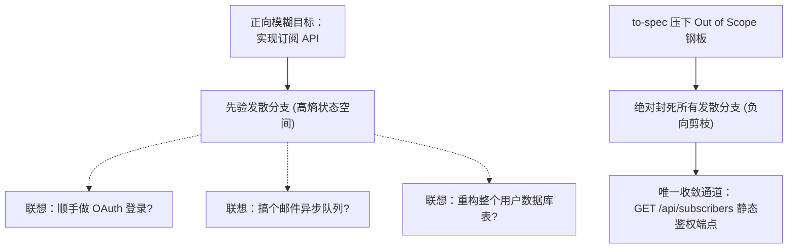
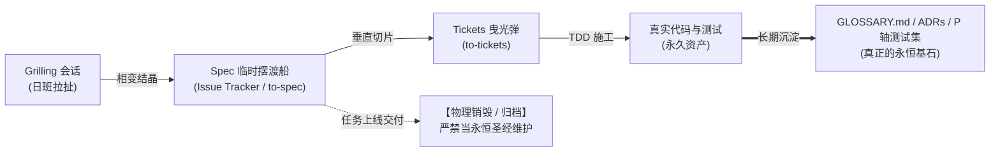

> 本文结合智能体第一性原理，解构 Matt Pocock 的 Skills 实践；主要参考 [AI Skills with Matt Pocock 播客](https://www.youtube.com/watch?v=4DhcSPkEbwI)及 [Skills 项目（本文所用版本）](https://github.com/mattpocock/skills/tree/4ae2317ddb22b046e26455e4f9c9b3aaaf62212d)。

---

### 引子：日班与夜班的断桥 —— 为什么你的 Agent 总在清晨交出一堆废铁？

在当前的软件工程实践中，TypeScript 知名布道师 Matt Pocock 曾提出过一个极富吸引力的协作图景：**“人类上日班，Agent 上夜班（The Day Shift and The Night Shift）”**。

在日班里，工程师与大模型坐在一起，通过激烈的盘问与方案碰撞（Grilling），把模糊的业务诉求抽丝剥茧，明确架构选型与接口边界；黄昏降临，工程师合上笔记本下班；而数个无状态的编码智能体（Coding Agent）则在后台自动排队接管任务，在夜色中静默写代码、跑测试、修复缺陷；等到次日清晨工程师泡好咖啡拉开终端，屏幕上已经躺着一份绿意盎然、提交整洁的 Pull Request。

然而，凡是真正把这套流程推入复杂工程的团队，几乎都迎面撞上过一堵冰冷的高墙：

> **清晨拉开终端，你等来的往往不是优雅的 PR，而是一场灾难性的精神崩溃现场：**  
> **夜班 Agent 要么把昨天反复强调“严禁引入”的沉重微服务框架悄悄打包了进来；要么围绕一个已被人类否决的死胡同方案，在几百次测试报错中原地打转，把上下文窗口塞满了上万行垃圾残骸；更荒谬的是，它常常在核心逻辑根本没有跑通的情况下，极度自信地宣布“全功能已完美交付”。**

为什么日班里讨论得如此透彻的共识，一到了夜班就荡然无存？

在前面的分析中，我们解构了前端的“需求榨取（`grill-me`）”与后端的“施工闭环（`implement`）”。但许多人唯独忽视了死死卡在二者正中央的物理枢纽——**`/to-spec`**。

在很多人眼里，`/to-spec` 无非就是顺手生成一份产品需求文档（PRD）的琐碎格式工具。然而，回到物理学与信息论的第一性原理审视：

> **`/to-spec` 绝不是一份平庸的需求文档模板，它是整个长程智能体系统跨越“昼夜时空断层”的唯一物理冷冻阀门！**  
> **它的全部工程意义，就在于将日班人机交互中沸腾流动的“动态反馈”，以零方差的刚性手段相变结晶为夜班无状态 Agent 的“静态前馈”；并赶在第一行代码写下之前，用确定性的“测试接缝（Seam）”把验收裁判权死死焊死在黑屋之外。**

本文将抛弃一切敏捷开发的概念泡沫，用严密的理论发动机对 `/to-spec` 展开一次彻底的深层解剖。

---

### 一、 权力关闸与相变结晶：为什么进入 `/to-spec` 必须严禁再次提问？

审视 Matt Pocock 的 [`to-spec/SKILL.md`](https://github.com/mattpocock/skills/blob/4ae2317ddb22b046e26455e4f9c9b3aaaf62212d/skills/engineering/to-spec/SKILL.md)，任何第一次阅读其源码的工程师都会被其正文第一行冷血的禁令所震撼：

> **`This skill takes the current conversation context and codebase understanding and produces a spec. Do NOT interview the user; just synthesize what you already know.`**  
> （本技能基于当前会话上下文和代码库理解生成 Spec。**绝对禁止再向用户发起任何面试式盘问**；你的唯一职责是综合归纳你已经知道的一切事实。）

在常规的 Prompt 工程直觉中，“多向用户发问、澄清细节”几乎被奉为金科玉律。为什么 `/to-spec` 却把“提问”定性为一项严重的系统缺陷？

#### 1. 理论发动机：信息完备性方程的阶段切分

我们在[《数学基石篇》](../agent-math-foundations/)与[《第一篇》](../agent-loop/)中，形式化推导出了支配智能体系统收敛的**信息完备性方程（核心方程一）**：

$$
I_{\text{前馈}} + \sum_{k=1}^n \Delta I_{\text{反馈}, k} \ge I_{\text{目标}}
$$

当我们将一个复杂的长程任务按“日班规划（准备阶段）”与“夜班施工（实施阶段）”进行切分时，我们在《数学基石篇》§三.5 严格证明了**阶段切分推论**：

$$
I_{\text{实施前馈}} = I_{\text{初始前馈}} + \sum_{k=1}^\tau \Delta I_{\text{准备阶段}, k}
$$

代入实施阶段的总账：

$$
I_{\text{实施前馈}} + \sum_{k=\tau+1}^n \Delta I_{\text{实施阶段}, k} \ge I_{\text{目标}}
$$

请仔细凝视这两个等式之间的物理因果：
* 在准备阶段（第 $1$ 步到第 $\tau$ 步），系统处于 **Grilling 模式**。此时用户需求充满未定性，系统必须通过多轮人机对答，从人类的生物神经元（$H$ 轴）中压榨出隐性的偏好与边界，获得极充沛的准备阶段反馈增量 $\sum \Delta I_{\text{准备阶段}}$；
* 但是，**一旦实施阶段的秒表被按下（第 $\tau+1$ 步启动），系统的观察原点发生了刚性突变！** 站在夜班施工的角度，那一笔曾经被称为“动态反馈”的人机对话，必须**一次性打包转化为实施阶段的静态前馈（$I_{\text{实施前馈}}$）**！

正如我们在《数学基石篇》§三.5 指出的工程边界：阶段切换必然伴随着会话清空，信息面临灾难性丢失的物理风险；而若将白天长达几十轮的探索全量塞入夜班，又会引入严重的历史残骸与信噪比衰减（DPI）。**`/to-spec` 的物理使命，就是作为跨会话的刚性载体，在剔除一切探索性废话的同时，无损锁死全部有效信息增量，使其合法转化为夜班新会话的纯净前馈。**

#### 2. 生活常识类比：餐厅点菜与后厨打单起锅

理解这种“权力关闸”，最好的场景就是每个人都经历过的**下馆子点菜**：

* **翻看菜单的讨论期（Grilling 阶段）**：你坐在餐桌前，翻着菜单跟服务员反复商量：“今天这鲈鱼新鲜吗？红烧还是清蒸？水煮牛肉能不能免辣？土豆粉能多加一份吗？”在这个阶段，你的诉求处于高度流动的液态，允许推倒重来，服务员也会根据厨房现状给你反馈；
* **点单机打印小票的那一秒（`/to-spec` 阶段）**：服务员把最终决定的菜品在手持机上按下一声“确认下单”，小票立刻在后厨打单机上“滋滋”打印出来，后厨的猛火大灶随即点火起油——**此时系统瞬间经历了物理相变，菜品契约彻底冷冻！**
* **后厨起锅后的绝对关闸（`Do NOT interview` 禁令）**：大厨起锅烧油开始炒菜之后，**服务员绝对不能每隔两分钟掀开厨房帘子跑出来敲你桌子问**：“哥，你看这盘鱼的葱花切一厘米还是两厘米？这锅牛肉你觉得先焯水还是先滑油？”如果服务员这么干，你必定觉得这餐厅极不专业当场发飙，而后厨的锅也必定因为频繁停顿直接炒糊！

Matt Pocock 在[`to-spec` 文档](https://github.com/mattpocock/skills/blob/4ae2317ddb22b046e26455e4f9c9b3aaaf62212d/docs/engineering/to-spec.md)中写道：
> *“When you reach for it, the deciding is already done. So it synthesises what is known... and does not start a new round of questions. The spec records decisions you already made. It is not a place to make new ones.”*

敲下 `/to-spec` 的那一刻，就相当于服务员把小票送进了后厨。它守住了两条致命底线：
1. **防止人类决策权无休止发散（Decision Oscillations）**：人类大脑天生具有厌恶最终拍板的妥协本能。如果没有刚性关闸机制，Agent 每次抛出一个技术细节反问，人类就会顺手发散出三个新功能诉求，导致准备阶段反馈账目永远无法出具终审报表；
2. **消灭交接缝隙中的信息双重计入与幻觉篡改**：如果允许 `/to-spec` 自由提问，模型就会凭借内源推测去填补那些人类没明确说清的空白，把未经检验的“猜测”伪造成“既定共识”。

**小票已经打出，炉火已经升起。剩下的唯一任务，是冷酷地照单施工。**

---

### 二、 接缝先于散文：解密“Seams before prose”与 $(P, M, H)$ 锚定

翻开传统的软件工程教科书，几乎所有的敏捷需求文档（PRD）都由冗长的散文（Prose）与层层叠叠的 User Stories 堆砌而成。

然而，[`to-spec`](https://github.com/mattpocock/skills/blob/4ae2317ddb22b046e26455e4f9c9b3aaaf62212d/skills/engineering/to-spec/SKILL.md) 流程的第 2 步却给出了一个极其反常、甚至反直觉的刚性约束：

> **`Sketch out the seams at which you're going to test the feature... The fewer seams across the codebase, the better - the ideal number is one. Check with the user that these seams match their expectations.`**  
> （勾勒出你将用来测试该特性的**接缝（Seams）**……整个代码库上的接缝越少越好——**理想的数量是唯一的一个**。在动笔写正文前，必须先与用户核对该接缝是否符合预期。）

在写下任何一段“作为一个用户，我想要……”的动人散文之前，为什么系统必须先确定甚至仅确定**唯一的一个测试接缝**？

#### 1. 理论发动机：恒温器比较器与 $(P, M, H)$ 物理锚定

我们在[《第三篇：驯服长程循环》](../agent-harness/)中深入解剖了裸 Agent Loop 走向失控的根本病根：**缺少确定性的恒温器比较器（Comparator），让大模型在同一个上下文窗口里既当运动员又当裁判员。**

并且，我们通过**定理五（脑内自查增量归零）**、**定理六（自测同源盲区与作弊）**以及**定理七（验证独立性定理：验证判据与执行权限必须物理隔离，运动员与裁判员绝对分离）**严格证明了：
* 自然语言写成的散文需求，属于纯粹的语义模型空间（$M$ 轴）与人类主观空间（$H$ 轴）；
* **自然语言散文无法充当长程代码执行的零方差物理比较器！**

要让夜班施工的无状态 Agent 在连续运转数小时时不发生漂移，必须在任务出发前，在物理世界中选定一个能够挂载自动化测试套件的**确定性程序基矢锚点（$P$ 轴）**。这个锚点，在软件架构物理学中被称为——**接缝（Seam）**。

#### 2. 生活常识类比：家电包装盒上的宣传语 vs 机身末端的三孔电源插头

* **传统长篇散文 PRD**，就像买一台家用吹风机时包装盒上印得天花乱坠的**商业宣传语**——“负离子润发、恒温气流包裹、纳米微风科技……”文字再动人、散文再华丽，它也不能用来给工厂质检员当合格尺；
* **`to-spec` 强推的 Seam**，则是结构工程师在产品开模前就焊死在机身末端的**唯一标配国标三孔插头（Seam）**！

工厂流水线上的质检机（后续的 `tdd` 与 `code-review` 技能）根本不需要拆开吹风机的塑料外壳，去看里面的电机线圈绕了多少圈、发热丝焊在哪个电阻旁边（内部私有实现细节）。质检员唯一要做的事，是把三孔插头“咔哒”一声推进标准测试插座（黑盒 $P$ 轴断言），推上电闸：
* 电机正常运转、吹出热风且不跳闸短路 $\implies$ 验收通过；
* 冒烟跳闸 $\implies$ 无论包装盒上写了多么唯美的散文，直接判定不合格打回重做！

#### 3. 为什么“接缝越少越好，理想数量是 1”？

很多初级架构师误以为，测试覆盖率越高越好，接缝越多越细越好。Matt Pocock 却在规范中严厉棒喝：**全代码库接缝越少越好，最理想的状态是只有一个最高接缝（Highest Seam）！**

这一工程直觉背后，蕴含着深刻的软件设计哲学（John Ousterhout 的《软件设计的哲学》与深模块理论）：
1. **深模块的高杠杆（Deep Modules）**：最好的模块是“接口极其简短，内部实现极其深厚”。如果一个特性在代码库里开凿了 10 个测试接缝（测试了 Controller、又测试了 Service、又测试了 Repository、又测试了 5 个内部 Helper 类），就相当于质检员把吹风机外壳彻底砸碎，在里面的每一个二极管和电容上都焊上测试探针——一旦工程师想把发热丝优化成陶瓷发热，所有测试断言瞬间全盘崩塌；
2. **杜绝古德哈特测试作弊**：接缝越多，模型在夜班面对测试报错时，越倾向于去篡改那些脆弱的内部 Mock 断言（我们在定理六中揭示的 $\nabla_{\text{测试规则}} \operatorname{Loss} \ll \nabla_{\text{重写业务}} \operatorname{Loss}$）；
3. **给模型保留最大自由度的“黑盒空间”**：将接缝收敛在最高层（如只测试公开的 HTTP API、或只测试 CLI 入口），只要外部插头通电运转正常，内部代码哪怕被重构、被优化、被重写，测试依然稳如泰山。

在动笔写需求前，先逼人类与模型就**唯一的通电测试插头**达成签字誓约——这就是 `to-spec` 能让长程任务不跑偏的第一道物理锚。

---

### 三、 雕塑家的剪枝艺术：为什么 `Out of Scope` 才是真正的降熵压舱石？

审视 [`to-spec` 模板](https://github.com/mattpocock/skills/blob/4ae2317ddb22b046e26455e4f9c9b3aaaf62212d/skills/engineering/to-spec/SKILL.md) 的骨架，任何习惯了传统敏捷文档的人都会立刻察觉到一种怪异的冷酷：

它没有把篇幅挥霍在无休止的“美好愿景陈述”上，而是在正文核心位置赫然钉下一道坚不可摧的负向铁幕——**`Out of Scope`（范围外硬红线）**。

Matt Pocock 在官方使用手册中留下了一句击中工程要害的警世箴言：
> *“The out-of-scope section lists real things. The things you refused are usually the most useful lines on the page.”*  
> （`Out of Scope` 栏目必须列出真实存在的事物。**那些被你斩钉截铁拒绝掉的选项，往往是整张纸上最具价值的文字！**）

为什么“不做什么”的价值，远远压倒了“要做什么”？

#### 1. 理论发动机：香农信息论中的状态空间剪枝与负信息

在香农信息论中，达成目标所要求的信息量等于消除先验不确定性：

$$
I_{\text{目标}} = H(Z) - \varepsilon
$$

大语言模型（LLM）由于在预训练语料中看过了数千万个软件项目的完整代码，它的先验概率分布天然具备一种致命的**“功能镀金（Gold-plating）”冲动**：
* 当你在需求里写下 *“实现一个用户邮箱订阅功能”* 时；
* 模型的自回归注意力机制会立刻激活海量的关联假设：*“要不要支持 OAuth 第三方登录？”、“要不要集成 Mailchimp 同步？”、“要不要做 Redis 延迟重试队列？”、“要不要加一个华丽的前端 Toast 提示动画？”*

在长达数十步的自主循环中，如果缺乏负向阻尼，大模型会极其自然地顺着这些高概率联想滑落，把宝贵的算力与上下文窗口浪费在根本无人要求的边角料上，最终导致主任务因 Token 耗尽或时间过长而半途崩塌。

#### 2. 生活常识类比：点外卖时加粗放大的“重度过敏忌口备注”

理解 `Out of Scope` 的最高价值，最接地气的场景莫过于**点外卖写备注**：

* 如果你点一碗牛肉面，在备注栏里洋洋洒洒写下一百字优美散文：“希望牛肉切片薄如蝉翼、汤底浓郁温润、面条煮得爽滑筋道……”，厨师在嘈杂的后厨扫一眼就扔到一边，煮成什么样完全凭概率；
* 但如果你的朋友对花生严重过敏，你在备注栏用加粗特大号字体只写下一行短字：**【严重过敏：绝对不要放任何花生碎和香菜，漏放直接退单送医院！】**
* 厨师抓起小票，第一眼锁死的一定是这行加粗的**禁令（Out of Scope 负向硬约束）**。他盛汤抓料的手会在空中顿住，把手里的花生勺狠狠放下。这行短短的字，是整张外卖单上信息净价值最高、唯一能保命的降熵关键！

`to-spec` 模板中的 `Out of Scope` 就是这样一张写给无状态 Agent 的**忌口警告单**。它在正文里用零歧义的文字明确钉死：
* 严禁重构全局认证层；
* 严禁引入外部消息队列中间件；
* 严禁修改现有的数据库 Migration 历史。

这些负向约束在数学上等同于**对模型的策略搜索空间施加了绝对狄利克雷边界条件（Dirichlet Boundary Conditions）**。它将潜在的发散路径直接归零，把全部注意力强制聚焦在唯一的核心通道上。

#### 3. 为什么坚决拒绝在 Spec 中写入具体文件路径与代码片段？

在 `Implementation Decisions` 章节中，`to-spec` 制定了另一项近乎苛刻的反直觉规则：
> **`Do NOT include specific file paths or code snippets. They may end up being outdated very quickly.`**  
> （**严禁在决策中包含具体的文件路径或代码片段**。因为它们极易迅速过时。）  
> *唯一例外：由 throwaway prototype（一次性原型验证）淬炼出的、能比自然语言更精确表达状态机或类型定义的极简结构。*

很多工程师感到困惑：给 Agent 喂具体的文件路径（如 `src/auth/jwt.ts:42`）难道不是最精确的吗？

答案恰恰切中了我们在[《第二篇》](../agent-control/)与[《第六篇》](../agent-memory/)中揭示的物理铁律：
* 文件路径和具体行号属于**易碎的局部实现细节（Implementation Details）**；
* 在夜班的多 Ticket 连续施工中，前 3 个 Ticket 很可能会重构目录、重命名文件；
* 如果在宏观 Spec 中硬编码了文件路径，到了第 4 个 Ticket 启动时，这条写死的路径就会瞬间退化为**误导模型寻路的毒性过期 Context**！

**Spec 的职责是固化“系统行为的不变量（Invariants）与契约”，而不是越俎代庖去替未来的执行者心算行号。**

---

### 四、 神话的破灭与工具的归位：警惕“规范驱动开发（SDD）”的新迷信

推导走到这里，我们必须解开当前 AI 编程领域一个最具迷惑性的思潮——**“规范驱动开发（Spec-Driven Development, SDD）”**。

在 2024 年底的大模型狂欢中，伴随着“自然语言是最新编程语言”的口号，一股狂热的思潮迅速蔓延：很多人认为，代码已经不重要了，代码只是临时的副产品；未来的软件工程只需要永久维护一份纯自然语言的 Spec，改动 Spec，Agent 就会自动重新生成整个软件。

Matt Pocock 本人在最初也是这一思潮的热烈拥趸。然而，在[一手播客访谈记录](https://www.youtube.com/watch?v=4DhcSPkEbwI)中，他坦白了自己亲身经历的惨痛幻灭：

> *“I started doing that a lot. I was especially looking at like spec-driven development... I thought, okay, maybe English is the hot new programming language, right? Like, maybe I can just write a spec, and that specification is going to be persistent... And as I experimented with it, I tried it a lot, and **I was just getting worse results than if I'd coded it by hand.** And I noticed that every time I would sort of run this loop of change the spec, see the code change, **the code would get worse... it was garbage.**”*

为什么把 Spec 当作永恒不朽的系统真理去维护，反而会催生出彻底失控的代码垃圾？

#### 1. 软件熵增（Software Entropy）与物理反馈回路的断裂

Matt 在访谈中回忆，正是这场幻灭逼得他重新拿起了书架上尘封 25 年的经典名著——《程序员修炼之道》（The Pragmatic Programmer），并重新顿悟了其中的**软件熵增定律**：

在真实代码世界中，自然语言天然具备多义性与模糊性。如果试图用“改 Spec $\to$ 全量重新生成代码”的闭环来开发：
* 缺乏细粒度的物理反馈回路；
* 模型的每一次重写，都在无序地重构底层实现，软件架构的熵（混乱度）以指数级飙升；
* 传统工程沉淀了几十年的经典武器——**“别跑得太快超过车灯照射范围（Don't outrun your headlights）”**、**“示踪弹（Tracer Bullets）”**、**“垂直切片（Vertical Slices）”**被抛到脑后，系统迅速走向不可维护的死局。

#### 2. 生活常识类比：超市采购便签纸 vs 家里的户口本与房产证

要理解 Spec 的物理边界，必须看清它在整个系统生命周期中的真实角色：

* **家里的户口本与房产证（Permanent Assets）**：无论你今天去哪家超市、买了什么菜，家里的户口本、房屋产权证和每月的固定记账规则，都是必须永久锁在抽屉里的底座资产。映射到软件工程中，这就是我们在[《第六篇》](../agent-memory/)确立的**冯·诺依曼长期持久化基准**：
  1. 统一团队业务名词的领域词汇表（`GLOSSARY.md`）；
  2. 锁死重大架构权衡的历史档案（`docs/adr/`）；
  3. 秒级判定业务是否成立的自动化测试断言集（$P$ 轴形式化代码）。
  这些是不随会话消亡的永久基石。

* **今天下午去超市前随手写的采购便签纸（Disposable Spec）**：上面记着“买 2 斤土豆、1 瓶生抽、2 盒纯牛奶”。它是一次性战术执行的**摆渡船**。当你推着购物车结完账回到家，把土豆和生抽塞进厨房橱柜的那一瞬间，**这张便签纸的物理使命就已经彻底终结——随手揉成一团扔进垃圾桶才是正解！**
  绝不可能有一位正常的家庭主妇，把昨天的买菜便签精心裱进相框供在神坛上；更不会有人在下个月去超市时，还神经质地在昨天那张发霉的旧便签上反复涂改！

**Spec 的物理本质，就是这份专属于某一次迭代的“超市采购便签纸”，是一艘跨越日班与夜班的临时摆渡船。**

正如 Pocock 在文档中的无情清醒判定：
> *“Do I keep the spec frozen once tickets start, or let the agent rewrite it? Nothing keeps it in sync. In practice it is a snapshot of what you knew at that moment, and it goes out of date the first time implementation teaches you something. **Treat it as disposable after the work ships.** Your GLOSSARY.md and ADRs are the files meant to last.”*

一旦渡船靠岸、任务上线，这艘摆渡船的使命就已经彻底终结。试图在未来的维护中天天去同步修改 Spec，是在给团队徒增无意义的文档形式主义枷锁。

#### 3. 真实血泪教训：`ready-for-agent` 诱发的自动驾驶翻车惨剧

在 [`to-spec` 的已知缺陷报告](https://github.com/mattpocock/skills/blob/4ae2317ddb22b046e26455e4f9c9b3aaaf62212d/docs/engineering/to-spec.md) 中，记录了一个极具戏剧性的工程翻车事故：
* `to-spec` 自动生成的 Spec 会被贴上一个名为 `ready-for-agent` 的标签，其本意是标记“该 Issue 格式已完备，无需人工前置分流”；
* 然而，企业中部署的那些无人值守的自动化挂机 Agent（AFK Agent），在轮询扫描到这个标签后，**误以为这是一张可以直接施工的单次工单！**
* 结果，AFK Agent 一口将包含数千字完整 Spec 的大文档硬生生塞进自己的上下文窗口，直接跳过了后续的切票工序（`to-tickets`），试图在单次 Session 内一口气徒手建起罗马城；
* 结局毫无悬念：**窗口瞬间被撑爆，模型瞬间跌落进 Dex Halsey 描述的 150k Token 之后的“痴呆区（Dumb Zone）”，在注意力严重溃散中把整个工程炸成了废墟。**

这一血淋淋的事故，再次用反面实验证实了第一性原理的严酷：
**宏观的 Spec 负责确立冷冻的目的地（Where we go），但它绝不能被直接当成施工图！唯有经过下一道工序（`to-tickets`）将其切碎为一枚枚垂直穿透的示踪弹（Tracer Bullets），长程工程才能安全着陆。**

---

### 五、 全景总结：三权分立链条中的中枢齿轮

至此，我们将 Matt Pocock 的完整工程链条，与作者的第一性原理体系完成终极合拢：

| 阶段 | 对应的 Matt Pocock 技能 | 信息论角色 | 物理载体与控制权归属 | 核心防线与红线 |
| :--- | :--- | :--- | :--- | :--- |
| **阶段 0：建地图** | `setup-matt-pocock-skills` `domain-modeling` | **全局静态前馈搭建** （做大 $I_{\text{初始前馈}}$） | 磁盘文件：`GLOSSARY.md`、ADR （长期资产，全员共享） | 统一名词语义，杜绝跨会话同名歧义与认知摩擦 |
| **阶段 1：人机碰撞** | `grill-me` `grill-with-docs` | **动态反馈汲取** （收集 $\sum \Delta I_{\text{准备阶段}}$） | 运行期 Context （主模型与人类 $H$ 轴剧烈交互） | 严禁过早写代码，用具象方案撞击人类默会知识 |
| **阶段 2：相变结晶** | **`/to-spec`（本篇核心）** | **阶段切分与信息冷冻** （将反馈转为实施前馈） | Issue Tracker 单张工单 （任务态瞬态载体） | **严禁再次面试！接缝先于散文（Seam=1）！用 Out of Scope 负向剪枝！** |
| **阶段 3：曳光切片** | `to-tickets` | **Context 预算控制** （防止跌入 Dumb Zone） | 垂直切片 Tickets （一次性消耗品工单） | 拒绝横向分层，坚持垂直穿透的 Tracer Bullet |
| **阶段 4：执行与审查** | `implement` / `tdd` `code-review` | **闭环动态反馈** （获取 $\Delta I_{\text{结果与验证}}$） | 黑屋外形式化程序 $P$ 轴 （只读测试套件 + 双轴审查） | 运动员裁判员隔离，严禁无测试裸奔，严禁改动测试断言 |

最终，所有高深的工程技巧，都在香农信息论与控制论的冰冷定律面前收敛为优雅的秩序：

> **`grill-me` 负责在混沌中榨取真实的人类意图；**  
> **`to-spec` 负责在相变点落下闸门，将脆弱的共识浇铸为不可篡改的契约钢印；**  
> **`to-tickets` 负责将巨石切割为适合大模型胃口的精致食粮；**  
> **而 `tdd` 与形式化测试，则在黑屋之外用物理事实守卫着最终的尊严。**

这就是 `/to-spec` 在 AI 智能体时代不可替代的工程王座。

---

### 参考资料

本文从本系列的信息完备性方程阶段切分、$(P, M, H)$ 独立验证空间、恒温器比较器及状态持久化原理出发，参考以下核心技术资料与工程实践：

- [to-spec 技能规范](https://github.com/mattpocock/skills/blob/4ae2317ddb22b046e26455e4f9c9b3aaaf62212d/skills/engineering/to-spec/SKILL.md)（Matt Pocock 官方开源 Skills 仓库中 `to-spec` 的实现定义与 Prompt 铁律）
- [to-spec 说明文档](https://github.com/mattpocock/skills/blob/4ae2317ddb22b046e26455e4f9c9b3aaaf62212d/docs/engineering/to-spec.md)（Matt Pocock 编写的官方使用手册与深度 FAQ，详细披露了与 tickets 的分工、接缝要求及 AFK 踩坑纪实）
- [AI Skills with Matt Pocock (播客访谈)](https://www.youtube.com/watch?v=4DhcSPkEbwI)（Matt Pocock 在 Pragmatic Engineer 播客中的深度对话，详述日班夜班模式、SDD 的狂热与幻灭、Dex Halsey 聪慧区与软件熵增）
- [Matt Pocock Skills 项目说明](https://github.com/mattpocock/skills/blob/4ae2317ddb22b046e26455e4f9c9b3aaaf62212d/README.md)（Skills 整体架构哲学与基于 Linear / GitHub 的工作流编排）
- [解构 Matt Pocock 的 Skills（一）：给跨会话 Agent 建一张项目地图](../matt-pocock-skills-01/)（项目地图、三层状态拓扑与五类前馈）
- [解构 Matt Pocock 的 Skills（二）：当人自己也不知道想要什么](../matt-pocock-skills-02/)（需求深挖、双前沿拉扯与默会知识撞击）
- [解构 Matt Pocock 的 Skills（三）：让 Agent 一边动手，一边看见自己有没有走偏](../matt-pocock-skills-03/)（曳光弹切片、TDD 与双轴代码审查）
