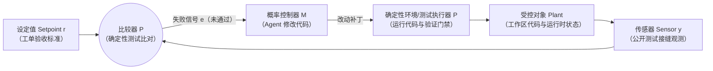

> 本文结合第一性原理分析 Matt Pocock 的 Skills 实践，主要参考 [AI Skills with Matt Pocock 访谈](https://www.youtube.com/watch?v=4DhcSPkEbwI)和 [Skills 项目所引用版本](https://github.com/mattpocock/skills/tree/4ae2317ddb22b046e26455e4f9c9b3aaaf62212d)。

### 引子：26 张工单，四分之三都在返工

在 Matt Pocock 的 [`to-tickets` 说明文档](https://github.com/mattpocock/skills/blob/4ae2317/docs/engineering/to-tickets.md)里，记着一个让人很不舒服的团队复盘：

> 一个团队接了一个复杂任务，一共拆成 26 张工单。他们按很常见的技术分层往里填人：先把语料库层（Corpus）全做完，再写生产者层（Producer），接着写聚合器层（Aggregator），最后再接选择器层（Selector）。
>
> 结果算总账时大家傻眼了：平均每关掉 1 张工单，前面大约跑了 20 次 Agent 会话，其中差不多四分之三的操作都是在推倒返工。团队自己做完事后复盘，结论非常明确：**每一类故障的根源都不在单块代码写得有多差，而全都在“按层横向拆单”这件事上。** [来源：`to-tickets` 说明](https://github.com/mattpocock/skills/blob/4ae2317/docs/engineering/to-tickets.md)

很多用过编码 Agent 的开发者都会有同感：明明在上一篇 [`to-spec`](/zhangmuchuan/blog/matt-pocock-skills-04/) 里把规格说明书写得很细了，为什么到了拆分任务、动手写代码的阶段，Agent 还是能前面绿灯一路跑完，到了合龙那天大面积推翻重写？

因为 Spec 只能把“你要去哪”先说清楚，它替代不了“代码在真环境里跑通之后给你的回音”。只要任务切法把“能看见回音的时刻”推到了最后一公里，哪怕模型再聪明，前面几十轮也只是在猜。

这篇文章用我们前几篇建立的信息论方程、期望信息净价值（VoI）和恒温器闭环模型，来拆解 [`to-tickets`](https://github.com/mattpocock/skills/blob/4ae2317/skills/engineering/to-tickets/SKILL.md) 背后的设计账：为什么按层拆必返工、纵向切片究竟省了什么钱、验收标准为什么会变成空话，以及一张工单做完后为什么必须重开一个干净的会话。

---

### 一、按层拆单为什么会“每步都绿、最后全改”？

先从[《数学基石篇》](/zhangmuchuan/blog/agent-math-foundations/)最底层的物理处境看起。模型运行的时候，参数是冻结的，它能看见的只有当前输入给它的上下文 $C$，而真实的代码库、依赖库行为、接口返回值都在上下文之外的环境 $E$ 里。于是“真实环境 $E \longrightarrow$ 上下文 $C \longrightarrow$ 模型输出 $R$”构成一条马尔可夫链：

$$
E \longrightarrow C \longrightarrow R
$$

根据数据处理不等式（定理一 DPI）：

$$
I(E; R) \le I(E; C)
$$

其中 $I(E; C)$ 是当前上下文 $C$ 所包含的关于外部真实环境 $E$ 的互信息量，$I(E; R)$ 是模型输出 $R$ 所能携带的关于环境 $E$ 的信息上界。再叠加《数学基石篇》**定理二（现实不可辨识性）**：若模型只在黑屋内靠思维链自转（$I(E; R_{\text{CoT}} \mid C) = 0$），**上下文 $C$ 里没有放进来的环境真相，模型自己在脑子里推演一百遍，也不可能凭空多算出一点点来**。

再看《数学基石篇》的方程一（信息完备性方程）：

$$
I_{\text{前馈}} + \sum_{k=1}^{n}\Delta I_{\text{反馈},k} \ge I_{\text{目标}}
$$

这里 $Z$ 代表“整条功能真实可用”的目标状态随机变量，$H(Z)$ 是它的先验不确定性，$I_{\text{目标}} = H(Z) - \varepsilon$ 则是把剩余不确定性压低到可交付容差 $\varepsilon$ 以内所需消除的有效信息阈值；$I_{\text{前馈}} = I(Z; C_0)$ 是开工前已经**实际放进初始上下文 $C_0$** 里的 Spec 与已读代码信息（躺在磁盘上尚未被读进窗口的文件仍属于外部环境 $E$ 的存量，不算前馈）；而 $\Delta I_{\text{反馈},k} = I(Z; O_k \mid C_{k-1})$ 则是第 $k$ 步在上一轮上下文 $C_{k-1}$ 的基础上，把代码放进真实环境运行后拿回的新观测 $O_k$ 带来的有效信息增量。Spec 能做厚的是 $I_{\text{前馈}}$，但它替不了运行期才能测出来的那部分 $\Delta I_{\text{反馈},k}$——比如某个第三方接口的真实返回字段、数据库事务到底有没有锁住、前后端约定的字段名是不是少了一个下划线。

**按层拆单的问题，就出在它人为把 $\Delta I_{\text{反馈},k}$ 推迟到了第 $n$ 步。**

这在生活里很常见。假如你买了一套毛坯房准备装修，目标很简单：尽快验证“水电布局顺不顺、人住进去能不能正常洗澡做饭”。

按“技术分层”拆单，相当于你请的装修队按工种排了四周流水线：
- **第一周（只干泥瓦拆改）**：把全屋所有墙体都按图纸敲好砌齐，拿着水平尺一量，每面墙都笔直。大家宣布：第一周验收全绿。
- **第二周（只干水电布管）**：把全屋冷热水管、强弱电线全埋进墙里，打个水压表看管子没漏水。大家又宣布：第二周验收全绿。
- **第三周（只干全屋贴砖装面板）**：瓷砖贴满，开关插座面板全拧上去，看着非常整齐。第三周继续全绿。
- **第四周（安装花洒、热水器和智能马桶，首次通水通电试住）**：开关一按，麻烦全来了——热水器位置上方正好少留了一路强电插座；卫生间热冷水口装反了；厨房橱柜把半个地漏盖住了。前四周测的都是“墙直不直”、“管漏不漏”，关于“人能不能顺利洗上热水澡”这条完整通路的信息量，前三周一直等于零。结果到了第四周，只能把贴好的瓷砖砸掉重刨墙。

软件开发里也是同一笔账。构造一个常见假设场景方便对照：假设我们要做一个会员订阅功能，如果按层横向切——第 1 周让 Agent 建完 5 张数据库表并跑通建表 SQL；第 2 周写完 10 个 Service 方法并配上一堆 Mock 单测；第 3 周套上 REST API；第 4 周前端联调接支付回调。前三周每张工单都在喊“测试全绿”，但前三周跑的只是语法检查和自己编造的假替身，整条“支付回调 → 改会员状态 → 前端读出来生效”的真实端到端增量 $\Delta I_{\text{反馈}}$ 始终接近于零。前三周积累的每一个误判（字段名想当然、状态机流转缺分支），到了第 4 周全部叠加在一起，返工就不再是改两行代码，而是掀掉底层表、服务层和接口层一起重写。

---

### 二、为什么纵向切片（曳光弹）信息净价值最高？

解决这个困局，Matt Pocock 在 [`to-tickets`](https://github.com/mattpocock/skills/blob/4ae2317/skills/engineering/to-tickets/SKILL.md) 里要求每一张工单都必须切成一个**纵向切片（Vertical Slice / Tracer Bullet）**——中文常译作“曳光弹”，意思就是哪怕只打通极窄的一条路，也要一口气穿通 Schema、API、UI 和测试这所有层，做完这一张票就能当场演示和验收。

还是拿上面装修毛坯房来比方：如果换成“纵向切片”的做法，你第一周不会全屋铺砖，而是先挑**客卫这一间最小功能区**，把它的墙体、冷热水管、电线、防水、马桶和花洒全部装到位，通水通电自己试洗一次（不需要豪华吊顶，也不用管其他两间卧室）。第一周结束，你花在全屋上的工钱和材料（$\operatorname{Cost}$）很少，但它当场帮你把“水压够不够、冷热管方向对不对、电路负载行不行”这些贯穿全屋的硬约束全摸清了——就算试洗时真发现冷热水管接反了，也只用敲开客卫三块砖半天改好，不用砸掉全屋。接下来再去装主卫和厨房，心里完全有底。

用[《第二篇：控制权的收放艺术》](/zhangmuchuan/blog/agent-control/)里的**期望信息净价值方程（方程二）**，可以把这件事算得很清楚：

$$
V(a \mid C_t) = \operatorname{VoI}(a) - \lambda \operatorname{Cost}(a) \equiv \Delta I_{\text{反馈}}(a) - \lambda \operatorname{Cost}(a)
$$

先把变量和条件交代清楚：
- $C_t$ 是当前已经掌握的代码库和规格上下文；
- $a \in \{a_{\text{纵向}}, a_{\text{横向}}\}$ 是候选的切片施工动作；
- $\operatorname{VoI}(a)$（由该动作带回的期望有效信息增量 $\Delta I_{\text{反馈}}(a) = I(Z; O_{t+1} \mid C_t, A_t = a)$ 度量）刻画这次跑通后对后续决策不确定性的缩减价值；
- $\operatorname{Cost}(a)$ 是写完并验证这张切片消耗的 Token、时间和人力核验成本，$\lambda > 0$ 是风险偏好与量纲折算系数。

按照霍华德信息价值理论的灵敏度判据（$\frac{\partial a^*}{\partial O} \neq 0$），一条信息之所以值钱，是因为它能立刻改写后续所有步骤的做法。注意看为什么纵向切片的净价值 $V(a_{\text{纵向}} \mid C_t)$ 压倒性地高于横向切层：
1. **当步成本 $\operatorname{Cost}(a_{\text{纵向}})$ 同样很低**：在刚才假设的会员订阅例子里，第一张纵向切片只做“点击模拟支付 1 元 → 写一条有效会员记录 → 页面读出已生效”，暂时不管优惠券、退款和重试，代码量极少；
2. **信息价值 $\operatorname{VoI}(a_{\text{纵向}})$ 却高出几个量级**：这一小步一旦在真实环境跑通，就把数据库迁移、接口序列化、鉴权中间件、前端状态刷新这整条骨架的未知数一次性消除了大半，**拿回来的真报错会直接改写后续所有工单的接口设计与字段假设（$\frac{\partial a^*}{\partial O} \neq 0$）**，避免错误假设滚到第四周放大成全屋返工的复利代价。

[`to-tickets` 指南](https://github.com/mattpocock/skills/blob/4ae2317/docs/engineering/to-tickets.md)里给出了一个很朴素的检验方法，专门用来抓出悄悄溜回来的横向切片：拿着每一张列出来的工单问一句——**“这张票做完之后，你能当场演示出什么用户可感知的行为？”** 如果答不出具体行为，只能回答“建好了几张表”或者“写好了服务类”，那它就是一张横向薄片，必须打回去重切。

顺带一提，[`to-tickets`](https://github.com/mattpocock/skills/blob/4ae2317/docs/engineering/to-tickets.md) 自己也有个坦白记录的常见毛病：**模型很容易把一个小改动拆得太碎**（比如 3 行改动给你拆出 12 张票）。因为模型默认倾向于寻找最小原子单元，却常常丢掉“把能独立演示的一组动作打包在一起”的全局判断。所以 `to-tickets` 在把工单写进 Tracker 之前，专门设了一步向用户提问校准（Quiz）：让你看一遍清单，确认粒度是不是太细、要不要合并，或者哪个工单其实整件事在一个上下文窗口里就能直接 `/implement` 做完，根本不用拆票。

---

### 三、工单切小之后，怎么防住“验收标准自己骗自己”？

任务切成了一张张纵向小票，下一个立刻撞上的坑是：**票看起来很小，验收条件写得却全是废话，或者还没开工就已经全绿了。**

回到[《第三篇：驯服长程循环》](/zhangmuchuan/blog/agent-harness/)里的恒温器控制模型。一个系统能不能自己发现跑偏并拉回来，全看四个零件有没有各司其职：

- **设定值 $r$**：工单里写的验收标准（Acceptance Criteria）；
- **传感器 $y$**：挂在公开接口上的测试接缝（Test Seam）所采集到的真实运行表现；
- **比较器（$P$）**：确定性测试框架自动比对 $y$ 是否满足 $r$，输出确定性的通过或失败误差信号 $e$（此处代表控制论里的判定映射，而非字面算术相减）；
- **控制器 $M$ 与确定性执行器 $P$**：Agent 根据失败信号 $e$ 在黑屋内生成代码修改方案，随后必须经由黑屋外的**确定性环境/测试执行器 $P$** 真实编译、运行与校验，才能驱动受控对象走向收敛，而不是靠 Agent 自己口头宣布改好。

在 Matt Pocock 的 [`to-tickets` 说明](https://github.com/mattpocock/skills/blob/4ae2317/docs/engineering/to-tickets.md)和我们整理的 to-spec 讨论记录里，这个闭环最容易在三个地方失灵。我们可以拿**验收新装的制冷空调**来对照看，一清二楚：

1. **设定值模棱两可（同义反复）**：你在装修验收单上写“让客厅待着舒服”。什么叫舒服？24℃ 还是 28℃？比较器根本判断不出 $y$ 算不算达标。工单上写“优化会员状态流转”、“确保会员页正常显示”就是这种毛病。合格的设定值必须是能被外部观测证伪的动作描述，比如“向回调接口发 `status=paid` 后，查询会员接口返回 `status=active`”。
2. **起点基线就已经达标（假性绿灯）**：这是 `to-tickets` 文档专门点出的一类高发事故——很多自动生成的验收条件，在 Agent 一行代码还没写的时候就已经通过了。这就好比你买了一台夏天制冷用的新空调，验收标准写着“屋里温度低于 26℃”，可偏偏验收那天赶在**三九寒天**、窗户还敞开着，空调连插头都没插，屋里温度计就已经显示 15℃。验收员看一眼温度计说“达标了”，实际上空调根本没工作。因此，[`to-tickets` 文档](https://github.com/mattpocock/skills/blob/4ae2317/docs/engineering/to-tickets.md)建议人手核对每条非回归类的新增验收标准时，都要先想清楚：**“在动手前的起始提交（base commit）上，什么样的观测能证明它现在是失败的？”** 起点都不亮红灯的新标准，放到后面只会给你制造虚假的通过信号。
3. **传感器直接拆开机器刺探内部零件（实现耦合）**：空调验收本该站在客厅拿温度计测出风口和室温有没有降下来（这是对外契约，也就是**测试接缝**）。但如果验收员非要把空调外机壳拆了，拿着转速仪和万用表死盯着里面压缩机转了多少圈、某根内部供电线电流是不是 3.2 安培——过两天厂家为了省电换了一种变频控制方式，内部电流变了，客厅照样凉快得很快，你的验收仪却当场亮红灯报警。**空调根本没坏，是你的检查方法绑死了内部实现。**
   把这翻译回信息论：测试断言死盯私有方法调用次数或内部缓存字段，相当于往传感器读数 $y$ 里掺进了大量与交付目标 $Z$ 无关的“实现细节噪声”，导致一重构内部结构就误报。传感器必须钉在公开接口、HTTP 响应或 CLI 输出上。

---

### 四、哪些票能一起开工，什么时候又不能切片？（DAG 与例外）

几十张纵向工单切出来以后，怎么安排动手顺序？

[`to-tickets`](https://github.com/mattpocock/skills/blob/4ae2317/skills/engineering/to-tickets/SKILL.md) 把所有工单组织成一张**有向无环图（DAG）**：每张票都要显式标明自己被谁阻塞（`Blocked by`）。所有前置依赖都已经做完、当下没有任何阻塞的票，共同组成这张图上的**可执行前沿（Frontier）**。

如图中所示，`A 购买会员` 没有前置阻塞，落在初始可执行前沿上；只有等它落地后，`B 取消续费` 与 `C 支付失败处理` 才能同时进入前沿并排施工，最后共同合流到 `D 生命周期验证`。

这里有两个常踩的坑和一个必须交代的例外：

#### 1. 别把“本来能并排做的菜”强行串成一条线
就像在家里做一桌菜：红烧肉得等五花肉买回来才能下锅（这是真阻塞）；但拍黄瓜和煮米饭跟五花肉互不相干，明明能同时动手。很多人在拆工单时出于习惯，喜欢从 `01` 到 `10` 一路顺次写“上一张阻塞下一张”。

从《数学基石篇》的方程一和方程二看，这种**假阻塞（Fake Blocker）**是一笔纯粹的亏本账：既然工单 B 的起点上下文 $C_0^{(B)}$ 根本不需要消费工单 A 的输出契约，强行串行并不会给 B 增加任何有效信息，只会人为拖后独立分支获取外部反馈 $\Delta I_{\text{反馈}}$ 的时间，白白支付额外的等待成本 $\operatorname{Cost}$ 并压死并行前沿。所以 `to-tickets` 的原则很干脆：**只有当工单 B 必须用到工单 A 才刚刚建出来的接口契约或实体时，才画阻塞边；否则就放开，让它们同时暴露在前沿上。**

#### 2. 画图纸的人不直接下场砌砖（以及为什么规划内部不要清窗）
在 Matt Pocock 的工具链里，规划与派发是分开的：[`to-tickets`](https://github.com/mattpocock/skills/blob/4ae2317/skills/engineering/to-tickets/SKILL.md) 只负责调研、切单、跟用户对完粒度和阻塞边后把票发布出去，它自己绝不调起任何实施 Agent；等到用户确认完毕，才由人手动按前沿开会话调 `/implement`，或者交给专门的 [`implement-spec`](https://github.com/mattpocock/skills/blob/4ae2317/skills/engineering/implement-spec/SKILL.md) 去读图并调度多个子 Agent。

顺带记住一个来自官方踩坑文档的实战提醒：如果上游是用 `/to-spec` 生成了一份特别长的规格，**千万不要在 `/to-spec` 和 `/to-tickets` 之间清理或压缩上下文（`/clear` 或 `/compact`）**——让它们在同一个窗口里顺着做完，能省掉重新从 Tracker 抓取长 Spec 时被截断、来回翻页的大量废操作（见 [`to-tickets` 常见问题](https://github.com/mattpocock/skills/blob/4ae2317/docs/engineering/to-tickets.md)）。这和下一节要讲的“一票一会话必须换新窗”并不矛盾，按《数学基石篇》的阶段切分边界看就非常清楚：`/to-spec` 到 `/to-tickets` 依然处在**同一个准备与拆解阶段**内部，此时很多细微的取舍语境还活在当前准备上下文 $C_t$（尚未到达交接切分点 $\tau$）里、尚未完全固化到新工单，强行清窗或压缩反而造成有损截断；而一旦进入实施阶段，每张独立工单对应各自的实施闭环，这才是切换窗口清洗调试残骸的正确边界。

#### 3. 纵向切片的唯一例外：不停水给老楼换主管道（宽范围重构）
有意思的是，[`to-tickets`](https://github.com/mattpocock/skills/blob/4ae2317/skills/engineering/to-tickets/SKILL.md) 自己主动指出了“纵向曳光弹”失灵的一种情形：**宽范围机械重构（Wide Refactor）**。比如一个假设场景：你要把全库 200 个文件里的 `user_id` 从数字类型统一改成字符串。你动一下源头类型，全站上千处调用点立刻一起编译报错。

从《第三篇》$(P, M, H)$ 验证架构和方程二来看，这种全局修改之所以不能切纵向切片，是因为它直接打穿了确定性程序门禁 $P$（类型检查器与编译器）的局部可验证性：改一个公共符号会让 200 个文件一起报红，任何单步改动带来的局部有效反馈信息 $\Delta I_{\text{局部验证}}$ 都被铺天盖地的全站编译错误噪声淹没，回滚和排错成本 $\operatorname{Cost}(a)$ 急剧放大。

这就好比**给一栋仍在住人的老居民楼把主供水细管统一换成粗管，而且要求施工期间全楼不能断水**。你不可能切一条“三楼样板间”，直接把主水管和三楼接口改粗——因为二楼、四楼的旧接口全接不上，水闸一拧开立刻喷水停摆。全站接口是全局耦合的，改源头就得全楼一起兜底。

这种时候硬切纵向切片只会到处报红，`to-tickets` 改用经典的三步**展开—迁移—收缩（Expand–Migrate–Contract）**，目的就是重新恢复程序门禁 $P$ 对每一步的局部绿灯验证能力：
1. **展开（Expand）**：先不动正在供水的旧细管，而是在旁边**并排铺好一条新粗管，并在每户接口处装上新旧双通的过渡转接头**。这样水依然正常供应，全楼住户不受影响——对应代码里先在旧字段旁边并排加上新类型，新旧双写共存，让确定性门禁 $P$（CI 编译与测试）始终维持在可独立校验的绿灯基准上；
2. **迁移（Migrate）**：接着按楼层拆成若干迁移工单（每张票受限于第一步的“展开”工单），水电工**一户户把水龙头从旧管拨到新粗管上**。因为旧管还在兜底、转接头也都在，每一户改完都能立刻拧开水龙头试水过关——对应按目录或模块分批把调用方挪到新接口，每批迁移完都能独立通过 $P$ 的检查（哪怕少数情况单批过不了，也能共享一条集成分支，一起阻塞最后一张集成验收票）；
3. **收缩（Contract）**：直到整栋楼最后一户都接上了新粗管，确认再无任何一户用着旧细管，再由一张被所有迁移批次阻塞的收尾工单，**把旁边那根已经空置的旧细管拆掉封口**——对应把旧字段和兼容代码干脆删掉。

---

### 五、一票一会话：为什么每张工单必须换一个干净窗口？

最后一个决定成败的物理问题：既然工单拆好了，能不能让同一个 Agent 在同一个对话窗口里，从第 1 张票一路做到第 10 张票？

不行。原因就在我们在[《第六篇：穿越时间的 Context》](/zhangmuchuan/blog/agent-memory/)分析过的**过程残骸（Process Debris）对有效信噪比的稀释**，以及[《数学基石篇》](/zhangmuchuan/blog/agent-math-foundations/)里**阶段切分公式成立的物理边界**。

先看生活里的交接场面。假如两位厨师接力做一桌宴席：第一位厨师做第一道糖醋排骨，中间试过两次油温、不小心打翻过半勺老抽、案板上留着切碎的姜末、骨头渣和用脏的碗筷。最后好不容易把排骨盛进盘子、老板尝过说合格了。

现在要做第二道水果沙拉。如果你不收拾灶台、不洗案板，让第二位厨师（哪怕还是同一个人）直接在这张满是油星和蒜末的案板上切苹果——不但苹果会串味，厨师注意力一晃还可能顺手抄起旁边那瓶刚才用剩的料酒。真正干净的做法是：**做完第一道菜，把成品端走入库，把案板擦干净换把新刀，只在台面上放好下一道菜的菜谱和已入库的备料清单。**

先看《数学基石篇》的阶段切分方程：在一个固定目标 $Z$ 下，如果准备阶段从初始上下文 $C_0$ 出发，历经 $\tau$ 轮观测 $O_1, \dots, O_\tau$ 到达上下文 $C_\tau$，且整段上下文**无损保留**给实施阶段，那么实施起点前馈满足：

$$
I_{\text{实施前馈}} = I_{\text{初始前馈}} + \sum_{k=1}^{\tau}\Delta I_{\text{准备阶段},k}
$$

写回条件互信息链式法则的形式，就是：

$$
I(Z; C_{\tau}) = I(Z; C_0) + \sum_{k=1}^{\tau} I(Z; O_k \mid C_{k-1})
$$

这里必须看清一个极易混淆的工程真相：**在理论无损极限下，把旧日志全塞进窗口并不会减少数学上的总互信息；但真实大模型并不是无限带宽的理想机器。** 跨工单切换时（目标已从工单 1 的 $Z_1$ 变为工单 2 的 $Z_2$），如果把第一单的整个会话窗口 $C_{\tau}$ 原封不动拖进第二单，第一张工单的调试残骸对新目标 $Z_2$ 而言，在已入库代码与工单规范 $C_{\text{入库}}^{(1)}$ 之外不再提供有效信息增量（$I(Z_2; C_{\text{残骸}}^{(1)} \mid C_{\text{入库}}^{(1)}) = 0$），反而会像脏案板上的油渍一样实打实地挤占有限注意力预算、拉低上下文的**信噪比（SNR）与有效信息的实际可利用性（遵循度）**（这正是《第二篇》与《第六篇》指出的有限注意力损耗，而非信息上界定理 DPI 本身）。

因此，“一票一会话”干的不是傻瓜式全盘重演，而是**有选择地做结晶化交接**：
- 把前一张工单跑完后**已经验证过的确定性事实**固化到物理载体中——即合入代码库的干净代码、项目领域地图、以及新工单文件里写清的目标与验收标准——由它们共同组成第二张工单干净的新起点上下文 $C_0^{(2)}$；
- 把调试过程中的几百行报错和死胡同残骸物理关在第一张工单的旧会话里丢掉；
- 同时牢记我们在本系列此前的分析里标出的有损交接约束：**接力是否有效，严格以接手者在新窗口 $C_0^{(2)}$ 里实际取得的信息为准**——如果前一张票里拍板了一个接口字段约定，却既没写进代码类型也没记进工单或文档，那新会话里的 Agent 一样会抓瞎。

Matt Pocock 在 `to-tickets` 自己的版本演进里，也实打实地踩过文件隔离的坑：早期本地模式的工单全部写在一个根目录 `tickets.md` 文件里，结果几个 Agent 并行一写就撞出读写竞争和 Git 冲突。后来他直接改成了 `.scratch/<feature-slug>/issues/<NN>-<slug>.md`，**每张工单一个独立文件，也正好对应一个干净的独立会话窗口**（见 [`to-tickets` 说明](https://github.com/mattpocock/skills/blob/4ae2317/docs/engineering/to-tickets.md)）。用物理文件和新上下文边界，把上一单的厨房垃圾挡在门外。

---

### 结语：把任务切开，不是为了拆得碎，是为了早点看见真相

把这整套设计合起来看，[`to-tickets`](https://github.com/mattpocock/skills/blob/4ae2317/skills/engineering/to-tickets/SKILL.md) 真正在解决的，并不是“怎么把大需求分成小文件”这种形式问题，而是在跟信息论里的延迟反馈抢时间：

1. **用纵向切片取代按层施工**，像先通水电试住一间样板间那样，用极小的成本 $\operatorname{Cost}$ 换取跨层链路最大的不确定性消除 $\operatorname{VoI}$；
2. **用恒温器标准锁死验收接缝**，确保设定值可证伪、起点能见红灯、传感器只看外部契约而不刺探内部零件；
3. **用 DAG 放出真实并发前沿**，只保留必须消费前序契约的阻塞边，碰上改全站接口的宽重构则老实走 Expand–Migrate–Contract 保住程序门禁 $P$ 的局部校验；
4. **用一票一会话清理过程残骸**，让下一位接手的 Agent 站在擦干净的案板前，只拿走上一单验证通过、已经入库的干净成品和接口约定。

当任务被正确切开，Agent 走上正轨还是走偏，就不再需要等到月底联调才看见。

不过，一张工单交付到 Agent 手里之后，在它真正动手写这几十上百行代码的几十分钟里，微观层面又该怎么约束它？如果测试代码也是同一个 Agent 自己写、自己跑、自己看绿灯，它会不会拿自己记错的尺子去量自己剪错的布？

下一篇，我们就走进单张工单内部，解构 `tdd` 技能。

---

### 参考资料

- [数学基石篇](/zhangmuchuan/blog/agent-math-foundations/)；[第一篇：架构的必然演进](/zhangmuchuan/blog/agent-loop/)；[第二篇：控制权的收放艺术](/zhangmuchuan/blog/agent-control/)；[第三篇：驯服长程循环](/zhangmuchuan/blog/agent-harness/)；[第六篇：穿越时间的 Context](/zhangmuchuan/blog/agent-memory/)。
- [解构 Matt Pocock 的 Skills（四）：从相变结晶到接缝预埋，用 to-spec 锚定跨会话前馈](/zhangmuchuan/blog/matt-pocock-skills-04/)。
- [to-tickets 技能规范](https://github.com/mattpocock/skills/blob/4ae2317/skills/engineering/to-tickets/SKILL.md)与[配套说明](https://github.com/mattpocock/skills/blob/4ae2317/docs/engineering/to-tickets.md)。
- [implement-spec 技能规范](https://github.com/mattpocock/skills/blob/4ae2317/skills/engineering/implement-spec/SKILL.md)与[implement 说明](https://github.com/mattpocock/skills/blob/4ae2317/docs/engineering/implement.md)。
- [tdd 技能规范](https://github.com/mattpocock/skills/blob/4ae2317/skills/engineering/tdd/SKILL.md)。
- [AI Skills with Matt Pocock 播客访谈记录](https://www.youtube.com/watch?v=4DhcSPkEbwI)。
