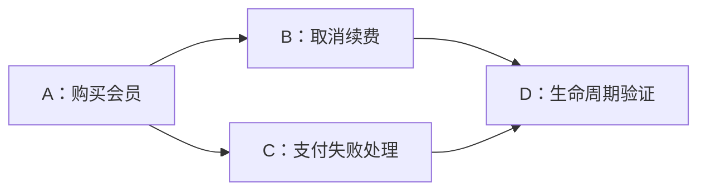

> 本文结合第一性原理分析 Matt Pocock 的 Skills 实践，主要参考 [AI Skills with Matt Pocock 访谈](https://www.youtube.com/watch?v=4DhcSPkEbwI)和 [Skills 项目所引用版本](https://github.com/mattpocock/skills/tree/4ae2317ddb22b046e26455e4f9c9b3aaaf62212d)。

### 引子：规格写清楚了，为什么做出来还是要返工？

想象你和 Agent 讨论了很久，终于确定要给会员系统加一套订阅功能。规格里写清楚了：用户可以购买会员；取消订阅后不再续费，但已支付的权益要保留到当前周期结束；第一版不做优惠券。上一篇的任务完成了：这些决定有了一个可以跨会话读取的载体。

接下来，你让 Agent 开始干活。它先设计所有数据库表，再写完后端服务，然后做接口，最后才接上页面。每一步结束，它都说自己完成了：表建好了，服务写好了，页面也能打开。

可等到第一次把支付结果真正送进系统，问题出来了：支付服务返回的事件，和数据库里保存订阅状态的方式对不上；页面显示“会员已开通”，后台却还没收到支付成功的通知。此时已经围绕原来的假设写了不少代码，修改不再只涉及一个地方。

这是一个用于说明问题的假设场景。它并不意味着按照技术层分工一定失败。它想让我们看见一个容易忽略的问题：**规格可以告诉我们想去哪里，但它不会自动告诉我们，这条路实际走不走得通。**

那我们怎样安排工作，才能让 Agent 在还没走得太远的时候，就看见自己的假设和现实之间有什么差距？Matt Pocock 的 [`to-tickets`](https://github.com/mattpocock/skills/blob/4ae2317/skills/engineering/to-tickets/SKILL.md) 给出的方向，是把工作拆成可以独立演示或验证的纵向切片，并写清它们之间的阻塞关系。但这些做法究竟为什么可能有用，什么时候又会增加负担？我们先回到自己的信息边界。

---

### 一、从规格到现实：已有信息还缺什么？

[《数学基石篇》](/zhangmuchuan/blog/agent-math-foundations/)从一次模型推理的边界出发，把外部环境记为 $E$，模型实际拿到的上下文记为 $C$，模型输出记为 $R$。在模型参数固定、外部环境只能通过本次输入影响输出的设定下，它们构成：

$$
E \longrightarrow C \longrightarrow R
$$

数据处理不等式给出：

$$
I(E;R) \le I(E;C)
$$

这句话不是说 Agent 不会推理，也不是说整理规格没有价值。它说的是：在上述设定下，仅靠对已有输入继续加工，不能凭空取得输入之外的当前环境证据。模型可以根据规格推演怎样处理支付通知，却不能只靠想象确认真实项目里已有的接口是否兼容、程序运行时会不会出现预期之外的状态。

上一阶段经过讨论得到的需求和 Spec，对接手实施的 Agent 是重要的前馈。但开始动手以后还会有两类信息进入工作台：一类是读取项目文件、接口文档等取得的**存量事实**；另一类是改动代码、运行程序之后才出现的**行动结果和验证证据**。

我们在《数学基石篇》中用信息完备性方程描述这种关系：

$$
I_{\text{前馈}} + \sum_{k=1}^{n}\Delta I_{\text{反馈},k} \ge I_{\text{目标}}
$$

这里 $I_{\text{前馈}}$ 表示选定阶段开始时已取得的目标相关信息；$\Delta I_{\text{反馈},k}$ 是第 $k$ 次交互带来的有效信息增量；$I_{\text{目标}}$ 表示在该理论模型中达成并验证目标所需的信息阈值。它提醒我们检查一笔账：**接手时知道了什么，执行中还能从哪里取得哪些信息？**

有一个前提不能省略。若把上下文更新理想化为完整保留已有内容并加入新观测，即 $C_k=(C_{k-1},O_k)$，条件互信息可以按链式法则累加；现实中的摘要、交接和上下文压缩可能丢失信息，接手者实际拿到的内容未必等于前一阶段积累的全部信息。公式给出分析信息来源的框架；信息足够、程序实际正确、测试覆盖充分，仍是需要分别判断的问题。

假设支付接口过去只允许模拟调用。Agent 在开始时读到文档，知道接口的字段；等代码运行起来，才发现测试环境返回的状态顺序和预想不同。这个状态顺序可能已经由代码和环境共同决定，但在执行前尚未被接手者可靠掌握；实际运行让他观察到特定环境下的结果。**不管 Spec 写得多漂亮，也不能把“我们打算这样工作”直接当作“系统已经这样工作”的证据。**

这就是任务拆分要面对的问题：不是把大目标切成多少张纸，而是怎样让系统边前进、边有机会取得能改变后续决策的反馈。

---

### 二、一份完整早餐：为什么要让每一片都能尝一口？

先离开代码，想象你要给一群朋友准备同样的三明治。你拿不准朋友对酱料的口味，也不确定现有的面包是不是太干。

一种做法是先把所有面包都抹好酱，再把所有配菜铺上，最后切好、装盘，一口气端出去。直到朋友尝第一口，你才发现酱料太咸，而面包也需要先烤一下。前面做的每一步都不是没有价值：面包切好了、蔬菜洗好了，单独检查食材也可能发现问题。只是，**你真正想知道的那一口早餐吃起来怎么样，一直等到最后才得到反馈。**

另一种做法，是先做一个小三明治：取一片面包，抹少量酱，加上配菜，烤好后请朋友尝一口。如果朋友说太咸，你可以在做剩下的之前调整酱料；如果说面包太干，也可以先改变烤制方法。朋友尝过这一口，并不证明之后每一份都会完美：剩余食材可能不同，最后的摆盘也还没有检查。但它确实让你更早看见一条完整路径上的问题。

这对应到订阅系统：

- **按层拆分**：先完成全部表结构，再完成全部服务和页面。每一层都能做局部检查，但用户购买会员这条完整路径可能要等后面才能验证。
- **纵向切片**：先让一个受限场景跑通，例如在测试环境中模拟一次支付成功，让系统保存状态，并在界面显示对应权益。完成后演示、运行测试，再依据结果决定下一张票怎样做。

这里的“小”不只是少写几行代码，而是**范围窄，但包含验证这项行为需要经过的关键环节**。具体需要哪些环节由功能决定；并非每张票都必须人为加上数据库、API 和页面。[`to-tickets` 原文](https://github.com/mattpocock/skills/blob/4ae2317/skills/engineering/to-tickets/SKILL.md)的要求是：每个切片形成一条窄而完整的路径，可以独立演示或验证，并尽量适合一个新的上下文窗口。

为什么这样切可能减少返工？因为反馈的**时间**会改变它的用途。上面那个假设中的支付事件，如果第一条切片就暴露字段不匹配，后续实现还没有大量依赖这个错误假设；如果所有功能都按同一假设写完才发现，受影响的地方可能更多。纵向切片让检查跨层交互的机会提前，而不是保证每次都能提前发现所有问题。

现在把这个故事中的“一口”换成一次真正的支付测试，看看它如何改变认知。设 $Z$ 表示“本次测试所针对的固定代码版本，能否在收到模拟支付成功事件后，将会员权益正确展示给用户”，$C_{k-1}$ 是开始测试前已经读到的规格、代码和先前结果，$O_k$ 是实际运行后观察到的结果。沿用《数学基石篇》对单步反馈的定义：

$$
\Delta I_{\text{反馈},k}=I(Z;O_k\mid C_{k-1})
$$

这个条件互信息衡量的是：在已有上下文的条件下，观察结果对区分 $Z$ 的可能状态能提供多少**期望信息**。运行之前，Agent 可能同时保留两种可能：系统能够正确同步权益，或者事件收到后权益没有正确更新。假设测试事件发出后，查询接口仍返回未开通，后者便有了具体证据；Agent 可以接着检查事件处理日志、数据库状态和查询接口，寻找出问题的环节。若预先设计的测试通过，则是当前测试条件下该路径满足断言的证据，而不是所有支付情形都正确的证明。

注意公式里的互信息是对可能观察结果的期望。某一次意外结果也可能让我们意识到先前漏想的情况，暂时产生更多具体疑问。单独的表结构测试也可能发现重要问题，它的价值取决于我们想判断什么；纵向切片多提供的是较早观察**跨层组合行为**的机会。信息增量和行动价值同样要分开：观察能帮助区分状态，不代表它一定改变当前选择。

仓库说明文档记录过一个值得观察的案例：某团队把工作按层拆成 26 张票，文档称平均每张已关闭的票约经历 20 次 Agent 运行，其中约四分之三是返工；其复盘将失败类别归因于横向拆分。这是该团队的经验报告，数字不能当作所有横向拆分的返工率，也不能只凭这份说明独立证明唯一因果。但它让“最后才集成”的代价有了具体的工程背景。[来源：`to-tickets` 说明](https://github.com/mattpocock/skills/blob/4ae2317/docs/engineering/to-tickets.md)

---

### 三、每一张票都有反馈？还得看我们拿什么判断

如果一份 Ticket 写着“做完会员购买功能”，Agent 完成后我们应该看什么？它回复“完成”，还是页面上出现一个按钮，就足够了吗？

回到[《第三篇》](/zhangmuchuan/blog/agent-harness/)的恒温器：要判断房间离目标温度还有多远，既要有**目标设定值**，也要有能够测量现状的**传感器**，还要能把测得的结果与目标比较。Ticket 的验收标准相当于对局部目标的具体表达；运行程序、测试或演示提供实际观察；比较两者，才能判断这次交付是否满足已写明的要求。

例如，在测试环境中，购买会员这张票可以包含这样一项验收条件：收到一条有效的支付成功事件后，用户能够通过会员查询界面看到已开通的权益。假设接手 Agent 启动测试服务后，向约定的事件接口发送 `{"event_id":"evt-01","status":"paid","user_id":"u-1"}`，再调用会员查询接口。若返回 `{"user_id":"u-1","active":false}`，就能看到这条路径与验收预期不符。这里的字段和接口结果是为了说明过程而构造的示例，不代表某个真实支付平台的协议。若事件被接收，但界面仍显示未开通，至少说明这条验证路径没有达到预期；接下来还要查看日志、状态和接口结果，才能定位哪一环出了问题。

验收条件写出来以后，还值得先反过来问一句：**什么观察会说明它没有满足？** 假如票上只写“会员功能正常”，不同人可能各自理解“正常”；改成“收到有效支付成功事件后，通过会员查询接口能看到该用户的权益”，就给出了更具体的观察方式。若这条新增行为在实现者开始工作的基准版本中已经成立，也应回头核对：是不是票写错了、目标早已完成，还是选错了测试范围。另一张票负责的行为不能在当前票独立完成时拿来冒充已验证结果。已有行为的回归条件则常常本来就应通过，不应要求所有检查在起点都失败。仓库说明也记录了验收条件已经成立、依赖其他票或仅重复任务描述的问题。[来源：`to-tickets` 说明](https://github.com/mattpocock/skills/blob/4ae2317/docs/engineering/to-tickets.md)

这里有三件事不能混为一谈：

1. **验收标准**说明什么行为算满足这张票。
2. **测试接缝**说明通过哪个公开接口输入、观察行为。
3. **测试运行结果**说明这次执行在给定条件下实际发生了什么。

测试接缝不是验收标准本身，测试通过也不是整个系统绝对正确。第一张票验证了模拟支付成功的路径，还不代表取消订阅、支付失败、真实第三方服务和所有用户的情况都已验证。

更重要的是，**标准本身也可能有问题**。如果用户真正要求“取消后权益保留到周期结束”，而 Agent 把它误解为“立即失效”，再用这一误解写实现和测试，测试全绿仍可能是在验证错误目标。程序 $P$ 可以可靠地执行给定断言，但断言是否代表用户意图，还需要回到已确认的规格、原始讨论，必要时请人校准；独立模型审查 $M$ 可以换一个上下文重新分析已有代码和规格，帮助发现原执行者忽略的矛盾，但两者可能共享错误假设；它是否带来原执行者未掌握的新外部事实，取决于审查时是否读取了这样的独立证据。

这就是《第三篇》区分事实获取和 $(P,M,H)$ 判断的用处：**运行结果是真的，并不自动意味着我们拿它回答的问题就是对的。**

---

### 四、新会话接力：把杂物留在身后，也别把关键信息一起丢下

任务做大以后，另一个问题出现了：即使每张票都能验证，也未必适合让同一个会话无限接着做。一次长任务中，试过但失败的命令、旧日志和中间假设可能不断堆积；某些内容对追溯问题有用，另一些则不再帮助当前决策。把所有东西始终留在工作台上，会增加识别当前目标和有效证据的负担。

想象一家店的晚班接替早班。早班为了找到漏水原因，检查过水龙头、记录过错误猜测，最后确认是冰箱排水管堵了，还预约了维修。晚班不需要把早班的每一次试探从头经历一遍；但它必须知道**哪里漏水、目前是否断电、维修什么时候来、哪些判断还没有确认**。如果交接本只写“漏水问题已处理”，晚班就可能误以为维修已经完成。

这就是新会话的双面性：它可以少带一些过程残骸，也可能少带关键约束。新窗口不天然比旧窗口更正确；如果错误假设被写进 Ticket，或者真正的决定没有写进去，新 Agent 依旧会在缺失或错误的前馈上行动。

用阶段切分来看，准备和前一张票执行时，通过读取、询问、测试得到的信息，相对于各自阶段是反馈；这些信息如果被正确保存，并在后一张票开始时实际交给接手者，就成为后一阶段的前馈。在目标固定且信息完整保留的理想条件下，可以写成：

$$
I_{\text{实施前馈}}
= I_{\text{初始前馈}} + \sum_{k=1}^{\tau}\Delta I_{\text{准备阶段},k}
$$

将它写回互信息链式法则，就是：

$$
I(Z;C_{\tau})=I(Z;C_0)+\sum_{k=1}^{\tau}I(Z;O_k\mid C_{k-1})
$$

这里重新选定 $Z$ 为准备与实施共同指向的固定目标，而不是把每次代码修改后的状态都视作同一个不变变量。在目标 $Z$ 固定、每次观测均被完整保留的设定下，右边的准备反馈与左边的阶段前馈是同一笔账的两种看法，不能在同一阶段再加一次。若后一阶段启动后才去读取文件，这次读取相对于后一阶段是动态外源反馈；它进入上下文后，又可以成为再下一阶段的前馈。

这里 $\tau$ 表示实施开始前最后一次准备性交互。等式的条件是完整保留：若交接文件只记住部分结论，实施者的前馈就要按**实际读到的内容**计算，不能把整个旧会话当成它已经知道的事。若讨论改变了目标，也要以新确定的目标重新分析，而不是把前后的目标混在一张账里。

所以，一张能让新 Agent 接手的票，不只是“标题 + 一句去实现”。它至少要让执行者知道本次要交付什么、如何判断完成、依赖哪些工作，以及去哪里读取仍然有效的整体约束。详细背景可以通过 Spec、项目文档和代码指针按需查找；需要追溯的原始讨论仍应保留。[`to-tickets` 的本地工单格式](https://github.com/mattpocock/skills/blob/4ae2317/skills/engineering/to-tickets/SKILL.md)提供了目标、验收条件、阻塞关系与状态；实际交接是否充分，还要结合具体任务检查。

播客中 Matt 提到自己对较长上下文质量的担忧，并以约 15 万 Token 描述当时的经验判断。这能解释他为什么重视跨会话切分，却不能当成所有模型共有的硬阈值。我们的 DPI 告诉我们信息不会在封闭加工中凭空增加；**它本身并不能推出“上下文一过某个长度，模型必然失效”，也不能证明每次换窗口都会提高准确率。** 切分的收益，要同遗漏、重新读取和协调的成本一起看。[来源：播客访谈记录](https://www.youtube.com/watch?v=4DhcSPkEbwI)

---

### 五、先做哪一张？依赖关系与能不能并行，是两道问题

现在回到订阅系统。假设我们把工作拆成几张票：

- **票 A**：建立最小购买会员路径，让一次模拟支付成功可以开通权益。
- **票 B**：在已有订阅的基础上实现取消自动续费，同时保留当前周期权益，依赖 A 提供的订阅基础。
- **票 C**：在已有订阅的基础上处理支付失败状态，也依赖 A。
- **票 D**：对购买、取消和支付失败组成的生命周期做整体验证，依赖 B 和 C。

下面的依赖图由本文会员示例归纳，用来说明先后关系：

还没完成 A 时，B 和 C 缺少这个示例所设定的基础；A 完成、结果可用后，B 和 C 的前置条件都满足，就进入可以考虑执行的范围；两者完成后，D 才能按照这张图进行整体验证。这一组当下前置任务已满足的票，就是 Skill 文档所说的 **frontier（可执行前沿）**。

这里的依赖边，是对“下一步需要什么已有条件”的显式记录，也与前馈有关：后一张票需要读取前一张票产生的代码、接口或状态，才能在实际基础上继续工作。如果票上没有写明真实阻塞关系，接手者可能过早开始，拿一个尚未存在或尚未确认的接口当作前提。

但**前置依赖都满足，不等于并行一定不会冲突**。票 B 和票 C 可能都要改同一个订阅状态机，也可能分别修改的代码对同一业务规则有不同假设。工作树隔离可以让各自的文件改动分开，合并时仍需要处理冲突，并运行跨票验证。相反，只要接口契约稳定、模拟依赖可用，有些原本看起来相互等待的工作也许可以提前开展；依赖图应描述真实约束，而不是把所有任务机械排成一条队伍。

在这张示例图里，A 的执行者提交了代码，也不等于任务系统里 A 自动变成“完成”。依赖 A 的执行者或调度者还需要核对它的验收证据、成果是否进入后续分支，以及完成状态是否对任务图可见。仓库的 [`implement` 说明](https://github.com/mattpocock/skills/blob/4ae2317/docs/engineering/implement.md)明确指出：该 Skill 提交代码后不会自动勾选验收项或关闭票。如果状态没有更新，依赖 A 的票就可能一直显示被阻塞；如果过早标成完成，又可能让接手者依赖尚未验证的成果。

[`to-tickets`](https://github.com/mattpocock/skills/blob/4ae2317/skills/engineering/to-tickets/SKILL.md) 负责生成并发布经过用户确认的拆分结果和阻塞关系；它本身不自动派发 Agent。仓库另一个 Skill [`implement-spec`](https://github.com/mattpocock/skills/blob/4ae2317/skills/engineering/implement-spec/SKILL.md) 才负责读取任务图，在前沿上启动实现子 Agent，使用各自的工作树和分支，并将结果合入集成分支。这是两个不同职责：一张排班表写清谁能上班，和实际安排、合并并检查每个人的工作，并不是同一个动作。

本地工单从一个共享文件改为每票一个文件，也是同一类问题的具体例子：仓库说明称，原先共享文件造成并行写入竞争，因此改成 `.scratch/<feature-slug>/issues/` 下每张票一个 Markdown 文件。这样可以减少大家同时修改同一工单文件的机会，但不能消除代码冲突或保证任务状态自动更新。[来源：`to-tickets` 说明](https://github.com/mattpocock/skills/blob/4ae2317/docs/engineering/to-tickets.md)

---

### 六、为什么不能把所有工作都切成小功能？

假设会员系统要把所有使用的用户标识从旧格式迁移到新格式。这个字段被很多模块共同使用。如果第一张票直接删掉旧字段，其他还没迁移的调用可能立刻出错。此时硬要让“每一小步都像新增购买按钮一样形成完整的用户功能”，就可能与真实变更方式不匹配。

一个日常类比是更换家里的门锁，又不希望家人下班后被锁在门外。先在门上并装一把备用锁，同时保留原来的锁，让旧钥匙在过渡期间仍可使用；再让需要进门的人逐步拿到并试用新钥匙，确认旧钥匙不再需要后，才拆掉旧锁。过渡期间需要管理两种钥匙，安排和核对都有成本；它的价值是降低某个家人还没换钥匙时就无法进门的风险。

类似地，Skill 对**宽范围机械重构**给出的例外是：先增加新形式并保留旧形式（Expand），再按批迁移调用方（Migrate），最后在确认旧调用已清理后移除旧形式（Contract）。如果各批次不能独立保持通过，则允许共用集成分支，并由最后的集成验证票承担完整检查。[来源：`to-tickets` 技能规范](https://github.com/mattpocock/skills/blob/4ae2317/skills/engineering/to-tickets/SKILL.md)

这与[《第四篇》](/zhangmuchuan/blog/agent-business/)中对试错成本的分析可以接上：在可回滚、可测试的环境里，我们可以较早实施并观察；当一次改动会影响很多调用方时，分阶段保留兼容路径可能降低某次失败的影响范围。但这不是说原地修改的成本必然无穷大，也不是说过渡方案总比一次性修改便宜。旧新并存本身有维护与一致性成本，需要看实际影响面、迁移能力和验证手段。

---

### 七、最难的不是画完任务图，而是让反馈改变后面的票

假设票 A 按计划先做购买会员。实现后团队发现，支付服务在测试环境中可能重复发送同一事件。如果原 Spec 已明确幂等规则，票 A 的测试就应检查它；如果此前没有约定，我们就需要先弄清实际发生了什么。假设 Agent 在测试日志中看见同一个 `event_id` 被接收两次，但用户权益被创建两次。它先记录这一运行结果，而不是立即把“支付方保证只发一次”或“用户要求怎样处理重复事件”当成事实；接着读取上游规格与接口约定。

若现有规则只写了正常支付成功，没有约定重复事件，Agent 需要向有决策权的人说明证据与影响，确认预期后再更新票 A 的验收条件和可能受影响的票 C。然后重新发送同一事件两次，检查权益是否仍只创建一次，并把测试结果带给后续任务。若已经有明确约定，则按约定直接修正并验证。

这时候，任务图不能只是创建完成后永远不动的清单。新的事实可能使后续票的范围、依赖或优先级发生变化；但 Agent 也不能把每个猜测都悄悄写成新的业务要求。**运行事实、模型推断和用户决定需要保留各自身份。**

信息价值的视角能帮助我们理解为何要早一点验证。一次检查值不值得做，要看它可能带来什么决策改善，以及执行、等待、协调和纠错需要付出什么代价。沿用[《第二篇》](/zhangmuchuan/blog/agent-control/)的信息净价值思路，可以写出其工程表达：

$$
V(a\mid C_t)=\operatorname{VoI}(a)-\lambda\operatorname{Cost}(a)
$$

这里 $a$ 是候选行动，例如先验证支付事件是否能让权益生效；$C_t$ 是当前已有的信息；$\operatorname{VoI}(a)$ 表示这次观察对后续决策可能带来的收益；$\operatorname{Cost}(a)$ 包含执行与验证所需的时间、算力和协调等成本，$\lambda$ 用来表达成本的权衡。若最不确定、最影响后续设计的是支付状态能否同步，一条能够较早检验这件事的窄切片，就可能比先打磨页面动画更有决策价值。

这里也需要对自己的数学底座做一次压力测试。《数学基石篇》在方程二中把决策意义上的 $\operatorname{VoI}$ 与条件互信息直接写成等号。一般情况下，这个等号还缺少连接两者的效用模型和条件：互信息以对状态不确定性的减少来度量，决策价值则看信息会不会改善选择以及改善多少。例如，知道事件来自哪个测试节点可能减少对日志来源的不确定性，但如果无论来自哪个节点都要先修复重复开通问题，这笔信息未必改变当前行动。本篇保留“收益与成本比较”的思想，不把两者直接相加或声称恒等；原式的严格适用范围仍需进一步修订。

这不是说每次都要计算一个精确分数。上述表达是决策标尺，不是给 Ticket 凭空赋予可测概率；更不能把信息论中的互信息，直接当成与业务损益同单位的决策收益。我们真正要追问的是：**这次执行后，可能看到什么？不同结果会不会影响下一步？为此要付出多少？** 除了信息收益，还要考虑实际交付价值、依赖和关键路径。

再看“切得越小越好”的诱惑。每多一张票，可能更早检查一次，也增加编写验收条件、交接上下文、合并代码和重新理解全局的成本；切得太碎，还可能让每个执行者看不到完整行为。仓库说明也把过度拆分列为常见问题，因此要求在发布前请用户检查粒度、依赖，以及是否应该合并或拆开。[来源：`to-tickets` 说明](https://github.com/mattpocock/skills/blob/4ae2317/docs/engineering/to-tickets.md)

如果工作本来就能在一个会话里可靠完成，而后续不需要独立交接，直接实施可能更合适；如果已有高质量、可验证的任务记录，也不必为了使用某个 Skill 再重复生成一套。**目的不是生产票，而是在受限的上下文、时间和风险条件下，把工作组织成能持续前进、也能及时纠错的过程。**

---

### 结语：任务被切开，闭环才有机会变短

上一篇里，我们讨论了怎样把已经形成的决定交给下一个会话。这一篇继续追问：接手之后，Agent 又怎样知道自己走得对不对？

规格和 Ticket 提供的是目标、约束与行动安排；程序执行、测试、演示和用户反馈能提供不同范围的证据。纵向切片把观察完整行为的机会往前移；验收条件让观察有了可比较的目标；依赖关系让接力更有根据；跨会话记录则让前一阶段的成果有机会成为下一阶段真正拿到的前馈。

但这些都是机会，不是自动生效的保证。切片完成后是否真的验证、验证能否发现重要错误、发现后是否有权更新计划，决定了反馈能否进入下一次行动。

下一篇，我们会把镜头推到一张票内部：当 Agent 已经拿到验收要求，如何通过更小的测试与实现循环，持续获得关于程序行为的反馈？这正是 `tdd` 要面对的问题。

### 参考资料

- [数学基石篇](/zhangmuchuan/blog/agent-math-foundations/)；判断更新。
- [to-tickets 技能规范](https://github.com/mattpocock/skills/blob/4ae2317/skills/engineering/to-tickets/SKILL.md)与[配套说明](https://github.com/mattpocock/skills/blob/4ae2317/docs/engineering/to-tickets.md)。
- [implement-spec 技能规范](https://github.com/mattpocock/skills/blob/4ae2317/skills/engineering/implement-spec/SKILL.md)与[implement 说明](https://github.com/mattpocock/skills/blob/4ae2317/docs/engineering/implement.md)。
- [tdd 技能规范](https://github.com/mattpocock/skills/blob/4ae2317/skills/engineering/tdd/SKILL.md)。
- [AI Skills with Matt Pocock 播客访谈记录](https://www.youtube.com/watch?v=4DhcSPkEbwI)。
