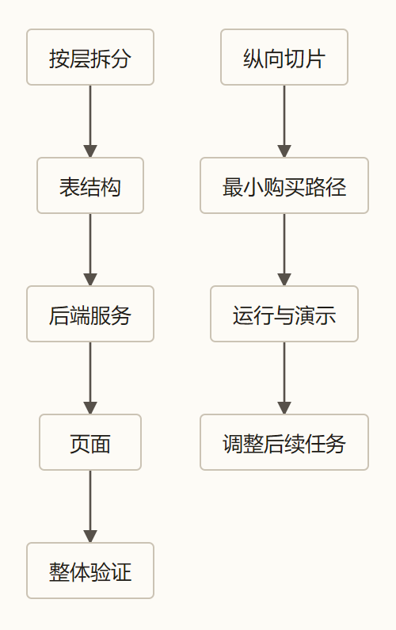
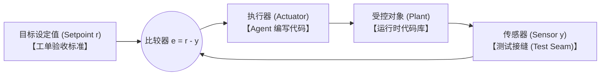
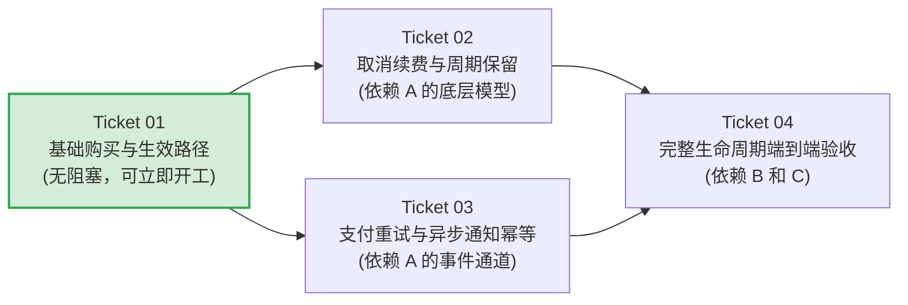
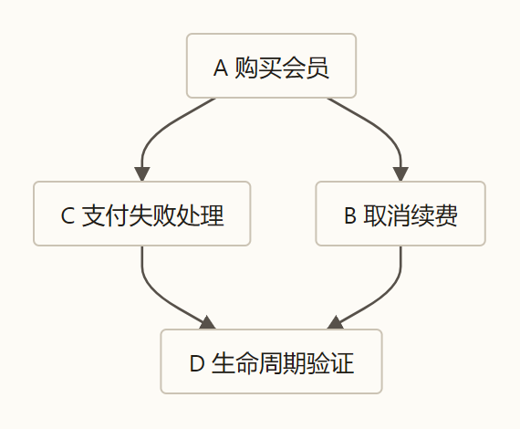

> 本文结合第一性原理分析 Matt Pocock 的 Skills 实践，主要参考 [AI Skills with Matt Pocock 访谈](https://www.youtube.com/watch?v=4DhcSPkEbwI)和 [Skills 项目所引用版本](https://github.com/mattpocock/skills/tree/4ae2317ddb22b046e26455e4f9c9b3aaaf62212d)。

### 引子：26 张工单与 75% 的返工深渊

在 Matt Pocock 开源的 Agent Skills 体系中，记录过一个令人深思的工程复盘案例：

> 某个开发团队把一个复杂的构建任务拆解为 26 张工单。他们严格按照经典的技术分层推进——先建完语料库层（Corpus），再写完生产者层（Producer），接着写聚合器层（Aggregator），最后才接上选择器层（Selector）。
>
> 最终的执行代价极其高昂：平均每张被关闭的工单经历了大约 20 次 Agent 运行，其中高达 75% 的操作全是推倒重来的返工。团队在复盘中明确指出：**这次系统性的返工并非源于底层代码实现质量，而是彻头彻尾由“横向分层拆解”这一任务组织方式所诱发。** [来源：`to-tickets` 说明](https://github.com/mattpocock/skills/blob/4ae2317/docs/engineering/to-tickets.md)

这正是无数团队在推进 Agent 落地时最容易陷入的隐形泥潭。

在上一篇[《解构 Skills（四）：to-spec》](/zhangmuchuan/blog/matt-pocock-skills-04/)中，我们解决了需求相变与高保真前馈的问题，让跨会话的 Agent 拿到了一份结构严密的 Spec。然而，现实给所有工程师上过的最深刻一课是：**哪怕你的 Spec 已经写得毫无破绽，只要你把任务切分的方式搞错了，Agent 依然会在没有真实环境反馈的“工程真空”里一路狂奔，直到最后全链路集成时全面崩塌。**

规格只能告诉你“目标在哪里”，却无法凭空证明“这条物理链路在当下代码库里究竟能不能跑通”。

面对这一挑战，Matt Pocock 给出的解法是 [`to-tickets`](https://github.com/mattpocock/skills/blob/4ae2317/skills/engineering/to-tickets/SKILL.md)——将宏观任务拆解为可以独立演示、具备可证伪验收标准的“曳光弹工单（Tracer-bullet Tickets）”，并通过显式声明阻塞边（Blocking Edges）构建可执行前沿。

这套模式背后的第一性原理是什么？为什么横向切层必然导致 75% 的返工？验收标准如何与测试接缝精准咬合？本文将用我们既有的信息论与恒温器控制框架，彻底解构任务切片背后的工程机制。

---

### 一、信息真空与延迟塌方：为什么横向切层必然导致反馈塌方？

要理解 26 张工单的教训，必须先回到[《数学基石篇》](/zhangmuchuan/blog/agent-math-foundations/)揭示的模型认知物理边界。

在封闭的单次推理中，外部环境真实状态 $E$、模型实际摄入的上下文 $C$ 与模型输出 $R$ 构成严格的马尔可夫链：

$$
E \longrightarrow C \longrightarrow R
$$

根据数据处理不等式（DPI）：

$$
I(E; R) \le I(E; C)
$$

这意味着：**任何大模型无论参数多大、逻辑推理能力多强，它绝不可能凭空创造出输入上下文之外的当前环境事实。**

当你把一个会员订阅功能按照横向技术层拆解时，反馈延迟的隐患就已经埋下：
- **第一周做表结构**：Agent 凭空推演建了 5 张表，本地单测验证建表 SQL 语法通过；
- **第二周写服务层**：Agent 假定表结构完全合理，写了 10 个 Service 方法，跑通了打桩的 Mock 单元测试；
- **第三周写 API 层**：Agent 假定 Service 接口语义稳定，封装了 RESTful 端点；
- **第四周做 UI 联调**：当第一笔真实的支付回调事件砸向系统时，所有人傻眼了——第三方支付网关推送的异步事件格式与此前设计的字段完全脱节；前端页面展示“已开通”，后台状态机却因为死锁未曾落库。

在这四周里，每一个局部的工单都在宣称“测试全绿、任务完成”，但整个系统关于最终业务目标 $Z$ 的**端到端真实反馈增量 $\Delta I_{\text{反馈}}$ 始终为零**！

```
【横向切层（高风险延迟塌方）】
阶段 1: 表结构 (DB)      ──[只有语法测试]──> 假装全绿 (真实反馈 = 0)
阶段 2: 服务层 (Service) ──[只有 Mock 测试]──> 假装全绿 (真实反馈 = 0)
阶段 3: 接口层 (API)     ──[只有桩测试]────> 假装全绿 (真实反馈 = 0)
阶段 4: 前端与联调 (UI)  ──[首次真实端到端]──> 接口不匹配、状态机死锁 (75% 返工)
```

在《数学基石篇》的信息完备性方程中：

$$
I_{\text{前馈}} + \sum_{k=1}^{n}\Delta I_{\text{反馈},k} \ge I_{\text{目标}}
$$

横向切分人为地将关键的跨层物理验证推迟到了最后一步（$k = n$）。在没有真实环境反馈校正的情况下，前期的每一次错误假设都在被后续层级指数级放大。到最后集成时，修改已经不是改一两个字段，而是必须推翻 5 张表、重写 10 个 Service、重构所有 API。

这就是横向切层在 Agent 工程中必然诱发“返工深渊”的信息论根源。

---

### 二、纵向切片：曳光弹（Tracer Bullet）与信息净价值

对抗这种延迟塌方的有效解法，是《程序员修炼之道》中早已奠立的经典工程战术：**曳光弹（Tracer Bullet）**。

在黑夜中盲射机枪，你不能把所有弹药一口气打光才去查看靶心。你必须在弹链中压入发光的曳光弹——扣下扳机，一道亮光划破夜空，从枪膛直穿靶标。哪怕这一枪只打穿了一个极小的小孔，它也瞬间照亮了弹道与真实环境的所有偏差。

在 `to-tickets` 的规范定义中，每一张工单都必须是一发曳光弹：
> “每个切片必须是一条穿透所有层级（Schema 存储、API 接口、UI 交互、自动化测试）的狭窄但完整的纵向闭环；它必须能够独立演示或验证，绝不能做成单一技术层的横向薄片。” [来源：`to-tickets` 技能规范](https://github.com/mattpocock/skills/blob/4ae2317/skills/engineering/to-tickets/SKILL.md)



同样是实现会员订阅系统，纵向切片的施工顺序完全颠覆了传统习惯：
- **切片 1（最小正向曳光弹）**：用户在测试页面点击“模拟充值 1 元”，前端调起测试接口，后端完成一次极简落库，页面刷新显示“体验期会员已生效”。
  - 这一步不考虑折扣券、不考虑复杂的退款重试、不考虑精美的动画。
  - 但它在**第一天就强行打穿了包含核心业务状态机在内的整条物理通路**！
- **切片 2（逆向与异常切片）**：在跑通的链路上，接入用户主动取消续费逻辑，验证到期权益不退回；
- **切片 3（边界兜底切片）**：接入第三方异步回调的幂等去重校验。

为什么纵向切片具有压倒性的工程优越性？我们用[《第二篇：控制权的收放艺术》](/zhangmuchuan/blog/agent-control/)中的**霍华德信息价值（VoI）净收益方程**来进行严格度量：

$$
V(a \mid C_t) = \operatorname{VoI}(a) - \lambda \operatorname{Cost}(a)
$$

其中：
- $a$ 是候选的工程行动（例如：打穿一条极窄的模拟支付端到端闭环）；
- $\operatorname{Cost}(a)$ 是实施与验证该切片所需消耗的 Token、时间与算力成本；
- $\operatorname{VoI}(a)$ 是这次环境交互对后续决策不确定性的期望缩减价值。

在单步反馈定义中，观测结果 $O_k$ 带来的信息增量为：

$$
\Delta I_{\text{反馈},k} = I(Z; O_k \mid C_{k-1})
$$

当 Agent 打穿第一条纵向曳光弹时，其代码量极少，$\operatorname{Cost}(a)$ 极低；但这次端到端执行所暴露出的环境真相——数据库连接池是否正常、API 路由是否响应、前端状态是否响应式刷新——直接消除了后续所有功能开发中最核心的系统级不确定性，其 $\operatorname{VoI}(a)$ 呈现数量级跃升。

**高信息价值先行，低风险细节后置。** 这就是为什么哪怕切片 1 极其简陋，它也能用极低的代价换取整条架构链路的物理确定性。

---

### 三、恒温器闭环：设定值与传感器的物理分离

把任务纵向切碎之后，最容易出现的下一个伪闭环是：**工单看起来切小了，但谁也不知道它到底算不算做对。**

很多团队在 Ticket 上写的内容宛如废话：
- “完成会员购买模块开发”
- “优化支付状态流转逻辑”
- “确保会员页面显示正常”

当 Agent 跑完并回复“我已完成会员购买模块开发”时，你敢把这段代码合进主干吗？

回到[《第三篇：驯服长程循环》](/zhangmuchuan/blog/agent-harness/)构建的恒温器闭环模型：



一个能自主纠偏的工程闭环，必须严格满足四大要素的物理咬合：
1. **目标设定值（Setpoint $r$）**：必须是**工单中的验收标准（Acceptance Criteria）**；
2. **传感器（Sensor $y$）**：必须是**锚定在公开契约上的测试接缝（Test Seams）**；
3. **比较器（Comparator $e = r - y$）**：必须是能够自动运行并输出布尔判定的测试套件；
4. **执行器（Actuator $u$）**：才是 Agent 编写和修改代码的动作。

在实战中，有三大陷阱会彻底摧毁这个恒温器闭环：

#### 陷阱一：同义反复（Tautology）——无法证伪的假设定值
如果验收标准写着“会员功能正常”，它就等于把设定值设为了未知数。比较器根本无法计算误差 $e$。
真正高质量的设定值必须是**可证伪的外部行为描述**：
> “向 `/api/webhooks/payment` 发送 `status=paid` 载荷后，调用 `/api/user/membership` 接口必须返回 `status=active`，且有效期顺延 30 天。”

#### 陷阱二：假性绿灯（Baseline False Positive）——在起始基线上早已通过
这是 `to-tickets` 说明中重点揭露的顽疾：很多工单生成的验收条件，在 Agent 还没动一行代码的基准版本（Base Commit）上就已经全绿了！
- 比如，一条验收标准写着：“用户未登录时访问会员页应重定向到登录页”。如果这个系统早在两周前就全局配置了路由守卫，那这条标准在当前提交上瞬间通过。
- **铁律：除了既有功能的防回归断言外，针对本次新特性验收的标准，在当前起点代码上必须能够明确复现红灯（失败）。** 如果新验收项从第一秒就是绿的，它要么测偏了，要么只是在空耗校验算力。

#### 陷阱三：测试接缝刺探内部实现——导致“机器没坏测试先红”
很多开发者在写验收测试时，习惯让断言深入到类内部的私有属性：检查某个内部缓存变量是不是等于 3，或者检查某个私有方法是否被调用了 2 次。
这彻底混淆了**验收标准（对外承诺的行为）**与**实现细节（对内组织的方式）**。从信息论角度看，断言死盯内部私有细节，本质上是在传感器中引入了大量与最终交付目标 $Z$ 完全无关的**实现噪声（Implementation Noise）**，人为降低了测量的有效信噪比。
传感器（测试接缝）必须牢牢钉在对外暴露的公共 API、HTTP 响应、数据库最终一致状态或 CLI 输出上。只有这样，Agent 在后续无论怎样重构内部类结构，都不会诱发虚假红灯。

---

### 四、有向无环图（DAG）：依赖前沿与伪阻塞消除

任务拆成多张纵向 Ticket 之后，施工顺序如何确定？

在 `to-tickets` 的设计中，每一张工单都必须显式声明自己的阻塞关系（`Blocked by`），从而共同构成一张**有向无环图（DAG）**。

以会员系统的纵向切分为例：





这里引出了 Agent 协作调度中极为关键的概念：**可执行前沿（Frontier）**。

#### 1. 什么是前沿（Frontier）？
在任务图中，**所有前置依赖项已经全部完成、当前处于无阻塞状态的工单集合，就是施工前沿**。
- 在项目启动第一天，前沿上只有 Ticket 01；
- 当 Ticket 01 落地并验证通过后，Ticket 02 和 Ticket 03 的阻塞边同时解除，两者**同时进入可执行前沿**；
- 此时，任务调度系统可以派发两个独立的 Agent，分别在两个隔离的 Git 工作树（Worktree）中并行施工！

#### 2. 警惕“人为串行化（Fake Blockers）”
在传统项目管理中，人们往往习惯把 10 张票按从 1 到 10 顺次串联。这种人为制造的串行伪阻塞，是对 Agent 并发算力与时间窗口的巨大浪费。
**只有当工单 B 必须严格消费工单 A 产出的特定接口契约或代码实体时，才允许建立 `Blocked by`。** 只要两者不存在硬性契约依赖，就必须在拓扑图上彻底松绑，让它们并排暴露在前沿中。

#### 3. 规划与派发解耦：`to-tickets` vs `implement-spec`
在 Matt Pocock 的工具链分工中，存在一道极其克制的职责边界：
- [`to-tickets`](https://github.com/mattpocock/skills/blob/4ae2317/skills/engineering/to-tickets/SKILL.md) **只负责出具 DAG 图纸并向用户提问校准**。它绝不越权启动任何执行 Agent；
- 用户在确认任务粒度、核对阻塞边无误后，图纸被固化为本地 Markdown 或 Tracker 上的 Issue；
- 紧接着，由另一个专门的执行技能 [`implement-spec`](https://github.com/mattpocock/skills/blob/4ae2317/skills/engineering/implement-spec/SKILL.md) 进场读取任务图，识别前沿，并在独立分支上批量调度实现子 Agent。
**做规划的人不直接下场砌砖，做施工的人不随意篡改图纸。** 这种关注点分离保证了系统拓扑的稳定性。

#### 4. 宽范围重构的特例：Expand-Migrate-Contract
有一种特殊工程场景会打破“纵向曳光弹”法则：**宽范围机械重构（Wide Refactors）**。
例如将全站 200 个文件中的 `user_id` 类型从 `number` 改为 `string`。这种重构的爆炸半径（Blast Radius）覆盖全库，改动一个符号就会导致全站编译报错，没有任何单一的纵向切片能够在本地独立变绿。

针对这种例外，`to-tickets` 给出了经典的三阶段解法：
- **Expand（展开）**：在旧字段旁边新增新类型字段，系统双写，新旧共存，保证当前 CI 全绿；
- **Migrate（分批迁移）**：按模块或目录切分工单，分批次将调用方迁往新字段，批次之间互不阻塞；
- **Contract（收缩）**：在确认所有调用方已无旧引用后，执行最终删除工单，彻底移除废弃字段。

---

### 五、一票一会话（One Ticket, One Session）：物理隔离过程残骸

任务切分好之后，最后一个核心问题浮出水面：**能否让同一个 Agent，在同一个会话窗口里，从第 1 张票一口气做到第 20 张票？**

答案是绝对不能。

在[《第六篇：穿越时间的 Context》](/zhangmuchuan/blog/agent-memory/)中，我们深入剖析过长程长任务的退化根源：**过程残骸（Process Debris）对有效信噪比的不可逆稀释。**

一个 Agent 在完成 Ticket 01 的过程中，会执行大量的调试命令、打印出几百行堆栈日志、走过两条试错死胡同、产生大量临时假设。这些信息在排查具体 Bug 时是有价值的，但一旦代码提交、测试跑通，它们就变成了**高摩擦的上下文噪声**。

如果让它继续做 Ticket 02，这些残留的旧日志和旧变量假设，会持续占用上下文预算，干扰注意力机制对新 Ticket 约束的识别。

```
【长程单会话：噪声污染】
[Ticket 01 目标] ──> [调试日志/失败尝试/临时假设] ──> [污染累积] ──> [Ticket 02 执行走偏]

【一票一会话：高保真结晶接力】
[Ticket 01] ──(提交代码 + 勾选验收)──> 【物理清除过程残骸】
                                                │
                                                ▼ (传递稳定前馈)
                                        [Ticket 02: 干净全新的 Context 窗口]
```

在阶段切分下，前一阶段通过探索和测试沉淀下来的有效成果，在经过结晶后，将成为后一阶段的前馈输入。在理想的完全保留条件下，满足：

$$
I_{\text{实施前馈}} = I_{\text{初始前馈}} + \sum_{k=1}^{\tau}\Delta I_{\text{准备阶段},k}
$$

写回互信息链式法则，即：

$$
I(Z; C_{\tau}) = I(Z; C_0) + \sum_{k=1}^{\tau} I(Z; O_k \mid C_{k-1})
$$

在多工单流水推进中，“前一张工单的测试与合并完成”相对于“下一张工单的启动”，在时序与信息拓扑上严格等价于其“准备阶段已完成”；其沉淀的代码与验收状态直接构成了下一张工单的有效实施前馈。

这个等式揭示了跨会话交接的核心机理：**新会话启动时，不需要把前任走过的每一步弯路在 Context 里重新回放一遍；它只需要摄入前任留下的最坚硬的结晶——已经合入主分支的干净代码、项目的权威地图，以及当前 Ticket 所明确声明的目标与验收条件。**

Matt Pocock 在工程演进中踩过的一个具体经验正好印证了这一点：
> 在 `to-tickets` 的早期版本中，所有本地工单都被记录在一个根目录下的单一共享文件 `tickets.md` 中。结果，当多个子 Agent 尝试并行执行任务时，频繁引发了难以调和的读写竞争与 Git 合并冲突。
>
> 最终的重构方案，是将工单彻底打散到 `.scratch/<feature-slug>/issues/<NN>-<slug>.md`，每张票一个独立的 Markdown 文件。每张票不仅是独立的物理文件，更严格对应一个全新、干净的 Context 窗口。 [来源：`to-tickets` 说明](https://github.com/mattpocock/skills/blob/4ae2317/docs/engineering/to-tickets.md)

**一票一会话，用物理边界阻断熵增。** 每一个接手前沿工单的 Agent，都是在一个信噪比极高、没有历史噪音的全新上下文中专注施工。

---

### 结语：把任务切开，闭环才有机会变短

回顾软件工程的发展史，每一次研发效率的飞跃，本质上都在做同一件事：**缩短从“做出假设”到“看见真相”的反馈距离。**

瀑布流开发之所以痛苦，是因为它把所有的跨层验证拖延到项目交付的最后一秒；而 Agent 时代的工程陷阱，正在于用极高智力的模型去机械复刻低效的横向瀑布流。

Matt Pocock 的 `to-tickets` 给出的解法，是一套环环相扣的工程破局方案：
1. **用纵向曳光弹击碎横向切层**，在第一天就用穿透全栈的最小闭环兑现最高的信息净价值（$\operatorname{VoI} \gg \operatorname{Cost}$）；
2. **用恒温器闭环重塑验收标准**，把目标设定值 $r$ 与测试接缝传感器 $y$ 严格剥离，用可证伪性拒绝同义反复，消除实现噪声；
3. **用 DAG 依赖图定义前沿**，只锁定真实契约，坚决铲除人为串行化的伪阻塞；
4. **用一票一会话构筑物理屏障**，在会话更替中洗去高摩擦残骸，让每个新 Agent 都手握高保真前馈轻装上阵。

把任务切开，闭环才有机会变短。

而当一个 Agent 已经接手了一张设计精良、验收明确的前沿工单，走进了干净的执行会话之后，在单张票的毫厘之间，它又该怎样确保自己的每一次改动都能被即时验证？

在下一篇中，我们将把镜头推向单张工单的内部微观世界，深入解构那个在软件工程界历久弥新的经典武器——`tdd`（测试驱动开发）。

---

### 参考资料

- [数学基石篇](/zhangmuchuan/blog/agent-math-foundations/)；[第一篇：架构的必然演进](/zhangmuchuan/blog/agent-loop/)；[第二篇：控制权的收放艺术](/zhangmuchuan/blog/agent-control/)；[第三篇：驯服长程循环](/zhangmuchuan/blog/agent-harness/)；[第六篇：穿越时间的 Context](/zhangmuchuan/blog/agent-memory/)。
- [解构 Matt Pocock 的 Skills（四）：从相变结晶到接缝预埋，用 to-spec 锚定跨会话前馈](/zhangmuchuan/blog/matt-pocock-skills-04/)。
- [to-tickets 技能规范](https://github.com/mattpocock/skills/blob/4ae2317/skills/engineering/to-tickets/SKILL.md)与[配套说明](https://github.com/mattpocock/skills/blob/4ae2317/docs/engineering/to-tickets.md)。
- [implement-spec 技能规范](https://github.com/mattpocock/skills/blob/4ae2317/skills/engineering/implement-spec/SKILL.md)与[implement 说明](https://github.com/mattpocock/skills/blob/4ae2317/docs/engineering/implement.md)。
- [tdd 技能规范](https://github.com/mattpocock/skills/blob/4ae2317/skills/engineering/tdd/SKILL.md)。
- [AI Skills with Matt Pocock 播客访谈记录](https://www.youtube.com/watch?v=4DhcSPkEbwI)。
