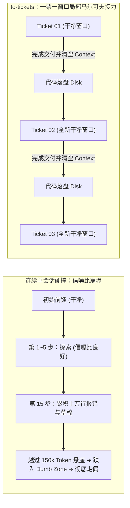
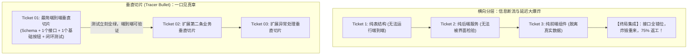
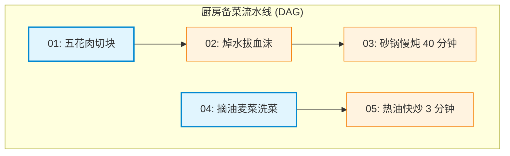
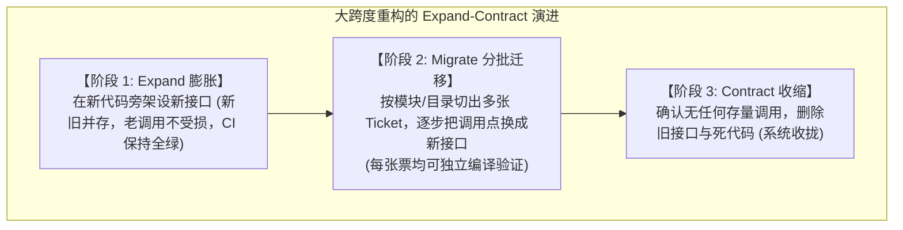

> 本文结合智能体第一性原理，解构 Matt Pocock 的 Skills 实践；主要参考 [AI Skills with Matt Pocock 播客](https://www.youtube.com/watch?v=4DhcSPkEbwI)及 [Skills 项目（本文所用版本）](https://github.com/mattpocock/skills/tree/4ae2317ddb22b046e26455e4f9c9b3aaaf62212d)。

---

### 引子：把大象切块的惨案 —— 为什么你的工单拆解带来了 75% 的返工？

在[上一篇关于 `/to-spec`](../matt-pocock-skills-04/)中，我们解剖了如何将日班中人机拉扯的流动意图，在相变点冷冻为一份锁死契约与唯一接缝的规格说明（Spec）。

很多团队在拿到这份完美的 Spec 之后，立刻做出了一个理所当然的决定：既然目标明确，那就把它拆解成工单（Tickets），派发给大模型开工吧！

然而，现实往往以极其残酷的姿态给工程师上一课：

> **在 Matt Pocock 记录的真实工程翻车档案中，有一个极具震撼力的标本：**  
> **某个技术团队把一个大型功能按传统软件架构习惯拆成了 26 个工单（先做数据库表、再做业务层、再做 API 接口、最后做前端选择器）。结果，这 26 个工单平均每个被 Agent 反复跑了整整 20 轮，其中整整 75% 的运行全是在痛苦地互相踩踏、推倒重来的返工（Rework）！**

为什么在人类世界里看似合理的工单拆解，一到了大模型手里就会变成吞噬算力的无底黑洞？

为什么让一个 Agent 顺着一张宏大的工单连续跑到底，必定在几十轮后陷入胡言乱语？

答案非常无情：**大任务怎么拆，不是项目管理者的主观喜好，而是受香农信息论、注意力物理退化律以及控制论严格支配的物理科学！**

在 Matt Pocock 的工具链中，负责承担这一手术刀职责的，正是 **`/to-tickets`**。

本文将从第一性原理出发，彻底穿透 `/to-tickets` 的内在机理，揭示为什么“垂直切片（Tracer Bullets）”能起死回生，为什么任务依赖图（DAG）必须收敛到“并发前沿（The Frontier）”，以及如何用“先架新桥再拆旧桥”的解法驯服大跨度重构的毁灭性风险。

---

### 一、 150k Token 悬崖与局部马尔可夫链：为什么必须“一票一窗口”？

要理解任务为什么必须切细，必须先穿透大语言模型在长程运行中的生理死穴。

在[播客访谈记录](https://www.youtube.com/watch?v=4DhcSPkEbwI)中，Matt Pocock 谈到了资深架构师 Dex Halsey 提出的经典理论——**“聪慧区（Smart Zone）与痴呆区（Dumb Zone）”**：

> *“无论模型厂商宣称自己的上下文窗口有 100 万还是 200 万 Token，在真实的工程逻辑推理中，真正的‘聪慧区’永远只有前 150,000 个 Token。每增加一个 Token，就像在原本安静的房间里多塞进一个大声喊叫的人；当几百个声音同时在房间里争夺注意力时，模型就会迅速丢失符号之间的因果联系，频繁出现幻觉，不可逆转地跌入‘痴呆区’。”*

#### 1. 理论发动机：数据处理不等式（DPI）与信噪比衰减

我们在[《数学基石篇》](../agent-math-foundations/)§二.1 中推导出的**定理一（数据处理不等式 DPI）**，在数学上锁死了这一宿命：

$$
I(E; R) \le I(E; C_t)
$$

在单次会话内部，大模型是确定性参数冻结的自回归映射：
* 随着任务执行轮次拉长，前 10 步尝试失败的几千行报错堆栈、临时生成的废弃脚本、翻阅无关文件的过程输出，全部滞留在上下文工作台 $C_t$ 中；
* 这些内容属于纯粹的**“过程残骸（Noise）”**；
* 上下文工作台的信噪比（SNR）急剧衰减，有效事实的条件概率被稀释，直接诱发我们在[《第三篇》](../agent-harness/)中揭示的**恶化飞轮**——把上一轮自己猜错的假设当成了既定客观事实，滚雪球式走向失控。

为了打破这一注意力衰减宿命，系统必须利用外部磁盘（Disk）实行**局部马尔可夫切分（Markovian Session Partitioning）**：

$$
C_{\text{fresh}}^{(k)} = \big(\text{Ticket}_k, \text{Disk\_Snapshot}\big)
$$

通过在工单边界强制清空显存上下文，上一次会话累积的万行报错与认知偏置被物理切断，新会话仅以落盘代码和单张切片作为干净前馈输入：

$$
\text{SNR}\big(C_{\text{fresh}}^{(k)}\big) \gg \text{SNR}\big(C_{\text{bloated}}^{(k)}\big)
$$

这从物理层面终止了错误假设自我强化的恶化飞轮，确保每一次执行都严格锁死在 150k Token 的“聪慧区”黄金窗口之内。

#### 2. 生活常识类比：挑山工的固定容积登山背篓

这好比黄山上的**挑山工背篓**：
* 挑山工背上的竹背篓容积是固定的（150k Token 限制）；
* 如果一个挑山工打算把整座大厦的建筑材料一次性运上山，他不仅把砖头装进背篓，还把沿途捡来的烂树枝、吃剩下的盒饭包装袋（过程残骸）一股脑塞在背篓里不倒掉；
* 爬到半山腰时，背篓早已不堪重负被杂物撑爆，挑山工眼冒金星，不仅新砖头装不进去，整个人连路都走不稳，必定失足滚下悬崖；
* **真正稳健的登山法，是每一趟只挑一趟专用的规整货物（一张 Ticket）**。到达中途补给站后，把货物结结实实卸在地面上（代码提交落盘），**把背篓里的杂物彻底抖搂干净、洗净晾干（清空上下文窗口）**，换一副崭新的肩膀挑下一趟货。

Matt Pocock 在 [`to-tickets/SKILL.md`](https://github.com/mattpocock/skills/blob/4ae2317ddb22b046e26455e4f9c9b3aaaf62212d/skills/engineering/to-tickets/SKILL.md) 规则中写下的这一条，正是挑山工哲学的工程投射：
> **`Each slice is sized to fit in a single fresh context window.`**  
> （每个切片的尺寸，必须精准控制在刚好能够装进一个崭新且独立的上下文窗口内。）

**任务切分的第一标尺，不是代码行数，而是大模型的注意力承载极限。**

---

### 二、 垂直千层蛋糕与曳光弹：为什么横向切层必然引发 26 票返工惨案？

明确了每个切片的容量上限后，下一个致命问题随之浮现：**手术刀应该顺着什么纹理切下去？**

面对一个包含数据库、后端 API、前端界面和测试代码的全栈功能，几乎所有受传统软件工程培训的开发者都会本能地**“按技术层级横向切片（Horizontal Slicing）”**：
* Ticket 1：把涉及到的 8 张数据库表建出来（Schema Layer）；
* Ticket 2：把数据访问层和 DAO 接口写好（Model Layer）；
* Ticket 3：把业务逻辑和聚合服务写好（Service Layer）；
* Ticket 4：把对外暴露的 HTTP 端点串起来（Controller Layer）；
* Ticket 5：最后把前端 React 界面画出来并联调。

这正是前文那个遭遇 75% 惨痛返工率的团队所采用的切法。为什么这种在人类团队里常见的横向分工，扔给 AI Agent 就会彻底暴雷？

#### 1. 理论发动机：阶段望远镜和与信息净价值方程（Net VoI）

我们在[《数学基石篇》](../agent-math-foundations/)§三.2 中证明了**定理三（信息链式累加定理 / 望远镜和）**，系统达成目标所需的信息累积服从：

$$
I(Z; C_n) = I_{\text{前馈}} + \sum_{k=1}^n \Delta I_{\text{反馈}, k} \ge I_{\text{目标}}
$$

并在§四.2 确立了支配单步交互的**信息净价值方程（Net VoI，核心方程二）**：

$$
V(a \mid C_t) = \Delta I_{\text{有效}}(a) - \Delta I_{\text{噪声}}(a) - \lambda \operatorname{Cost}(a)
$$

现在我们用这一严密标尺，彻底解剖横向切层与垂直切片的数学死局与生机：

* **横向切层（Horizontal Slicing）的致命死穴**：
  当 Agent 执行 Ticket 1（纯建表结构）时，由于没有上层 API 和前端 UI 的真实调用，测试仅能验证语法正确性，该反馈与商业最终目标 $Z$ 条件独立：

  $$
  \Delta I_{\text{有效}, 1} = I(Z; O_1 \mid C_0) = 0
  $$

  更致命的是，静止的中间层代码埋下了大量未经验证的主观臆测（$\Delta I_{\text{噪声}} > 0$）。在前 $n-1$ 张工单中，有效信息增量持续归零。直到最终联调的一瞬间，跨层接口错位集中大爆发，修改底层 Schema 导致上层代码全面推倒重来，返工成本急剧发散：

  $$
  \operatorname{Cost}_{\text{联调}} \to \infty \implies V_{\text{横向}} = \sum_{k=1}^n V(a_k) \ll 0
  $$

  这就是 Matt Pocock 记录的 26 张工单、单票跑 20 轮、75% 纯属返工的数学真相！

* **垂直切片（Tracer Bullet）的物理闭环**：
  垂直切片强制每一张工单穿透全栈（Schema $\to$ API $\to$ UI $\to$ Tests）。每一个动作 $a_k$ 都直接触发端到端运行，逼迫外部环境吐出确定性的全绿信号或真实报错：

  $$
  \Delta I_{\text{有效}, k} = I(Z; O_k \mid C_{k-1}) > 0
  $$

  同时，因为单一切片范围狭窄，在本地沙箱内改动的破坏半径趋近于零，试错成本极低（$\operatorname{Cost}_k \approx 0$）。代入双重控制准则：

  $$
  V(a_k \mid C_{k-1}) \approx \Delta I_{\text{有效}, k} > 0
  $$

  垂直切片的核心物理价值，在于它在每张票的终点强制交付了黑屋之外的确定性程序校验 $\mathbf{P}$（可运行的全绿自动化测试），杜绝了大模型在上下文内部靠语义脑补（$\mathbf{M}$ 空间幻觉）宣告完成；同时保证交付物具备端到端独立可演示性（Demoable），使得人类基矢 $\mathbf{H}$ 能够在每一步以最小精力完成物理真值核验。每一张票落地，信息完备性方程右侧的条件互信息即实现一次单调递增，将整体系统牢牢锁定在正向净价值轨道上。

#### 2. 生活常识类比：千层蛋糕的垂直切角 vs 裸烤十张干面皮

* **横向切层（Horizontal Slicing）**，就像打算做一个 10 层的芒果千层蛋糕。如果你按技术层级分工：
  * 第一天只烤 10 张光秃秃的干面皮；
  * 第二天只打一大盆生甜奶油；
  * 第三天只切一盆芒果丁。
  在前三天里，单独嚼干面皮或舀一勺生奶油，你根本不知道这蛋糕最后到底甜不甜、腻不腻、饼皮够不够软。等到第四天把它们全部一层层抹好拼装在一起，咬下第一口才发现：奶油太酸、饼皮烤焦发苦！但此时 10 层全做完了，没有任何挽回余地，整盘蛋糕只能全部倒进垃圾桶！
* **垂直切片（Tracer Bullet 示踪弹）**，则是**直接用蛋糕刀，垂直切下一块“从顶层果酱、中间奶油水果、一直到底层饼皮”的完整三角切块！**
  虽然这块切片很窄（只有两口的分量），但咬下去的第一秒，你的舌头就能立刻端到端尝出整体风味对不对。第一块验证美味，后面整盘蛋糕照着做绝对不会翻车！

Matt Pocock 在 [`to-tickets` 文档](https://github.com/mattpocock/skills/blob/4ae2317ddb22b046e26455e4f9c9b3aaaf62212d/docs/engineering/to-tickets.md) 中写下了这一醒目的判定：
> *“Every ticket is a **tracer bullet**: a narrow but complete path through every layer of the change (schema, API, UI, tests) that you can demo on its own as soon as it lands. This is what makes the skill different from the obvious way to split work, which is to cut one layer at a time and integrate at the end.”*

**垂直切片不追求广度，追求的是端到端生命因果的绝对打通。每一张票落地，必须立地成佛，立刻可演示、可测试、可独立交付！**

---

### 三、 厨房备菜流水线与前沿调度：解密 Blocking Edges 的有向无环图

当我们将大任务切割为一颗颗垂直的示踪弹之后，下一个关键问题接踵而至：**这些工单该按什么顺序被执行？能不能让 5 个 Agent 同时并发动手？**

在很多半吊子的多智能体框架中，开发者喜欢建一个“共享任务池（Task Pool）”，派发 5 个 Agent 冲进去随意抢工单。结局几乎无一例外是灾难性的：Agent A 正在改用户表，Agent B 也在改同一张表；Agent C 试图调用一个接口，而负责实现该接口的 Agent D 还没开工——代码库瞬间爆发剧烈的 Git 冲突与死锁。

#### 1. 理论发动机：序贯决策因果链与拓扑正交性

我们在[《数学基石篇》](../agent-math-foundations/)§四 中阐明，智能体工程受**序贯决策动力学（Sequential Control）**严格支配。设全部工单构成有向无环图 $G = (V, E_{\text{block}})$，其中 $V = \{T_1, T_2, \dots, T_m\}$，阻断边 $(T_i, T_j) \in E_{\text{block}}$ 表示工单 $T_j$ 被 $T_i$ 阻塞。

阻断边的本质是**物理信息依赖**：在 $T_i$ 未完工落盘前，$T_j$ 启动所需的前提事实未进入物理世界，强行开工将导致初始前馈严重亏空（$I(Z_j; C_0) < I_{\text{ready}}$）。根据**定理二（现实不可辨识性）**，此时大模型的推演只能依赖先验幻觉猜想，必然引发逻辑冲突与代码踩踏。

系统在任意调度时刻 $t$ 的**并发前沿集合（The Frontier）**严格定义为：

$$
\operatorname{Frontier}(t) = \big\{ T_j \in V \setminus V_{\text{done}}(t) \;\big|\; \forall (T_i, T_j) \in E_{\text{block}}, \; T_i \in V_{\text{done}}(t) \big\}
$$

对于处于前沿上的任意两个工单 $T_a, T_b \in \operatorname{Frontier}(t)$，拓扑排序在数学上保证了它们之间不存在任何可达路径。它们的文件修改域在物理上相互正交：

$$
\operatorname{Scope}(T_a) \cap \operatorname{Scope}(T_b) = \emptyset
$$

**正是阻断边构筑的拓扑屏障，从数学上保证了前沿工单天然具备零冲突并发执行的物理自由度！**

#### 2. 生活常识类比：周末四菜一汤的备菜流水线与“前沿（Frontier）”

理解工单拓扑依赖，最直观的生活场景就是**周末请朋友来家里聚餐做“四菜一汤”**：

假设菜单是：【砂锅红烧肉】和【清炒油麦菜】。
后厨的工序存在着刚性的先后依赖（`Blocked by`）：
* **红烧肉工序**：五花肉切块（工单 01） $\to$ 焯水拔血沫（工单 02，依赖 01） $\to$ 入砂锅慢炖 40 分钟（工单 03，依赖 02）；
* **清炒油麦菜工序**：摘菜洗菜（工单 04） $\to$ 热油快炒出锅（工单 05，依赖 04）。

现在审视整个厨房的调度：
* **什么是“前沿（The Frontier）”？**
  在刚系上围裙的第 0 分钟，**工单 01（切五花肉）**与**工单 04（摘油麦菜）**的前置依赖全部为空！
  **它们就处于当前的“前沿（Frontier）”上！** 此时你可以叫上朋友两个人同时动手——你切肉、他摘菜，各干各的，互不干扰，流水线完美并发；
* **什么时候必须绝对串行？**
  工单 03（下锅慢炖）必须被工单 02（焯水）死死卡住（Blocked）。绝不可能因为砂锅闲着，你就把还没切块、还带着血沫的生猪肉直接扔进砂锅里——抢跑必定做出一锅腥臭的烂菜！

`to-tickets` 在规范中设立的依赖规则，正是这一做饭哲学的无损映射：
> **`Work the frontier: any ticket whose blockers are all done. For a purely linear chain that means top to bottom.`**  
> （永远只干“前沿”上的工单：那些所有被依赖的前置票全部已完成的工单。如果是纯线性依赖链，就严格从上到下执行。）

#### 3. 真实踩坑记实：从单文件 `tickets.md` 到独立文件的演进

在早期版本中，Matt Pocock 曾设计把所有 tickets 生成在根目录同一个 `tickets.md` 文件里。结果在多 Agent 并发或者交接时，频繁出现多方同时修改同一文件导致的覆写丢失与 Git 冲突。

随后团队立刻执行了**状态持久化隔离**：
* 每一个工单必须独立落盘为一个 Markdown 文件：`.scratch/<feature-slug>/issues/<NN>-<slug>.md`；
* 编号严格按照依赖前沿排定，如 `01-setup-schema.md`、`02-add-api.md`；
* Agent 一次只读取、只认领属于自己的那张独立文件。

**物理文件的彻底解耦，为无锁并发消除了最后的隐患。**

---

### 四、 主干道改建的保通哲学：大跨度重构（Wide Refactor）的“先架新桥再拆旧桥”

在确立了“垂直切片示踪弹”的至高法则后，工程世界立刻抛出了一道极端刁钻的杀手题：

> **如果本次任务不是增加一个新业务功能，而是一次波及全系统的大跨度重构（Wide Refactor）呢？**  
> 比如：重命名数据库核心主键列名，或者把一个全库通用的核心接口参数类型从 `string` 重构成 `UserIdentity` 对象。这一处改动会瞬间导致全系统 **10,000 个调用点同时报错**！  
> 此时根本不存在任何能够“单票自成闭环、还能让 CI 跑通”的窄垂直切片！如果强行垂直切，第一张票就会让全局测试全盘飘红，系统瞬间陷入瘫痪。

面对这种具有全域毁灭性爆炸半径（Blast Radius）的任务，示踪弹原则失效了吗？

#### 1. 理论发动机：爆炸半径收敛与分阶段风险解耦

我们在[《第四篇：走出代码温室》](../agent-business/)§一 中建立了**成本两极收敛模型**。

对于全域重构（Wide Refactor），单次突变的爆炸半径覆盖全库调用点（$R_{\text{blast}} = N_{\text{codebase}}$）。若采用原子性直接重构，全局编译瞬间破坏，自动化测试套件（$P$ 轴传感器）全面瘫痪，单步破坏成本直接发散：

$$
\operatorname{Cost}_{\text{direct}} \to \infty \implies V_{\text{direct}} = \Delta I - \lambda \operatorname{Cost}_{\text{direct}} < 0
$$

为了将负净价值任务拉回生存区间，唯一可行的路径是通过时间维度的冗余重叠，将一次性不可逆冲击分解为三个受控阶段：

1. **Expand（膨胀）**：并排引入新接口，保留旧接口。此时系统调用方零受损，CI 传感器持续在线：

   $$
   \operatorname{Cost}_{\text{expand}} \approx 0 \implies \text{CI} \equiv \text{GREEN}
   $$

2. **Migrate（分批迁移）**：将全量调用点划分为 $K$ 个局部正交子集 $\bigcup_{j=1}^K B_j = \text{Callers}$，按模块分别派发工单迁移，每步改动成本均被严格限制在局部容差以内：

   $$
   \forall j, \quad \operatorname{Cost}(B_j) \le \operatorname{Cost}_{\text{local}} \ll \operatorname{Cost}_{\text{direct}} \implies \text{CI} \equiv \text{GREEN}
   $$

3. **Contract（收缩）**：确认存量旧调用完全归零后，以独立工单安全移除死代码：

   $$
   \operatorname{Cost}_{\text{contract}} \approx 0 \implies \text{CI} \equiv \text{GREEN}
   $$

**Expand-Contract 模式的数学本质，是在每一步都以零成本换取 CI 编译反馈的存活，确保系统全程不跌入 $V < 0$ 的盲动死区。**

#### 2. 生活常识类比：城市主干道改建的“先架新桥再拆旧桥”

* **灾难性的蛮干写法**：就像市政部门改建跨江大桥，施工队为了省事，第一天夜里用几吨炸药把唯一的既有老桥直接炸得粉碎。第二天清晨，全城早高峰交通瞬间大瘫痪，成千上万辆车堵在江边动弹不得（CI 几千处报错全红，整个系统无法运行）；
* **聪明的工程写法——Expand-Contract（膨胀-收缩）模式**：
  * **第一步 Expand（膨胀 / 旁边架新桥）**：老桥继续通车（保留旧字段与旧接口），施工队在旁边并排搭起一座符合新标准的高性能新桥（新增新字段与新接口）。此时新旧并存，**全城没有一辆车受阻，CI 依然全绿！**
  * **第二步 Migrate（迁移 / 分批引导车流）**：第一天把江南区的公交车引导到新桥走（第一批工单，按目录/模块迁移）；第二天把出租车引导过去……一段路一段路迁移，每一次迁移后全城交通依然畅通无阻；
  * **第三步 Contract（收缩 / 彻底拆除老桥）**：等到所有车辆全部习惯从新桥通行，确认老桥上连一只蚂蚁都没有了，工人们才从容开进推土机，把废弃的老桥平稳拆除。

Pocock 在 [`to-tickets/SKILL.md`](https://github.com/mattpocock/skills/blob/4ae2317ddb22b046e26455e4f9c9b3aaaf62212d/skills/engineering/to-tickets/SKILL.md) 中，将这一时序展开定义为全流程唯一的刚性豁免：
> *“A **wide refactor** is one mechanical change whose blast radius fans across the whole codebase... Don't force it into a tracer bullet; sequence it as **expand–contract**. First expand: add the new form beside the old so nothing breaks. Then migrate the call sites over in batches... Finally contract: delete the old form once no caller remains.”*

**最高明的重构不是惊天动地的爆破，而是润物细无声的和平演进。**

---

### 五、 验票防线：真伪验收条件的照妖镜 —— 拒绝出发前就全绿的同义反复

当一张 Ticket 交付给夜班 Agent 时，Agent 怎么知道自己做完了？
答案是每张 Ticket 尾部附带的 **验收条件（Acceptance Criteria, AC）**。

然而，在大模型工程中，最容易诱发灾难的就是**虚假验收条件**。在 [`to-tickets` FAQ 手册](https://github.com/mattpocock/skills/blob/4ae2317ddb22b046e26455e4f9c9b3aaaf62212d/docs/engineering/to-tickets.md) 中，总结了三种高频出现的**伪测试假象**：
1. **出发前就已经通过的测试（Tautological Mirrors）**：在 Agent 还没写任何一行代码前，跑一下测试就已经全是绿色；
2. **需要别的工单才能满足的测试**：自身无法独立验证，必须依赖未来某个未开工工单的隐性产物；
3. **同义反复的复述废话**：把需求标题用英文重新排版一遍，根本不构成可测量的物理断言。

#### 1. 理论发动机：定理六同源盲区与 0 bit 伪测试证明

我们在[《数学基石篇》](../agent-math-foundations/)§五 中证明了**定理五（脑内自评增量归零）**与**定理六（自测同源盲区与作弊）**。将这一原理应用于验收条件（Acceptance Criteria, AC），可直接推导出一项严格的信息论定理：

**定理（基准提交全绿测试的 0 bit 证明）**：  
设某项验收断言的观测结果为随机变量 $O \in \{\text{PASS}, \text{FAIL}\}$。若该测试用例在 Agent 动工前的基准提交点（Base Commit, $C_{\text{base}}$）上已经能够通过，即：

$$
P(O = \text{PASS} \mid C_{\text{base}}) = 1
$$

则该测试结果的香农先验条件熵严格为零：

$$
H(O \mid C_{\text{base}}) = -1 \log_2(1) - 0 \log_2(0) = 0 \text{ bit}
$$

代入条件互信息不等式：

$$
0 \le I(Z; O \mid C_{\text{base}}) \le H(O \mid C_{\text{base}}) = 0 \implies \boxed{I(Z; O \mid C_{\text{base}}) \equiv 0 \text{ bit}}
$$

**形式化结论**：一个在动工前就已经全绿的验收断言，其向系统注入的关于目标真实状态 $Z$ 的互信息量**精确为零**！同时根据霍华德信息价值公理，由于它无论何时都无法改变后续开发决策（$\frac{\partial a^*}{\partial O} = 0$），其信息价值 $\operatorname{VoI}(O) \equiv 0$。

它不仅无法验证任何新功能的正确性，反而以虚假的绿灯制造了安全的幻觉，沦为毫无工程价值的“自证反射镜”。

#### 2. 生活常识类比：买新锁回家先用钥匙拧两圈

理解验票有效性，最通俗的生活经验莫过于**去五金店买一把新挂锁**：

* 如果你买了一把新锁拿在手上，**根本不用插钥匙，用手轻轻一拉锁梁，“啪”的一声锁就自己弹开了**——请问你会觉得“这把锁太好用了、质量太完美了”吗？
* 你只会倒吸一口凉气：**这把锁从出厂那一秒起就是个彻头彻尾的废品！它根本起不到任何防御和锁门的作用！**
* 一把合格的锁在出厂时，必须处于**“锁死拔不开”的状态（在动手写代码前，测试必须真实报错失败）**；只有当你拿出对应的原装钥匙插进锁孔、正反拧动两圈之后，锁梁才能顺利弹开。钥匙打开锁孔的这一瞬间，才真正完成了防盗能力的有效验证。

Matt Pocock 在手册中给出了极具操作性的质检防线：
> *“For each criterion, name the observation that would show it false, and confirm it fails at the commit the implementer starts from.”*  
> （对每一个验收条件，必须明确说出‘什么样的观测现象会证明它失败’，并亲自核实它在实施者动手的那个初始提交点上确实会失败！）

**一个在动工前不能报错失败的测试，根本不配被称为测试。**

---

### 六、 全景大图：从宏观意图到微观比特的完整闭环

至此，我们完成了对 Matt Pocock 技能全家桶核心工程骨干的全面解构。将全套技能串联在一起，展现在我们面前的，是一座因果首尾咬合的现代智能体软件工厂：

| 技能 | 对应工厂工序 | 生活常识类比 | 承担的理论使命 | 核心物理交付物 |
| :--- | :--- | :--- | :--- | :--- |
| **`grill-with-docs`** | **需求澄清与碰撞** | 坐在餐桌前翻看菜单反复讨论 | 汲取人机动态反馈（$\sum \Delta I_{\text{准备阶段}}$），榨取默会知识 | 澄清后的共识与架构 ADR |
| **`to-spec`** | **相变结晶与权力关闸** | 点单机打出小票送进后厨、猛火起锅烧油 | 阶段切分，将反馈冷冻为实施前馈，锁定唯一接缝（Seam=1） | 锁死非目标边界的 Spec 工单 |
| **`to-tickets`（本篇）** | **垂直切片与工单分流** | 垂直切开千层蛋糕；排定四菜一汤备菜流水线 | 控制 150k Token 信噪比，垂直穿透（Tracer Bullets），排定前沿 DAG | 一票一文件的独立工单集（`.scratch/issues/`） |
| **`implement` / `tdd`** | **闭环装配与精密加工** | 厨师按小票起锅颠勺，试吃尝咸淡 | 双重控制边做边探，借黑屋外的测试套件（$P$ 轴）闭环收敛 | 真实代码提交与全绿测试 |
| **`code-review`** | **双轴终审质检** | 质检员把三孔插头推进测试插座通电 | 依据定理七实行运动员与裁判员绝对隔离，双轴独立审查 | 经受住检验的生产级 Pull Request |

---

### 结语：让大象轻盈起舞的刀法

回顾人类软件工程数十年走过的历程，我们常常被各种抽象的开发方法论搞得疲惫不堪。

大语言模型的到来，没有颠覆物理世界的客观定律，反而以百倍的严酷度放大了软件工程的经典智慧：
* 为什么不要超过车灯照射范围？因为大模型前方的注意力只有 150k Token；
* 为什么要放示踪弹？因为只有穿透所有层级的垂直切片，才能给无状态的模型提供真实的物理反馈；
* 为什么要排定前沿依赖？因为即便最强大的多智能体集群，也无法违背因果逻辑的时间箭头。

**`/to-tickets` 不是一份平庸的任务拆解工具。它是大模型时代系统架构师手中的解牛神刃——以无厚入有间，把庞大混沌的软件工程大象，轻盈地切割为一颗颗呼啸穿透黑夜的绿色曳光弹。**

---

### 参考资料

本文从本系列的信息完备性方程微观离散步进、定理一（DPI 衰减）、双重控制准则、$(P, M, H)$ 独立验证空间及状态持久化原理出发，参考以下核心技术资料与工程实践：

- [to-tickets 技能规范](https://github.com/mattpocock/skills/blob/4ae2317ddb22b046e26455e4f9c9b3aaaf62212d/skills/engineering/to-tickets/SKILL.md)（Matt Pocock 官方开源 Skills 仓库中 `to-tickets` 的实现规范与垂直切片铁律）
- [to-tickets 说明文档](https://github.com/mattpocock/skills/blob/4ae2317ddb22b046e26455e4f9c9b3aaaf62212d/docs/engineering/to-tickets.md)（Matt Pocock 编写的官方手册，详述 Tracer Bullets、26 票横向切层惨案、阻塞依赖与 Expand-Contract 模式）
- [AI Skills with Matt Pocock (播客访谈)](https://www.youtube.com/watch?v=4DhcSPkEbwI)（Matt Pocock 在 Pragmatic Engineer 播客中的深度对话，披露 Dex Halsey 150k Smart Zone、示踪弹起源及软件熵增）
- [Matt Pocock Skills 项目说明](https://github.com/mattpocock/skills/blob/4ae2317ddb22b046e26455e4f9c9b3aaaf62212d/README.md)（Skills 全流程工序编排与 Linear / GitHub 自动化体系）
- [解构 Matt Pocock 的 Skills（一）：给跨会话 Agent 建一张项目地图](../matt-pocock-skills-01/)（项目地图与五类前馈）
- [解构 Matt Pocock 的 Skills（二）：当人自己也不知道想要什么](../matt-pocock-skills-02/)（双前沿拉扯与默会知识撞击）
- [解构 Matt Pocock 的 Skills（三）：让 Agent 一边动手，一边看见自己有没有走偏](../matt-pocock-skills-03/)（实施闭环、TDD 与双轴代码审查）
- [解构 Matt Pocock 的 Skills（四）：从相变结晶到接缝预埋，用 to-spec 锚定跨会话前馈](../matt-pocock-skills-04/)（阶段切分、权力关闸与唯一最高接缝）
