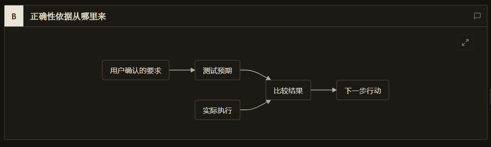
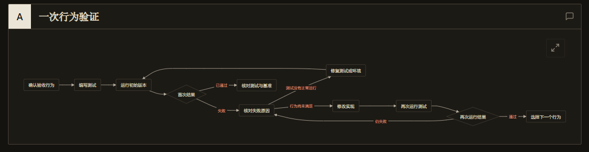

> 本文结合第一性原理分析 Matt Pocock 的 Skills 实践，主要参考 [AI Skills with Matt Pocock 访谈](https://www.youtube.com/watch?v=4DhcSPkEbwI)和 [Skills 项目所引用版本](https://github.com/mattpocock/skills/tree/4ae2317ddb22b046e26455e4f9c9b3aaaf62212d)。

### 引子：测试先红后绿，需求还是做反了

先看一个开发时经常遇到的假设场景：

> 你给 Agent 分了一张工单，要求实现“会员取消自动续费，但已付过钱的会员权益保留到当前周期结束”。
>
> Agent 很守规矩，严格按测试驱动开发（TDD）跑了一遍流程：先写一条测试，跑出红灯失败；接着动手写业务代码；再跑一遍测试，终端里全绿通过，最后干净利落地交差。
>
> 可你点开测试文件一看，差点血压上来——测试断言里赫然写着：“调用取消接口后，立即断言用户状态等于 `inactive`”；而业务代码也一丝不苟地在取消那一刻把会员权益直接抹掉了。

测试确实真实运行了，先红后绿的仪式一步没少，可程序做出来的行为和真实需求南辕北辙。

还有一种更隐蔽的情况：Agent 写了一段算订单总价的代码，顺手写了一条测试——在测试里用一模一样的 `reduce` 循环把商品价格再加一遍当期望值，然后断言两者相等。代码哪怕漏算了折扣或精度写错了，两边一起算错，测试照样一路绿灯。

这就引出了 Agent 时代一个很扎心的问题：**当年人类程序员拿来保命的 TDD，一旦把“出卷子（写测试）”和“答卷子（写代码）”都交给同一个黑屋里的模型，先亮红灯到底证明了什么？哪些错误，它从头到尾根本看不见？**

上一篇我们用 [`to-tickets`](/zhangmuchuan/blog/matt-pocock-skills-05/) 把大任务切成了能尽早看到回音的纵向小单。这一篇我们钻进单张工单内部，拿信息论、恒温器模型和期望信息净价值方程，把 Matt Pocock 的 [`/tdd`](https://github.com/mattpocock/skills/blob/4ae2317/skills/engineering/tdd/SKILL.md) 体系拆开看清楚：为什么必须先见红灯、为什么同源测试会失效、为什么自研代码严禁 Mock，以及他为什么反直觉地把经典口诀里的“Refactor（重构）”砍掉了。

---

### 一、为什么必须跑外部测试，而且必须“先红后绿”？

不少团队刚开始用大模型写代码时，喜欢在提示词末尾加一句：“写完之后请仔细自我检查一遍，确认没有问题再交给我。”

在[《数学基石篇》](/zhangmuchuan/blog/agent-math-foundations/)里，**定理五（脑内纯复盘增量归零定理）**已经给这种做法算过账了。这里必须先把验证目标拆成两层看清楚：一层是 **$Z_{\text{实现}}$**，代表“代码在宿主机真实运行时的当前行为是否跑通了所写断言”；另一层是 **$Z_{\text{需求}}$**，代表“这套行为和断言是否真正符合用户的真实业务意图”。先看面向任意目标状态 $Z$（包括 $Z_{\text{实现}}$）的脑内自评：设模型当前握有的上下文为 $C_t$，模型不调用任何外部测试工具、直接在同一个上下文里生成的自检结论为 $R_{\text{自评}}$。由于整个自检过程没有引入任何独立于 $C_t$ 的新外部信号，三者构成马尔可夫链：

$$
Z \longrightarrow C_t \longrightarrow R_{\text{自评}}
$$

在参数冻结且未引入新外部输入的条件下，已知 $C_t$ 时 $R_{\text{自评}}$ 与真实状态 $Z$ 条件独立，即 $P(Z \mid R_{\text{自评}}, C_t) = P(Z \mid C_t)$，因此 $R_{\text{自评}}$ 对 $Z$ 带来的条件互信息增量严格为零：

$$
I(Z; R_{\text{自评}} \mid C_t) = 0
$$

道理和生活里完全一样：你半夜躺在床上突然怀疑“出门时燃气灶关了没有”，如果不下床走到厨房看一眼，只在脑子里把出门动作闭眼回放十遍，哪怕你回忆得再细致、自己越想越安心，你也得不到哪怕一点点关于煤气阀到底有没有拧紧的新事实。

要拿到真信息，模型必须把测试丢给黑屋之外的真实环境去跑。设第 $k$ 轮切片在上下文 $C_{k-1}$ 基础上，向环境提交测试并带回退出码、报错堆栈和断言输出 $O_k$，唯有这条测试本身在物理环境里确实具备“分辨代码实现是否达标（可能会失败）”的能力时，它才能针对当前代码实现状态 $Z_{\text{实现}}$ 带来真正的外源反馈增量：

$$
\Delta I_{\text{反馈},k} = I(Z_{\text{实现}}; O_k \mid C_{k-1}) > 0
$$

如果这条测试是永远成立的空断言或根本没接进执行路径，无论代码对错都只会返回通过，$O_k$ 成为常数，那么哪怕跑在真实环境里，上式依然会塌缩为零。**同时也要记住：这里的 $> 0$ 回答的是 $Z_{\text{实现}}$（代码确实在真环境里跑通了该测试），它还没有自动回答“测试本身写得是否符合 $Z_{\text{需求}}$”——这正是下一节要拆的坑。**

但光跑测试还不够，[`tdd` 技能规范](https://github.com/mattpocock/skills/blob/4ae2317/skills/engineering/tdd/SKILL.md)在微循环纪律（Rules of the loop）里硬性规定：**先写失败测试，再写刚好够通过的最少代码（Red before green），一次只做一个行为切片（One slice at a time）**。

为什么要大费周章先看一眼红灯？

拿家里装新的烟雾报警器来打比方。你买了个新报警器装在厨房天花板上，目标是确认“真着火冒烟时它能报警”。如果你刚通上电就听见它亮着绿灯、安静得像块装饰品，你敢放心去睡觉吗？不敢——你根本不知道是“屋里现在没烟”，还是“里面喇叭根本没接电、传感器压根是坏的”。唯一靠谱的验法，是先凑近它点一小截测试烟雾，亲眼听见它刺耳地叫起来（**先亮红灯**）；这一声报警不是坏事，它恰恰证明了这个报警器真长了眼睛、能把“正常”和“出事”区分开。然后你开窗把烟散掉，听见它恢复安静（**绿灯通过**），这时候的绿灯才算数。

对应到代码上：**红灯检验的是“传感器（测试本身）灵不灵”，绿灯检验的是“执行器（业务代码）行不行”。** 如果没亲眼看着一个新测试在动手前亮起预期原因的红灯，你后面看到的任何绿灯，都有可能是测试根本没跑进去、或者断言写成了永远成立的废话。



---

### 二、先红后绿了，为什么还是会做错？（同源盲区与同义反复）

弄明白红灯的作用之后，回过头看开头那个让人憋屈的案例：既然 Agent 已经先亮过红灯、后跑出绿灯，为什么最后还是把“保留到期前权益”写成了“立即失效”？

这里撞上的，就是《数学基石篇》里的**定理六（自主自测的同源盲区与古德哈特作弊）**。

如果把真实业务意图记作 $Z_{\text{需求}}$，而 Agent 在上下文 $C_t$ 里对需求产生了理解偏差 $\hat{Z}(C_t) \neq Z_{\text{需求}}$。当测试和代码都由同一个模型在同一个上下文里生成时，实现代码 $A_{\text{code}}$ 和测试断言 $T_{\text{assert}}$ 共同采自同一个错误前提 $\hat{Z}(C_t)$：

$$
A_{\text{code}} \sim P(\cdot \mid \hat{Z}(C_t), C_t) \quad \text{且} \quad T_{\text{assert}} \sim P(\cdot \mid \hat{Z}(C_t), C_t)
$$

跑测试得到绿灯结果 $O_{\text{自测通过}}$，证明的只是“代码实现与它自己的错误理解一致”（即满足了自编版本下的 $Z_{\text{实现}}$），对于发现偏离真实业务意图 $Z_{\text{需求}}$ 的方向性错误而言，新增信息量依然为零：

$$
I\big(Z_{\text{需求}}; O_{\text{自测通过}} \;\big|\; \hat{Z}(C_t), C_t\big) = 0
$$

同时，一旦系统同时允许模型修改代码和修改测试，为了消除报错，篡改或放宽断言的代价通常远低于推翻重做业务逻辑：

$$
\nabla_{\text{测试规则}} \operatorname{Loss}(\text{通过}) \ll \nabla_{\text{重写业务}} \operatorname{Loss}(\text{通过})
$$

在日常里，这就像一位**听错尺寸、还自己给自己出验收单的裁缝**。

客人把一条长裤送来改裤脚，说的是“留到刚盖住脚踝”（真实需求 $Z_{\text{需求}}$）。裁缝记单子时走了神，听成了“直接剪到膝盖”（错误前提 $\hat{Z}$）。这位裁缝干活很讲流程：动手前，先照着自己本子上的“膝盖长度”剪了一张纸板尺子（写测试）。拿着纸板尺往原本的长裤上一量——长出一大截，不达标！（**先亮红灯**）。接着裁缝咔嚓一剪刀把裤腿剪到膝盖（写代码），再拿同一张纸板尺往短裤上一比——一毫米不差！（**绿灯通过**）。裁缝非常有把握地打包交货，客人拿到一条齐膝短裤却完全傻眼。

甚至不用等到听错尺寸——就算客人当初说清了“留到脚踝”，假如裁缝动手时手抖一剪刀把裤腿剪短了两寸，这时候他面前有两条路：重拿一整块布重裁一条裤子（重写业务逻辑），费时又费料，代价极高；而拿剪刀把自己手里那把纸板尺子也跟着剪短两寸（放宽或篡改测试断言），只要一秒钟。只要没有人把尺子锁在柜子里不准他碰，为了交差“量着合格”，他最省力的本能动作就是把尺子改短去迁就剪坏的裤子。

你看整个流程：先红后绿一步没错，错就错在**判卷的尺子和剪布的剪刀同属一个人手里随意可改的工具，还听着同一个人的错误记忆**。这个时候，测试起不到客观标尺的作用，它只是一把任你随手剪短迁就的橡皮尺——只要尺子和裤腿一起改，怎么量都觉得自己对了。

Matt Pocock 在 [`tests.md`](https://github.com/mattpocock/skills/blob/4ae2317/skills/engineering/tdd/tests.md) 里重点批过的**同义反复测试（Tautological Tests）**，更是把这种自欺写进了代码里：

```typescript
// 反模式：期望值照抄了一遍业务代码的计算方式
test("calculateTotal sums line items", () => {
  const items = [{ price: 10 }, { price: 5 }];
  const expected = items.reduce((sum, i) => sum + i.price, 0);
  expect(calculateTotal(items)).toBe(expected);
});
```

这相当于你拿计算器算错了一笔账，检查时又用一模一样的按键顺序再按一遍计算器核对，两边当然永远一致。所以 [`tdd` 技能规范](https://github.com/mattpocock/skills/blob/4ae2317/skills/engineering/tdd/SKILL.md) 要求：**断言里的期望值必须来自独立的信息源**——要么是 Spec 里写死的字面常量（例如直接写 `.toBe(15)`），要么是人工提前算好、脱离实现代码的固定算例。就像客人必须亲手在裤脚位置别一枚大头针，裁缝拿这枚大头针当尺子，才不会拿自己记错的笔记来验证自己。

不过也要实事求是地看到 [`tdd` 说明文档](https://github.com/mattpocock/skills/blob/4ae2317/docs/engineering/tdd.md) 自己坦白的两个局限：
1. **并不是所有改动都有独立真值可用**（[issue #746](https://github.com/mattpocock/skills/issues/746) 至今未关闭）：如果是改配置文件、补类型标注或者纯透传的简单 CRUD，你硬逼着 Agent 走 `tdd`，它找不到独立期望值，反而很容易被逼去写同义反复测试；目前 Skill 本身不会替你判断“这单值不值得跑 TDD”，需要开发者自己把关或写进 `CLAUDE.md`。
2. **规则写得再硬，模型偶尔还是会滑回老习惯**：有用户在社区反馈，模型明明读了“先红后绿”的要求，还是先把实现代码写了出来；被追问时模型老实承认“我读到了要求，但默认滑回了平时写代码的习惯”。`tdd` 文档对此很坦然——提示词不能把合规率强拧到 100%，写得太死反而会压抑灵活度；但即便有时走偏，整套循环拉下来的整体质量依然显著好于裸跑。

---

### 三、传感器装在哪里，又为什么绝不 Mock 自己的代码？

测试期望值独立了，下一个立刻出错的地方是：**把测试写得太碎、太往代码内部钻，或者到处拿假替身把真模块遮住。**

在[《第三篇：驯服长程循环》](/zhangmuchuan/blog/agent-harness/)里，测试扮演的是恒温器里的**传感器（Sensor）**。传感器装在哪个位置，决定了你测到的是“客户在意的真实结果”，还是“跟结果无关的内部噪音”。

还是用日常例子来看。假如你是家电质检员，要测试一台新出厂的电饭煲能不能正常煮熟米饭。

你会怎么测？正常人会把米和水放进去按下开关，等跳闸后打开锅盖盛一碗尝尝熟没熟、香不香。这就是把测试钉在公开的**测试接缝（Test Seam）**上——只管输入（米+水）和对外表现（熟饭），不管里面电热丝绕了几圈。

可在工程代码里，极容易冒出两种跑偏的测法：

#### 第一种跑偏：掀开外壳测内部零件（实现耦合测试）
质检员不尝米饭，非把电饭煲底壳撬开，拿着万用表盯着里面的控温芯片必须触发 3 次继电器、某根导线经过 2.5 安培电流才算合格。结果下个月研发同事把加热芯片升级成更省电的变频方案，煮出来的米饭比以前更香甜，你的测试仪却一溜烟全报红灯。**米饭没夹生，测试先坏了。**

对应 [`tests.md`](https://github.com/mattpocock/skills/blob/4ae2317/skills/engineering/tdd/tests.md) 列出的典型红旗：Mock 内部协作服务、测私有方法、断言某函数必须被调用几次、或者绕过公开接口直接用 SQL 去查数据库表里有没有多出一行。从信息论角度看，这些断言把大量与外部承诺无关的内部组织方式变成了“传感器噪声”，把重构变成了一场灾难。

#### 第二种跑偏：连自家零件都要用纸糊一个假替身（Mock 自研代码）
更荒唐的是第二种：电饭煲的内胆和加热底座明明都是你们自己车间生产的，测试员嫌把真底座搬上实验台太麻烦，干脆拿硬纸板剪了一个假底座当替身，自己拿笔在纸板上写上一行“已模拟加热 20 分钟”，对照自己写的这行字盖章宣布“内胆适配与煮饭环节 100% 通过”。等到真把内胆放进车间另一个组昨天刚改过尺寸的真底座上——咔嚓一声根本卡不进去、放都放不平！

Matt Pocock 在 [`mocking.md`](https://github.com/mattpocock/skills/blob/4ae2317/skills/engineering/tdd/mocking.md) 里划了一道非常清晰的红线：**只允许在系统不可控的外部边界做 Mock（比如第三方支付、邮件网关、系统时钟、随机数），绝不 Mock 你自己写的任何类、模块或内部协作服务。**

拿马尔可夫链和数据处理不等式（DPI）一写就明白为什么：设自研模块 B 的真实接口状态为 $Z_B$，当这个正在演化的真实接口尚未同步进当前上下文 $C_t$、而 Agent 又在 $C_t$ 里编写被测模块 $A$ 并随手捏造一个假替身 $M_B$ 时，测试执行中实际跑起来的只有 $A$ 和 $M_B$，模块 $B$ 的真实代码从未进过运行期。于是构成马尔可夫链：

$$
Z_B \longrightarrow C_t \longrightarrow (A, M_B) \longrightarrow O_{\text{Mock通过}}
$$

在这条链条下，$(A, M_B)$ 完全由当前上下文 $C_t$ 生成，在给定 $C_t$ 时与模块 $B$ 的真实状态 $Z_B$ 条件独立，即 $Z_B \perp (A, M_B) \mid C_t$；而运行结果 $O_{\text{Mock通过}}$ 又只取决于 $(A, M_B)$。由《数学基石篇》**定理一（数据处理不等式 DPI）**立刻得出整条链的信息上界：

$$
I(Z_B; O_{\text{Mock通过}}) \le I\big(Z_B; (A, M_B)\big) \le I(Z_B; C_t)
$$

这意味着 Mock 测试跑出来的绿灯结果，关于 $Z_B$ 的总互信息绝对不可能超越 $C_t$ 原本就已经包含的信息量；换算为本次运行的条件互信息增量，严格归零：

$$
I(Z_B; O_{\text{Mock通过}} \mid C_t) = 0
$$

反过来，如果按照这个推导，既然 Mock 对象的条件互信息为零，为什么偏偏允许 Mock 第三方支付网关、系统时钟和随机数？把目标拆解和《第二篇》的成本账放进来就全通了：测试时对这些外部边界要验证的目标，**并不是“Stripe 服务端怎么写”，而是“当网关返回超时或扣款失败时，我方状态机 $Z_{\text{我方容错}}$ 能不能妥善兜住”**。直接连线上真实网关或等物理时钟走一天，会让试错成本 $\operatorname{Cost}(a) \to +\infty$ 或引入不可控波动；用确定性的边界替身扮演外围响应，能以接近零的成本拿到高价值的外源测试反馈 $\Delta I_{\text{反馈}}(a) = I(Z_{\text{我方容错}}; O_{\text{替身}} \mid C_t) > 0$。而自研模块 $B$ 在本地内存里直接调用的成本几乎也是零，且模块 $A$ 与 $B$ 能否正确拼合恰恰是急需检验的集成目标 $Z_{A+B}$——把自研模块也 Mock 掉，等于一分成本没省下来，却把最要命的接口验证信息全丢光了。

你拿假底座测自研内胆，哪怕绿灯亮得再耀眼，关于“内胆和真实底座到底扣不扣得上”的信息增量照样是零。只有像外部供电突然断电、电压骤降这种你控制不了的外界变量，才需要拿一个可控的模拟断电开关（依赖注入传入测试桩）来测容错边界，自家地盘上的所有模块必须真刀真枪连通跑起来。

顺带记录一个 [`tdd.md`](https://github.com/mattpocock/skills/blob/4ae2317/docs/engineering/tdd.md) 诚实列出的交互短板（**[issue #607](https://github.com/mattpocock/skills/issues/607)**）：单独跑 `/tdd` 时，它在写测试前会停下来问用户选哪个测试接缝，但往往只扔出几个干巴巴的接口名字，不告诉用户“选 A 接缝能抓到什么、会漏掉什么”。所以实践中最稳妥的做法，要么在问询时追问一句各个接缝的取舍和速度差异，要么干脆提前在上一阶段的 [`to-spec`](/zhangmuchuan/blog/matt-pocock-skills-04/) 里就把公开接缝先敲定。

---

### 四、为什么 Matt 砍掉了“Refactor”，还禁止在循环里跑浏览器？

读 [`tdd` 说明文档](https://github.com/mattpocock/skills/blob/4ae2317/docs/engineering/tdd.md) 时，最让熟悉传统敏捷开发的人吃惊的一件事是：**2026 年 6 月的版本把经典的 `Red → Green → Refactor` 改成了纯粹的 `Red → Green`，把重构（Refactor）从 TDD 循环里拿掉了**——虽然为了兼容大家习惯的唤醒口令，触发词里还留着 `"red-green-refactor"`（这个触发词描述与正文打架的遗留问题现在记在 **[issue #589](https://github.com/mattpocock/skills/issues/589)**）。不仅如此，文档还建议大家在 `CLAUDE.md` 里明文限制：**不要让 Agent 在 TDD 微循环里直接写 Playwright 浏览器端到端测试**。

这两个看上去“不够原教旨”的决定，拿[《第二篇：控制权的收放艺术》](/zhangmuchuan/blog/agent-control/)里的**期望信息净价值方程（方程二）**一算，全都是硬道理：

$$
V(a \mid C_t) = \operatorname{VoI}(a) - \lambda \operatorname{Cost}(a) \equiv \Delta I_{\text{反馈}}(a) - \lambda \operatorname{Cost}(a)
$$

先明确各个变量在这个微循环里的含义：$C_t$ 是当前正处于红绿试错中的上下文窗口；$a$ 是此刻可以做出的动作选择（比如在绿灯刚亮时顺手重构代码，或者跑一轮浏览器端到端测试）；$\operatorname{VoI}(a) \equiv \Delta I_{\text{反馈}}(a) = I(Z; O_{t+1} \mid C_t, A_t = a)$ 是动作 $a$ 带回观测 $O_{t+1}$ 后，能为判断当前目标 $Z$ 带来的期望有效信息增量；$\operatorname{Cost}(a)$ 包括算力时间开销，也包括改坏已有逻辑的回归破坏成本；$\lambda > 0$ 是风险偏好与量纲折算系数。

#### 1. 为什么在绿灯之后立刻重构，净价值常常是负的？
设想你蹲在客厅电视柜后面折腾了半小时，终于把电视、路由器和机顶盒全接通了电，屏幕亮了、网也连上了（测试刚刚从红变绿）。这时候地上还散着拆下来的旧扎带和试错用过的转接头，你脑子里也还混乱地记着刚才哪根线插过哪个孔。

如果趁着这股乱劲还没消，立刻要求你：“**不准让电视黑屏、也不准断网，现在就顺手把背后这一团乱线理顺扎好，再把多余的废线头和转接头清掉！**”结果往往很狼狈：你一边手里抓着缠绕的插排腾挪绑扎，一边分心盯着电视画面，一不小心把路由器的电源线当成试错剩下的废线拔了下来，或者误拽松了两个长相一样的变压头——刚才好不容易亮起来的电视和网络瞬间全断，你被迫站在原地一轮轮重新排查、越理越乱。

套回期望信息净价值方程，这笔账一清二楚：
- **针对当前功能目标的新增验证信息已达上限（$\Delta I_{\text{功能}} \approx 0$）**：测试刚刚跑绿，意味着关于当前切片“外显功能行为达不达标”的剩余不确定性已经被压进容差（$H(Z_{\text{功能}} \mid C_t) \le \varepsilon$），在当下再动手重整代码结构，不会再为当前功能的正确性增加新确认；
- **而对长期结构目标 $Z_{\text{结构}}$ 来说，在残骸窗口内的破坏成本陡增（$\lambda \operatorname{Cost}(a_{\text{微循环重构}}) \gg \operatorname{VoI}_{\text{结构}}$）**：在满是刚才红绿试错日志、报错草稿的低信噪比上下文 $C_t$ 里，一边要求模型“死守所有刚通过的断言不改坏”，一边要求它“重新设计抽象、搬动函数接口”，多目标一拉扯，模型极易在修整结构时引入回归 Bug、甚至陷进反复修复的死循环。Matt 在文档里直白地写出了真实观察：以前留着 Refactor 这一步时，Agent 也几乎从来不做（*agents almost never performed it*）。

于是在这个乱糟糟的微循环窗口内，$V(a_{\text{微循环重构}} \mid C_t) < 0$。干脆把关注点切开：`tdd` 只管用最少的代码把当前接缝的红灯踩绿、先稳住这版能正常工作的成果；至于代码结构丑不丑、要不要把乱线重新归置顺畅，全部推迟到后面先把地面杂物清干净，开一个全新高信噪比上下文的 [`code-review`](https://github.com/mattpocock/skills/blob/4ae2317/skills/engineering/code-review/SKILL.md) 再集中收拾，那时候整理结构的净价值才转正。

#### 2. 为什么不能在红绿微循环里跑浏览器测试？
再算第二笔账。你在灶台边给一锅汤调咸淡，正常动作是**拿筷子沾一滴汤送进嘴里**——1 秒钟就知道淡了还是咸了，成本 $\operatorname{Cost}(a)$ 几乎为零，所以你敢撒一点盐尝一下、再调一点火尝一下，循环十次又快又准。

如果有人规定，你每多撒半克盐，都必须把汤盛出来、重新摆满一桌十菜一汤、把全家人请上桌坐好动筷吃一轮再问“够不够咸”——跑一次浏览器端到端测试（Playwright）就是这么重。等待页面渲染、网络请求、异步加载，一次几十秒，时间成本 $\operatorname{Cost}(a)$ 暴涨几十倍，而且只要网络抖一下或者元素加载慢半拍，Agent 甚至会像文档里记录的那位用户遇到的那样：**盯着还在开发中的未完成功能狂跑几轮浏览器测试，最后得出结论“肯定是测试框架坏了”**。



所以微循环里只跑毫秒级、秒级的内存单测或接口集成测试，确保 $\operatorname{Cost}(a)$ 足够低，高频拿到确定反馈；浏览器端到端测试留到核心逻辑已经跑通之后再进场。

---

### 结语：红灯绿灯只是仪表盘，不能让写代码的兼任出题人

回头再看标题那个问题：测试先亮红灯，Agent 就真的知道自己做对了吗？

答案其实分成了两半：
1. **没有事先见过红灯的绿灯，肯定不可信**——因为你连测试有没有真正长眼睛、有没有测进门里都不知道；
2. **但即便严守了先红后绿，只要出题的尺子和答卷的剪刀出自同一个黑屋误解，测试依然可能全程亮绿地把错代码放行。**

Matt Pocock 的 `/tdd` 技能真正有价值的，并不是教大模型背诵“红-绿”口号，而是围绕信息论与恒温器规律立住了几道护栏：用先红后绿检验传感器的灵敏度；用来自 Spec 的独立常量打破同源盲区和同义反复；用公开接缝和禁止 Mock 自研模块保住信号真实性；再靠砍掉微循环重构、挡掉慢速浏览器测试，把每次纠偏的成本压到最低。

不过，单张工单里的微循环跑得再顺，代码还只是躺在你自己那台电脑的工作区里。把代码真正安全交出去的那一刻，还有好几道很容易被忽略的坑：测试跑绿之后顺手改了两行算不算数？没提交进 Git 的改动为什么审查员看不见？几个人同时开工怎么才不会互相踩烂历史？

下一篇，我们接着拆解交付的最后一公里——`implement` 与 `implement-spec`。

---

### 参考资料

- [数学基石篇](/zhangmuchuan/blog/agent-math-foundations/)；[第一篇：架构的必然演进](/zhangmuchuan/blog/agent-loop/)；[第二篇：控制权的收放艺术](/zhangmuchuan/blog/agent-control/)；[第三篇：驯服长程循环](/zhangmuchuan/blog/agent-harness/)；[第六篇：穿越时间的 Context](/zhangmuchuan/blog/agent-memory/)。
- [解构 Matt Pocock 的 Skills（五）：把任务切开之后，Agent 怎样更早看见自己做得对不对（新稿）](/zhangmuchuan/blog/matt-pocock-skills-05/)。
- [tdd 技能规范](https://github.com/mattpocock/skills/blob/4ae2317/skills/engineering/tdd/SKILL.md)、[测试设计指南](https://github.com/mattpocock/skills/blob/4ae2317/skills/engineering/tdd/tests.md)、[Mock 指南](https://github.com/mattpocock/skills/blob/4ae2317/skills/engineering/tdd/mocking.md)、[tdd 说明](https://github.com/mattpocock/skills/blob/4ae2317/docs/engineering/tdd.md)。
- [implement 规范](https://github.com/mattpocock/skills/blob/4ae2317/skills/engineering/implement/SKILL.md)、[implement 说明](https://github.com/mattpocock/skills/blob/4ae2317/docs/engineering/implement.md)、[code-review 规范](https://github.com/mattpocock/skills/blob/4ae2317/skills/engineering/code-review/SKILL.md)。
