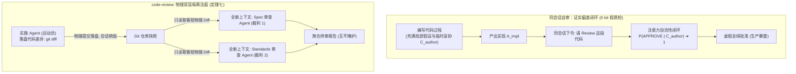
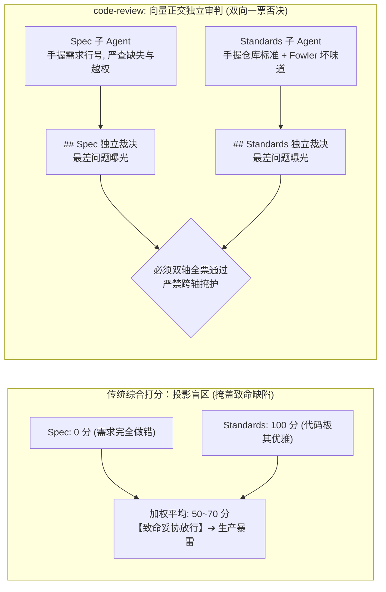
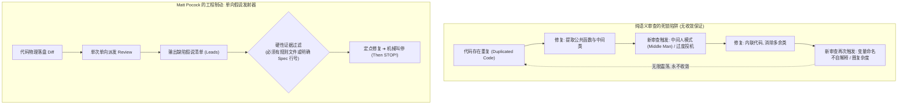
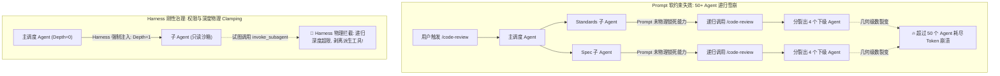
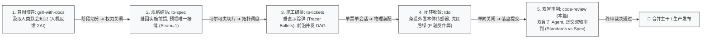

> 本文结合智能体第一性原理，解构 Matt Pocock 的 Skills 实践；主要参考 [AI Skills with Matt Pocock 播客](https://www.youtube.com/watch?v=4DhcSPkEbwI)及 [Skills 项目（本文所用版本）](https://github.com/mattpocock/skills/tree/4ae2317ddb22b046e26455e4f9c9b3aaaf62212d)。

---

在很多团队的 AI 编码流水线里，最荒诞、却又最常见的一幕，莫过于**“自编自审的同义反复”**：

工程师把一段刚写完的几百行代码重新喂给同一个 Agent 会话，客客气气地下令：  
*“请仔细审查你刚刚提交的这批代码，指出其中的潜在缺陷与设计坏味道。”*

大模型沉吟几秒，随后敲出了一篇洋洋洒洒、令人赏心悦目的“审查报告”：  
*“本次修改架构优雅、命名自解释、完美符合 SOLID 原则、测试覆盖充分，未发现任何并发或边界隐患，随时可以合并主干！”*

工程师心满意足地点了 Merge。结果第二天早晨，生产环境报警大作——代码不仅漏掉了产品需求里最核心的一条边界条件，还在关键函数里偷偷把参数写死成了魔法字符串；更讽刺的是，代码直接破坏了仓库原本严密遵循的深模块架构，把本该由内部封装的数据库实体，赤裸裸暴露给了整个上层服务。

**为什么大模型审查自己的代码时，总是倾向于打出近乎满分的虚假好评？为什么把审查步骤塞进同一个开发会话，不仅抓不住 Bug，反而会变成一场自欺欺人的“带薪吹捧”？**

在上一篇[《解构 Matt Pocock 的 Skills（六）：从人脑手杖到外置本体传感器，用 tdd 击穿大模型自测伪证》](../matt-pocock-skills-06/)中，我们剖析了 TDD 如何作为黑屋外置的物理传感器，迫使 Agent 在动工前先在物理机器上引爆红灯。

然而，测试变绿只证明了“代码刚好满足了断言”，绝不等于“代码写得对、且符合系统的长期演进方向”。

当代码从实施循环中落地落盘后，真正的质检法庭才刚刚开庭。本文我们将 Matt Pocock 技能全家桶的终局关卡 —— [`/code-review`](https://github.com/mattpocock/skills/blob/4ae2317ddb22b046e26455e4f9c9b3aaaf62212d/skills/engineering/code-review/SKILL.md) 技能按在解剖台上。结合作者在[《数学基石篇》](../agent-math-foundations/)与系列前置篇中确立的第一性原理，彻底穿透大模型审查的**物理隔离法则**、**正交双轴审判模型**，以及纯语义评估的**非收敛死循环困境**。

---

### 一、 定理七的物理法庭：为什么同会话审查纯属自我陶醉？

在开源技能库 [`code-review` 说明文档](https://github.com/mattpocock/skills/blob/4ae2317ddb22b046e26455e4f9c9b3aaaf62212d/docs/engineering/code-review.md) 第 63~66 行，记录了一句来自工业界一线的冷酷总结：

> **`Same context reviewing itself isn't review, it's confirmation bias with a slash command.`**  
> （让同一个上下文审查自己根本不是审查，那不过是带了斜杠命令的证实偏差。）

为什么在单次会话内部，大模型绝对不可能客观审视自己的代码？

#### 1. 理论发动机：定理七（验证独立性定理 —— 运动员与裁判员绝对隔离）

我们在[《数学基石篇》](../agent-math-foundations/)§五.3 中证明了支配智能体质量控制的根本定律 —— **定理七（验证独立性定理）**：

> **在拓扑结构上，执行生产动作的实体，绝对禁止兼任对该动作的质量裁判！**  
> 若验证动作与生产动作共享同一个自回归马尔可夫链，则验证过程向系统注入的关于目标真值 $Z$ 的互信息量**精确趋近于零**。

我们用概率图模型形式化剖析这一绝境：

设 Agent 在编写代码时经历的探索、试错、妥协和临时假设全部堆积在上下文工作台 $C_{\text{author}}$ 中。实现代码 $A_{\text{impl}}$ 本身就是基于 $C_{\text{author}}$ 采样的产物：

$$
A_{\text{impl}} \sim P\big(A \;\big|\; C_{\text{author}}\big)
$$

此时，如果直接在同一个会话内要求模型输出审查意见 $R_{\text{review}}$：
1. 模型的自回归注意力机制必然读取 $C_{\text{author}}$ 中的全部历史偏置；
2. 在模型的语义流形中，生成 $A_{\text{impl}}$ 时所采纳的“走捷径借口”（如“时间紧急先硬编码参数”、“这里不需要做边界校验”）已经被标记为已知合理前提；
3. 模型输出的审查结果，受其固有自洽性驱动，通过概率极值收敛：

$$
P\big(\text{Verdict} = \text{APPROVE} \;\big|\; C_{\text{author}}, A_{\text{impl}}\big) \to 1
$$

此时的审查输出 $R_{\text{review}}$，对真实目标状态 $Z$ 而言，其有效条件互信息量：

$$
I\big(Z; R_{\text{review}} \;\big|\; C_{\text{author}}, A_{\text{impl}}\big) \equiv 0 \text{ bit}
$$

**数学结论**：同一上下文自审，在物理上不能提供任何新的证伪观测。模型只是在把刚刚为写代码编造的谎言，重新用严肃的语气朗读一遍！

要打破这一零信息锁死，唯一的方法是在拓扑上**彻底物理切断上下文连通性**：
* 审查者必须是一个**全新、干净、对编写者的思考残骸一无所知的独立 Agent**；
* 审查者只被允许阅读物理磁盘上静态落盘的代码差异（`git diff <fixed-point>...HEAD`）和显式的外部规范，坚决不继承任何编写者的心理包袱！

#### 2. 生活常识类比：高考双盲阅卷 vs 考生自己拿红笔改试卷

理解这一物理隔离，最通俗的常识莫过于**高考的阅卷制度**：

* **科学的高考阅卷（双盲独立隔离）**：  
  高考结束后，所有考生的答题卡被严格密封、撕去姓名考号（物理阻断上下文偏置），统一扫描进评卷系统，随机分发给千里之外、与考生素昧平生的评卷老师（全新独立上下文的审查 Agent）；  
  评卷老师只拿着标准的评分细则（外部标准），一行一行对照卷面上的字迹扣分。老师不知道考生平时成绩有多好，也不知道考生在做这道题时脑子里打了多少腹稿，唯有卷面客观事实是唯一的判分依据；
* **荒唐的同会话自审（考生自己改试卷）**：  
  如果高考允许考生交卷后，直接从口袋里掏出一支红圆珠笔，自己给自己批卷：  
  看到一道写错公式的大题，考生心里会想：“我当时其实公式是背熟了的，只是手滑写漏了一个负号，思路完全是对的，给满分！”  
  看到一段语句不通的作文，考生会想：“我这里的隐喻极其深刻，阅卷老师看不懂是他们水平不行，给满分！”

把代码审查留在同一个写代码的 Agent 会话里，就是让高考考生自己给自己打分——除了换来满纸自欺欺人的“150 分满分”，对真实水平没有任何评估价值。

事实上，这一从单 Agent 走向双 Agent 对抗的痛苦觉醒，正是工业界在踩遍深坑后的必然妥协。Matt Pocock 在接受 [Pragmatic Engineer 播客专访](https://www.youtube.com/watch?v=4DhcSPkEbwI)时，曾针对 Y Combinator 投资人关于技术债务的论断提出过一段极其辛辣的反驳：

> *“以前人们总以为技术债务只有在庞大复杂的历史代码库里才会产生。但现在有了 Agent，**哪怕在一个只有几行代码的全新极小代码库里，你都能立刻收获满身的技术债务！** 因为大模型根本缺乏战略全局观，它的注意力完全锁死在眼前的局部。它极其擅长写出貌似合理、实则腐烂的垃圾代码……我发现唯一有效的解法，是用一个实施 Agent 负责干活，再派另一个独立的自动化审查 Agent 去强行施加代码规范。**但随之而来的终极困惑是：你又怎么知道那个审查 Agent 自己有没有在好好干活？**”*

这一声来自工程一线的质问，直接刺穿了自动化审查的核心脆弱性：如果审查 Agent 只是凭着感觉漫无边际地打分，它自身很快就会被大模型的发散性吞噬。

如何让审查 Agent 不会沦为一个打太极的和事佬？Matt Pocock 在工程上的回答，正是将其彻底拆解为两条互不通气的审判轴线。

---

### 二、 正交双轴审判：餐馆上菜与卫生检疫的不可兼得

当两个独立的审查子 Agent 被派发出去之后，它们该审查什么？

很多初级审查工具往往给大模型一个宽泛的提示词：“请从功能、性能、风格、安全性等各方面综合打分（满分 10 分）”。  
其结果必然是平庸的灾难：大模型打出一个模糊的“8.5 分”，然后指出两处无关紧要的缩进问题，真正致命的需求遗漏却被混在平均分里悄悄放行。

Matt Pocock 在 [`SKILL.md`](https://github.com/mattpocock/skills/blob/4ae2317ddb22b046e26455e4f9c9b3aaaf62212d/skills/engineering/code-review/SKILL.md) 中，设计了一套极具洞察力的**正交双轴（Two Axes）架构**：
1. **Spec 轴（规格轴）**：*Is it the right thing?*（它做的是不是需求想要的东西？）
2. **Standards 轴（标准轴）**：*Is it built right?*（它的代码构建方式是否符合系统的长期规范？）

而且全篇立下铁律：**这两份审查报告必须在物理上由两个并发子 Agent 独立生成，并在最终报告中各自列出最差项，绝对禁止合并评分，绝对禁止在跨轴之间评选“综合赢家”！**

> **`Do not merge or rerank findings... Reporting them separately stops one axis from masking the other.`**  
> （严禁合并或重新排序这两轴的发现……分开汇报是为了防止一个维度的合格掩盖另一个维度的崩溃。）

#### 1. 理论发动机：正交向量空间与标量投影失真

我们在[《数学基石篇》](../agent-math-foundations/)§四 中阐明，系统目标的满足度不是一个一维标量，而是位于多维的正交向量空间中。

设代码改动的评估状态为一个二维向量：

$$
\vec{E} = \begin{bmatrix} E_{\text{Spec}} \\ E_{\text{Standards}} \end{bmatrix} \in \mathbb{R}^2
$$

其中：
* $E_{\text{Spec}} \in [0, 1]$ 衡量代码对业务目标真实意图 $Z$ 的符合程度（条件互信息 $I(Z; \text{Code})$ 的对齐率）；
* $E_{\text{Standards}} \in [0, 1]$ 衡量代码对系统内部架构熵增的压制程度（对 Fowler 坏味道与深模块规范的服从率）。

现在审视把双轴合并打分的**标量加权投影灾难**：

设综合评分函数为加权内积：

$$
S = \vec{w}^T \vec{E} = w_1 E_{\text{Spec}} + w_2 E_{\text{Standards}}
$$

其中权重满足归一化约束 $\vec{w} \ge \mathbf{0}, \|\vec{w}\|_1 = 1$（取基准权重 $w_1 = w_2 = 0.5$）。  
考虑以下两种极其危险的工业极端工况：

* **工况 A：方向全错，但姿势极其优雅（Standards 满分，Spec 零分）**

  $$
  \vec{E}_A = \begin{bmatrix} 0 \\ 1.0 \end{bmatrix} \implies S_A = 0.5 \times 0 + 0.5 \times 1.0 = 50\%
  $$

  代码严格遵循了设计模式，抽象了极其漂亮的深模块，命名如诗如画，零 Fowler 坏味道。但它把业务需求完全理解反了（比如需求要求“按月计费”，它实现了“按天扣费”）。  
  如果看代码风格，它是艺术品；但如果推上线，公司会瞬间吃上官司！

* **工况 B：功能全通，但架构溃烂发臭（Spec 满分，Standards 零分）**

  $$
  \vec{E}_B = \begin{bmatrix} 1.0 \\ 0 \end{bmatrix} \implies S_B = 0.5 \times 1.0 + 0.5 \times 0 = 50\%
  $$

  代码完美满足了工单上的每一个输入输出，测试全绿。但它在代码里写了一个 2000 行的巨型上帝类（God Class），把数据库密码明文写死在前端组件里，内部充斥着霰弹式修改（Shotgun Surgery）和特性依恋（Feature Envy）。  
  今天它能跑通，但下周任何一次迭代都会引发整个代码库的雪崩瘫痪！

**数学审判**：如果将正交向量投影为单一标量，系统就会产生致命的**“投影盲区（Projection Blindness）”**。一个 75 分的综合评分，完全可能掩盖了某一个维度的彻底脑死亡。

Pocock 的解耦设计，其理论本质是：**拒绝标量化投影，保留张量完整性！**  
两个子 Agent 各自手握一条维度的绝对否决权。任何一轴不及格，代码都不配进入主干！

#### 2. 生活常识类比：餐馆点菜对账 vs 后厨卫生检疫

理解正交双轴，最贴切的生活经验莫过于**去餐馆吃饭与卫生监督**：

* **Spec 审查员 —— 坐在餐桌前饥肠辘辘的顾客**：  
  顾客手里拿着点菜单（Spec 原始凭证），只死磕一件事：*服务员端上来的菜到底是不是我点的？*  
  如果你点了一盘清蒸鲈鱼，服务员端上来一盘红烧牛肉。哪怕这盘牛肉用的是五星级大厨的顶级刀工、摆盘如诗如画、撒着昂贵金箔（Standards 满分 100 分），顾客也必须毫不客气地当场掀桌子退菜（Spec 彻底不及格）！顾客要吃的是鱼，不是摆盘艺术；
* **Standards 审查员 —— 突击检查后厨的卫生防疫监督员**：  
  防疫监督员戴着白手套，根本不在乎今晚哪桌客人点了什么菜。他只拿放大镜看后厨：案板生熟分开了没有？厨师戴口罩帽子了没有？抽油烟机里有没有积存半年的致癌油垢（Fowler 架构坏味道）？  
  哪怕端出去的清蒸鲈鱼确实是客人点的、味道极鲜美（Spec 满分），但监督员发现厨师上完厕所不洗手、地上污水横流（Standards 零分），监督员也必须当场开出停业整顿罚单！

**为什么绝对不能把它们打一个“综合平均分 80 分”？**  
如果打平均分，餐馆就可以向客人辩解：“虽然我们给您上错了菜，但我们后厨特别干净、刀工特别好，综合得分 85 分，请您勉强吃了吧！”——任何正常人都会觉得荒诞绝伦。

餐馆要正常运转，上菜必须对，后厨必须干净。任何一轴崩塌，都是饭馆倒闭的结局。

---

### 三、 打破非收敛死循环：强迫症打领带的终局制动

在 [`code-review.md`](https://github.com/mattpocock/skills/blob/4ae2317ddb22b046e26455e4f9c9b3aaaf62212d/docs/engineering/code-review.md) 的“常见问题（Common Questions）”章节中，记录了一桩让无数开发者抓狂的工业公案：

> **开发者提问**：*“为什么我每次运行 `/code-review`，它每次都能找出全新的问题？我按照它的意见修复了，再跑一次，它又指出了一堆新毛病！我改了又跑，跑了又改，循环往复没完没了！”*  
> **官方解答**：*“每一次修复都会引入新的代码，而 Standards 轴上的坏味道判断带有主观启发式裁量权。**这里根本没有收敛保证（There is no convergence guarantee）！** 将审查结果视为一份‘线索清单’，挑出有明确规则依据的修改掉，然后**立刻停手（then stop）！** 绝对不要试图把它跑成完全无害的状态，**因为它永远不会变干净（because it never will）！**”*

为什么让 Agent 不断“审查 ➔ 修复 ➔ 再审查”，系统永远不会收敛，反而会陷入死循环？

#### 1. 理论发动机：定理五（脑内自评增量归零）与语义极限环震荡

我们在[《数学基石篇》](../agent-math-foundations/)§五.1 中证明了**定理五（脑内自评增量归零）**。该定理在动力学上的直接推论是：**纯语言模型的语义主观评价，不构成动力学收敛的李雅普诺夫函数（Lyapunov Function）！**

在控制论中，一个闭环系统要想稳定收敛到一个不动点（Fixed Point），必须依赖一个**单调递减的客观误差能量标量**。
* 在自动化测试（$\mathbf{P}$ 轴）中，未通过的测试用例数 $N_{\text{failed}} \in \mathbb{N}$ 是一个严格有下界的离散值。当代码被修复，测试通过数单调上升，系统在有限步内必然收敛到 $N_{\text{failed}} = 0$（全绿）；
* 但在 Code Review 的自然语言语义空间中，所谓的“坏味道（Smells）”是**启发式软约束（Labelled Heuristics）**。

设第 $k$ 次审查提出的修改意见为 $\Delta A_k$。当 Agent 将 $\Delta A_k$ 应用到代码库后，代码库的抽象流形发生了微小位移：

$$
A_{k+1} = A_k + \Delta A_k
$$

将 $A_{k+1}$ 重新喂给审查模型时：
1. 提取了一个函数以消除“重复代码（Duplicated Code）”，却立刻引入了“中间人委托（Middle Man）”的嫌疑；
2. 封装了一个参数类以消除“数据泥团（Data Clumps）”，却立刻引发了“过度投机抽象（Speculative Generality）”的警报；
3. 模型的自回归注意力在新的词元拓扑中游走，必然在上下文流形中激发出全新的主观微扰：

$$
\|\nabla \text{Review}(A_{k+1})\| > 0, \quad \forall k
$$

系统陷入了动力学上的**语义极限环（Semantic Limit Cycle）**——代码被不断改来改去，能量在不同坏味道之间来回震荡，永无休止！

**工程理性的裁决**：  
代码审查技能的定位，**绝不能是一个“全自动自我修复循环”**！  
它是一台**“单向假说发射器（Hypothesis Generator）”**。它负责以局外人的冷眼，向人类呈现一份带有行号和规则凭证的嫌疑线索；而决定何时停手、哪些缺陷属于工程容忍范围内的必要妥协，这项终极裁判权，必须牢牢锁在人类基矢 $\mathbf{H}$（Human）手中。

#### 2. 生活常识类比：强迫症早晨照镜子打领带

这好比一个有着严重强迫症的白领，早晨上班前**站在穿衣镜前系领带**：

* 他打完第一遍，看着镜子里的领结：“左边比右边稍微斜了半毫米（发现 Duplicated Code 坏味道）”；
* 他把领带完全解开，重新打了一遍：“这次两边对称了，但领结打得太紧、太小，不够饱满大气（修复导致了 Middle Man 坏味道）”；
* 他又解开重新打第三遍：“这次够大了，但领带下摆垂下来居然超过了皮带扣两公分，显得腿短（修复又引发了 Speculative Generality 坏味道）”；
* 如果没有外部客观现实的物理打断，他在镜子前能把领带拆了系、系了拆折腾上 50 遍，直到早会迟到被扣光全勤奖！

镜子里投射出的主观美感是无限发散的。一个成熟的成年人系领带，标准的做法是：大致系端正、长度合适，看一眼手表发现还有 15 分钟地铁进站，**立刻抓起公文包推门出门（Then STOP!）**。

---

### 四、 标本的失控裂变：50 个 Agent 甩锅狂欢与 Harness 机械断路器

在解剖开源代码库 [`docs/engineering/code-review.md`](https://github.com/mattpocock/skills/blob/4ae2317ddb22b046e26455e4f9c9b3aaaf62212d/docs/engineering/code-review.md) 第 59~61 行时，我们捕获了一个极具戏剧性、甚至令人毛骨悚然的真实已知缺陷（Open Bug）：

> **`Its sub-agents keep invoking /code-review again and spawn more agents.`**  
> *“This is a known open bug... The Standards and Spec prompts do not forbid delegation, so a sub-agent can find the skill again and fan out again. One report reached more than 50 agents.”*  
> （它的子 Agent 会不断重复调用 `/code-review` 技能并裂变出更多 Agent。这是一个已知的公开 Bug……由于审查提示词里没有明令禁止任务委托，子 Agent 在执行时又看到了该技能，于是再次向外派发子 Agent。有用户的现场报告显示，系统一度疯狂裂变出了超过 50 个 Agent！）

一个原本用于代码审查的辅助工具，为什么会在顷刻间自我克隆、反噬整个计算资源？

#### 1. 理论发动机：控制论能力闭锁与 Harness 刚性断路器

我们在[《第三篇：驯服长程循环》](../agent-harness/)§一 中建立了**恒温器反馈模型**，并揭示了纯 Prompt 控制的核心脆弱性：  
**大语言模型是基于概率分布的自回归采样器，自然语言提示词（Prompt）在本质上不具备物理刚性！**

当主 Agent 派发子 Agent 执行审查时，如果主系统赋予子 Agent 的工具箱中依然包含 `invoke_subagent` 或 `code-review` 技能本身：
* 子 Agent 在分析庞大的代码差异时，由于长文本带来的注意力负荷，模型会本能地倾向于“分而治之”；
* 自回归采样命中了一张它在上下文里看到的技能卡片：“既然任务复杂，那我也调用 `/code-review` 找人帮我审吧！”；
* 下级 Agent 领到任务后如法炮制，继续向外分裂。原本平行的两轴审查，瞬间蜕变为几何级数发散的**递归调用核爆（Recursive Explosion）**！

许多开源开发者的第一反应，是在提示词末尾补一句苦口婆心的劝诫：*“请直接完成审查，绝对不要调用 `/code-review` 或创建更多子 Agent。”*

**这是典型的用祈祷代替架构！**  
大模型在复杂的上下文扰动下，永远存在自然语言指令被忽略的概率泄漏。真正稳健的工程架构，必须从提示词神学走向**宿主环境控制（Harness Clamping）**：
1. **执行权限物理降级**：派发给审查子 Agent 的运行时环境，必须在物理工具箱中**彻底剥离 `invoke_subagent`、`edit_file`、`write_file` 等写操作与派生工具**，使其沦为纯粹的“只读观察者（Read-only Sandbox）”；
2. **递归深度刚性计数**：宿主 Harness 维护全局调用栈深度计数器。一旦检测到调用栈深度 $\text{Depth} \ge 1$，立刻熔断任何派生请求，从物理底层彻底扑灭无限递归的火苗。

#### 2. 生活常识类比：甩锅经理给员工打电话，员工层层外包拉了 50 个群

理解这种递归失控，最生动的生活写照莫过于**大公司里的层层甩锅外包**：

* 总经理让部门经理张三去核对一份销售合同（用户触发 `/code-review`）；
* 张三觉得自己手头事情多，心想“我有支配下属的权力”，于是转手把合同丢给下属李四，命令李四去核对；
* 李四拿到合同一看头大，也心想“我也能找人”，于是把合同又发给了实习生王五；
* 实习生王五不知道该找谁，灵机一动在微信里拉了 10 个外包兼职群，让兼职人员分头核对……  
* 仅仅半个小时后，总经理打开后台一看：整个公司已经有 50 个人在各个群里疯狂转发这份合同、互相推诿、发消息刷屏，大家都在问“这合同到底该由谁出最终结论”，但实际上没有一个人真正坐下来读哪怕一行字！

解决这个荒诞乱象的唯一办法，是总经理在把合同交给张三的那一秒，当场把张三办公室的门反锁，没收张三的手机和座机（Harness 物理剥离派发工具），指着桌子严厉命令：“你今天必须坐在这个房间里，用你自己的眼睛把合同看完！不准打电话、不准出门、不准叫外卖！”

没有物理断路器的授权，最终只会收获一场消耗惊人的官僚主义自嗨。

---

### 五、 全景大图：从意图到上线的全家桶架构终审

行文至此，Matt Pocock 技能全家桶的七篇文章全部推导完毕。展现在我们面前的，是一座环环相扣、控制权由放至收的现代智能体工业流水线：

我们将整套工程流水线在各个阶段的理论使命与物理交付物汇总成表，以见天地全貌：

| 技能阶段 | 承担的理论使命 | 物理本质机制 | 严厉禁止的死穴 | 核心物理交付物 |
| :--- | :--- | :--- | :--- | :--- |
| **`grill-with-docs`** | 意图空间探索与降维 | 汲取人机动态交互反馈（$\sum \Delta I_{\text{反馈}}$） | 严禁过早写代码；杜绝假性共识 | 架构决策记录（ADR）与共识清单 |
| **`to-spec`** | 阶段切分与权力关闸 | 将反馈冷冻为实施前馈；锁定唯一接缝（$\text{Seam}=1$） | 严禁目标范围蔓延；严禁未冻结就开工 | 锁死非目标边界的 Spec 规格说明书 |
| **`to-tickets`** | 马尔可夫切分与拓扑调度 | 垂直切片（Tracer Bullets）；按前沿（Frontier）并发 | 严禁横向切层（75% 返工）；严禁并发踩踏 | 独立文件工单集（`.scratch/issues/`） |
| **`tdd`** | 外置物理本体传感器 | 在黑屋外架设 $\mathbf{P}$ 轴传感器；先红后绿反作弊 | 严禁事后补测（$0\text{ bit}$）；严禁在循环内混入 Refactor | 全绿自动化测试套件与最小实现 |
| **`code-review`（本篇）** | **双盲三权分立终审法庭** | **双盲子 Agent 物理隔离；正交双轴审判（Standards vs Spec）** | **严禁同会话自审（证实偏差）；严禁合并综合分（掩盖崩溃）** | **正交双轴终审质检报告与最差缺陷曝光** |

---

### 六、 结语：控制权收放的终局，是用数学与常识驯服概率幽灵

回顾整个解构之旅，我们从一个懵懂的大模型在黑屋中茫然四顾出发，一路走过了意图澄清、规格相变、拓扑切片、物理传感器装配，最终来到了这间庄严的双盲法庭。

许多人认为，AI 时代的软件开发正在变得越来越不可预测，代码的生成将沦为一种碰运气的“玄学调优”。

但 Matt Pocock 技能库在解剖台上的真实标本证明了相反的事实：  
**越是面对充满概率幻觉、自测作弊与注意力发散的大模型，软件工程越会以一种极度冷酷、甚至近乎偏执的力学规律，回归到信息论、控制论与常识理性的怀抱！**

* 从同会话自审的自我陶醉，走向独立法庭的双盲隔离；
* 从和稀泥式的综合打分，走向互不掩盖的正交双轴；
* 从强迫症般的死循环改动，走向带有明确客观依据的单向假说发射；
* 从软弱无力的提示词祈祷，走向带有物理权限熔断的刚性 Harness。

大模型永远不会成为通晓一切的神灵，但只要我们亲手为其筑牢信息闭环与控制法庭，那缕穿透黑屋墙壁的光线，终将稳稳照亮每一行奔向物理现实的真实代码。

---

### 参考文献与一手资料

1. **理论基石系列**：
   - [《数学基石篇：智能体第一性原理的形式化推导与极值收敛》](../agent-math-foundations/)
   - [《第一篇：架构的必然演进 —— 从黑屋信息边界推导为什么通用模式走向 Agent Loop》](../agent-loop/)
   - [《第二篇：控制权的收放艺术 —— 纯循环、Skill 与 Workflow 的连续光谱》](../agent-control/)
   - [《第三篇：驯服长程循环 —— 从恒温器闭环推导 Harness 驾驭工程》](../agent-harness/)
   - [《第四篇：走出代码温室 —— 为什么写代码的架构不能直接照搬到业务荒野》](../agent-business/)
   - [《第六篇：穿越时间的 Context —— 从第一性原理看 Agent Memory》](../agent-memory/)
   - 《判断更新》
2. **Matt Pocock 系列专题**：
   - [解构 Matt Pocock 的 Skills（一）：给跨会话 Agent 建一张项目地图](../matt-pocock-skills-01/)
   - [解构 Matt Pocock 的 Skills（二）：当人自己也不知道想要什么](../matt-pocock-skills-02/)
   - [解构 Matt Pocock 的 Skills（三）：让 Agent 一边动手，一边看见自己有没有走偏](../matt-pocock-skills-03/)
   - [解构 Matt Pocock 的 Skills（四）：从相变结晶到接缝预埋，用 to-spec 锚定跨会话前馈](../matt-pocock-skills-04/)
   - [解构 Matt Pocock 的 Skills（五）：从垂直切片到前沿调度，用 to-tickets 驾驭长程施工](../matt-pocock-skills-05/)
   - [解构 Matt Pocock 的 Skills（六）：从人脑手杖到外置本体传感器，用 tdd 击穿大模型自测伪证](../matt-pocock-skills-06/)
3. **一手工程资料**：
   - Matt Pocock, [code-review 技能规范 (`code-review/SKILL.md`)](https://github.com/mattpocock/skills/blob/4ae2317ddb22b046e26455e4f9c9b3aaaf62212d/skills/engineering/code-review/SKILL.md)
   - Matt Pocock, [code-review 说明与 FAQ 手册 (`docs/engineering/code-review.md`)](https://github.com/mattpocock/skills/blob/4ae2317ddb22b046e26455e4f9c9b3aaaf62212d/docs/engineering/code-review.md)
   - Pragmatic Engineer Podcast, [Claude Code: The greatest piece of software since the iPhone - Matt Pocock (播客访谈记录)](https://www.youtube.com/watch?v=4DhcSPkEbwI)
   - Matt Pocock, [Skills 项目说明文档 (`README.md`)](https://github.com/mattpocock/skills/blob/4ae2317ddb22b046e26455e4f9c9b3aaaf62212d/README.md)
