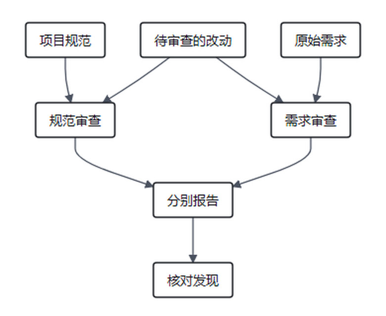

> 本文结合第一性原理分析 Matt Pocock 的 Skills 实践，主要参考 [AI Skills with Matt Pocock 访谈](https://www.youtube.com/watch?v=4DhcSPkEbwI)和 [Skills 项目所引用版本](https://github.com/mattpocock/skills/tree/4ae2317ddb22b046e26455e4f9c9b3aaaf62212d)。

### 引子：测试全绿之后，问题可能藏在哪里？

假设我们请 Agent 做一个会员取消订阅功能。用户已经说清楚：取消后不再自动续费，但已经付费的权益要保留到当前周期结束。Agent 写完代码，运行测试，结果全部通过。

我们打开实现，却发现它在用户点击取消的那一刻，就把会员权益关掉了。测试为什么没亮红灯？因为测试只检查了自动续费是否关闭，没有检查已购买的权益是否仍然有效。

再想象另一种情况：功能确实按要求工作，可项目已有统一的时间处理规则，新代码却在不同文件里分别手写日期计算。眼下测试全绿，几个月后要修改计费周期时，团队才发现同一条规则散落在好几个地方，需要逐处确认。

这是两个为解释问题构造的场景。前一个追问的是**有没有做对用户要求的事**；后一个追问的是**这份实现能否与项目已有约定和长期维护需要相处**。两者并不总是一起出错。

[上一篇](/zhangmuchuan/blog/matt-pocock-skills-implement/)说到，交付之前需要确认审查者看到的确实是待交付的改动。这一次我们继续追问：即使代码真的送到了另一个 Agent 面前，为什么我们认为它有机会发现原执行者遗漏的问题？这种机会从哪里来，又止步于哪里？

Matt Pocock 的 [`/code-review`](https://github.com/mattpocock/skills/blob/4ae2317/skills/engineering/code-review/SKILL.md) 是一个观察标本。本篇以项目的 `4ae2317` 版本为准：它让两个子 Agent 分别对照项目规范和原始需求审查同一份改动。我们先不急着评价这个流程好不好，先回到自己的理论，看看一次审查究竟发生了什么。

### 一、先回到黑屋：多说一次，就多了一份证据吗？

在[《数学基石篇》](/zhangmuchuan/blog/agent-math-foundations/)里，我们把外部真实环境记作 $E$，模型当前实际取得的上下文记作 $C$，输出记作 $R$。在模型参数固定、外部环境只通过上下文影响本次输出的设定中：

$$
E \longrightarrow C \longrightarrow R
$$

根据数据处理不等式：

$$
I(E;R)\le I(E;C)
$$

其中 $I(E;C)$ 描述上下文中关于环境的信息，$I(E;R)$ 描述输出中关于环境的信息。这个式子提醒我们：如果没有取得新的外部材料，模型反复加工已有上下文，不能凭空获得关于当前外部环境的新证据。

看一个日常场景。你帮朋友订蛋糕，记得朋友说过“不要花生”。店员把蛋糕送来，你盯着订单和蛋糕盒看了半天，觉得“应该没放花生”。这句话也许是认真想过的结论，但只要你既没有看配料表，也没有询问店员或检查标签，思考本身就不会让配料表上的字自动出现在你眼前。

不过，如果订单上其实还写着“不能使用含坚果的奶油”，你第一次看漏了，重新阅读后注意到它，这次整理就有价值。原材料没有新增，**你能利用到的信息却变了**。

这个区别对于理解审查非常重要。设 $Z$ 是我们想判断的目标状态，例如指定版本的代码是否满足取消订阅的约定；$C_t$ 是当前已有上下文；$R_{\text{自评}}$ 是只根据该上下文生成的自评。按照《数学基石篇》定理五，在 $Z\rightarrow C_t\rightarrow R_{\text{自评}}$ 的条件独立设定下：

$$
I(Z;R_{\text{自评}}\mid C_t)=0
$$

这表示，在给定完整 $C_t$ 的理想模型中，自评没有额外引入关于 $Z$ 的外部证据；它不表示重新推理永远不能帮助能力有限的执行者发现已经存在的信息。实际工作里，重读需求、换一个问题检查代码，可能发现之前漏掉的矛盾。**新外部观测与重新利用已有信息，是两种不同的收益。**

把另一个 Agent 请来，情况就有两种。若它读到执行者先前没有取得的原始工单、项目规范或真实运行结果，这些材料可能为审查带来额外信息。若它拿到的都是已有材料，它仍可能通过不同的注意重点和推理方式发现此前没被利用的问题，但不能仅因为“换了一个窗口”，就声称它创造了新的外部事实。

更不能把“独立窗口”理解成“判断必然独立”。两个 Agent 可能使用相同模型、读同一份有缺陷的需求、沿用相似的训练偏好，也可能共同漏掉同一个问题。审查有纠错机会，但机会不是保证。

### 二、同一份改动，为什么需要两把尺子？

我们在[《第三篇》](/zhangmuchuan/blog/agent-harness/)用恒温器拆过反馈：传感器带回现状，比较器根据目标判断差距。如果只拿到现状，却没有说清要和什么标准比较，审查就很容易变成一句模糊的“看起来不错”。

回到订蛋糕。朋友订的是一个六寸、不要花生、晚上六点前送到的蛋糕。蛋糕店内部还有操作要求：过敏原信息必须在交接单上标清，配送时间按统一表格记录。

店员做完后，第一位同事对照顾客订单：尺寸对吗？配料是否满足忌口？约定时间有没有记录正确？第二位同事对照店里的交接要求：过敏原有没有写在配送员能看到的地方？交接单是否按店里的约定填写？

假设蛋糕满足顾客要求，但过敏原信息漏写到交接单上，第一把尺子可能没有发现问题，第二把尺子却指出了交接风险。反过来，交接单填得整整齐齐，但蛋糕里放了花生，表格符合店内规则也不能说明顾客的订单做对了。

代码审查也有类似区分。在本地版本的 [`code-review` 规范](https://github.com/mattpocock/skills/blob/4ae2317/skills/engineering/code-review/SKILL.md)中，两位审查者读取同一份改动，但使用不同判断依据：

- **Spec 审查**对照来源工单或规格，检查要求是否遗漏、实现是否有误，以及是否出现未经要求的额外行为。
- **Standards 审查**对照项目文档里的编码标准，另结合一组代码坏味道作启发式判断。项目自身明确规定优先；坏味道是需要结合上下文判断的线索，并非一经出现就自动违规。

把两份报告分开有一个具体好处：即使代码命名清晰、符合规范，也不会因此掩盖“权益被提前关闭”的需求错误；即使功能满足工单，也不会自动消除维护上的问题。原 Skill 要求分别汇报两条轴线，而不是把它们混成一个总分。[来源：code-review 说明](https://github.com/mattpocock/skills/blob/4ae2317/docs/engineering/code-review.md)



图：根据 [code-review 规范](https://github.com/mattpocock/skills/blob/4ae2317/skills/engineering/code-review/SKILL.md)归纳双轴审查；“核对发现”是接收报告后的验证工作，并非该版本 Skill 自动逐条完成的步骤。

看一个简化的假设代码。工单写明“取消后保留已支付周期的权益”，改动却包含：

```python
def cancel(subscription):
    subscription.auto_renew = False
    subscription.access_active = False  # 取消当下立即关闭权益
```

Spec 审查者需要把第二次赋值和工单中的周期要求放在一起看，指出它可能提前关闭权益，并引用对应的需求和代码位置。Standards 审查者则可能发现这段变更违反项目里有关时间处理的明确约定；如果没有这条约定，就不能把个人偏好包装成硬性违规。审查报告提出问题后，执行者仍要检查实际调用路径及状态模型，不能仅凭这一小段示例假定整个系统必然出错。

但这里还得把尺子的来源看清楚。Spec 审查能检查实现与规格是否一致，却不能凭空证明规格忠实表达了用户真实意图。如果顾客的订单本身把“不放花生”漏掉了，审查员严格照着这张错误订单核对，仍可能把蛋糕交错。对应到代码，如果原始工单已经误写成“取消后立即关闭权益”，审查者即使发现实现与工单完全一致，也没有因此证明工单正确。

标准也一样。文档可能已经过期，或者根本没有记录某条重要规则。没有依据时硬说“规范要求如此”，不是更严格，而是在把推测写成事实。本地 Skill 在找不到 Spec 且用户确认不存在时，会跳过该轴并报告没有规格；这比根据代码倒推一份需求再宣布通过更诚实。

### 三、不同审查窗口，为什么可能帮助发现遗漏？

让我们回到蛋糕店。做蛋糕的店员刚经历了一连串操作：换配方、调整烘烤时间、补写订单。她记得自己一直在努力满足顾客的要求，也知道每个决定当时是怎么做出来的。轮到自己检查时，她可能顺着刚才的做法看过去，看到“已处理过花生问题”，就以为每一处都处理好了。

另一位同事没参与制作，只拿到顾客订单、配料表和最后的成品记录。她从“花生是否真的被排除”开始查，发现奶油里仍有花生碎。这不意味着第一位店员必然会自欺，也不意味着第二位永远正确；只是两人面对材料时，可能有不同的注意路径和假设。

模型也一样。执行者的 Context 中有自己的计划、试错和解释，新审查窗口可以不带入完整的推演历史，围绕原始目标和改动重新检查。它可能减少对既有方案的依附，也让一个审查者集中看需求，另一个集中看规范。

不过，我们在[《第二篇》](/zhangmuchuan/blog/agent-control/)里讨论过 Context 信噪比：不是什么都装得越多越好，也不能为了简短把必要条件都扔掉。审查者如果只收到一段 diff，却拿不到适用规则，可能误判；如果把整个项目历史毫无选择地塞进去，重要约束也可能更难被找到。

还有一种更难发现的共同盲区：假如两位同事拿到的都是同一张漏写忌口的订单，即使她们分开工作、分别检查配料和交接表，也都可能以为花生没有问题。隔开两人的讨论，不能让遗漏的顾客要求自动出现在订单上。此时需要回查原始沟通、询问顾客，或取得其他足以区分假设的依据。这是《数学基石篇》讨论同源盲区时值得保留的提醒：**分开审查能改变判断过程，却不自动修复共同缺失的依据。**

因此，独立上下文的设计要同时回答两个问题：**哪些执行过程可以不带过去，以免把原来的判断当成既定事实？哪些原始需求、代码、规范和必要背景必须带过去，才能真正判断？**

这和“独立”二字的直觉有一点不同。审查者不需要对项目一无所知；它需要的是不把实现者尚未验证的解释当成结论，同时拥有足够的原始材料和回查入口。固定起点和目标版本、明确要求、项目规范以及可定位的代码，都是为了让它能把判断落在具体对象上。

[`/code-review`](https://github.com/mattpocock/skills/blob/4ae2317/skills/engineering/code-review/SKILL.md) 因此要求先确定比较起点，再检查引用有效、diff 非空，之后才派两个审查者。它还要求 Spec 发现引用规格内容，Standards 发现引用规则或具体代码位置。引用不是正确性的证明，但它让接收报告的人有地方回查。

### 四、审查报告，是新的事实还是待核对的判断？

假设第二位蛋糕店同事读了配料表后说：“这里可能含花生，不能交付。”这句话有价值，因为它指出了一个值得立即核对的问题。可如果她看错了配料表版本，或者把同名但不同成分的原料认错，直接照着她的话丢掉整批蛋糕，也可能产生新的损失。

最可靠的做法是什么？找到她指出的那张配料表，核对产品、批次和具体成分。发现成立就处理；发现不成立就说明原因。**审查意见是一条需要核对的线索；如果可能涉及严重风险，可以先暂停交付，再查清依据并决定处理方式。**

代码审查也是如此。审查 Agent 说“权益可能提前失效”，我们要找到对应代码，核对需求，再选择适当方式验证它是否真的会发生。它说“这段代码违反项目规范”，也要确认它引用的规范适用于当前路径，而不是把个人偏好写成项目规定。

这里可以用我们在《数学基石篇》中使用的 $(P,M,H)$ 视角，分别看证据来源和判断能力：程序 $P$ 可以执行测试或做规则检查；模型 $M$ 可以对照自然语言需求和代码提出疑点；人类 $H$ 可以澄清未记录的业务意图、判断重大取舍。它们并不天然组成一条每次都必须走完的流水线。某个问题可由已有测试直接验证，就不必重复请人判断；如果问题关乎规格没有记录的商业选择，运行更多测试也无法替用户作出决定。

注意，程序也只能按给定规则运行：测试通过意味着该次运行满足了测试断言，而不是证明断言一定对应真实需求。模型报告有语义判断能力，也可能误报、漏报。人类掌握自身意图，却也可能记错历史决定。可靠性来自**把证据、判断和不确定之处分开，并按实际问题核对**，而不是把任何一方当成永远不会出错的裁判。

本地 [code-review 说明](https://github.com/mattpocock/skills/blob/4ae2317/docs/engineering/code-review.md)也提醒：审查输出可能引用错误位置或夸大影响，报告中的每一项发现仍需回查。该 Skill 聚合两份报告，并不保证逐条验证或自动修复；发现问题、确认问题、修改和复验，是不同动作。

### 五、审查没看到的代码，也可能改变结论

上一篇提到的交付断点，在这里仍然成立。假设审查员拿到昨天保存的蛋糕订单，却没有看到今天修改后的忌口要求，她再仔细也只能检查旧订单。这不是审查者的态度问题，而是审查材料没有覆盖目标版本。

本地版本的 Skill 使用：

```bash
git diff <fixed-point>...HEAD
```

这会从比较基准与 `HEAD` 的共同祖先出发，查看到当前提交为止的差异；工作区和暂存区尚未提交的改动不包含在内。如果 `/implement` 先调用这种审查，再提交刚写完的代码，而中间没有提交，那么审查可能看不到待交付改动，甚至因为 diff 为空而停止。[来源：implement 说明](https://github.com/mattpocock/skills/blob/4ae2317/docs/engineering/implement.md)

所以，在请审查者判断之前，要先核对三个具体对象：原始要求是什么、比较范围覆盖了什么、最终交付的又是哪份代码。审查之后如果为了修复问题继续修改，还要根据修改影响决定复验；之前针对旧版本的报告，不能无条件当作新版本的检查结果。

这种身份约束也影响报告。审查者看到的是一个变更范围，不一定看到整个项目的所有行为；报告说明的是它在给定材料和审查角度下发现了什么，不是对系统不存在其他缺陷的证明。单张工单分别审查有利于聚焦，多个工单集成后再看它们的相互作用也可能有价值；是否两次都做，要看任务风险和成本。

### 六、什么时候应该停下审查，继续交付？

蛋糕店同事发现花生碎后，店员更换了配料。复核时，她又建议把盒子上的字写得更圆润。另一位同事看后觉得丝带颜色可以再调整。它们未必都是错的，但如果顾客马上要取餐，团队需要区分：哪些问题影响忌口和交付，哪些只是可讨论的偏好？

这就是[《第二篇》](/zhangmuchuan/blog/agent-control/)的信息价值与成本问题：继续检查、处理下一条建议，可能减少什么实际损失？会消耗多少时间和人力？会不会因为修改又带来新的风险？

沿用《第二篇》的净价值思路，我们把当前上下文记为 $C_t$，把一次候选检查记为 $a$，可以写成：

$$
V(a\mid C_t)=\operatorname{VoI}(a\mid C_t)-\lambda\operatorname{Cost}(a)
$$

这里的 $\operatorname{VoI}$ 表示检查结果对后续决策带来的预期效用改善；$\operatorname{Cost}$ 包括时间、算力、人工核对，以及行动可能引入的代价；$\lambda$ 表示成本的权重和量纲折算。若两者已经统一到同一效用单位，也可以把权重并入成本。对花生过敏这一问题，核对配料表的结果可能决定是否暂停交付，避免严重损失；对丝带颜色的主观偏好，继续争论可能既不改变是否安全交付，也不值得耽误取餐。

这里正好需要对原有公式作一次压力测试：《数学基石篇》曾把决策论中的 VoI 与条件互信息写成等同形式，但减少多少不确定性与改善多少决策效用并不是同一个量。一次观察可以揭示新信息，却不一定改变行动；同样数量的信息，对不同风险和不同选择的价值也可能不同。因此本文使用上面的效用减成本表达式，把互信息留给讨论信息增量；不能直接把两者当作恒等式。实际数值通常难以精确估计，涉及既定安全或授权红线时，也不能用一个粗略估计绕开这些约束。

信息量和决策价值不能直接画等号。多一份报告，不代表多一个会改变行动的重要发现；一条看似很小的发现，如果涉及过敏原或支付金额，却可能决定是否立即停止交付。应当核对严重性、依据和影响，再判断修复与复验的范围。

本地 code-review 文档记录了一个值得警惕的现象：反复审查、反复修改时，新改动和带主观判断的质量建议可能不断出现，流程没有保证必然收敛。这不意味着可以忽略严重问题，而是提醒我们：**停止条件不应只是“再也找不到任何意见”，而应结合已确认问题、剩余风险和实际交付要求。**[来源：code-review 说明](https://github.com/mattpocock/skills/blob/4ae2317/docs/engineering/code-review.md)

同样，两个子 Agent 并行有其成本。对于影响资金的复杂变更，多一条独立核对路径可能很有价值；对于可轻易回退的文案调整，相同的审查配置未必划算。审查设计应依据风险、现有测试、规范和材料质量来选择，而不是把 Agent 数量当作可靠性的刻度。

### 结语：独立，不是把事实隔开

一次有用的审查，需要有人拿到正确版本的改动，拿到相应的目标和判断依据，再把发现写成能够回查的具体问题。独立上下文可能让另一位审查者不必沿着实现者刚才的思路走，但它不能替代材料、不能保证两个判断没有共同盲区，也不能自动把意见变成已经修好的代码。

把 `/code-review` 放回我们自己的理论里看，真正值得设计的不是“再叫几个 Agent”，而是**让每一次判断知道自己在看什么、依据什么、能说明什么，以及下一步如何核对**。

一份报告结束后，代码仍然会继续演进。哪些反复出现的问题值得变成更清楚的项目约定，哪些能固化为程序检查，哪些仍需要具体情境下的人来判断？这又把我们带回了长程 Agent 的下一层问题：怎样让一次纠错，成为下一次行动真正用得上的经验。

### 参考资料

- [code-review 技能规范](https://github.com/mattpocock/skills/blob/4ae2317/skills/engineering/code-review/SKILL.md)与[说明](https://github.com/mattpocock/skills/blob/4ae2317/docs/engineering/code-review.md)：引用版本 `4ae2317`。
- [implement 说明](https://github.com/mattpocock/skills/blob/4ae2317/docs/engineering/implement.md)：实施、审查与提交的接口问题。
- [Matt Pocock 访谈记录](https://www.youtube.com/watch?v=4DhcSPkEbwI)：自动审查及其自身可靠性的讨论。
