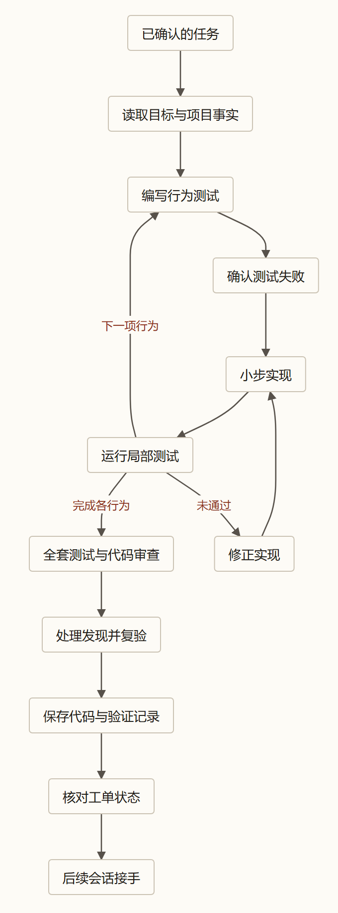

> 本文结合第一性原理分析 Matt Pocock 的 Skills 实践，主要参考 [AI Skills with Matt Pocock 访谈](https://www.youtube.com/watch?v=4DhcSPkEbwI)和 [Skills 项目所引用版本](https://github.com/mattpocock/skills/tree/4ae2317ddb22b046e26455e4f9c9b3aaaf62212d)。

### 引子：测试全绿、也敲了 `commit`，为什么交接还是断了？

不少工程师把 Agent 带进真实项目时，都会碰到下面这种看似已经收尾、实际上却在最后一公里出岔子的假设场景：

> 你交给 Agent 一张工单。它一路很听话：按接缝跑完红绿循环、跑过全量测试套件全绿，最后干脆地回了一句：“已提交到当前分支，任务完成。”
>
> 可等你准备接着往下推时，问题一连串冒出来：
> 1. 后续依赖这张工单的几个任务，在任务板上依然显示被卡住，根本没人知道它已经做完了；
> 2. 审查流程刚启动就返回“未发现任何改动”，因为代码虽然改在磁盘上，却还没落到审查命令读取的提交点；
> 3. 再仔细一翻提交记录，发现它在测试全绿之后、执行 `git commit` 之前顺手改了两个类型注解，而这一版最终提交的代码，从生下来就没跑过一次测试。

写完代码、看见终端绿灯，甚至敲下提交命令，工作就算真正交出去了吗？远远没有。

前面两篇我们分别拆了[宏观工单切片（`to-tickets`）](/zhangmuchuan/blog/matt-pocock-skills-05/)和[微观红绿循环（`tdd`）](/zhangmuchuan/blog/matt-pocock-skills-06/)。这一篇我们把目光放到交工的那一瞬间，用信息论和并发状态控制的思路，解剖 Matt Pocock 的 [`/implement`](https://github.com/mattpocock/skills/blob/4ae2317/skills/engineering/implement/SKILL.md) 和并行调度技能 [`/implement-spec`](https://github.com/mattpocock/skills/blob/4ae2317/skills/engineering/implement-spec/SKILL.md)：一份工作究竟要带上哪些物理凭证，才算安全、干净地交到下一个人手里？

---

### 一、先验后改：为什么测试全绿后顺手改两行，刚才的绿灯就作废了？

许多人直觉里，“测试通过”像是贴在代码上的一张静态合格证——只要跑过一次绿灯，这包代码就算合格了。

但如果回到[《数学基石篇》](/zhangmuchuan/blog/agent-math-foundations/)和[《第三篇：驯服长程循环》](/zhangmuchuan/blog/agent-harness/)，按照**方程一（信息完备性边界）**，系统能否交付不看嘴上宣布，而看当前上下文对交付目标的**剩余不确定性是否已经压到可接受容限以下**：

$$
I(Z; C_n) \ge H(Z) - \varepsilon \iff H(Z \mid C_n) \le \varepsilon
$$

其中 $Z$ 是当前待交付代码在真实环境下的真实正确性，$C_n$ 是第 $n$ 步交付前上下文里积累的全部有效观测，$\varepsilon \ge 0$ 是允许的残余不确定性容限。而在验证动作里，测试运行换回来的不是一张脱离时间的奖状，而是一条绑定四项物理元数据的**条件证据记录**：

$$
\text{Evidence} = \big(\text{Commit Hash / 代码快照},\; \text{Test Command},\; \text{Exit Code},\; \text{Environment}\big)
$$

也就是说，某条绿灯只能证明“在当时那个环境下，针对当时那一份代码快照，跑那条命令拿到了零退出码”。只要其中任何一项变了——哪怕只改了一个字符——旧证据就跟当前实体脱钩了。

这在日常里再好理解不过。假如你周一上午去医院做了全套入职体检，抽血、拍片、心电图样样正常，拿回一张写着“各项指标合格”的体检单；周二晚上回到家，你随手喝了一瓶来历不明、配方也没看过的药水；周三早上你去公司报到，却理直气壮地把周一那张体检单拍在人事桌子上说：“你看，我的身体完全达标。”

换谁都不会认这张单子。周一体检单证明的是“喝药之前的你”没问题；在周二你把药水吞下去的那一秒，你的身体状态已经变成了新状态，周一的报告对现在的你究竟安不安全，已经失去了约束力。

用第一性原理把这笔账算清楚：设修改前的版本 A 上跑出来的绿灯观测为 $O_A$，而最终要提交的版本 B 在真实环境中的正确性为 $Z_B$，改动完成后的当前上下文为 $C_B$（其中只包含修改记录与过时证据 $O_A$）。代码空间不存在连续小扰动保证——一个括号、一个类型字面量或一个空值判断的微调，都足以改变整条执行路径。因此在缺乏针对版本 B 的新运行观测 $O_B$ 时，旧快照证据 $O_A$ 不能替版本 B 消解残余不确定性，系统仍然停留在未满足信息完备性边界的高熵状态：

$$
H(Z_B \mid C_B, O_A) > \varepsilon
$$

与此同时，如果 Agent 靠自己脑补“我就改了个注解，肯定不影响运行”，根据**定理五（脑内纯复盘增量归零）**，由于未引入任何新外部测试输入，真实状态 $Z_B$、当前所掌握上下文与自评结论之间构成马尔可夫链 $Z_B \longrightarrow (C_B, O_A) \longrightarrow R_{\text{自评}}$，于是自评输出的增量严格为零：

$$
I(Z_B; R_{\text{自评}} \mid C_B, O_A) = 0
$$

模型自己口头担保，对真实宿主机上会不会崩掉不提供任何信息增量。所以交付链条上的第一条硬规矩很朴素：**代码只要在验证之后发生了哪怕一行的改动，原先的绿灯一律作废，必须针对最终要提交的快照重新跑通全量验证，直到拿到绑定新快照的 $O_B$ 并满足 $H(Z_B \mid C_B, O_B) \le \varepsilon$。**

---

### 二、幽灵 Diff：为什么改动就在电脑里，审查员却什么也没看见？

按[《第一篇：架构的必然演进》](/zhangmuchuan/blog/agent-loop/)的黑屋模型与**定理一（单次推理信息上界与数据处理不等式 DPI）**，审查员 Agent $M$ 也坐在黑屋里工作：实际代码改动事实 $E_{\text{改动}}$ 必须先通过工具塞进它的上下文窗口 $C_{\text{审查}}$，再由它产出审查结论 $R_{\text{审查}}$。三者构成一条不可逆的马尔可夫链：

$$
E_{\text{改动}} \longrightarrow C_{\text{审查}} \longrightarrow R_{\text{审查}}
$$

由数据处理不等式（DPI）可得：

$$
0 \le I(E_{\text{改动}}; R_{\text{审查}}) \le I(E_{\text{改动}}; C_{\text{审查}})
$$

这里 $I(E_{\text{改动}}; C_{\text{审查}})$ 是输入上下文对真实代码改动的覆盖信息量，$I(E_{\text{改动}}; R_{\text{审查}})$ 是审查结论真正触及到改动事实的信息量。如果工具链的观测口径没有对齐到实际改动发生的位置，导致上下文窗口里关于新改动的输入几乎为空，那么审查员再聪明，结论对真实改动的信息量也会被死死卡在零。

这就像超市面包房里，店员已经把刚烤好的三盘新面包摆在了后厨自己的操作台上（代码已写完在本地工作区），却忘了端进前厅的“今日新品验收柜”（还没提交进 `HEAD`）。巡检员按规章只核对前厅验收柜相比昨天基准清单的新增变化——打开柜门一看，里面跟昨天一模一样，没有任何新增货品。于是巡检员在报告上顺手勾了一笔：“本次上架记录无任何异常变动，审查通过。”

把视角切回 Matt Pocock 的工具链，这种“观测窗口没对准施工现场”的**接缝错位**就真实发生过：
- 在 [`/implement`](https://github.com/mattpocock/skills/blob/4ae2317/skills/engineering/implement/SKILL.md) 里，规定的施工顺序一共 5 步：读工单定接缝 $\to$ 按 `tdd` 跑红绿切片 $\to$ 高频跑类型检查和单文件测试 $\to$ 跑一次全量测试套件 $\to$ **调用 `code-review` 审查，然后执行 `commit` 提交到当前分支**；
- 而在底层 [`/code-review`](https://github.com/mattpocock/skills/blob/4ae2317/skills/engineering/code-review/SKILL.md) 技能里，抓取代码差异的命令写得清清楚楚：

```bash
git diff <fixed-point>...HEAD
```

这里立刻冒出一个物理上的盲区：**`git diff <fixed-point>...HEAD` 比对的是分支起点和当前最新提交 `HEAD` 之间的差异；它完全不管工作区（Working Tree）和暂存区（Index）里还没提交的文件改动！** [来源：`implement` 说明](https://github.com/mattpocock/skills/blob/4ae2317/docs/engineering/implement.md)

当 `HEAD` 指针一步没动时，Diff 命令吐回来的就是空集合，$I(E_{\text{改动}}; C_{\text{审查}}) = 0$，由上方 DPI 不等式立刻推出 $I(E_{\text{改动}}; R_{\text{审查}}) = 0$。在 [`implement` 说明文档](https://github.com/mattpocock/skills/blob/4ae2317/docs/engineering/implement.md)里，Matt Pocock 坦率记录了这个**两边至今都还没修好的真实 Bug**：多位用户反馈 `/implement` 在提交前调用 `/code-review` 时，审查员因为 Diff 为空根本看不见新写的代码。文档同时还指出了另一个隐患：就算看见了代码，在刚刚写完代码、满脑子都是既有假设的同一个会话里做自我审查，往往也带着极强的确认偏误。因此目前的实际应对办法是：**要么在送审前先打一个临时快照提交（Interim Commit），让 `HEAD` 真正包含这些改动；要么干脆在提交完之后，另外开一个干净的新会话单独调用 `/code-review`。**

另外，按照[《第三篇》](/zhangmuchuan/blog/agent-harness/)的恒温器闭环模型，一个闭环得先校准“目标设定点与检测边界”（即测试接缝），传感器才有意义。而 [`implement` 说明](https://github.com/mattpocock/skills/blob/4ae2317/docs/engineering/implement.md)里也交代了一个弱点：**`implement` 本身并不会主动停下来跟人确认测试接缝。** 它完全信任上游 `to-spec` 或 `tdd` 已经把接缝敲定；如果你直接拿一份没校准好检测边界的粗略描述去跑 `/implement`，它就会直接按惯性执行，“连红绿循环都不一定问你，闷头把代码写完”。

---

### 三、并发踩踏与工作树隔离：5 个厨师挤在同一张案板上

单张工单能顺利交差了，下一个工程诱惑马上就会出现：既然一张票跑一次 `/implement` 挺快，我能不能在同一个项目目录里开三五个终端窗口，同时派好几个 Agent 一起写？

千万别这么干。[`implement` 说明文档](https://github.com/mattpocock/skills/blob/4ae2317/docs/engineering/implement.md)里记录了一起货真价实的现场事故：

> 有位用户在同一个本地 Git 检出目录里，同时打开多个 `/implement` 会话处理三张工单。仅仅过了一个下午，由于所有会话共用同一个工作目录、同一个暂存区索引（`.git/index`）和同一个 `HEAD` 指针，现场彻底乱套：一个会话执行 `git commit --amend` 时，直接把另一个会话刚刚提交的记录给覆盖改写了；存进暂存栈的东西在 `refs/stash` 里莫名消失；多个工单的提交交叉跑到了错误的分支上。 [来源：`implement` 说明](https://github.com/mattpocock/skills/blob/4ae2317/docs/engineering/implement.md)

为什么会这样？从第一性原理看，多个黑屋执行体（各自独立的上下文 $C_1, C_2$）却共享同一份可变的外部物理环境状态 $E_{\text{工作区}}$——就像我们在本系列此前的分析里指出的，这类共享可变状态没法靠上下文隔离自动分开，写入顺序一旦交叉就会直接互相覆盖。

打个直观的比方：**这就像让 5 位厨师挤在同一张窄案板、共用同一口铁锅和同一本手写菜单上同时炒 5 道菜。** 厨师 A 刚切好牛肉码在案板左边，转身去拿碗的工夫，厨师 B 端着刚焯完水的青菜往案板上一倒，顺手一抹抹布把调料汁全混了进去；厨师 C 刚在菜单上划掉一道菜，厨师 D 以为这一行还没做又添上一笔。一小时下来，整张案板一团糟，谁也说不清锅里那勺盐到底是谁放的。

为了解决多工单并行问题，Matt Pocock 单独做了一个调度技能 [`/implement-spec`](https://github.com/mattpocock/skills/blob/4ae2317/skills/engineering/implement-spec/SKILL.md)（参考其[说明文档](https://github.com/mattpocock/skills/blob/4ae2317/docs/engineering/implement-spec.md)）。它定下的规范思路，正好对应把“共挤一张大案板”改造成“**每人分一间带独立灶台的小厨房，最后由总管统一合盘**”：

1. **给每个可执行前沿工单开独立的 Git Worktree**：调度器读取任务图（DAG），为前沿上每一张已无阻塞的工单派发一个全新上下文的子 Agent，并用独立工作树（Worktree）隔离出单独的磁盘目录、单独的暂存区和单独的分支 `HEAD`。厨师 A 在自己的小厨房里切肉炒菜哪怕把锅烧糊了，也溅不到厨师 B 半滴油。
2. **用轻量上下文指针通信，不重复拷贝大段总结**：调度器给子 Agent 派活时，只传 Spec 路径、工单号、探索笔记路径和前置提交指针（Context Pointers），保持调度器自己和子 Agent 的窗口干净。
3. **只管各自做完，统一交由 Merger 合并代理合流**：每个子 Agent 在自己工作树里跑通 `tdd`，并在交差前先把集成分支的最新进度拉回自己分支合一下；随后由专门的**合并子代理（Merger Subagent）**统一把各个分支快速合并（Fast-forward）回唯一的一条集成分支上。

但非常有意思的是，把 [`implement` 说明](https://github.com/mattpocock/skills/blob/4ae2317/docs/engineering/implement.md) 与 [`implement-spec` 文档](https://github.com/mattpocock/skills/blob/4ae2317/docs/engineering/implement-spec.md) 放在一起看，作者并没有把 Worktree 吹成万能银弹，反而老老实实指出了“即使上了独立小厨房，依然会撞上的四道暗坑”。把它们翻译回第一性原理，**这四道坑恰恰对应着 Worktree 并没有真正隔离掉的四种物理与信息耦合**：
- **暗坑 1：独立小灶台，共用同一格冰柜（`refs/stash` 全局共享）**：Git Worktree 虽然隔开了工作目录、暂存区和 `HEAD`，但[`implement` 说明文档](https://github.com/mattpocock/skills/blob/4ae2317/docs/engineering/implement.md)特别指出，底层仓库里的 `.git/refs/stash` 依然是整个仓库共用的。好比每位厨师虽然有了独立灶台，厨房角落却只有一台共用的冰柜抽屉，有人随手把半成品塞进去暂存，另一个人清冰柜时顺手一倒，东西照样蒸发。只要还存在任何共享可写账本，并发体就会通过它隐式互相污染；因此在工程实操上，与其依赖全局共享的 `git stash`，不如直接打临时提交（Interim Commit）把当前进展封存在各自工作树对应的独立分支上。
- **暗坑 2：跨分支的“语义撞车”**：工单文本里的阻塞边只是事先猜测它们不会改到同一个文件。真实写起来，Web 端工单和移动端工单依然可能同时往同一个消息字典或类型注册表里加字段——实际记录里就发生过两个并行 Agent 各自给同一概念起了 `blockedSince` 和 `blockedOn` 两个不同名字[来源：`implement-spec` 说明](https://github.com/mattpocock/skills/blob/4ae2317/docs/engineering/implement-spec.md)。目录隔离挡不住跨越文件边界的共享领域状态漂移；如果上游没把契约先收敛，多分支并行只会把语义冲突延后到合并时刻爆发，因此需要事先靠探索笔记约定公共命名，或干脆加一条阻塞边让它们排队。
- **暗坑 3：厨艺再好的师傅，被安排进只配了标准公用调料架的小隔间，做起菜来还是少一味“私房调料”；偏偏试菜表规定“缺这味料时就跳过风味校验”，结果没放调料的菜也照样被盖了合格章（`.gitignore` 忽略的本地文件）**：Git Worktree 里只包含 Git 跟踪的文件。那些被 `.gitignore` 排掉的本地测试夹具、本地数据库或密钥文件，在新建的工作树里全都不存在，导致某些依赖它们的测试在工作树里静默跳过、照样亮绿灯[来源：`implement-spec` 说明](https://github.com/mattpocock/skills/blob/4ae2317/docs/engineering/implement-spec.md)！按**定理二（现实不可辨识性）**，缺了真实本地环境因子 $E_{\text{环境}}$ 的空跑绿灯根本无法代表真实宿主机状态，所以遇到这类工单，只能显式指定回主检出目录去跑。
- **暗坑 4：千万不能在半途提前召唤全局 `code-review`**：[`implement-spec`](https://github.com/mattpocock/skills/blob/4ae2317/skills/engineering/implement-spec/SKILL.md) 明确把全局 `code-review` 押后到所有工单全部合入集成分支之后只跑一次。按**方程二（期望信息净价值）**，让 `code-review` 对着只做到一半的代码库对照整张 Spec 查漏补缺，它报出来的“后半截未完成需求”并不带来有效新信息（$\operatorname{VoI} \approx 0$），反而会诱导修复子 Agent 越权去干后面工单的活，触发新一轮修改与审查的高代价空转。[`implement-spec` 说明](https://github.com/mattpocock/skills/blob/4ae2317/docs/engineering/implement-spec.md)记录过一个真实案例：一个 5 张工单的功能，就因为在中间阶段过早启动审查，或是在收尾阶段放任审查—修复循环缺乏明确终止条件，连续跑了差不多 **4 个小时**！

---

### 四、代码交了，工单却没关：交接的最后半步去哪了？

哪怕前面四关全都平安闯过——代码没“先验后改”、做了临时提交让审查员看全了、没和别人踩成一团、全套测试绿灯亮得清清楚楚——到了收尾那一秒，还有一个极容易掉链子的地方：**任务状态机没刷新。**

在 Matt Pocock 的 [`/implement`](https://github.com/mattpocock/skills/blob/4ae2317/skills/engineering/implement/SKILL.md) 规范里，有一个刻意留下的空缺：
> **`/implement` 的职责在把代码提交到当前分支那一刻就结束了。它既不会去勾选工单里的验收复选框（`- [ ]`），也不会去 GitHub 或本地 Markdown 上关闭工单，更不会替你把 `code-review` 挑出来的意见全部改完。** [来源：`implement` 说明](https://github.com/mattpocock/skills/blob/4ae2317/docs/engineering/implement.md)

结果是什么？在下游拿着 [`to-tickets`](https://github.com/mattpocock/skills/blob/4ae2317/skills/engineering/to-tickets/SKILL.md) 任务图等待开工的系统视角里，这张票的阻塞标记一直没消掉。这就像**接力赛里的第一棒选手，拼命冲过接力区之后，转身去观众席坐下了——既没把接力棒递到第二棒手里，也没在记分板上划掉自己这一棒。第二棒站在起跑线上望着空跑道干等了一下午。**



就算换用自带全流程调度的 `implement-spec`，在接外部 Tracker 时照样遇到过同一类**外部传感器滞后**问题（见 [`implement-spec` 说明](https://github.com/mattpocock/skills/blob/4ae2317/docs/engineering/implement-spec.md)）：在 GitHub 上，一张工单的 `blocked-by` 计数要等前置 Issue 彻底关闭才会清零，而那些 Issue 往往要等整条大 PR 最后合并时才一起关。也就是说，任务运行到一半时，外部工单系统返回给调度器的前沿状态传感器是过时的！所以 `implement-spec` 不得不让调度器自己在内存里维护实时账本：只要前置分支已经成功合入集成分支，就立刻把下游节点算进可开工前沿，不等 GitHub 关单。

回到[《第六篇》](/zhangmuchuan/blog/agent-memory/)和本系列此前的分析强调的**阶段交接条件**：上一个黑屋里辛辛苦苦验证出来的信息增量，如果只留在即将销毁的短期上下文里，新开会话能读到的就是零；只有当它真正写进了**下一棒接手者一定读得到、信得过的持久化载体 $C_{\text{交付}}$**（Commit、更新后的计划状态、真实同步的 Tracker）里，才算完成跨时间的前馈传递。一个真正闭环的交付动作，提交出去的不应该只是一串孤零零的 Git Commit，而是四样对齐的物理事实：
1. **最终落库的 Commit Hash**：与最后一次全量测试跑绿时对应的代码快照一字不差；
2. **可复核的测试命令与结果凭证**：证明绿灯确实覆盖了该快照；
3. **逐条核对的验收状态**：把工单里的验收复选框对照实测情况勾清；
4. **前沿状态流转**：明确关闭已完成节点或刷新合入记录，把接力棒稳稳递给下一张工单。

---

### 结语：交出去的不是几行代码，而是可核验的确定性

把 `/implement` 和 `/implement-spec` 的门道理顺后，会发现交付阶段真正防的，从来不是“Agent 不会写代码”，而是各种隐蔽的**状态脱节**：

- 测试跑绿之后又改了代码，是**验证证据和代码快照脱节**；
- 代码留在工作区没提交，是**真实改动和审查员视野脱节**；
- 多人挤在同一目录下并发，是**本地状态与并发写入控制权脱节**；
- 提交了分支却不更新工单前沿，是**代码落库和下游调度状态脱节**。

把这四处脱节一一焊死，Agent 交出去的才不再是一份让人提心吊胆的“口头汇报”，而是一块随时能被下一个会话放心接手的确定性积木。

不过，在上面第二、三节里我们多次提到一个关键守门人——`code-review`。当代码终于稳稳提交上分支，我们按规范另开一个干净的独立窗口，派两个互不见面的子 Agent 上场审查时，这件事就万无一失了吗？换一个 Agent 重新看一遍，就真的能把藏在深处的问题看出来吗？

下一篇，也就是这个系列的最后一篇，我们来解构 `code-review`。

---

### 参考资料

- [数学基石篇](/zhangmuchuan/blog/agent-math-foundations/)；[第一篇：架构的必然演进](/zhangmuchuan/blog/agent-loop/)；[第二篇：控制权的收放艺术](/zhangmuchuan/blog/agent-control/)；[第三篇：驯服长程循环](/zhangmuchuan/blog/agent-harness/)；[第六篇：穿越时间的 Context](/zhangmuchuan/blog/agent-memory/)。
- [解构 Matt Pocock 的 Skills（五）：把任务切开之后，Agent 怎样更早看见自己做得对不对（新稿）](/zhangmuchuan/blog/matt-pocock-skills-05/)；[解构 Matt Pocock 的 Skills（六）：测试先亮红灯，Agent 就真的知道自己做对了吗（新稿）](/zhangmuchuan/blog/matt-pocock-skills-06/)。
- [implement 技能规范](https://github.com/mattpocock/skills/blob/4ae2317/skills/engineering/implement/SKILL.md)与[配套说明](https://github.com/mattpocock/skills/blob/4ae2317/docs/engineering/implement.md)。
- [implement-spec 技能规范](https://github.com/mattpocock/skills/blob/4ae2317/skills/engineering/implement-spec/SKILL.md)与[配套说明](https://github.com/mattpocock/skills/blob/4ae2317/docs/engineering/implement-spec.md)。
- [code-review 技能规范](https://github.com/mattpocock/skills/blob/4ae2317/skills/engineering/code-review/SKILL.md)；[tdd 技能规范](https://github.com/mattpocock/skills/blob/4ae2317/skills/engineering/tdd/SKILL.md)；[to-tickets 技能规范](https://github.com/mattpocock/skills/blob/4ae2317/skills/engineering/to-tickets/SKILL.md)。
